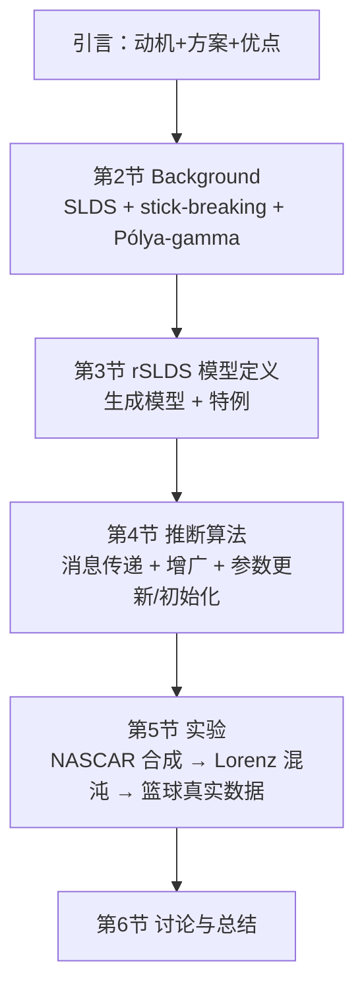
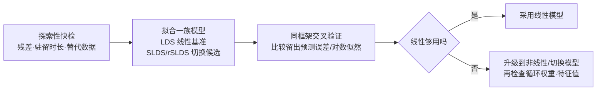

# Recurrent Switching Linear Dynamical Systems (rSLDS) 阅读笔记

> 来源文献：Linderman, Miller, Adams, Blei, Paninski & Johnson, *Recurrent Switching Linear Dynamical Systems*（Linderman et al., 2017, arXiv:1610.08496）。
> 关联文献：Nair 等（2023, *Cell* **186(1):178–193.e15**，DOI `10.1016/j.cell.2022.11.027`，PMID 36608653）*An approximate line attractor in the hypothalamus encodes an aggressive state*——该文用 rSLDS 对 VMHvl 神经群体做动力学建模，识别出编码攻击升级的"近似线吸引子"。
> 本笔记以中文为主，收录正文的【原文 / 翻译 / 逐句细讲】，并附若干零基础概念问答。

---

## 目录

1. [论文与文献背景速览](#0-论文与文献背景速览)
2. [1 Introduction 引言](#1-introduction-引言)
   - [第一段](#11-第一段)
   - [第二段](#12-第二段)
     - [延伸讲解 A：可处理的贝叶斯算法是什么](#ext-a)
     - [延伸讲解 B：核心句——切换通过 logistic 回归依赖 x 与 u](#ext-b)
     - [延伸讲解 C：外生输入 u_t 是什么](#ext-c)
     - [延伸讲解 D：非高斯因子怎么混进 x 的更新](#ext-d)
     - [延伸讲解 E：x 的更新来自推断吗？要不要观测 y](#ext-e)
     - [延伸讲解 F：增广变量 / Pólya-gamma 是什么](#ext-f)
   - [第三段](#13-第三段)
   - [第四段](#14-第四段)
3. [2 Background 导语段](#2-background-导语段)
   - [2.1 SLDS: Switching linear dynamical systems](#21-slds-switching-linear-dynamical-systems)
   - [2.2 stick-breaking logistic 回归与 Pólya-gamma 增广](#22-stick-breaking-logistic-回归与-pólya-gamma-增广)
4. [3. Recurrent Switching State Space Models](#3-recurrent-switching-state-space-models)
5. [4. Bayesian Inference](#4-bayesian-inference)
   - [4.1 Message Passing](#41-message-passing)
   - [4.2 Augmentation for non-Gaussian Factors](#42-augmentation-for-non-gaussian-factors)
   - [4.3 Updating Model Parameters](#43-updating-model-parameters)
   - [4.4 Initialization](#44-initialization)
6. [5. Experiments](#5-experiments)
   - [5.1 Synthetic NASCAR](#51-synthetic-nascar)
   - [5.2 Lorenz Attractor](#52-lorenz-attractor)
   - [5.3 Basketball Player Trajectories](#53-basketball-player-trajectories)
     - [补充问答：Lorenz 实验证明了什么？它算“实际数据”吗？](#qa-lorenz)
7. [6. Discussion](#6-discussion)
8. [附录 A：基础概念问答（面向零基础读者）](#附录-a基础概念问答面向零基础读者)
   - [3.1 经典 SLDS 是什么](#31-经典-slds-是什么)
   - [3.2 什么叫非线性的时间序列数据](#32-什么叫非线性的时间序列数据)
   - [3.3 建模前如何判断数据是否具有非线性动力学特征](#33-建模前如何判断数据是否具有非线性动力学特征)
   - [3.4 建模之前要确定状态演化和观测是否非线性吗](#34-建模之前要确定状态演化和观测是否非线性吗)
   - [3.5 线性模型能否构建与吸引子相关的内容](#35-线性模型能否构建与吸引子相关的内容)
   - [3.6 AR-HMM / rAR-HMM 与 SLDS 的关系](#36-ar-hmm--rar-hmm-与-slds-的关系)
   - [3.7 传统最简模型 HMM 是什么](#37-传统最简模型-hmm-是什么)
   - [3.8 势函数 ψ 与消息传递（第 4 节预读）](#38-势函数-ψ-与消息传递第-4-节预读)
   - [3.9 核心递推 x_{t+1}=A_kx_t+b_k 是什么](#39-核心递推-x_t1a_kx_tb_k-是什么)
9. [附录 B：rSLDS 用在本人数据（跨模态迁移学习）上能解析出什么](#附录-brslds-用在本人数据跨模态迁移学习上能解析出什么)
10. [附录 C：吸引子模型——“迁移”对学习的重要性（Naive vs Transfer）](#附录-c吸引子模型迁移对学习的重要性naive-vs-transfer)
11. [附录 D：rSLDS 分析设计与输入数据规格（Naive vs Transfer，光-水任务）](#附录-drslds-分析设计与输入数据规格naive-vs-transfer光-水任务)

---

## 0. 论文与文献背景速览

**rSLDS 论文的核心贡献**：提出一类 **"循环"切换线性动力系统（recurrent switching linear dynamical systems, rSLDS）**——在经典 SLDS 基础上，让离散状态（模式）的切换概率**受连续隐状态/外生输入控制**，并给出基于 **Pólya-gamma 增广**的高效贝叶斯推断算法，使推断既快又保持"线性-高斯"的闭式结构。

**关联文献的关系**：
- Nair 等（2023, *Cell*）的 **Figure 2A** 分析管线为：降维提取群体因子 → **用 rSLDS 把潜因子空间划分为离散状态 → 对每个状态拟合一套线性动力系统** → 低维可视化。
- 对 VMHvl$\;^{Esr1}$ 群体，rSLDS 揭示出一个**长时程常数（>50 s）的"积分维度"**，构成**近似线吸引子**：轨迹沿吸引子的推进与攻击升级相关，个体"积分维度时程常数"与攻击性的相关性达 $r^2=0.77$。
- 对照地，MPOA$\;^{Esr1}$ 在交配时表现为**旋转动力学**（rotational dynamics）而非线吸引子。
- 一句话：**rSLDS（Linderman et al., 2017）是一类"分段线性 + 位置依赖切换"的可解释生成式时序模型；Nair 等（2023）把它当作工具，在神经群体层面识别出编码攻击升级的线吸引子动力学。**

---

## 1. Introduction 引言

### 统一理解框架（先读）

论文处理的数据是**时间序列**：随时间一步步变化的观测（如神经元电压、球员位置）。核心世界观：

> 复杂的时间序列往往不是"从头到尾一个规则"，而是**由几段可重复使用的简单"模式"拼接而成**；而且**"何时从模式 A 切到模式 B"往往不是随机的，而是由系统当下所处的状态决定的**。

- 第一段：动机（复杂行为 = 可复用简单模式 + 受连续状态触发的切换）；
- 第二段：方案（在 SLDS 上让切换受隐状态控制，用 Pólya-gamma 保住高斯闭式推断）；
- 第三段：这套方案值得用的三大优点；
- 第四段：论文路线图。

---

### 1.1 第一段

#### 原文
> Complex dynamical behaviors can often be broken down into simpler units. A basketball player finds the right court position and starts a pick and roll play. A mouse senses a predator and decides to dart away and hide. A neuron's voltage first fluctuates around a baseline until a threshold is exceeded; it spikes to peak depolarization, and then returns to baseline. In each of these cases, the switch to a new mode of behavior can depend on the continuous state of the system or on external factors. By discovering these behavioral units and their switching dependencies, we can gain insight into complex data-generating processes.

#### 翻译
复杂的动态行为常常可以被拆解成更简单的单元。一名篮球运动员先找到正确的场上位置，然后发动一次挡拆战术；一只老鼠察觉到捕食者，决定猛然蹿走并躲藏起来；一个神经元的电压先在基线附近波动，直到超过某个阈值，它便放电冲到去极化峰值，随后回到基线。在以上每一种情形里，"切换到一种新行为模式"这件事，都可能取决于系统当前的连续状态，也可能取决于外部因素。因此，只要我们能自动发现这些行为单元、以及它们之间"何时切换"的依赖关系，就能洞察复杂数据背后的产生过程。

#### 逐句细讲

1. **"Complex dynamical behaviors can often be broken down into simpler units."**
   - "dynamical behaviors" = 随时间演化、有内在规律的行为/过程（时间序列背后的东西）。
   - 观点：复杂运动常是**几个简单子过程轮番上场**的拼接。无需为整段数据造一个巨复杂的公式，只需找出"有哪些简单单元 + 按什么顺序/何时切换"。

2. **三个例子的作用——展示"切换"是普遍现象**
   - **篮球挡拆（pick and roll）**：球员先"站到合适位置"，再发动挡拆。**会不会切到挡拆，取决于当前在球场上的位置**——位置是连续变化的量。
   - **老鼠逃跑**：正常活动 → 察觉捕食者（外部威胁）→ 切到"蹿走躲藏"。触发是**外部因素 + 与威胁的距离**（距离也是连续量）。
   - **神经元放电**（最重要、最贴近本文）：静息时电压在基线附近波动；一旦电压**跨过放电阈值**，就"切换"到发放状态冲到峰值再回到基线。**电压是连续值，"是否超过阈值"是连续状态驱动的离散事件**——正是本文模型核心结构（离散 + 连续 + 二者耦合）的缩影。

3. **核心句："the switch ... can depend on the continuous state of the system or on external factors"**（全文题眼）
   - 两个层面：
     - **连续状态**：电压值、位置、威胁距离，取任意实数、连续变化；
     - **离散模式**：在做什么（挡拆 or 站位、放电 or 静息），取有限个类别。
   - 传统最简模型（如 HMM）假设"下一步切到哪个模式只取决于当前模式，与连续状态无关"（像抛硬币）。
   - 论文强调真实世界恰恰相反：**切换常由连续状态触发**。这正是标题 "Recurrent（循环的）" 的含义——连续状态"反馈"决定下一步的离散切换。

4. **收尾句**：能自动从数据里找出一共几种模式、每种模式内部规则、以及"什么状态触发切换"，就还原了数据"被生产"的过程——这就是理解复杂系统。

---

### 1.2 第二段

#### 原文
> This paper proposes a class of recurrent state space models that captures these dependencies and a Bayesian inference and learning algorithm that is computationally tractable and scalable to large datasets. We extend switching linear-Gaussian dynamical systems (SLDS) by introducing a class of models in which the discrete switches can depend on the continuous latent state and exogenous inputs through a logistic regression. Previous models including this dependence, like the piecewise affine framework for hybrid dynamical systems, abandon the conditional linear-Gaussian structure in the continuous states and thus greatly complicate inference. Our main technical contribution is a new inference algorithm that leverages auxiliary variable methods to make inference both fast and easy.

#### 翻译
本文提出一类能够刻画上述依赖关系的**循环状态空间模型**，并配套一个**计算上可处理、可扩展到大数据集的贝叶斯推断与学习算法**。我们扩展了"切换线性-高斯动力系统"（SLDS）：引入的一类新模型，允许**离散切换通过 logistic 回归来依赖当前的连续隐状态与外生输入**。以往那些同样包含这种依赖的模型（例如混合动力系统的分段仿射框架）都**放弃了连续状态上的条件线性-高斯结构**，从而把推断变得异常复杂。我们的主要技术贡献是一个新的推断算法：借助**增广变量方法**，让推断既快又容易。

#### 逐句细讲（技术菜单，逐个拆术语）

1. **"A class of recurrent state space models + Bayesian inference algorithm"**
   - **state space model（状态空间模型）**：假设观测到的信号由看不见的"内部状态 $x$"演化而来，观测只是它的有噪声投影（类比：只看到海面冰山一角，水下才是真正的驱动者）。
   - **recurrent（循环）**：指"连续状态反过来影响下一步的切换"这条回路。
   - **Bayesian inference（贝叶斯推断）**：把参数也当未知量，输出参数的**整个后验分布**（含不确定性），可融入先验、抗小样本。
   - 作者承诺：计算**可行、能上大数据**（很多漂亮模型因算不动而无法用）。

2. **什么是 SLDS（被扩展的旧模型）**
   - "switching + linear + Gaussian + dynamical system" 逐词拆：
     - dynamical system：状态如何一步步演化：$x_{t+1}=f(x_t)$；
     - linear：每个模式内部演化是线性的，$x_{t+1}=A_kx_t+b_k$（$k$ 为模式编号）；
     - Gaussian：噪声为高斯（钟形）噪声；
     - switching：系统有 $K$ 套规则 $(A_1,b_1),\dots,(A_K,b_K)$，由离散状态 $z_t$ 决定用哪一套。
   - 类比：$K$ 个不同"性格"的机器人在接力，谁上岗由 $z_t$ 说了算。
   - 为何偏爱"线性+高斯"：所有概率计算（滤波、平滑、推断）都有**解析闭式解**（卡尔曼滤波体系），精确又飞快——即"结构红利"。

3. **本文对 SLDS 的扩展（最关键一句）**
   - 经典 SLDS 里离散切换 $z_{t+1}$ 只由 $z_t$ 决定（马尔可夫链），**看不见连续状态 $x_t$**——即"不看位置就乱切"。
   - 本文让切换概率**由 $x_t$（及外生输入 $u_t$）决定**，用 **logistic regression**：
     $$z_{t+1}\mid z_t,x_t \sim \text{分类分布}\big(\text{由 } \nu=R_{z_t}x_t+r_{z_t}\text{ 经 logistic/stick-breaking 得到}\big)$$
   - 通俗理解：logistic 回归是"用连续数值算概率"的标准工具；模型可学会"当电压跨过阈值（$x$ 到某区域），切到放电的概率飙升"。
   - **exogenous inputs（外生输入）**：系统外部信号（刺激等），同样进入回归控制切换。

4. **前人工作的痛点**
   - 让切换依赖连续状态并非本文首创；控制论里的 **piecewise affine（分段仿射）/ hybrid dynamical systems（混合动力系统）** 早已这么做（状态空间分区、各区不同仿射规则）。
   - 致命伤：为加依赖而**放弃"线性+高斯"结构**，改用任意非线性/非高斯描述 → 推断无闭式解，要靠高维数值积分/粒子滤波/启发式，**又慢又难**。
   - 本文策略："鱼和熊掌都要"——既要切换依赖连续状态的灵活性，又保留条件线性-高斯结构，靠 Pólya-gamma 增广。

5. **主要技术贡献：auxiliary variable methods（增广变量 / Pólya-gamma 增广）**
   - 难点：切换项 $\psi(x_t,z_{t+1})$ 是"关于 $x_t$ 的非线性函数"（logistic 形状），破坏处处高斯的图结构，积分算不出来。
   - 思路一句话概括：
     > 往模型里多加一个看不见的辅助随机变量 $\omega$，使得在固定 $\omega$ 的条件下，原非高斯项重新变成高斯项，于是所有原本解析的算法又能用；把 $\omega$ 积分掉后，模型与原模型完全等价（没有偷换模型）。
   - 类比：原来看不见路（非线性），先"打一盏探照灯"（引入 $\omega$），灯下看见高斯路走完该走的路；"关灯"（积分掉 $\omega$）后到达的位置与不开灯完全一致，但路好走了。
   - 具体工具：**Pólya-gamma 分布**（Polson 等的积分恒等式，Linderman 等推广到多类/时序）。加了它，logistic 项变高斯 → 卡尔曼式消息传递恢复 → 整个 Gibbs 采样器每步闭合更新，**快且容易**。

<a id="ext-a"></a>

#### 延伸讲解 A：“计算上可处理、可扩展到大数据集的贝叶斯推断与学习算法”是什么

- **贝叶斯推断与学习（Bayesian inference & learning）**：给定观测数据，一边**反推隐藏的东西**（潜状态 $z,x$ = 推断），一边**估计参数 $\theta$**（= 学习），并给出带不确定性的后验。
- **计算上可处理（tractable）**：每个计算步骤都能用**解析/闭式**完成，不靠巨型数值积分或无界迭代。对 rSLDS：Pólya-gamma 增广把“非高斯切换项”变回高斯 → 卡尔曼式消息传递、各参数共轭更新一步到位。
- **可扩展（scalable）**：运行时间随序列长度 $T$ 近似线性（O(T)），能啃长序列、大数据、甚至缺失数据（rSLDS 论文篮球例子 25 万+ 时间步）。
- 一句话：**让“参数多、潜状态多、数据长”的贝叶斯拟合真正跑得动、跑得快**——很多漂亮模型（如分段仿射框架）恰恰卡在这。

##### 在 Nair 2023 里“能干什么”（同一工具，代码 `lindermanlab/ssm`，最大似然 + 近似变分推断）

| rSLDS 给每只动物/每段时间的输出 | Nair 用它做的分析 |
|---|---|
| 离散状态 $z$（每动物 $K$ 个状态） | 找“行为富集态”（如 state 3 富集 attack / mating）；画状态-行为时间线、状态转移图 |
| 每状态线性系统 $A_k$ | 特征分解 → 各维**时间常数** → 认出慢“积分维度”（τ > 50 s） |
| 由特征值判断动力学形态 | **近似线吸引子**（line attractor score）；对照 MPOA 的旋转动力学 |
| 低维潜因子 $x$ | PCA 变换后在 2D/3D 状态空间画轨迹、flow field、能量/速度景观 |
| 外部输入 $u$（姿态特征） | 区分“行为本身 vs 内部状态”（补充图比较有无输入） |
| 生成式（可前向模拟） | FSE 前向模拟误差 + 5 折交叉验证 ELBO，验证模型抓住动力学 |
| 跨个体拟合 | 对 n=14 只鼠逐只拟合提取时间常数 → 与攻击性相关（r²=0.77） |

两个最关键“能干的事”：① **从高维钙成像自动提炼“低维动力学画像”**（几百神经元 → 几个离散状态 + 各状态线性动力学 → 收敛到线吸引子）；② **能跨动物重复拟合做统计**（6 只攻击、3 只交配、14 只相关分析都能逐只拟合并比较）——这是发现“时间常数 ≈ 个体攻击性”的前提。

<a id="ext-b"></a>

#### 延伸讲解 B：核心句拆解——“离散切换通过 logistic 回归依赖当前连续隐状态与外生输入”

逐词拆开再拼起来：
- **离散切换**：每步在 $K$ 个模式里选一个进入（$z_{t+1}\in\{1,\dots,K\}$）。
- **依赖**：指切换的**概率分布**由 $x_t,u_t$ 决定（不是 $z_{t+1}$ 直接等于某个函数）。
- **当前连续隐状态 $x_t$**：此刻系统内部的连续读数（电压/位置/低维神经因子）；用“当前”是因为用 $x_t$ 决定下一步 $z_{t+1}$。
- **外生输入 $u_t$**：来自系统外部、可测的驱动信号（详见延伸讲解 C）。
- **logistic 回归**：把连续数值变成“各类别概率”的工具——二分类用 $\sigma(\nu)=e^\nu/(1+e^\nu)$；多类（$K$ 模式）用 softmax 或论文采用的 **stick-breaking**。

数学：先算“得分向量”，是 $x_t,u_t$ 的线性组合
$$\nu_{t+1}=R_{z_t}x_t+W_{z_t}u_t+r_{z_t}$$
其中 $R_{z_t}$（$K{-}1\times M$）是“循环权重”（$x$ 高一些某些模式概率上升）、$W_{z_t}$ 是输入权重、$r_{z_t}$ 偏置保留马尔可夫倾向。再把 $\nu$ 经 logistic/stick-breaking 变成概率并抽样：
$$z_{t+1}\sim\mathrm{Softmax}/\mathrm{StickBreaking}(\nu_{t+1})$$

**符号速查表（维度能对上：$(K{-}1)\times M$ 乘 $M\to K{-}1$；$(K{-}1)\times P$ 乘 $P\to K{-}1$）**

| 符号 | 维度 | 含义 |
|---|---|---|
| $\nu_{t+1}$ | $K{-}1$ | 切换“原始得分向量”，非概率，越大越偏向该候选；下标 $t{+}1$ = 用于决定下一步 $z_{t+1}$ |
| $x_t$ | $M$ | 当前连续隐状态（内部、需推断；来自式 2 的演化） |
| $R_{z_t}$ | $(K{-}1)\times M$ | “循环”权重：$x$ 的每个分量让切换偏向哪个候选、多强 |
| $u_t$ | $P$ | 外生输入（外部给定、可测） |
| $W_{z_t}$ | $(K{-}1)\times P$ | 外生输入权重：$u_t$ 如何影响切换偏向 |
| $r_{z_t}$ | $K{-}1$ | 偏置：$x_t=0,u_t=0$ 时也存在的基准倾向（保留经典 SLDS 的马尔可夫习性；若 $R,W=0$ 则退化为纯马尔可夫转移） |
| Softmax / StickBreaking | — | 把 $K{-}1$ 维得分变成 $K$ 个非负、和为 1 的概率（论文用 stick-breaking，softmax 是常见替代） |
| $z_{t+1}$ | 标量 $\in\{1,\dots,K\}$ | 按所得概率分布抽出的下一步离散模式 |

**下标别混淆**：$x_t,u_t$ 的下标 $t$ = 时间点取值（每刻不同值）；$R_{z_t},W_{z_t},r_{z_t}$ 的下标 $z_t$ = “当前模式是哪个就选第几套参数”（不是随时间变）。

**一句话读法**：根据当前模式 $z_t$ 挑一套权重，把当前内部状态 $x_t$ 与外生输入 $u_t$ 线性打分、加偏置 $r$，得到 $z_{t+1}$ 的倾向得分，再变概率抽一个下一步模式。

直观效果：$x,u$ 的取值把潜空间“切”成若干区域，每区域对应一个模式；$x$ 走到哪片区域，切换就倾向往哪个模式走（论文 Figure 1 下排概率图：$P(z_{t+1}=k\mid x_t)$ 随 $x_t$ 平滑变化）。

对照经典 SLDS：切换只看 $z_t$（纯随机马尔可夫）vs 看 $z_t+x_t+u_t$（能学到“进入某区域才切换”）。神经元例子：$x_t$=当前电压，$u_t$=外部刺激；模型自动学到“电压过阈值 → 放电模式概率 > 0.5”。

<a id="ext-c"></a>

#### 延伸讲解 C：u_t 是什么（外生输入）

- **定义**：$u_t\in\mathbb{R}^P$ 是**来自系统外部、直接给定/可观测**的驱动变量（协变量），**不是模型内部动力学演化出来的**。它随时间变化，作为“已知的输入”喂给模型。
- **作用位置**：在 rSLDS 里主要进入切换回归（$\nu$ 里的 $W_{z_t}u_t$），也可让式 (2)(3)（潜动力学与观测）线性依赖 $u_t$。
- **与 $x_t$ 的区别**：
  - $x_t$：**内部隐状态**——由模型自己演化、不可直接观测（需要推断）；
  - $u_t$：**外部已知输入**——直接测得/给定（刺激、环境、距离等），不靠推断。
- **rSLDS 论文**：把式 (2)(3) 扩到可含 $u_t$ 的线性项，用于把“外部条件”也考虑进切换/演化。
- **Nair 2023 里的具体 $u_t$**：由 MARS 自动姿态估计提取的**姿态特征**——两鼠之间的距离（椭圆/关键点质心间距）、resident 对 intruder 的朝向角；额外尝试过 resident 速度、resident 椭圆面积以及“无输入”版本。**作用**：把“外部情境/行为”与“内部状态”区分开，帮助判断识别到的线吸引子是**内部状态**而非被输入直接驱动（补充图 S3 比较不同输入的模型表现）。
- 通俗例子：威胁等级、刺激强度、光照、两鼠距离等——$u_t$ 高时，切到“攻击/逃窜”模式的概率上升。

<a id="ext-d"></a>

#### 延伸讲解 D：非高斯因子是怎么“混进”x_t 的更新的（为什么推断会卡住）

- $x_t$ 在图上连着好几样东西；给定其它一切更新 $x_t$ 时，它的后验要把所有邻居因子都乘进来：
$$p(x_t\mid\cdots)\ \propto\ \underbrace{\mathcal{N}(\text{动力学项})}_{\text{高斯}}\times\underbrace{\mathcal{N}(y_t\mid x_t)}_{\text{高斯}}\times\underbrace{\psi(x_t,z_{t+1})}_{\text{logistic，非高斯}}$$
- 最后一项目 $\psi(x_t,z_{t+1})$ 是“下一步模式 $z_{t+1}$ 的概率依赖 $x_t$”的因子（$\sigma(Rx_t+r)$ 形状）。**高斯 × logistic ≠ 高斯** → 积分/归一化无闭式解。
- 直观：更新“电压 $x_t$”时，有个 sigmoid 因子在说“电压越高，下一步是放电模式概率越大”；把 sigmoid 和高斯乘在一起就不再是可解析的高斯。
- 这正是 Pólya-gamma 增广要处理的：给这个因子加辅助变量 $\omega$，使其条件高斯，乘积又变回高斯。

<a id="ext-e"></a>

#### 延伸讲解 E：x 从 x_t 到 x_{t+1} 的更新来自贝叶斯推断吗？要不要观测 y？

区分两件事（容易混）：

**(a) 演化机制（模型定义，不靠 y）**：$x_{t+1}=A_kx_t+b_k+v_t$。知道当前 $x_t$ 与参数即可**正向预测** $x_{t+1}$——纯动力学规则，不需要观测。

**(b) 贝叶斯推断（估计“对 x 的信”，需要 y 校正）**：不知道真实 $x_t$、只有观测 $y_{1:T}$ 时反推 $x_t$（后验），把两类信息合并：
$$p(x_t\mid y_{1:T})\propto\underbrace{p(x_t\mid\text{动力学先验})}_{\text{来自 (a)，不用 y}}\times\underbrace{p(y_t\mid x_t)}_{\text{观测似然，需要 y}}$$
卡尔曼式的“预测–校正”：预测用动力学 (a)；校正用观测 $y_t$ 把估计拉回数据说的位置。

**回答**：演化规则是模型定义、不是推断；但“从数据更新我们对 $x_t$ 的信念（后验）”是贝叶斯推断，且**要靠观测 $y_t$ 当“证据锚点”**。没有 $y$ 只能让动力学先验一路瞎传播（不确定性发散）；有 $y$ 每步都被锚定。这也解释了 Lorenz 实验挖空中间段（mask）后 $z/x$ 不确定性增大——缺观测只剩动力学先验传播。

补充：$x$ 的正向预测（机制）即使没观测也能算——只是“没把握”；所以要区分“算得出（机制）”与“算得准/有把握（需要观测校正）”。

<a id="ext-f"></a>

#### 延伸讲解 F：增广变量（auxiliary variable）是什么 / Pólya-gamma 增广

**F1 什么叫“增广变量”（最基础）**
- auxiliary = 辅助；augmented = 被加进去。增广变量 = 为让难算的计算变好算而**临时加进模型的一个额外随机变量**；它不代表真实含义，只在计算中途存在。
- 机制三步：① 把难处理的 $p(x)$ 写成边缘化形式 $p(x)=\int p(x,\omega)d\omega$；② 选 $\omega$ 使 $p(\omega)$ 好采样、$p(x\mid\omega)$ 好算（如高斯）；③ 采样/积分掉 $\omega$ 后回到原分布——**模型没变**。
- 类比：黑夜里打灯看清路（$\omega$），走完关灯终点不变；“直接算合影难→知道光源 $\omega$ 就好算，再把 $\omega$ 平均掉”。
- **增广变量 ≠ 潜变量**：潜变量（HMM 的 $z$、SLDS 的 $x$）有真实含义、你关心它的值；增广变量（Pólya-gamma 的 $\omega$）**没有含义、纯数学道具、只求积分掉**。

**F1.5 术语视角：“增广（augmentation）”到底指什么**
- 词义：augment = **增大、扩充、加强**。统计学/机器学习里的“增广” = 把原来的对象“放大/加料”——往变量集合或概率空间里**加入原本没有的成分**，使后续处理更容易。
- **augmented space / augmented distribution**：把原问题“提升（lift）”到更大的空间（多一个维度 $\omega$），在那里 $x$ 的条件分布变得好算（如高斯）；解完再“降回”——把 $\omega$ **边缘化（marginalize）掉**。所以“增广 ↔ 边缘化”是一对操作：先升维解题，再降维返回。
- 与 **auxiliary（辅助）** 的侧重区别：auxiliary 强调“它是帮手”；augmentation 强调“我们把问题扩展了”。两词常并用（auxiliary / augmented variable）。
- 与 **data augmentation（数据增广）** 同词提醒：后者指给训练数据加变换副本（提升泛化），精神类似（扩增使后续更容易/更稳），但机制不同（数据增广**不要求**边缘分布不变）。
- 术语的关键性质：真正的“增广”必须满足 $p(x)=\int p(x,\omega)d\omega$——即对 $x$ 的边缘回到原分布。若不满足这一点，就**改了模型**而不是“增广”。

**F2 auxiliary variable methods（Pólya-gamma 增广）在 rSLDS 里的具体作用**
- 难点：切换因子 $\psi(x_t,z_{t+1})$ 是 logistic（非线性），与高斯相乘后消息积分无闭式解。
- 恒等式（Polson–Scott–Windle）：
$$\frac{(e^{\psi})^a}{(1+e^{\psi})^b}=2^{-b}\,e^{\kappa\psi}\int_0^\infty e^{-\omega\psi^2/2}\,p_{\mathrm{PG}}(\omega\mid b,0)\,d\omega,\qquad \kappa=a-\tfrac b2$$
被积函数含 $e^{\kappa\psi-\tfrac12\omega\psi^2}$，是关于 $\psi$ 的高斯形状；而 $\psi=R x_t+r$ 是 $x_t$ 的线性函数 → 关于 $x_t$ 高斯。
- 于是 $\psi$ 增广后 $\propto\mathcal{N}(\nu\mid\Omega^{-1}\kappa,\Omega^{-1})$（$\Omega=\mathrm{diag}(\omega)$）；$\omega$ 的条件后验仍是 Pólya-gamma（共轭，易更新）。
- 关键：积分掉 $\omega$ 后**精确回到原模型（不是近似）**——模型语义没变，只是推断更顺（恢复卡尔曼式消息 + 块 Gibbs；还顺带能处理 Bernoulli 观测）。
- 两个用处：主用 = 切换项；附用 = Bernoulli 观测（Lorenz 例子）。

**F3 自检总结（易错点修正）**
- 优势：$z_{t+1}$ 受连续状态 $x_t$ 调制（不只受 $z_t$）。✅
- 修正①：正向算 $p(z_{t+1}\mid x_t)$ 很容易（logistic 打分即可）；难的其实是**贝叶斯推断**——从整段观测反推/更新 $x$ 的后验时，非高斯切换因子混入、消息传递无闭式。
- 修正②：Pólya-gamma 增广**不是**“直接算 $x\to z$”，而是加 $\omega$ 使切换因子**条件高斯**、恢复对 $x$ 的闭式推断；$\omega$ 积分掉后等价（非近似）。
- 精修版总结：*rSLDS 的核心优势是让 $z_{t+1}$ 受连续隐状态 $x_t$ 调制（而非仅 $z_t$）。正向计算这个依赖不难；难在贝叶斯推断中更新 $x$ 的后验时非高斯因子破坏闭式解。本文用 Pólya-gamma 增广——引入辅助变量 $\omega$ 把该因子“摊”成条件高斯，且积分掉 $\omega$ 后模型不变——从而让“含 $x\to z$ 依赖”的推断又快又准地可解。*

---

### 1.3 第三段

#### 原文
> The class of models and the corresponding learning and inference algorithms we develop have several advantages for understanding rich time series data. First, these models decompose data into simple segments and attribute segment transitions to changes in latent state or environment; this provides interpretable representations of data dynamics. Second, we fit these models using fast, modular Bayesian inference algorithms; this makes it easy to handle missing data, multiple observation modalities, and hierarchical extensions. Finally, these models are interpretable, readily able to incorporate prior information, and generative; this lets us take advantage of a variety of tools for model validation and checking.

#### 翻译
我们发展的这类模型及其配套的学习与推断算法，在理解丰富的时间序列数据方面有若干优势。**第一**，这些模型把数据分解成简单的片段，并把"片段之间的切换"归因于隐状态或环境的变化——这就提供了对数据动力学的**可解释表示**。**第二**，我们用**快速、模块化的贝叶斯推断算法**来拟合这些模型——这让我们很容易处理**缺失数据、多种观测模态，以及层次化扩展**。**最后**，这些模型是**可解释**的、**易于融入先验信息**的，并且是**生成式**的——这让我们能利用各种各样的**模型验证与检查**工具。

#### 细讲：三大优点逐条展开

**优点一：可解释的表示（interpretable representations）**
- **拆成简单片段**：模型自动把长时间序列切成若干小段，每段内部是"一套线性规则"（一个离散模式）。输出是一份"清点清单"：共 $K$ 种模式、各对应哪些时间段。
- **把切换归因于原因**：rSLDS 相对经典 SLDS 的**新增价值**——经典 SLDS 只能说"何时切换"，说不清"为什么"；rSLDS 因切换受连续隐状态控制，还能说"切换发生在 $x$ 进入某区域 / 环境信号变化之时"。相当于不只记录事故，还给出诱因。
- 对神经科学家的价值：找到"哪个潜变量一变就触发行为切换"≈ 找到编码该行为的神经信号。
- 小结：优点一 = **能看懂结果**（来自"分段线性 + 可解释的线性分区"结构）。

#### 补充问答：“拆成简单片段”的拆分条件是什么

- 先纠正直觉：分段**不是**“预设断点再分别拟合”（不是 change-point detection），而是模型在**学习和推断中自动切出来的**——给每个时刻分配离散状态 $z_t$，$z_t$ 何时变，片段就在哪里断。
- **本质条件**：一个片段 = 一段能被**单套线性动力学 $(A_k,b_k,Q_k)$ 较好解释**的时间窗。“简单”= 片段内部是线性（仿射）+ 高斯噪声，没有复杂非线性演化；当同一套线性系统解释不好（数据规律变了），就切换状态、形成边界。
- **谁决定何时切**：经典 SLDS 靠马尔可夫随机切换（段长几何分布，看不出“为什么切”——这是它的局限）；rSLDS 由连续状态 $x_t$/外生输入触发（$x$ 进入某区域 → 切到对应模式），切换点 = “规律该变的地方”。
- **模型怎么“知道”在哪切（推断视角）**：训练时最大化整段数据的解释力（对数似然/ELBO），在“继续当前模式（省一次切换，但若规律已变则拟合差）”与“切到新模式（拟合变好，但要付切换代价）”之间权衡；推断算法自动找出使整体似然最大的 $z$ 分配 → 同时决定“切几刀、刀在哪”。**没有显式阈值**——拆分 = “哪个分段方案最能解释数据”这个优化问题的答案。
- **段长不固定**：数据驱动。只要数据还支持同一套线性系统就延续，支持不住就切 → 段长可长短不一（NBA“跑底角”只几秒；Nair 的攻击富集态可跨多个动作持续较久——这正是 rSLDS 能发现“内部状态比单个动作长”的原因）。

**优点二：快速、模块化的贝叶斯推断（fast, modular Bayesian inference）**
- 为什么"模块化"重要：rSLDS 可看作三块拼图：① 连续状态演化（每模式一套线性系统）→ ② 离散切换（logistic/stick-breaking）→ ③ 观测发射（线性高斯）。Pólya-gamma 使**每个模块能独立完成自己的闭式更新**，像流水线工位——换/升级某模块不必重写其他工位。
- 三个实际好处：
  - **missing data（缺失数据）**：逐时间点消息传递，某步无观测就跳过该项，其余照跑。论文 Lorenz 实验挖掉一大段观测，模型仍能合理推断该时段模式。
  - **multiple observation modalities（多观测模态）**：一个隐状态同时驱动多路观测（钙信号 + 行为 + 声音等），模块化让"一个隐状态、多个发射模块"易于搭建。
    - ❗ 澄清：**多观测模态不是必须的**，单模态默认够用。论文三个实验全部单模态（NASCAR = 10 维线性高斯观测；Lorenz = 100 维 Bernoulli 观测；篮球 = 2D 位置轨迹）。Nair 2023 也只把钙成像荧光当作观测 $y$，行为是用作**标注** + 作为**外部输入 $u_t$**，而非第二条发射流。多模态是"模块化架构预留的扩展插槽"，需要融合互补信息时才用。
  - **hierarchical extensions（层次化扩展）**：多只动物/多个被试：各动物有"个性参数"又共享"群体先验"，互相借用统计强度；模块化使单被试模型"包一层"即变成多被试层次模型。
- "fast" 的意义：闭合更新使单次迭代便宜，才能处理百万时间步级数据（论文篮球数据 25 万+ 步）。
- 小结：优点二 = **实用、能扛真实数据的脏乱差（缺失、多模态、多个体）**。

**优点三：可解释 + 能融入先验 + 生成式 → 可验证**
- **interpretable**：每个离散模式就是一套线性系统 $(A_k,b_k)$，可直接看特征值、不动点、箭头场理解它在做什么（Nair 等 2023 正是这样把每个状态读成"点吸引子/旋转/积分方向"）。

#### 补充问答：解释性三件套（特征值 / 不动点 / 箭头场）是什么？与吸引子和动物状态什么关系？

**1. “每个离散模式 = 一套线性系统 $(A_k,b_k)$”是什么**
- 状态 $k$ 内，隐状态演化 $x_{t+1}=A_kx_t+b_k+v_t$。“看懂这套系统”= 用三种等价工具描述 $A_k$ 的“性格”：
  1. **特征值（eigenvalues）**：把 $A_k$ 对角化后，各主方向上的缩放/旋转因子；
  2. **不动点（fixed point）**：$x^*=(I-A_k)^{-1}b_k$——若 $I-A_k$ 可逆，系统停在这点就不再动；
  3. **箭头场（flow field / vector field）**：状态空间每个位置 $x$ 上的“演化方向”$x_{t+1}-x_t=(A_k-I)x+b_k$，画成一堆箭头。

**2. 与吸引子的关系（用特征值判断形态）**

| $A_k$ 特征值（离散时间） | 动力学形态 | 箭头场样子 |
|---|---|---|
| 全部模 $<1$ | **点吸引子**：收敛到不动点 $x^*$ | 箭头都指向一点 |
| 复共轭、模 $\approx1$ | **旋转/环（rotational）** | 箭头绕着转 |
| 一个模 $\approx1$（接近 1）、其余 $<1$ | **慢积分方向 $\approx$ 线吸引子** | 沿一条线很慢，垂直方向被拉回（槽/谷） |
| 有模 $>1$ | 发散（不稳定） | 箭头向外 |

时程常数 $\tau$ 由 $|\lambda|$ 决定：$|\lambda|$ 越接近 1 → $\tau$ 越大（越慢、记忆越长）。看特征值在实轴/复平面的位置即可判断是点、环还是慢积分方向。

**3. 与“动物状态”的关系（Nair 的读法）**
- 每个离散状态 = 一种“行为相关的内部动力学模式”（通常富集在某段行为时间）；$A_k$ 的形态告诉你这个内部状态如何随时间演化，从而对应到动物状态：
  - **VMHvl 攻击态（$A_k$ 有一个慢特征方向 $\approx$ 线吸引子）**：沿慢方向的活动缓慢爬升/持续 → 编码“攻击动机强度”随时间升级；沿吸引子的位置越高 = 越接近攻击（嗅探低 → 骑跨中 → 攻击高）。个体差异：该方向时程常数越长，该鼠越具攻击性（$r^2=0.77$）。
  - **MPOA 交配态（$A_k$ 复共轭 $\approx$ 旋转）**：活动按顺序激活不同细胞类群 → 对应交配动作序列（嗅探 → USV+ 骑跨 → 插入）；旋转角 $\theta$ = 动物处于哪个行为阶段。
- 一句话：**“特征值/箭头场”把数学状态翻译成生理状态——线吸引子 = 持续/可升级的内部状态（攻击/交配动机强度）；旋转 = 顺序推进的动作序列（交配阶段）。**

- **incorporate prior information**：贝叶斯框架允许把领域知识写进先验（如"动力学大致稳定、谱半径接近 1"）。小样本神经数据尤其受益。
- **generative（生成式）**：训练好后不但能解释旧数据，还能**凭空生成同风格新数据**。NASCAR/Lorenz 实验即拿模型"生成样本"与"真实样本"并排对比。
- **model validation and checking**：生成式带来**检验模型好坏**的能力：
  - **后验预测检验（posterior predictive check）**：从拟合模型反复生成模拟数据，看真实数据是否落在模拟数据的典型范围内；
  - 论文用此证明经典 SLDS"不行"（生成样本发散跑飞），而 rSLDS 生成样本与真实 Lorenz/NASCAR 很像——用"生成质量"支持模型选择。
- 小结：优点三 = **可信**（可解释、可注入先验、可被生成测试反复拷问）。

**三段串成一句话**：
> 动机（复杂时序 = 可复用简单模式 + 受连续状态触发的切换）→ 方案（SLDS + 受隐状态控制的切换 + Pólya-gamma 保住高斯闭式推断）→ 为什么值得用（结果可解释、能吃缺失/多模态/多个体、模型可生成可验证）。

---

### 1.4 第四段

#### 原文
> In the following section we provide background on the key models and inference techniques on which our method builds. Next, we introduce the class of recurrent switching state space models, and then explain the main algorithmic contribution that enables fast learning and inference. Finally, we illustrate the method on synthetic data experiments and an application to recordings of professional basketball players.

#### 翻译
在下一节中，我们提供本文方法所依托的**关键模型与推断技术的背景知识**。紧接着，我们引入一类**循环切换状态空间模型**，随后解释**使快速学习与推断成为可能的主要算法贡献**。最后，我们通过**合成数据实验**以及一个针对**职业篮球运动员记录**的应用来展示这一方法。

#### 细讲（= 一张全文地图）
- **"In the following section we provide background..."** → **第 2 节 Background**
  - 2.1 讲 SLDS 数学定义；2.2 讲 stick-breaking logistic 回归 + Pólya-gamma 增广。
- **"we introduce the class of recurrent switching state space models..."** → **第 3 节**
  - 正式定义 rSLDS（离散/连续/观测 + 循环依赖），配图 1 示意图、图 2 图模型，及若干特例（rAR-HMM、shared、recurrence-only、sticky 等）。
- **"...and then explain the main algorithmic contribution..."** → **第 4 节 Bayesian Inference**
  - 消息传递为何失效 → Pólya-gamma 增广恢复快速块 Gibbs → 参数更新（共轭先验）与初始化。
- **"Finally, we illustrate the method on synthetic data experiments and basketball..."** → **第 5 节 Experiments**
  - ① NASCAR 合成：先自证"模型没病"（真实规则即 rSLDS，能否反推）；
  - ② Lorenz：对公认非线性混沌系统做近似，并从 100 维离散观测 + 大段缺失恢复切换（能否拟合真非线性 + 扛缺失）；
  - ③ 篮球：真实 NBA 轨迹上发现"跑左底角、切入篮下"等可解释、与位置相关行为状态（真实数据上有用）。
- 实验设计逻辑：**先自证正确 → 再证能拟合真正的非线性系统 → 最后证明对真实数据产生可解释洞察**。



---

## 2. Background 导语段

#### 原文
> Our model has two main components: switching linear dynamical systems and stick-breaking logistic regression. Here we review these components and fix the notation we will use throughout the paper.

#### 翻译
我们的模型有两个主要组成部分：**切换线性动力系统（SLDS）**与 **stick-breaking（棍棒分解）logistic 回归**。在这里，我们回顾这两个组成部分，并**固定（统一约定）本文通篇将要使用的记号**。

#### 简短说明
- **"two main components"（两大组件）**：rSLDS 由两块"现成积木"拼成：
  1. **SLDS**（2.1 节）：负责"分段线性动力学"那一半——离散切换 + 每模式一套线性高斯演化 + 线性高斯观测；
  2. **stick-breaking logistic 回归**（2.2 节）：负责"由连续状态算离散切换概率"那一半——用棍棒分解这种 logistic 多分类链接函数（配合 Pólya-gamma），既让切换依赖连续状态，又保持高斯共轭。
- **"fix the notation"（固定记号）**：约定本文通篇符号（$z_t$ 离散状态、$x_t$ 连续状态、$A_k,Q_k$ 等）以此处为准，后面不再重新解释。

简单说：**"本文 = 积木 A（SLDS）+ 积木 B（棍棒 logistic 回归）；先熟悉两块积木并约好记号。"** 2.1 讲积木 A、2.2 讲积木 B。

---
### 2.1 SLDS: Switching linear dynamical systems

#### 原文（分段）

> Switching linear dynamical system models (SLDS) break down complex, nonlinear time series data into sequences of simpler, reused dynamical modes. By fitting an SLDS to data, we not only learn a flexible nonlinear generative model, but also learn to parse data sequences into coherent discrete units.

> The generative model is as follows. At each time $t=1,\dots,T$ there is a discrete latent state $z_t\in\{1,\dots,K\}$ that follows Markovian dynamics, $z_{t+1}\mid z_t,\{\pi_k\}_{k=1}^K\sim\pi_{z_t}$ (1) where $\{\pi_k\}_{k=1}^K$ is the Markov transition matrix and $\pi_k\in[0,1]^K$ is its $k$th row. In addition, a continuous latent state $x_t\in\mathbb{R}^M$ follows conditionally linear (or affine) dynamics, where the discrete state $z_t$ determines the linear dynamical system used at time $t$: $x_{t+1}=A_{z_t}x_t+b_{z_t}+v_t,\ v_t\overset{\text{iid}}{\sim}\mathcal{N}(0,Q_{z_t})$ (2) for matrices $A_k,Q_k\in\mathbb{R}^{M\times M}$ and vectors $b_k\in\mathbb{R}^M$ for $k=1,\dots,K$. Finally, at each time $t$ a linear Gaussian observation $y_t\in\mathbb{R}^N$ is generated from the corresponding latent continuous state, $y_t=C_{z_t}x_t+d_{z_t}+w_t,\ w_t\overset{\text{iid}}{\sim}\mathcal{N}(0,S_{z_t})$ (3) for $C_k\in\mathbb{R}^{N\times M}$, $S_k\in\mathbb{R}^{N\times N}$ and $d_k\in\mathbb{R}^N$. The system parameters comprise the discrete Markov transition matrix and the library of linear dynamical system matrices, which we write as $\theta=\{\{\pi_k,A_k,Q_k,b_k,C_k,S_k,d_k\}\}_{k=1}^K$. For simplicity, we will require $C$, $S$, and $d$ to be shared among all discrete states in our experiments. In general, equations (2) and (3) can be extended to include linear dependence on exogenous inputs, $u_t\in\mathbb{R}^P$, as well.

> To learn an SLDS using Bayesian inference, we place conjugate Dirichlet priors on each row of the transition matrix and conjugate matrix normal inverse Wishart (MNIW) priors on the linear dynamical system parameters, writing $\pi_k\overset{\text{iid}}{\sim}\mathrm{Dir}(\alpha),\ (A_k,b_k,Q_k)\overset{\text{iid}}{\sim}\mathrm{MNIW}(\lambda),\ (C_k,d_k,S_k)\overset{\text{iid}}{\sim}\mathrm{MNIW}(\eta)$, where $\alpha,\lambda,\eta$ denote hyperparameters.

#### 翻译

切换线性动力系统（SLDS）把复杂、非线性的时间序列数据，分解成“更简单、可重复使用的动力模式”的序列。对数据拟合一个 SLDS，我们不仅学到灵活的**非线性生成模型**，还学到把数据序列**解析成连贯的离散单元**。

生成模型如下。每个时刻 $t=1,\dots,T$ 有一个离散隐状态 $z_t\in\{1,\dots,K\}$，遵循马尔可夫动力学：$z_{t+1}\mid z_t\sim\pi_{z_t}$ (1)，其中 $\{\pi_k\}$ 是马尔可夫转移矩阵，$\pi_k\in[0,1]^K$ 是它的第 $k$ 行。此外，连续隐状态 $x_t\in\mathbb{R}^M$ 遵循**条件线性（仿射）动力学**——由离散状态 $z_t$ 决定 $t$ 时刻使用哪套线性动力系统：$x_{t+1}=A_{z_t}x_t+b_{z_t}+v_t,\ v_t\sim\mathcal{N}(0,Q_{z_t})$ (2)，其中 $A_k,Q_k\in\mathbb{R}^{M\times M}$、$b_k\in\mathbb{R}^M$（$k=1,\dots,K$）。最后，每个时刻由一个**线性高斯观测**模型从对应的连续隐状态产生观测 $y_t\in\mathbb{R}^N$：$y_t=C_{z_t}x_t+d_{z_t}+w_t,\ w_t\sim\mathcal{N}(0,S_{z_t})$ (3)，其中 $C_k\in\mathbb{R}^{N\times M}$、$S_k\in\mathbb{R}^{N\times N}$、$d_k\in\mathbb{R}^N$。系统参数包括离散马尔可夫转移矩阵与一整套线性动力系统矩阵，记作 $\theta=\{\{\pi_k,A_k,Q_k,b_k,C_k,S_k,d_k\}\}_{k=1}^K$。为简单起见，实验中要求 $C,S,d$ 在所有离散状态间**共享**。一般情况下，式 (2)(3) 还可以扩展到对**外生输入** $u_t\in\mathbb{R}^P$ 的线性依赖。

要用贝叶斯推断学习 SLDS，我们在转移矩阵的每一行上放置**共轭的 Dirichlet 先验**，在每套线性动力系统参数上放置**共轭的矩阵正态逆 Wishart（MNIW）先验**：$\pi_k\sim\mathrm{Dir}(\alpha),\ (A_k,b_k,Q_k)\sim\mathrm{MNIW}(\lambda),\ (C_k,d_k,S_k)\sim\mathrm{MNIW}(\eta)$，其中 $\alpha,\lambda,\eta$ 为超参数。

#### 逐段细讲

**① 开篇句：SLDS 是做什么的**
- “break down … into sequences of simpler, reused dynamical modes”：把整段复杂时序切分成若干“可复用、更简单”的动力模式。SLDS 既是**生成模型**（能生成新数据）又是**解析器**（把数据切块并标注为各离散单元）。
- 注意 “reused（复用）”：$K$ 个模式在不同时间反复出现，不是每个片段独有。

**② 式 (1)：离散隐状态层（“开关/模式”，马尔可夫）**
- $z_t\in\{1,\dots,K\}$：时刻 $t$ 处于哪个模式（$K$ 个离散取值之一）。
- 马尔可夫：$z_{t+1}$ 的分布只依赖 $z_t$（一阶）。$z_{t+1}\mid z_t\sim\pi_{z_t}$ 表示：若现在处于模式 $k$，就从第 $k$ 行 $\pi_k$ 抽样下一个模式。
- 转移矩阵 $\{\pi_k\}$ 是 $K\times K$ 随机矩阵；每行 $\pi_k\in[0,1]^K$ 是概率分布（行和为 1）。
- **关键**：这里 $z_{t+1}$ 与连续状态 $x_t$ **无关**（开环）——这正是第 3 节 rSLDS 要改的地方。

**③ 式 (2)：连续隐状态层（“动力学”，分段线性）**
- $x_t\in\mathbb{R}^M$：$M$ 维连续隐状态（如神经群体低维活动、隐藏位置）。
- 条件线性/仿射：固定 $z_t=k$ 时 $x_{t+1}=A_kx_t+b_k+v_t$——$A_k$（$M\times M$）转移矩阵，$b_k$ 偏移（“仿射”= 比纯线性多常数 $b$），$v_t\sim\mathcal{N}(0,Q_k)$ 过程噪声。
- “conditionally”=“在给定 $z_t$ 的条件下”：每个模式内部是线性高斯；整体因切换而成为非线性/分段线性。
- 参数库：$K$ 套 $(A_k,Q_k,b_k)$，$z_t$ 是“选择器”。

**④ 式 (3)：观测层（发射）**
- $y_t\in\mathbb{R}^N$：可观测数据（如 $N$ 个神经元的荧光）。
- $y_t=C_{z_t}x_t+d_{z_t}+w_t$：观测 = 隐状态线性映射 + 偏移 $d_k$ + 高斯观测噪声 $w_t\sim\mathcal{N}(0,S_k)$。$C_k$ 为 $N\times M$ 发射矩阵。
- 为什么“线性高斯”如此重要：全部变量条件高斯 → 消息传递/卡尔曼滤波闭式可算 → 高效精确推断（第 4 节消息传递的基础）。

**⑤ 参数集合 θ 与“共享 C,S,d”**
- $\theta$ 汇总离散层（转移矩阵）+ 连续层（$K$ 套动力系统）+ 观测层（$K$ 套发射参数）。
- 实验中让 $C,S,d$ 跨状态共享：简化模型，且保证观测含义不随状态改变，只有动力学随状态变。
- 可选扩展：式 (2)(3) 可加入对输入 $u_t$ 的线性依赖（把外生变量“喂”进动力学/观测）。rSLDS 会用到输入；Nair 2023 就把姿态特征（两鼠距离、朝向角）当作外部输入。

**⑥ 先验：Dirichlet + MNIW（贝叶斯共轭）**
- 贝叶斯设定：把参数当随机变量，给先验再求后验。
- $\pi_k\sim\mathrm{Dir}(\alpha)$：转移矩阵每行是分类分布，Dirichlet 是它的**共轭先验** → 后验仍是 Dirichlet，更新只需“伪计数 + 观测计数”。
- $(A_k,b_k,Q_k)\sim\mathrm{MNIW}(\lambda)$：矩阵正态逆 Wishart 是“线性高斯回归系数 + 协方差”的共轭先验 → 给定潜状态序列后，动力学参数可闭式后验更新。
- 同理 $(C_k,d_k,S_k)\sim\mathrm{MNIW}(\eta)$ 管发射参数。
- “conjugate（共轭）”是全文反复出现的词：共轭 = 先验与似然同族 → 后验解析可求 → 是“Gibbs 块更新、又快又准”的根本原因。

#### 小结
SLDS = 三层：离散切换（马尔可夫，式 1）× 分段线性潜动力学（式 2）× 线性高斯观测（式 3），加上 Dirichlet/MNIW 共轭先验做贝叶斯学习。它已是灵活的非线性生成模型；唯一不足是**开环切换**（切换不看 $x_t$），留待 2.2 的 stick-breaking logistic 回归与第 3 节 rSLDS 解决。

#### 名词澄清：开环（open loop）是什么意思

- 术语来自**控制论**：
  - **开环（open loop）**：控制/转移**不依赖系统的当前状态**，没有“反馈回路”——按预设规则走，不测量也不利用系统的实际状态。
  - **闭环（closed loop / feedback）**：测量系统当前状态，并据此调整行为，形成**反馈回路**。
- 生活类比：**定时器控制的洒水器**（到点就浇，不管土壤干不干）= 开环；**湿度传感器控制的洒水器**（干了才浇）= 闭环。
- 在 SLDS 里的含义：离散状态的切换是**开环**的——$z_{t+1}$ 只按固定转移概率从 $z_t$ 抽，**不看连续状态 $x_t$**；即“切换不受系统当前状态的反馈调节”。
- 后果：若真实规则是“$x$ 进入某区域才发生切换”，开环模型就学不到（见第 3 节第一段）。
- rSLDS 的改动：把 $x_t$ 接进切换（$z_{t+1}\mid z_t,x_t$）→ 切换变成**闭环（有反馈）**，这正是它叫 **recurrent（循环）** 的原因。

#### 名词澄清：recurrent（“循环”）到底指什么

英文 “recurrent”（循环）说的是 **rSLDS 里多了一条“从连续状态回到下一步离散状态”的反馈回路**，让离散状态 $z$ 与连续状态 $x$ **相互影响、成环**：

```mermaid
flowchart LR
    z[离散状态 z_t<br/>模式] -->|选择用哪套线性动力学| x[连续状态 x_t<br/>电压 / 位置 / 低维活动]
    x -->|决定下一步切换概率<br/>z_{t+1} ~ 由 R·x_t + r 决定| z2[下一步离散状态 z_{t+1}]
    z2 -. 驱动 x 演化 .-> x
```

- **标准 SLDS = “开环 / 前馈”**：$z_{t+1}$ 只由 $z_t$ 决定（马尔可夫链），$x$ 是被 $z$“牵着走”的单向关系；**不存在 $x\to z$ 的反向箭头，没有回路**。
- **rSLDS = “闭环”**：把 $x_t$ **反馈**进切换概率（$z_{t+1}\mid z_t,x_t$），于是 $z\to x$（选择哪套线性系统）与 $x\to z$（决定何时切换）互相喂给，形成循环依赖。
- 论文图 2a 的图模型里，特意用**红边**标出的正是这条新增的 $x\to z$ 循环依赖边。

与 RNN 中 “recurrent” 的异同：
- RNN 的“循环”指隐状态自反馈（$h_t=f(h_{t-1},x_t)$），时间上把上一刻状态喂回自己；
- rSLDS 的“循环”更具体：指**离散模式切换被连续隐状态反馈调制**，使离散/连续两套变量互相决定。二者同属“把系统自身状态反馈回输入端”，但作用的层面不同（RNN 在隐藏单元层，rSLDS 在“连续状态 → 离散切换”这条边上）。

神经直觉：电压 $x$ 跨过阈值 → 切到放电模式 $z$；放电又反过来改变电压——**行为模式与神经状态互为因果**，是真实的闭环，故称 “recurrent（循环）”。

#### 常见疑问：θ 是什么？y 是观测数据吗？

**θ = 模型里所有“全局参数”的总集合（一套“拨盘”）**

$$\theta=\big\{\{\pi_k,\ A_k,Q_k,b_k,\ C_k,S_k,d_k\}\big\}_{k=1}^K$$

- 双层大括号表示：**对每个模式 $k=1,\dots,K$ 都有一套** $\{\pi_k;\ A_k,Q_k,b_k;\ C_k,S_k,d_k\}$，把所有模式打包在一起就是 $\theta$。
- 它分三组，正好对应三层：
  - $\pi_k$：离散层——从模式 $k$ 出发的转移概率行；
  - $A_k,Q_k,b_k$：连续层——模式 $k$ 内部那套线性（仿射）动力系统（动力学矩阵、过程噪声协方差、偏移）；
  - $C_k,S_k,d_k$：观测层——模式 $k$ 的发射参数（把潜状态投影到观测、观测噪声、观测偏移）。
- $\theta$ 是**整段数据共享、不随时间变**的“未知数”，推断目标就是估计它（后验 $p(\theta\mid y)$）。
- ⚠️ 注意 **$z_t,x_t$ 不属于 $\theta$**：它们是随每个时刻变化的**隐变量（潜变量）**；$\theta$ 是全局参数，$z/x$ 是逐时刻潜状态。打个比方：$\theta$ 像“传感器的校准/镜头参数”，$x$ 像“画面里真正发生的内容”，$y$ 像“你拍到的画面”。

**y = 观测数据，对！**（成像例子里：不是 raw 像素，而是“喂给模型的观测特征”）

- $y_t\in\mathbb{R}^N$：$t$ 时刻的**观测向量**——即“这一刻你实际测到、可直接拿去分析的那 $N$ 个数”。
- 钙成像例：若某只鼠记录并提取出 $N$ 个神经元，那么
  $$y_t=\big[\text{神经元 1 在 }t\text{ 时刻的(归一化)活性},\ \dots,\ \text{神经元 }N\text{ 的活性}\big]\in\mathbb{R}^N$$
  也就是**这一帧所有神经元的钙活性向量**（如 z-score/σ 归一化后的活性序列）。Nair 2023 喂给 rSLDS 的正是这种“神经元 × 时间”矩阵。
- ⚠️ 区分三个层面，别混淆：
  1. **raw 像素/视频帧**（显微镜拍到的图）→ 经细胞提取/分割（CNMF-E 等）后才得到；
  2. **$y_t$ 观测**（每神经元活性时间序列）→ 这才是模型“看到”的；
  3. **$x_t$ 连续隐状态**（低维群体因子）→ 模型假设 $y$ 由它产生，本身观测不到。
- 发射方程 $y_t=C_{z_t}x_t+d_{z_t}+w_t$ 的意思：**低维隐活动 $x_t$（$M$ 维）被矩阵 $C$（$N\times M$）投影/展开成高维的 $N$ 个神经元活性 $y_t$，再叠加热噪声 $w_t$**。$C$ 的每一列 ≈ “某个隐因子贡献给每个神经元的权重”；通常 $N\gg M$——几百上千个神经元，由少数几个群体因子驱动。

---

### 2.2 Stick-breaking logistic regression and Pólya-gamma augmentation

#### 原文（分三段）

> Another component of the recurrent SLDS is a stick-breaking logistic regression, and for efficient block inference updates we leverage a recent Pólya-gamma augmentation strategy (Linderman, Johnson, and Adams, 2015). This augmentation allows certain logistic regression evidence potentials to appear as conditionally Gaussian potentials in an augmented distribution, which enables our fast inference algorithms.

> Consider a logistic regression model from regressors $x\in\mathbb{R}^M$ to a categorical distribution on the discrete variable $z\in\{1,2,\dots,K\}$, written as $z\mid x\sim\mathrm{SB}(\nu),\ \nu=Rx+r$, where $R\in\mathbb{R}^{(K-1)\times M}$ is a weight matrix and $r\in\mathbb{R}^{K-1}$ is a bias vector. Unlike the standard multinomial logistic regression, which uses a softmax link function, we instead use a stick-breaking link function $\mathrm{SB}:\mathbb{R}^{K-1}\to[0,1]^K$, which maps a real vector to a normalized probability vector via the stick-breaking process
$$\mathrm{SB}(\nu)=\big(\mathrm{SB}_1(\nu),\dots,\mathrm{SB}_K(\nu)\big),\qquad \mathrm{SB}_k(\nu)=\sigma(\nu_k)\prod_{j<k}\sigma(-\nu_j)\ \ (k=1,\dots,K-1),\qquad \mathrm{SB}_K(\nu)=\prod_{j<K}\sigma(-\nu_j),$$
where $\sigma(x)=e^x/(1+e^x)$ denotes the logistic function. The probability mass function $p(z\mid x)$ is
$$p(z\mid x)=\prod_{k=1}^{K}\big(\sigma(\nu_k)\big)^{\mathbb{1}[z=k]}\big(\sigma(-\nu_k)\big)^{\mathbb{1}[z>k]}$$
where $\mathbb{1}[\cdot]$ denotes an indicator function.

> If we use this regression model as a likelihood $p(z\mid x)$ with a Gaussian prior density $p(x)$, the posterior density $p(x\mid z)$ is non-Gaussian and does not admit easy Bayesian updating. However, Linderman, Johnson, and Adams (2015) show how to introduce Pólya-gamma auxiliary variables $\omega=\{\omega_k\}_{k=1}^{K}$, so that the conditional density $p(x\mid z,\omega)$ becomes Gaussian. In particular, by choosing $\omega_k\sim\mathrm{PG}(\mathbb{1}[z\ge k],\nu_k)$, we have $z\mid x,\omega\sim\mathcal{N}(\Omega^{-1}\kappa,\Omega^{-1})$, where the mean vector and covariance matrix are determined by $\Omega=\mathrm{diag}(\omega),\ \kappa_k=\mathbb{1}[z=k]-\tfrac12\mathbb{1}[z\ge k]$. Thus instantiating these auxiliary variables in a Gibbs sampler or variational mean-field inference algorithm enables efficient block updates while preserving the same marginal posterior distribution $p(z\mid x)$.

#### 翻译

循环 SLDS 的另一个组成部分是 **stick-breaking logistic 回归**；为了实现高效的**块推断更新**，我们借助近期提出的 **Pólya-gamma 增广**策略。这种增广使得某些 logistic 回归的“证据势”在增广分布中表现为**条件高斯势**，从而让我们的快速推断算法成为可能。

考虑一个从回归变量 $x\in\mathbb{R}^M$ 到离散变量 $z\in\{1,2,\dots,K\}$ 的类别分布的 logistic 回归模型，写作 $z\mid x\sim\mathrm{SB}(\nu),\ \nu=Rx+r$，其中 $R\in\mathbb{R}^{(K-1)\times M}$ 是权重矩阵、$r\in\mathbb{R}^{K-1}$ 是偏置向量。与使用 softmax 链接函数的标准多项 logistic 回归不同，我们改用 **stick-breaking 链接函数** $\mathrm{SB}:\mathbb{R}^{K-1}\to[0,1]^K$，它通过棍棒分解过程把一个实向量映射成一个归一化的概率向量：
$$\mathrm{SB}_k(\nu)=\sigma(\nu_k)\prod_{j<k}\sigma(-\nu_j)\ (k=1,\dots,K-1),\qquad \mathrm{SB}_K(\nu)=\prod_{j<K}\sigma(-\nu_j),$$
其中 $\sigma(x)=e^x/(1+e^x)$ 是 logistic 函数。概率质量函数为 $p(z\mid x)=\prod_{k=1}^{K}(\sigma(\nu_k))^{\mathbb{1}[z=k]}(\sigma(-\nu_k))^{\mathbb{1}[z>k]}$。

如果把该回归模型作为似然 $p(z\mid x)$、并给 $x$ 一个**高斯先验** $p(x)$，那么后验 $p(x\mid z)$ 是**非高斯**的，无法轻松做贝叶斯更新。不过，**引入 Pólya-gamma 辅助变量** $\omega=\{\omega_k\}$ 后，条件密度 $p(x\mid z,\omega)$ 就变成**高斯**。具体地，取 $\omega_k\sim\mathrm{PG}(\mathbb{1}[z\ge k],\nu_k)$，则有 $z\mid x,\omega\sim\mathcal{N}(\Omega^{-1}\kappa,\Omega^{-1})$，其中 $\Omega=\mathrm{diag}(\omega),\ \kappa_k=\mathbb{1}[z=k]-\tfrac12\mathbb{1}[z\ge k]$。于是，在 Gibbs 采样器或变分平均场推断中引入这些辅助变量，就能实现**高效的块更新**，同时**保持边缘后验 $p(z\mid x)$ 不变**。

#### 逐段细讲

**① 本节在全文中的角色（“积木 B”）**
- 第 2 节导语说过 rSLDS = 积木 A（SLDS）+ **积木 B（stick-breaking logistic 回归）**；本节就是讲积木 B。
- 它要解决两件事：**(i)** 给出“由连续状态 $x$ 算离散切换概率”的具体数学形式（多类 logistic 回归）；**(ii)** 给出让这个形式在贝叶斯推断里**可算**的工具（Pólya-gamma 增广）。

**② 第一段：两个目的**
- **stick-breaking logistic 回归**：用来把 $\nu=Rx+r$ 变成 $K$ 个类的概率（切换概率）。
- **Pólya-gamma 增广**：让 logistic 证据势变成“**条件高斯势**”（即固定辅助变量后是高斯），于是卡尔曼式消息传递、共轭块更新又能跑——“fast inference algorithms”。

**③ 第二段：模型形式与 stick-breaking 详解**
- 输入 $x$（回归自变量，也就是 rSLDS 里的连续隐状态），输出 $z$ 的类别分布。
- $\nu=Rx+r$：得分为 $K-1$ 维（**不是 $K$ 维**）——因为只需要 $K-1$ 刀，最后一类自动拿剩余。
- **棍棒分解的直觉**（把总概率 1 想成一根长度 1 的棍子）：
  - 第 1 类：切下 $\sigma(\nu_1)$ 这一截 → $P(z=1)=\sigma(\nu_1)$；
  - 剩 $1-\sigma(\nu_1)=\sigma(-\nu_1)$；再从中切 $\sigma(\nu_2)$ 比例 → $P(z=2)=\sigma(\nu_2)\sigma(-\nu_1)$；
  - 依此类推：$P(z=k)=\sigma(\nu_k)\prod_{j<k}\sigma(-\nu_j)$；最后一类拿走剩下的 $\prod_{j<K}\sigma(-\nu_j)$。
- **为什么用 stick-breaking 而不是 softmax？** softmax 把 $K$ 个得分放到一个归一化里、各类**耦合**在一起，不好拆；stick-breaking 则把总概率拆成**一叠独立的 logistic 项**，每一项都能各自用 Pólya-gamma 增广 → 推断变得容易。这是本节选它的核心理由。
- 概率质量函数 $p(z\mid x)=\prod_k \sigma(\nu_k)^{\mathbb{1}[z=k]}\sigma(-\nu_k)^{\mathbb{1}[z>k]}$：若 $z=k$，第 $k$ 项取 $\sigma(\nu_k)$、前面各项取 $\sigma(-\nu_j)$；若 $z>k$ 则第 $k$ 项取 $\sigma(-\nu_k)$——刚好复现棍棒分解的结果。

**④ 第三段：Pólya-gamma 增广（为什么需要、怎么用）**
- **问题**：把 logistic 回归当似然、$x$ 给高斯先验 → 后验 $p(x\mid z)$ = “高斯 × logistic”，**非高斯**，没有简单的共轭更新（正是延伸 D 说的“非高斯因子混入”）。
- **办法**：引入辅助变量 $\omega_k\sim\mathrm{PG}(\mathbb{1}[z\ge k],\nu_k)$。固定 $\omega$ 后，$p(x\mid z,\omega)$ 变成**高斯**：$z\mid x,\omega\sim\mathcal{N}(\Omega^{-1}\kappa,\Omega^{-1})$。
- **关键性质**：把 $\omega$ 积分/采样掉后，**边缘后验 $p(z\mid x)$ 与原来完全一致**（不是近似、没改模型）——这就是“增广”的等价性（对照延伸 F1.5）。
- **用途**：在 Gibbs 或变分平均场里带上 $\omega$，每步都是高斯/共轭的闭式更新 → **块更新高效**；这正是第 4.2 节要用的核心工具。

#### 小结
本节 = **积木 B**：用 **stick-breaking logistic 回归**给出“由连续状态算 $K$ 类切换概率”的形式（$\nu=Rx+r$，$K-1$ 维得分），再用 **Pólya-gamma 增广**把它变成条件高斯，从而在贝叶斯推断中可高效计算。下一节（第 3 节）就把它与 SLDS 拼起来，正式定义 rSLDS。

#### 补充问答：2.2 第二段描述的是“把信号分段的方法”吗？

**不是。** 2.2 第二段描述的是**离散切换的概率模型（分类规则）**——给定连续状态 $x$，用 stick-breaking logistic 回归算出“下一步进入各类模式”的概率。它是“**切换概率的计算器 / 生成机制**”，不是“分段算法”。

分段（segmentation）是**下游产物**：模型拟合/推断完成后，每个时刻被指派一个 $z_t$；$z_t$ 序列发生变化的地方才形成“段边界”。**分段属于推断层的结果，由数据决定（见 1.3 的补充问答）。**

三层区分：

| 层次 | 位置 | 回答的问题 |
|---|---|---|
| ① 切换/分类规则（**生成机制**） | **2.2 第二段** | 给定 $x$，下一步更可能切到哪一类（$\nu=Rx+r$ → stick-breaking 概率） |
| ② 沿时间的跳转 | 2.1 式 (1) / 第 3 节式 (4) | $z_{t+1}$ 如何依赖 $z_t,x_t,u_t$ |
| ③ 推断 / 分段（**结果**） | 第 4 节 | 从观测反推每个时刻的 $z_t$；$z_t$ 变化处 = 段边界 |

一句话：**2.2 第二段只提供了“分段规则里的概率部分”（怎么算切换概率），真正“在哪切”是推断出来的、由数据决定的。** 不要把它理解成一种分段算法。

---

## 3. Recurrent Switching State Space Models

#### 原文（分段）

> The discrete states in the “classical” SLDS of Section 2.1 are generated via an *open loop*: the discrete state $z_{t+1}$ is a function only of the preceding discrete state $z_t$ and $z_{t+1}\mid z_t$ is independent of the continuous state $x_t$. That is, if a discrete switch should occur whenever the continuous state enters a particular region of state space, the SLDS will be unable to learn this dependence.

> We introduce the *recurrent switching linear dynamical system* (rSLDS), an extension of the SLDS to model these dependencies directly. Rather than restricting the discrete states to open-loop Markovian dynamics as in Eq. (1), the rSLDS allows the discrete state transition probabilities to depend on additional covariates, and in particular on the preceding continuous latent state. That is, the discrete states of the rSLDS are generated as
$$z_{t+1}\mid z_t,x_t,\{R_k,r_k\}\sim\pi_{\mathrm{SB}}(\nu_{t+1}),\qquad \nu_{t+1}=R_{z_t}x_t+r_{z_t}\tag{4}$$
where $R_k\in\mathbb{R}^{(K-1)\times M}$ is a weight matrix that specifies the recurrent dependencies and $r_k\in\mathbb{R}^{K-1}$ is a bias that captures the Markov dependence of $z_{t+1}$ on $z_t$. The remainder of the generative process follows that of the SLDS from Eqs. (2)-(3). See Figure 2a for a graphical model, where the edges representing the new dependencies of the discrete states on the continuous latent states are highlighted in red. As with the standard SLDS, both the discrete and continuous rSLDS dynamics could be extended with linear dependence on exogenous inputs, $u_t$, as well.

> Figure 1 illustrates an rSLDS with $K=5$ discrete states and $M=2$ dimensional continuous states. Each discrete state corresponds to a set of linear dynamics defined by $A_k$ and $b_k$, shown in the top row. The transition probability, $\pi_{z_t}$, is a function of the previous states $z_t$ and $x_{t-1}$. We show only the dependence on $x_{t-1}$ in the bottom row. Each panel shows the conditional probability, $\Pr(z_{t+1}=k\mid x_t)$, as a colormap ranging from zero (white) to one (color). Due to the logistic stick breaking, the latent space is iteratively partitioned with linear hyperplanes.

> There are several useful special cases of the rSLDS.

> **Recurrent ARHMM (rAR-HMM)** Just as the autoregressive HMM (AR-HMM) is a special case of the SLDS in which we observe the states $x_{1:T}$ directly, we can define an analogous AR-HMM. See Figure 2b for a graphical model, where the edges representing the dependence of the discrete states on the continuous observations are highlighted in red.

> **Shared rSLDS (rSLDS(s))** Rather than having separate recurrence weights (and hence a separate partition) for each value of $z_t$, we can share the recurrence weights as, $\nu_{t+1}=Rx_t+r_{z_t}$.

> **Recurrence-Only rSLDS(ro)** There is no dependence on $z_t$ in this model. Instead, $\nu_{t+1}=Rx_t+r$. While less flexible, this model is eminently interpretable, easy to visualize, and, as we show in experiments, works well for many dynamical systems. The example in Figure 1 corresponds to this special case.

> **Standard SLDS** We can recover the standard SLDS by removing the dependence on $x_t$ (so that the discrete state follows open-loop Markovian dynamics as in Eq. 1).

> **Recurrent Sticky SLDS** Rather than allowing the continuous states to govern the entire distribution over next discrete states, $z_t$ may only affect whether or not to stay in the current state. That is,
$$s_{t+1}\sim\mathrm{Bern}\big(\sigma(x_t^\top r_{z_t})\big),\qquad z_{t+1}\sim\begin{cases}\delta_{z_t} & \text{if } s_{t+1}=1\\ \bar{\pi}_{z_t} & \text{o.w.}\end{cases}$$
where $\bar{\pi}_k\in[0,1]^{K-1}$ is a distribution on states other than the current state. The “stay-or-leave” variable, $s_{t+1}$, depends on the current location.

#### 翻译

第 2.1 节“经典”SLDS 里的离散状态是通过**开环**方式生成的：离散状态 $z_{t+1}$ 只是前一个离散状态 $z_t$ 的函数，且 $z_{t+1}\mid z_t$ **与连续状态 $x_t$ 无关**。也就是说，如果真实规则是“每当连续状态进入状态空间的某个区域就应发生切换”，SLDS 将**无法学到这种依赖**。

我们引入 **循环切换线性动力系统（rSLDS）**，它是 SLDS 的扩展，用来直接刻画这类依赖。rSLDS 不再像式 (1) 那样把离散状态限制为开环马尔可夫动力学，而是允许离散状态的**转移概率依赖于额外的协变量**，尤其是前一刻的连续隐状态。也就是说，rSLDS 的离散状态生成为
$$z_{t+1}\mid z_t,x_t,\{R_k,r_k\}\sim\pi_{\mathrm{SB}}(\nu_{t+1}),\qquad \nu_{t+1}=R_{z_t}x_t+r_{z_t}\tag{4}$$
其中 $R_k\in\mathbb{R}^{(K-1)\times M}$ 是刻画**循环依赖**的权重矩阵，$r_k\in\mathbb{R}^{K-1}$ 是捕捉 $z_{t+1}$ 对 $z_t$ 的**马尔可夫依赖**的偏置。生成过程的其余部分沿用式 (2)–(3) 的 SLDS。见图 2a 的图模型，其中表示“离散状态对连续隐状态的新依赖”的边用**红色**标出。与标准 SLDS 一样，rSLDS 的离散与连续动力学也都可以扩展为对**外生输入** $u_t$ 的线性依赖。

图 1 展示了一个 $K=5$ 个离散状态、$M=2$ 维连续状态的 rSLDS。每个离散状态对应一套由 $A_k$ 和 $b_k$ 定义的线性动力学（上排）；转移概率 $\pi_{z_t}$ 是前一刻状态 $z_t$ 与 $x_{t-1}$ 的函数（下排只画了对 $x_{t-1}$ 的依赖）。每幅图用色图显示条件概率 $\Pr(z_{t+1}=k\mid x_t)$（白=0，彩色=1）。由于 logistic 棍棒分解，潜空间被**线性超平面**逐步切分。

rSLDS 有若干有用的特例。

- **循环 ARHMM（rAR-HMM）**：正如自回归 HMM（AR-HMM）是 SLDS “直接观测到状态 $x_{1:T}$”的特例，我们可以定义类似的 AR-HMM。见图 2b 的图模型（红边表示离散状态对连续观测的依赖）。
- **共享 rSLDS(rSLDS(s))**：不为每个 $z_t$ 单独设循环权重（也就不单独分区），而是**共享**循环权重：$\nu_{t+1}=Rx_t+r_{z_t}$。
- **仅循环 rSLDS(ro)**：该模型中不含对 $z_t$ 的依赖，而是 $\nu_{t+1}=Rx_t+r$。它虽然灵活性较低，但**可解释性极强、易于可视化**，且实验表明对很多动力系统都工作良好。图 1 的示例就是这一特例。
- **标准 SLDS**：去掉对 $x_t$ 的依赖（离散状态回到式 (1) 的开环马尔可夫动力学），就回到了标准 SLDS。
- **循环 sticky SLDS**：不让连续状态主导“下一个离散状态”的整个分布，而只让它影响**“留下还是离开”当前状态**：$s_{t+1}\sim\mathrm{Bern}(\sigma(x_t^\top r_{z_t}))$；若 $s_{t+1}=1$ 则 $z_{t+1}=\delta_{z_t}$（留在原状态），否则从 $\bar{\pi}_{z_t}$ 中抽一个“非当前状态”的分布。这里的“留-走”变量 $s_{t+1}$ 依赖于**当前位置**。

#### 逐段细讲

**① 为什么需要 rSLDS（开环的问题）**
- 经典 SLDS：$z_{t+1}\mid z_t$ 是闭着眼睛乱切的马尔可夫链，**看不见 $x_t$**。
- 后果：真实系统里常见的“进入某区域就切换”（电压过阈值、位置到某处）根本学不到；换来的只是“模式驻留时间服从几何分布”。
- rSLDS 的一句话改动：把 $z_{t+1}$ 的分布从“只看 $z_t$”改成“看 $z_t$ + $x_t$（+ 可选 $u_t$）”。

**② 式 (4) 详解（核心）**
$$z_{t+1}\mid z_t,x_t\sim\pi_{\mathrm{SB}}(\nu_{t+1}),\qquad \nu_{t+1}=R_{z_t}x_t+r_{z_t}$$

| 符号 | 维度 | 含义 |
|---|---|---|
| $\nu_{t+1}$ | $K-1$ | 切换得分向量（送进 stick-breaking 得概率） |
| $x_t$ | $M$ | 当前连续隐状态 |
| $R_{z_t}$ | $(K-1)\times M$ | **循环权重**：$x_t$ 各分量对切换倾向的贡献；每模式一套 |
| $r_{z_t}$ | $K-1$ | 偏置：保留 $z_{t+1}$ 对 $z_t$ 的**马尔可夫依赖** |
| $\pi_{\mathrm{SB}}$ | — | stick-breaking 概率映射（见 2.2） |

- 与 2.2 的 `ν=Rx+r` 完全一致：本式就是 2.2 那套机制在 rSLDS 里的落地。
- 论文此处式 (4) 未写 $u_t$，但段末明确说“可扩展为对外生输入的线性依赖”（即 $\nu$ 里可再加 $W_{z_t}u_t$，Nair 2023 就用了姿态特征作输入）。

**③ Figure 1 / Figure 2（图形直观）**
- 图 1（$K=5,M=2$）：上排五个“小箭头场”= 每个模式一套线性动力学（点=不动点 $(I-A_k)^{-1}b_k$）；下排五张概率色图 = $P(z_{t+1}=k\mid x_t)$，白→彩表示从 0 到 1。关键：**stick-breaking 用线性超平面把潜空间逐刀切开**——$x$ 走进哪片区域，就倾向切到哪个模式。
- 图 2a：rSLDS 的图模型，红边 = 新增的 $x\to z$ 循环依赖；图 2b：rAR-HMM 的图模型，红边 = 离散状态依赖连续**观测**。

#### Figure 1 图注翻译与解释

**原文**
> Figure 1: A draw from the prior over recurrent switching linear dynamical systems with K = 5 discrete states shown in different colors. (Top) The linear dynamics of each latent state. Dots show the fixed point (I − A_k)^{-1} b_k. (Bottom) The conditional p(z_{t+1}|x_t) plotted as a function of x_t (white=0; color=1). Note that the stick breaking construction iteratively partitions the continuous space with linear hyperplanes. For simpler plotting, in this example we restrict p(z_{t+1}|x_t,z_t) = p(z_{t+1}|x_t).

**翻译**
图 1：从“循环切换线性动力系统”的**先验**中抽取的一个样本，含 $K=5$ 个离散状态（用不同颜色表示）。(上排) 每个潜状态的线性动力学；**圆点**标出不动点 $(I-A_k)^{-1}b_k$。(下排) 条件概率 $p(z_{t+1}\mid x_t)$ 作为 $x_t$ 的函数（白 = 0；彩色 = 1）。注意：**棍棒分解构造用线性超平面逐步划分连续空间**。为便于作图，本示例中我们限定 $p(z_{t+1}\mid x_t,z_t)=p(z_{t+1}\mid x_t)$。

**解释**
1. **“从先验中抽样”**：这不是拟合数据的结果，而是从未经训练的先验里随机抽出的“模型长什么样”——说明这套模型的先验本身就能产生多样、可解释的动力学。
2. **上排 = 每个状态的线性动力学**：画的是向量场（$x_{t+1}=A_kx_t+b_k$ 的走向），**圆点**满足 $x^*=(I-A_k)^{-1}b_k$（由 $x=Ax+b$ 解出）。不同颜色 = 不同状态，各自形态不同（有的收敛成点、有的旋转）。
3. **下排 = 切换概率的空间分布**：$p(z_{t+1}=k\mid x_t)$ 共 5 张色图。关键现象——**边界是直线（线性超平面）**，因为 stick-breaking 的每一刀都是 $\sigma(R_kx+r_k)$ 型 logistic 函数，其等值线是线性超平面；不同颜色区域像“被反复切开的蛋糕”，$x$ 落在哪块就倾向切到哪个模式。
4. **最后一句的含义**：完整 rSLDS 的切换依赖 $z_t$ 与 $x_t$（$\nu=R_{z_t}x_t+r_{z_t}$）；**这里为作图简单去掉了对 $z_t$ 的依赖**（即仅循环特例 rSLDS(ro)：$\nu=Rx_t+r$）。所以每张色图只随 $x_t$ 变化、与“当前 $z$”无关，否则需为每个 $z$ 各画一组图、无法在一张图里表现。
5. **整体意义**：“分段线性”的几何直观——状态空间被线性超平面切成 $K$ 个区域，每区一套线性动力学 → 全局非线性、局部线性。
6. **⚠️ 数据来源：不是真实数据！** 图注写明 “**A draw from the prior**”——是从**参数的先验**中随机抽一组参数、再按模型画出来的**纯合成示意**（未接触任何真实数据）。目的：展示“模型族能表示什么样的动力学”以及 stick-breaking 的几何性质，与拟合结果无关。

**全篇各图的数据来源对照**

| 图 | 数据来源 | 性质 |
|---|---|---|
| 图 1 | 从**先验抽样** | 纯合成示意（本问题所指） |
| 图 2 | — | 图模型结构示意，无数据 |
| 图 3（NASCAR） | **模拟生成** | 合成数据（自证能反推生成机制） |
| 图 4（Lorenz） | **数值模拟** | 合成数据（逼近真非线性 + 缺失数据） |
| 图 5（篮球） | **真实** NBA 球员轨迹 | 全篇唯一的真实数据示例 |


**④ 五个特例（按灵活度递减）**

| 特例 | 切换得分 | 特点 |
|---|---|---|
| 完整 rSLDS | $\nu=R_{z_t}x_t+r_{z_t}$ | 每模式有自己的“分区”；最灵活 |
| **rSLDS(s)** 共享 | $\nu=Rx_t+r_{z_t}$ | 所有模式共享同一分区，只保留 $z_t$ 的偏置 |
| **rSLDS(ro)** 仅循环 | $\nu=Rx_t+r$ | 完全去掉 $z_t$ 依赖；最易解释/可视化（图 1 即此） |
| 标准 SLDS | 去掉 $x_t$ 依赖 | 退回开环马尔可夫 |
| rAR-HMM | 同 rSLDS，但 $x$ 直接可观测 | 观测即状态（对应 3.6 的家族谱系） |
| 循环 sticky SLDS | $s\sim\mathrm{Bern}(\sigma(x_t^\top r_{z_t}))$ | 连续状态只决定“留/走”；适合“大部分时间待在原状态”的场景 |

**④.5 为什么要列出这些特例（rAR-HMM / shared / recurrence-only …）？**

不是“凑数”，而是有明确目的：

1. **把 rSLDS 定位成“统一框架”而非孤立模型**：前人模型与常见模型（AR-HMM、标准 SLDS、sticky）都被收编为它的参数特例 → 一个模型涵盖一族，理论价值更高。
2. **与已有文献建立接口**：rAR-HMM 对应控制/统计中早已研究的自回归切换模型；标准 SLDS 是经典基准——读者可迅速把新方法与熟悉的东西对上号。
3. **提供“复杂度菜单”（tunable）**：
   - 完整 rSLDS：每模式独立分区，最灵活但参数多、易过拟合、推断更重；
   - **rSLDS(s) 共享**：共享分区 → 参数少、更稳、分区更易解释；
   - **rSLDS(ro) 仅循环**：去掉 $z_t$ 依赖，最简、最易解释与可视化（图 1 用它演示）；
   - **标准 SLDS / sticky**：更保守的退化情形。
   使用者可按数据量与解释需求选择复杂度（相当于在小/大模型间做“贝叶斯模型选择”）。
4. **实用价值**：特例能显著减少参数与推断难度——短数据/大数据/强噪声场合更稳健；某些特例还贴合领域假设（如 sticky 适合“多数时间停留在一状态”）。
5. **科学解释与假设检验**：不同特例对应不同科学假设（切换是否由状态驱动？分区是否各模式共享？连续状态是否只决定留/走？）。可用同框架的交叉验证（ELBO / FSE）比较哪种假设被数据支持——Nair 2023 就用这种比较决定“是否加输入、状态数 $K$ 取多少”。

**各特例的典型用途**：
- **rAR-HMM**：连续状态可直接观测、或想把观测本身当状态建模时（也对接前人 AR-HMM 文献）；
- **shared rSLDS(s)**：当“分区几何”在不同模式下应一致时，共享权重更省参数、分区更稳；
- **recurrence-only rSLDS(ro)**：只要“位置驱动切换”、不要模式依赖时；论文图 1 与合成实验用它做最简示范；
- **standard SLDS / sticky**：作基准对照（检验“加 recurrence 是否必要”）与“只决定留/走”的场景。

**⑤ 小结**
- 第 3 节 = **正式把积木 A（SLDS）+ 积木 B（stick-breaking logistic 回归）拼成 rSLDS**：只在式 (1) 上把 $z_{t+1}$ 的依赖从 $z_t$ 扩到 $z_t,x_t$（式 4），其余不动。
- 它同时给出了“模型族谱”：完整 rSLDS、共享、仅循环、标准 SLDS、rAR-HMM、sticky 六个变体，供不同灵活度/解释性需求选择。
- 代价：切换项变成非高斯 → 推断变难；解法就是 2.2 的 Pólya-gamma 增广（第 4 节展开）。

---

## 4. Bayesian Inference

#### 原文

> Adding the recurrent dependencies from the latent continuous states to the latent discrete states introduces new inference challenges. While block Gibbs sampling in the standard SLDS can be accomplished with message passing because $x_{1:T}$ is conditionally Gaussian given $z_{1:T}$ and $y_{1:T}$, the dependence of $z_{t+1}$ on $x_t$ renders the recurrent SLDS **non-conjugate**. To develop a message-passing procedure for the rSLDS, we first review standard SLDS message passing, then show how to leverage a Pólya-gamma augmentation along with message passing to perform efficient Gibbs sampling in the rSLDS. We discuss stochastic variational inference in the supplementary material.

#### 翻译
把“从连续隐状态到离散隐状态”的循环依赖加进来，会带来新的**推断挑战**。在标准 SLDS 中，块 Gibbs 采样可以用消息传递完成，因为给定 $z_{1:T}$ 与 $y_{1:T}$ 时 $x_{1:T}$ 是**条件高斯**的；而 rSLDS 里 $z_{t+1}$ 对 $x_t$ 的依赖使得模型变得**非共轭**。为了给 rSLDS 建立消息传递流程，我们先回顾标准 SLDS 的消息传递，再展示如何结合 **Pólya-gamma 增广**与消息传递，实现高效的 Gibbs 采样。随机变分推断放在补充材料中讨论。

#### 逐句细讲

**① 新依赖带来什么麻烦**
- 标准 SLDS：给定 $z$ 与 $y$，潜状态 $x$ 是条件高斯 → 卡尔曼式消息传递 + 块 Gibbs 全部闭合可算。
- rSLDS：多了“$z_{t+1}$ 看 $x_t$”这条边 → 图里多出一个**非高斯因子** → 模型不再共轭（non-conjugate）→ 原来那套无法直接套用。
- 论文路线：先复习标准 SLDS 消息传递（4.1），再用 Pólya-gamma 增广把它救回来（4.2），然后用高效 Gibbs 块更新（4.3）、初始化（4.4）；随机变分推断见补充材料。

---

### 4.1 Message Passing

#### 原文

> First, consider the conditional density of the latent continuous state sequence $x_{1:T}$ given all other variables, which is proportional to
$$\prod_{t=1}^{T-1}\psi(x_t,x_{t+1},z_{t+1})\,\psi(x_t,z_t,z_{t+1})\prod_{t=1}^{T}\psi(x_t,y_t),$$
> where $\psi(x_t,x_{t+1},z_{t+1})$ denotes the potential from the conditionally linear-Gaussian dynamics and $\psi(x_t,y_t)$ denotes the evidence potentials. The potentials $\psi(x_t,z_{t+1})$ arise from the new dependencies in the rSLDS and do not appear in the standard SLDS. This factorization corresponds to a **chain-structured undirected graphical model** with nodes for each time index.

> We can sample from this conditional distribution using message passing. The message from time $t$ to time $t'=t+1$, denoted $m_{t\to t'}(x_{t'})$, is computed via
$$\int \psi(x_t,y_t)\,\psi(x_t,z_{t'})\,\psi(x_t,x_{t'},z_{t'})\,m_{t''\to t}(x_t)\,dx_t\tag{5}$$
> where $t''$ denotes $t-1$. If the potentials were all Gaussian, as is the case without the rSLDS potential $\psi(x_t,z_{t+1})$, this integral could be computed analytically. We pass messages forward once, as in a Kalman filter, and then sample backward. This constructs a joint sample $x_{1:T}\sim p(x_{1:T})$ in $O(T)$ time. A similar procedure can be used to jointly sample the discrete state sequence, $z_{1:T}$, given the continuous states and parameters. However, this computational strategy for sampling the latent continuous states breaks down when including the non-Gaussian rSLDS potential $\psi(x_t,z_{t+1})$.

> Note that it is straightforward to handle missing data in this formulation; if the observation $y_t$ is omitted, we simply have one fewer potential in our graph.

#### 翻译

首先考虑“给定其他一切变量时，连续潜状态序列 $x_{1:T}$ 的条件密度”，它正比于
$$\prod_{t=1}^{T-1}\psi(x_t,x_{t+1},z_{t+1})\,\psi(x_t,z_t,z_{t+1})\prod_{t=1}^{T}\psi(x_t,y_t),$$
其中 $\psi(x_t,x_{t+1},z_{t+1})$ 表示来自**条件线性高斯动力学**的势，$\psi(x_t,y_t)$ 表示**证据势**。$\psi(x_t,z_{t+1})$ 这类势来自 rSLDS 的新增依赖，在标准 SLDS 中不存在。这个分解对应一个**链式结构的无向图模型**，每个时间点一个节点。

我们可以用**消息传递**从该条件分布中采样。从时刻 $t$ 到 $t'=t+1$ 的消息记为 $m_{t\to t'}(x_{t'})$，由下式计算：
$$\int \psi(x_t,y_t)\,\psi(x_t,z_{t'})\,\psi(x_t,x_{t'},z_{t'})\,m_{t''\to t}(x_t)\,dx_t\tag{5}$$
其中 $t''$ 表示 $t-1$。如果所有势都是高斯的（即没有 rSLDS 的 $\psi(x_t,z_{t+1})$ 项时），这个积分可以**解析地**算出。我们像卡尔曼滤波那样**前向传递一次消息**，然后**反向采样**，就能在 $O(T)$ 时间内构造出 $x_{1:T}$ 的联合样本。对离散状态序列 $z_{1:T}$ 也有类似流程（给定连续状态与参数）。然而，一旦包含非高斯的 rSLDS 势 $\psi(x_t,z_{t+1})$，这套采样连续潜状态的计算策略就**失效**了。

注意：该形式很容易处理**缺失数据**——若某个观测 $y_t$ 缺失，我们只需在图中**少写一个势**。

#### 逐段细讲

**② 条件密度的因子分解（三类 $\psi$）**
- 目标：$p(x_{1:T}\mid\text{其余})\propto\prod\psi(x_t,x_{t+1},z_{t+1})\,\psi(x_t,z_t,z_{t+1})\prod\psi(x_t,y_t)$。
- 三类因子（对照 3.8 预读）：
  1. $\psi(x_t,x_{t+1},z_{t+1})$：**动力学**（式 2）——高斯，好算；
  2. $\psi(x_t,z_t,z_{t+1})$（正文也写作 $\psi(x_t,z_{t+1})$）：**循环切换**（式 4）——**非高斯**，麻烦所在；
  3. $\psi(x_t,y_t)$：**发射/证据**（式 3）——高斯，好算。
- 这三个因子逐时刻相连，构成一个**链式无向图**：$x_t$ 与 $x_{t+1}$ 被串起来，每节上都挂着对应的高斯/非高斯“势”。

**③ 消息传递（式 5）怎么读**
$$m_{t\to t'}(x_{t'})=\int \underbrace{\psi(x_t,y_t)}_{\text{当前观测}}\,\underbrace{\psi(x_t,z_{t'})}_{\text{循环切换}}\,\underbrace{\psi(x_t,x_{t'},z_{t'})}_{\text{动力学}}\,\underbrace{m_{t''\to t}(x_t)}_{\text{过去的所有信息}}\,dx_t$$
- 含义：把“从前面传过来的信息（前向消息）”＋“当前观测”＋“切换因子”＋“到下一步的动力学”合并，对 $x_t$ **积分（消元）**，得到关于 $x_{t'}$ 的消息——就像把 $t$ 之前的一切“打包”成对 $t'$ 的先验。
- **全高斯时**（无循环切换因子）：高斯乘积积分仍是高斯 → **有闭式解** → 前向一次（卡尔曼滤波）+ 反向采样 = 经典的**前向滤波-后向采样（FFBS）**，$O(T)$ 得到整段 $x_{1:T}$ 的联合样本。
- **对 $z$ 同理**：给定 $x$ 与参数，可用类似流程联合采样 $z_{1:T}$。
- **卡点**：一旦含非高斯 $\psi(x_t,z_{t+1})$，式 (5) 的积分**没有闭式解**（高斯 × logistic）→ 流程“失效”，这正是 4.2 要用 Pólya-gamma 增广修的地方。

**④ 缺失数据处理很自然**
- 若 $y_t$ 缺失，只需在图/乘积中**去掉那一项 $\psi(x_t,y_t)$**，其余照常——这就是论文 Lorenz 实验里“挖掉一段观测仍能推断”的实现基础（呼应延伸 E 与 3.3）。

#### 小结
- 4.1 把推断写成：**条件密度分解 → 链式图 → 消息传递**。
- 全高斯时 = 卡尔曼式前向滤波 + 后向采样，$O(T)$ 且精确；
- 唯一障碍是非高斯的循环切换因子 $\psi(x_t,z_{t+1})$ → 留给 4.2 用 **Pólya-gamma 增广**把它变成高斯，恢复闭式。

---

### 4.2 Augmentation for non-Gaussian Factors

#### 原文

> The challenge presented by the recurrent SLDS is that $\psi(x_t,z_{t+1})$ is not a linear Gaussian factor; rather, it is a categorical distribution whose parameter depends nonlinearly on $x_t$. Thus, the integral in the message computation (5) is not available in closed form. There are a number of methods of approximating such integrals, like particle filtering or Laplace approximations, but here we take an alternative approach using the recently developed Pólya-gamma augmentation scheme, which renders the model conjugate by introducing an auxiliary variable in such a way that the resulting marginal leaves the original model intact.

> According to the stick breaking transformation described in Section 2.2, the non-Gaussian factor is
$$\psi(x_t,z_{t+1})=\prod_{k=1}^{K-1}\big(\sigma(\nu_{t+1,k})\big)^{\mathbb{1}[z_{t+1}=k]}\big(\sigma(-\nu_{t+1,k})\big)^{\mathbb{1}[z_{t+1}>k]}\tag{6}$$
> where $\nu_{t+1,k}$ is the $k$th dimension of $\nu_{t+1}$, as defined in (4). Recall that $\nu_{t+1}$ is linear in $x_t$. Expanding the definition of the logistic function, we have
$$\psi(x_t,z_{t+1})=\prod_{k=1}^{K-1}\frac{(e^{\nu_{t+1,k}})^{\mathbb{1}[z_{t+1}=k]}}{(1+e^{\nu_{t+1,k}})^{\mathbb{1}[z_{t+1}\ge k]}}\tag{6}$$

> The Pólya-gamma augmentation targets exactly such densities, leveraging the following integral identity:
$$\frac{(e^{\psi})^a}{(1+e^{\psi})^b}=2^{-b}e^{\kappa\psi}\int_0^\infty e^{-\omega\psi^2/2}p_{\mathrm{PG}}(\omega\mid b,0)\,d\omega,\qquad \kappa=a-\tfrac b2\tag{7}$$
> where $p_{\mathrm{PG}}(\omega\mid b,0)$ is the density of the Pólya-gamma distribution, $PG(b,0)$, which does not depend on $\psi$.

> Combining (6) and (7), we see that $\psi(x_t,z_{t+1})$ can be written as a **marginal of a factor on the augmented space**, $\psi(x_t,z_{t+1},\omega_t)$, where $\omega_t\in\mathbb{R}^{K-1}$ is a vector of auxiliary variables. As a function of $\nu_{t+1}$, we have
$$\psi(x_t,z_{t+1},\omega_t)\propto\prod_{k=1}^{K-1}\exp\Big\{\kappa_{t+1,k}\nu_{t+1,k}-\tfrac12\omega_{t,k}\nu_{t+1,k}^2\Big\},$$
> where $\kappa_{t+1,k}=\mathbb{1}[z_{t+1}=k]-\tfrac12\mathbb{1}[z_{t+1}\ge k]$. Hence,
$$\psi(x_t,z_{t+1},\omega_t)\propto\mathcal{N}(\nu_{t+1}\mid\Omega_t^{-1}\kappa_{t+1},\ \Omega_t^{-1}),$$
> with $\Omega_t=\mathrm{diag}(\omega_t)$. Again, recall that $\nu_{t+1}$ is a linear function of $x_t$. Thus, after augmentation, the potential on $x_t$ is effectively **Gaussian** and the integrals required for message passing can be written analytically. Finally, the auxiliary variables are easily updated as well, since $\omega_{t,k}\mid x_t,z_{t+1}\sim\mathrm{PG}(\mathbb{1}[z_{t+1}\ge k],\nu_{t+1,k})$.

#### 翻译

循环 SLDS 带来的挑战在于：$\psi(x_t,z_{t+1})$ **不是线性高斯因子**，而是一个其参数**非线性地依赖 $x_t$** 的类别分布。因此，消息计算式 (5) 里的积分**没有闭式解**。对此类积分有许多近似方法（如粒子滤波、Laplace 近似），但我们采用另一种思路：用近期提出的 **Pólya-gamma 增广**方案——它通过引入一个辅助变量使模型变得**共轭**，而由此得到的**边缘分布与原模型完全一致**。

按 2.2 的棍棒分解变换，该非高斯因子为
$$\psi(x_t,z_{t+1})=\prod_{k=1}^{K-1}\big(\sigma(\nu_{t+1,k})\big)^{\mathbb{1}[z_{t+1}=k]}\big(\sigma(-\nu_{t+1,k})\big)^{\mathbb{1}[z_{t+1}>k]}\tag{6}$$
其中 $\nu_{t+1,k}$ 是 $\nu_{t+1}$ 的第 $k$ 维（见式 4）；且 $\nu_{t+1}$ 关于 $x_t$ 是线性的。展开 logistic 函数定义，可写成
$$\psi(x_t,z_{t+1})=\prod_{k=1}^{K-1}\frac{(e^{\nu_{t+1,k}})^{\mathbb{1}[z_{t+1}=k]}}{(1+e^{\nu_{t+1,k}})^{\mathbb{1}[z_{t+1}\ge k]}}\tag{6}$$

Pólya-gamma 增广恰好针对这类密度，利用如下积分恒等式：
$$\frac{(e^{\psi})^a}{(1+e^{\psi})^b}=2^{-b}e^{\kappa\psi}\int_0^\infty e^{-\omega\psi^2/2}p_{\mathrm{PG}}(\omega\mid b,0)\,d\omega,\qquad \kappa=a-\tfrac b2\tag{7}$$
其中 $p_{\mathrm{PG}}(\omega\mid b,0)$ 是 Pólya-gamma 分布 $PG(b,0)$ 的密度，**它不依赖 $\psi$**。

结合式 (6) 与 (7)：$\psi(x_t,z_{t+1})$ 可写成**增广空间上一个因子的边缘** $\psi(x_t,z_{t+1},\omega_t)$，其中 $\omega_t\in\mathbb{R}^{K-1}$ 是辅助变量向量。作为 $\nu_{t+1}$ 的函数有
$$\psi(x_t,z_{t+1},\omega_t)\propto\prod_{k=1}^{K-1}\exp\Big\{\kappa_{t+1,k}\nu_{t+1,k}-\tfrac12\omega_{t,k}\nu_{t+1,k}^2\Big\},\qquad \kappa_{t+1,k}=\mathbb{1}[z_{t+1}=k]-\tfrac12\mathbb{1}[z_{t+1}\ge k]$$
于是
$$\psi(x_t,z_{t+1},\omega_t)\propto\mathcal{N}(\nu_{t+1}\mid\Omega_t^{-1}\kappa_{t+1},\ \Omega_t^{-1}),\qquad \Omega_t=\mathrm{diag}(\omega_t)$$
又因 $\nu_{t+1}$ 是 $x_t$ 的线性函数，**增广之后关于 $x_t$ 的势实际上变成了高斯**，消息传递所需的积分就可以解析写出。最后，辅助变量也很容易更新：$\omega_{t,k}\mid x_t,z_{t+1}\sim\mathrm{PG}(\mathbb{1}[z_{t+1}\ge k],\nu_{t+1,k})$。

#### 逐段细讲

**① 页面的困难与选择**
- 困难：$\psi(x_t,z_{t+1})$ 是**类别分布**，其参数（概率）非线性依赖 $x_t$ → 式 (5) 积分无闭式解。
- 备选近似：粒子滤波、Laplace 近似等（会引入近似误差/计算代价）。
- 本文选择：**Pólya-gamma 增广**——引入辅助变量使模型共轭，**边缘分布保持不变**（精确，不是近似）。

**② 式 (6)：把非高斯因子写成 logistic 乘积**
- 直接用 2.2 的棍棒分解 PMF，逐项写成 $\sigma(\nu_k)$ 与 $\sigma(-\nu_k)$ 的幂次乘积。
- 再用 $\sigma(\nu)=\frac{e^{\nu}}{1+e^{\nu}}$、$\sigma(-\nu)=\frac{1}{1+e^{\nu}}$ 改写为“$(e^{\nu})^{a}/(1+e^{\nu})^{b}$”形式：
  - 若 $z_{t+1}=k$：取 $a=1$、$b=1$ → 得 $\sigma(\nu_k)$；
  - 若 $z_{t+1}>k$：取 $a=0$、$b=1$ → 得 $\sigma(-\nu_k)$；
  - 若 $z_{t+1}<k$：$a=b=0$ → 该项为 1。
- **就是要凑成式 (7) 左边的形状**，才好用 PG 恒等式。

**③ 式 (7)：Pólya-gamma 恒等式（“魔法公式”）**
- 左边是“$(e^{\psi})^a/(1+e^{\psi})^b$”——正是 logistic 型因子；
- 右边把它写成“对 $\omega$ 的积分”：被积函数含 $e^{\kappa\psi-\frac12\omega\psi^2}$，这是**关于 $\psi$ 的高斯形状**；
- 关键：$\omega$ 服从 **Pólya-gamma** $PG(b,0)$，其密度**不依赖 $\psi$** → 积分里 $\omega$ 只是一个“权重混杂变量”。

**④ 增广后：非高斯 → 条件高斯**
- 把式 (6) 的每个 $k$ 项代入式 (7)，得到 $\psi(x_t,z_{t+1},\omega_t)\propto\prod_k\exp\{\kappa_k\nu_k-\frac12\omega_k\nu_k^2\}$——这是 $\nu$ 的二次型 → 写成 $\mathcal{N}(\nu\mid\Omega^{-1}\kappa,\Omega^{-1})$。
- 又因 $\nu=R_{z_t}x_t+r_{z_t}$ 是 $x_t$ 的线性函数，**关于 $x_t$ 也是高斯** → 式 (5) 的积分恢复解析可算，消息传递、块 Gibbs 全部可行。
- 辅助变量的条件后验也是 Pólya-gamma：$\omega_{t,k}\mid x_t,z_{t+1}\sim\mathrm{PG}(\mathbb{1}[z_{t+1}\ge k],\nu_{t+1,k})$ → 采样/更新简单（共轭）。

**⑤ 一句话总结**
- 这一节就是 2.2 / 延伸 F 的“正式推导”：**用 PG 辅助变量 $\omega$ 把 logistic 切换因子“摊”成关于 $x_t$ 的条件高斯**，从而让 4.1 里卡住的消息传递积分重新有闭式解；且积分掉 $\omega$ 后模型不变。

> 注：论文 PDF 中这一节公式的指标函数有 OCR 噪声（如把 $\mathbb{1}[z=k]$ 误作 $\mathbb{1}[z\le k]$）；笔记按标准 stick-breaking / PG 恒等式给出正确形式。

#### 小结
- 4.2 = **给非高斯循环切换因子做 Pólya-gamma 增广**：$\omega\sim PG$ → $\psi$ 变条件高斯 → 消息传递可解析；
- 三个好处：**精确**（边缘不变）、**共轭**（辅助变量易更新）、**可扩展**（每条时间边加一个 $\omega_t$ 向量）。

---

### 4.3 Updating Model Parameters

#### 原文

> Given the latent states and observations, the model parameters benefit from simple **conjugate updates**. The dynamics parameters have conjugate MNIW priors, as do the emission parameters. The recurrence weights are also conjugate under a MNIW prior, given the auxiliary variables $z_{1:T}$. We set the hyperparameters of these priors such that random draws of the dynamics are typically **stable** and have **nearly unit spectral radius in expectation**, and we set the mean of the recurrence bias such that states are **equiprobable in expectation**. We will discuss initialization in the following section.

#### 翻译
给定潜状态与观测，模型参数的更新享有**简单的共轭更新**。动力学参数有共轭的 MNIW 先验，发射参数亦然。**给定辅助变量与 $z_{1:T}$ 后，循环权重也在 MNIW 先验下共轭**。我们设置这些先验的超参数，使得随机抽出的动力学通常**稳定**、且**期望谱半径接近 1**；并把循环偏置的均值设为使各状态**先验等概率**。初始化将在下一节讨论。

#### 逐句细讲

**① 为什么参数更新很简单**
- 一旦（在 Gibbs 迭代中）拿到了潜状态 $z_{1:T},x_{1:T}$ 与增广变量 $\omega$，模型就退化成“一组线性高斯回归”，而线性高斯回归在 MNIW 先验下是**共轭**的。
- 三组参数各自闭式更新：
  - 动力学 $(A_k,Q_k,b_k)$ —— MNIW 共轭；
  - 发射 $(C_k,S_k,d_k)$ —— MNIW 共轭；
  - **循环权重 $(R_k,r_k)$** —— 在给定 $\omega$ 与 $z$ 后也变成线性高斯回归 → **MNIW 共轭**（这正是 4.2 增广换来的好处）。

**② 超参数的两个设定技巧**
- **动力学稳定、谱半径≈1**：让抽样的模式动力学不要发散（不发生数值爆炸），但也不要太快衰减——期望谱半径接近 1 意味着鼓励**慢动力学/长记忆**（对应线吸引子/积分器这类现象）。
- **循环偏置均值使状态等概率**：避免先验先把某个模式“预设”得更常出现，让数据自己去定。

**②.5 超参数设定详解（谱半径与等概率偏置）**

**A. “动力学稳定 + 期望谱半径接近 1”是什么意思**
- **谱半径（spectral radius）**：矩阵 $A_k$ 所有特征值模的最大值，$\rho(A_k)=\max_i|\lambda_i|$。离散线性系统 $x_{t+1}=A_kx_t+b_k$ 的长期行为全由它决定：
  - $\rho<1$：**稳定**，扰动衰减（收敛到不动点）；
  - $\rho=1$：**临界/中性**，扰动不衰减（持续活动 / 积分器 / 线吸引子）；
  - $\rho>1$：**不稳定**，指数发散。
- **时程常数**：$\tau=-\Delta t/\ln\rho$；$\rho\to1$ 时 $\tau\to\infty$（极慢、记忆极长）。
- **为什么要“稳定”**：不稳定 → 潜状态指数爆炸、与有界的数据不符、采样病态（数值发散）。
- **为什么要“接近 1”而不只是 $<1$**：若先验偏向快速衰减（$\rho$ 远小于 1），模型就**表达不了慢动力学**（持续活动、缓慢爬升、积分、线吸引子），会把这些现象当噪声“压掉”。把期望谱半径设在接近 1，等于**给“慢结构”留出充分的先验空间**，让数据决定到底快还是慢。
- **科学意义**：这是“先验设计影响科学发现”的典型——Nair 2023 能发现 $\tau>50$ s 的积分维度，前提之一就是动力学先验**不排斥慢动力学**。
- **怎么做到**：MNIW 先验 = 矩阵正态（管 $A_k,b_k$）+ 逆 Wishart（管 $Q_k$）；通过选择其均值/尺度，使抽出的 $A_k$ 特征值一般落在单位圆内、且幅度集中在 1 附近（论文未给具体数值，细节在补充材料）。

**B. “循环偏置 $r$ 的均值使各状态等概率”是什么意思**
- $r$ 决定**基线切换倾向**（当 $x_t=0,u_t=0$ 时各类的相对倾向）。若 $r$ 的先验偏向某段值，就等于先验性地偏爱某些模式。
- 把它的均值设成“各状态先验等概率” = **先验中立**：不预设哪个模式更该出现，让数据决定模式使用频率。
- 好处：避免先验诱导“假状态/假切换”，并让模型选择（如 $K$ 的取值）比较公平。

**C. 两个设定合起来的目的**
- 动力学：**能稳定，但又足够慢**（覆盖从快速衰减到慢积分的整个有用范围）；
- 切换：**先验不偏向任何模式**；
- 结果：后验结构主要由数据决定（而非先验偏见）——这正是论文强调“可解释、可验证”的基础。

#### 小结
4.3 = **参数步**：在“状态 + 辅助变量”都给定后，所有参数（动力学、发射、循环权重）都是共轭闭式更新，且超参数设定保证了先验动力学稳定且鼓励慢动力学。

---

### 4.4 Initialization

#### 原文

> Given the complexity of these models, it is important to initialize the parameters and latent states with reasonable values. We used the following initialization procedure: (i) use probabilistic PCA or factor analysis to initialize the continuous latent states, $x_{1:T}$, and the observation, $C$, $S$, and $d$; (ii) fit an AR-HMM to $x_{1:T}$ in order to initialize the discrete latent states, $z_{1:T}$, and the dynamics models, $\{A_k,Q_k,b_k\}$; and then (iii) greedily fit a decision list with logistic regressions at each node in order to determine a **permutation** of the latent states most amenable to stick breaking. In practice, the last step alleviates the undesirable dependence on ordering that arises from the stick breaking formulation. We discuss this and alternative approaches in more depth in the supplementary material.

> With this initialization, the Gibbs sampler refines the parameter and state estimates and explores (at least a mode of) the posterior.

#### 翻译
鉴于这些模型的复杂性，**用合理的初值初始化参数与潜状态非常重要**。我们采用如下初始化流程：
(i) 用**概率 PCA 或因子分析**初始化连续潜状态 $x_{1:T}$ 以及观测参数 $C,S,d$；
(ii) 对 $x_{1:T}$ 拟合一个 **AR-HMM**，以初始化离散潜状态 $z_{1:T}$ 与各动力学模型 $\{A_k,Q_k,b_k\}$；
(iii) 再用逻辑回归**贪心地拟合一个决策表（decision list）**，确定一个**最适合 stick-breaking 的状态排序（permutation）**。实践中，最后一步缓解了 stick-breaking 形式带来的“对顺序的依赖”。补充材料里有更深入的讨论。

经此初始化后，**Gibbs 采样器**再精修参数与状态估计，并探索（至少是）后验的一个众数区域。

#### 逐步细讲

**① 为什么要初始化**
- rSLDS 参数多、后验多峰（多模式 + 非共轭），从随机初值直接跑 Gibbs 容易卡在坏局部解或收敛慢。
- 因此先用“便宜、可靠”的方法给一个合理起点，再让贝叶斯采样去精修。

**② 三步初始化（逐步升级）**
1. **PCA / 因子分析**（无监督降维）：先把高维观测 $y$ 降成低维连续潜状态 $x_{1:T}$ 的估计，顺便得到发射参数 $C,S,d$ 的初值。
2. **AR-HMM**：把上一步的 $x_{1:T}$ 当作“已提取的连续序列”，拟一个自回归切换模型 → 得到离散状态 $z_{1:T}$ 与每个模式的动力学 $\{A_k,Q_k,b_k\}$ 的初值。
3. **决策表 + 逻辑回归**：stick-breaking 有**顺序依赖**（哪个类先切、切多少，会影响表达与拟合）；这一步贪心地重排状态顺序，使 stick-breaking 表示最“顺手”。

**③ 之后交给 Gibbs**
- 初始化只是“起跑位置”，Gibbs 采样器再交替更新（状态步 ↔ 参数步），逐步逼近后验的众数区域。

> 注：论文 PDF 这里把连续潜状态（应为 $x_{1:T}$）与离散状态（$z_{1:T}$）的符号 OCR 混淆了；笔记按语义给出正确对应（连续 $\to x$，离散 $\to z$）。

#### 小结
4.4 = **初始化流程**：PCA/FA 找连续潜状态与发射 → AR-HMM 找离散状态与动力学 → 决策表重排状态顺序（缓解 stick-breaking 的顺序依赖）→ Gibbs 接管精修。

---

## 5. Experiments

#### 原文

> We demonstrate the potential of recurrent dynamics in a variety of settings. First, we consider a case in which the underlying dynamics truly follow an rSLDS, which illustrates some of the nuances involved in fitting these rich systems. With this experience, we then apply these models to simulated data from a canonical nonlinear dynamical system – the Lorenz attractor – and find that its dynamics are well-approximated by an rSLDS. Moreover, by leveraging the Pólya-gamma augmentation, these nonlinear dynamics can even be recovered from discrete time series with large swaths of missing data, as we show with a Bernoulli-Lorenz model. Finally, we apply these recurrent models to real trajectories on basketball players and discover interpretable, location-dependent behavioral states.

#### 翻译
我们在多种场景下展示循环动力学的潜力。**首先**，考虑一个真实动力学就是 rSLDS 的例子（检验能否把生成机制反推回来），这能展示拟合这类丰富系统时的一些微妙之处。**接着**，把这些模型应用到来自经典非线性动力系统——Lorenz 吸引子——的模拟数据，发现它的动力学可以被 rSLDS 很好地近似。**此外**，借助 Pólya-gamma 增广，这些非线性动力学甚至可以从**大段缺失**的离散时间序列中恢复（伯努利-Lorenz）。**最后**，把这些循环模型应用到篮球运动员的真实轨迹上，发现可解释的、与位置相关的行为状态。

#### 三个实验的设计逻辑

| 实验 | 数据 | 检验什么 |
|---|---|---|
| 5.1 NASCAR | 合成（真规则 = rSLDS） | **自证**：能否把已知生成机制反推回来 |
| 5.2 Lorenz | 数值模拟（真非线性混沌） | 能否**逼近真非线性** + 从**缺失**离散观测恢复 |
| 5.3 篮球 | **真实** NBA 轨迹 | 在真实数据上能否得到**可解释**洞察 |

---

### 5.1 Synthetic NASCAR©

#### 原文

> We begin with a toy example in which the true dynamics trace out ovals, like a stock car on a NASCAR© track. There are four discrete states, $z_t\in\{1,\dots,4\}$, that govern the dynamics of a two dimensional continuous latent state, $x_t\in\mathbb{R}^2$. Fig. 3a shows the dynamics of the most likely state for each point in latent space, along with a sampled trajectory from this system. The observations, $y_t\in\mathbb{R}^{10}$, are a linear projection of the latent state with additive Gaussian noise. We simulated $T=10^4$ time-steps of data and fit an rSLDS to these data with $10^3$ iterations of Gibbs sampling.

> Fig. 3c shows a sample of the inferred latent state and its dynamics. It recovers the four states and a rotated oval track, which is expected since the latent states are **non-identifiable up to invertible transformation**. Fig. 3d plots the samples of $z_{1000}$ as a function of Gibbs iteration, illustrating the uncertainty near the change-points.

> From a decoding perspective, both the SLDS and the rSLDS are capable of discovering the discrete latent states; however, the rSLDS is a much more effective **generative model**. Whereas the standard SLDS has only a Markov model for the discrete states, and hence generates the geometrically distributed state durations, the rSLDS leverages the location of the latent state to govern the discrete dynamics and generates the much more realistic, periodic data in Fig. 3f.

#### 翻译

我们先从一个玩具例子开始：真实动力学在状态空间里画出**椭圆轨道**（像赛道上的赛车）。有 4 个离散状态 $z_t\in\{1,\dots,4\}$，支配一个 2 维连续隐状态 $x_t\in\mathbb{R}^2$。图 3a 显示潜空间中每个点最可能的模式及其动力学，并叠加一条采样轨迹。观测 $y_t\in\mathbb{R}^{10}$ 是潜状态的线性投影加高斯噪声。我们模拟了 $T=10^4$ 个时间步，并用 $10^3$ 次 Gibbs 迭代拟合 rSLDS。

图 3c 是推断出的潜状态及其动力学：它恢复了 4 个状态和一条**旋转过的椭圆轨道**（“旋转”是预期的，因为潜状态在**可逆线性变换下不可辨识**）。图 3d 把 $z_{1000}$ 的后验样本作为 Gibbs 迭代次数的函数画出来，展示了在**切换点附近**的不确定性。

从解码角度看，SLDS 与 rSLDS 都能发现离散状态；但 **rSLDS 是更好的生成模型**：标准 SLDS 只有马尔可夫模型，生成的驻留时长服从**几何分布**；rSLDS 则利用潜状态的位置来控制切换，生成图 3f 中那种**更真实的周期性数据**。

#### 细讲

- **场景**：4 状态轮流接棒，使 $x_t$ 沿椭圆转圈。数据：$10^4$ 步、10 维高斯观测。
- **能恢复生成机制**：推断的 4 个状态与旋转后的椭圆（与真值差一个可逆线性变换——因为模型只能辨识到仿射等价类）。
- **不确定性**：在**切换时刻**（换状态的那一刻）后验最不确定（图 3d 中颜色在各迭代间会跳）。
- **关键对比（本实验的核心）**：
  - SLDS：驻留时长是**几何分布**（与位置无关）→ 生成的轨迹与真值差别很大（图 3e 发散）；
  - rSLDS：切换由位置 $x_t$ 控制 → 生成轨迹保留真实的**周期性**（图 3f）。
- **意义**：这一节用“知道真相”的数据证明——rSLDS 不只是换个叫法，它确实能学到“位置驱动切换”这件事。

#### Figure 3 图注翻译与解释

**原文**
> Figure 3: Synthetic NASCAR©: an example of Bayesian inference in a recurrent switching linear dynamical system (rSLDS). (a) In this case, the true dynamics switch between four states, causing the continuous latent state, x_t ∈ R^2, to trace ovals like a car on a NASCAR© track. The dynamics of the most likely discrete state at a particular location are shown with arrows. (b) The observations, y_t ∈ R^10, are a linear projection with additive Gaussian noise (colors not given for visualization only). (c) The rSLDS correctly infers the continuous state trajectory, up to affine transformation. It also learns to partition the continuous space into discrete regions with different dynamics. (d) Posterior samples of the discrete state sequence match the true discrete states, and show uncertainty near the change points. (e) Generative samples from a standard SLDS differ dramatically from the true latent states in (a), since the run length in the SLDS is a single geometric random variable that are independent of the continuous state. (f) In contrast, the rSLDS learns to generate states that share the same periodic nature of the true model.

**翻译**
图 3：合成 NASCAR©：在循环切换线性动力系统（rSLDS）中做贝叶斯推断的一个例子。
- **(a)** 本例中真实动力学在**四个状态**之间切换，使连续隐状态 $x_t\in\mathbb{R}^2$ 画出椭圆轨道（像赛道上的赛车）。箭头表示特定位置上“最可能状态”的动力学。
- **(b)** 观测 $y_t\in\mathbb{R}^{10}$ 是潜状态的线性投影加高斯噪声（仅为可视化而未标颜色）。
- **(c)** rSLDS 正确推断了连续状态轨迹（**只在仿射变换意义下可辨识**），并学到把连续空间划分成动力学不同的离散区域。
- **(d)** 离散状态序列的后验样本与真实状态吻合，并在**切换点**附近表现出不确定性。
- **(e)** 标准 SLDS 的生成样本与 (a) 中的真实潜状态差别巨大——因为 SLDS 的驻留长度是一个**几何随机变量**，与连续状态无关。
- **(f)** 相反，rSLDS 学会生成与真实模型具有同样**周期性**的状态序列。

**解释**
- **(a) vs (c)**：真值轨道与推断轨道只差一个仿射变换——因为模型对潜变量只辨识到“可逆线性变换等价类”，这**不是错误**。
- **(b)**：观测是“高维（10 维）、带高斯噪声的线性投影”——典型的潜变量模型假设。
- **(d)**：说明模型**自己知道哪里不确定**（切换时刻），这是贝叶斯方法的价值。
- **(e) vs (f)**（本图重点）：直接把“开环 SLDS”与“闭环 rSLDS”的**生成能力**放一起比较：前者生成轨迹会“乱跑/发散”，后者保留了真实系统的周期性。

---

### 5.2 Lorenz Attractor

#### 原文

> Switching linear dynamical systems offer a tractable approximation to complicated nonlinear dynamical systems. ... However, as we show in the case of the Lorenz attractor, the standard SLDS is often a poor generative model, and hence has difficulty interpolating over missing data. The recurrent SLDS remedies this by connecting discrete and continuous states.

> Fig. 4a shows the states of a Lorenz attractor, whose nonlinear dynamics are given by
$$\frac{d\mathbf{x}}{dt}=\begin{bmatrix}\alpha(x_2-x_1)\\ x_1(\beta-x_3)-x_2\\ x_1x_2-\gamma x_3\end{bmatrix}$$
> Though nonlinear and chaotic, we see that the Lorenz attractor roughly traces out ellipses in **two opposing planes**. ...

> Rather than directly observing the Lorenz states, we simulate $N=100$ dimensional discrete observations from a generalized linear model, $\rho_{t,n}=\sigma(c_n^\top x_t+d_n),\ y_{t,n}\sim\mathrm{Bern}(\rho_{t,n})$. ... As a further challenge, we also **hold out** a slice of data for $t\in[700,900]$, identified by a gray mask. ...

> Fitting an rSLDS via the same procedure ... we find that the model **separates these two planes into two distinct states**, each with linear, rotational dynamics shown in Fig. 4b. ... The times $\{t:y_{t,1}=1\}$ are shown as dots, and the mean posterior probability $\mathbb{E}[\rho_{t,1}]$ is shown with $\pm3$ standard deviations. Again, even in the absence of observations, the model is capable of **intelligently interpolating**, inferring when there should be a discrete change in dynamics.

> Finally, as expected, data generated from a standard SLDS ... is quite different from the real data. It switches from one state to another independent of the $x$ location, resulting in large divergences from the origin. In contrast, the rSLDS states are noisy yet qualitatively similar to those of the true Lorenz attractor.

#### 翻译

切换线性动力系统为复杂非线性系统提供了一种**可处理**的近似——其一核心动机是：拟合后能使用几十年的线性系统滤波/平滑/控制理论。但如 Lorenz 所示，**标准 SLDS 常是个糟糕的生成模型**，难以在缺失数据上插值；rSLDS 通过**连接离散与连续状态**修复了这一点。

图 4a 是 Lorenz 吸引子（含乘积项的混沌系统）；虽非线性且混沌，但它大致在**两个相对的“平面”**上画出椭圆。

我们并不直接观测 Lorenz 状态，而是从**广义线性模型**模拟 $N=100$ 维**离散（伯努利）观测**：$\rho_{t,n}=\sigma(c_n^\top x_t+d_n),\ y_{t,n}\sim\mathrm{Bern}(\rho_{t,n})$。更进一步，我们**挖掉** $t\in[700,900]$ 一段数据（图中灰色遮掩）作为额外挑战。这里再次用到 Pólya-gamma 增广——这次是为了让连续隐状态与**伯努利观测**共轭。

用同样流程拟合 rSLDS，模型**把两个平面分成两个不同的状态**，各自是线性旋转动力学（图 4b）。潜状态只在可逆变换下可辨识。对比图 4c 可见：rSLDS 在数据发生大跳变处采样出离散状态切换；而在**观测被遮掩的区间，不确定性更大**。这种离散状态的不确定性会传递到事件概率 $\rho$（图 4f 给出第一个输出维度：黑点为真实事件时刻 $\{t:y_{t,1}=1\}$，绿线为后验均值 $\mathbb{E}[\rho_{t,1}]$ 并带 ±3 标准差）。即使在**无观测**时，模型也能**智能插值**，推断该在哪里发生离散切换。

最后，如预期：用标准 SLDS 生成的数据与真实数据差别很大——它的切换**与 $x$ 位置无关**，导致轨迹大幅偏离原点；而 rSLDS 的状态虽然有噪声、但定性上**与真实 Lorenz 吸引子相似**。

#### 细讲

- **目的**：用一个**公认的非线性混沌系统**（而非 rSLDS 自产数据）检验模型能否“逼近真实非线性”。
- **观测很硬**：高维、离散（伯努利，类似 spike/事件序列），且**大段缺失** → 逼模型“靠动力学外推”。
- **PG 的第二个用途**：把 Bernoulli 发射也变成条件高斯（与切换项同样手法）。
- **结果**：两个平面 → 两个状态，各带旋转动力学（呼应“分段线性”）。“切换点恰好在数据大跳变处”——说明模型学到了真正的切换机制。
- **插值能力**：遮掩区间内后验不确定性变大，但仍能合理推断切换时刻与事件概率——**这正是“缺失数据”优势的直接展示**。
- **对照**：标准 SLDS 因“切换不看位置”而发散；rSLDS 与其有质性差别。

#### 展开：什么叫“在两个平面间混沌振荡”？

**① Lorenz 方程（为什么会混沌）**
$$\dot x_1=\alpha(x_2-x_1),\qquad \dot x_2=x_1(\beta-x_3)-x_2,\qquad \dot x_3=x_1x_2-\gamma x_3$$
经典参数 $\alpha=10,\ \beta=28,\ \gamma=8/3$。含 $x_1x_3$、$x_1x_2$ 这类**乘积项** → 非线性 → 混沌。状态是 3 维 $(x_1,x_2,x_3)$。

**② “两个平面”其实指两个“翼（lobes）”**
- Lorenz 吸引子的形状像一只**蝴蝶**：轨迹分别绕**两个中心**打转，形成两个近似扁平的“翼”。作者说的 “two opposing planes” 就是这两个相对的、近似平面的翼。
- 两个中心 = 系统的**一对不稳定不动点**：
$$x^{\pm}=\Big(\pm\sqrt{\gamma(\beta-1)},\ \pm\sqrt{\gamma(\beta-1)},\ \beta-1\Big)$$
（经典参数下约 $(\pm8.5,\pm8.5,27)$），分别位于两翼中心。

**③ 两个时间尺度——这是“分段线性”能成立的关键**
- **快**：在某一翼上近似**平面内旋转**（一圈圈绕中心转）→ 近似线性旋转动力学；
- **慢**：偶尔“跳”到另一翼 → 一次**离散切换**。

**④ “混沌”体现在哪里**
- **何时换翼、换到哪一翼**对初值极度敏感、长期不可预测（正 Lyapunov 指数）；
- 但**每一翼内部的运动**却相当规则（近似旋转）。
- 所以整体 = “规则旋转 + 不可预测的切换”。

**⑤ 与 rSLDS 的对应（为什么它能拟合 Lorenz）**
| Lorenz 的结构 | rSLDS 中的对应 |
|---|---|
| 两个翼 | 两个**离散状态**，各配一套近似线性旋转动力学（Fig. 4b） |
| 两翼的分界 | 一个**线性超平面**（把空间一分为二） |
| 换翼 | 由位置 $x_t$ 触发的**离散切换** |

- 这就解释了：为什么**标准 SLDS**（切换不看位置）会失败（乱换翼→发散），而 **rSLDS**（切换看位置）能重现蝴蝶结构。

**⑥ 一句话**
“两个平面间混沌振荡” = **轨迹绕着两个“翼”各自旋转（快、近似线性），偶尔在两翼间不可预测地跳跃（慢、离散切换）**——而 rSLDS 正好用“两套线性动力学 + 位置驱动切换”把这个结构学下来。

#### Figure 4 图注翻译与解释

**原文**
> Figure 4. A recurrent switching linear dynamical system (rSLDS) applied to simulated data from a Lorenz attractor — a canonical nonlinear dynamical system. (a) The Lorenz attractor chaotically oscillates between two planes. Scale bar shared between (a), (b), (g) and (h), with x_i ∈ R^3. (b) The rSLDS, with x_i ∈ R^3, identifies these two modes and their approximately linear dynamics, up to an invertible transformation. It divides the space in half with a linear hyperplane. (c) Unrolled over time, we see the points at which the Lorenz system switches from one plane to the other. Gray window denotes masked region of the data. (d) The observations come from a generalized linear model with Bernoulli observations and a logistic link function. (e) Samples of the discrete state show that the rSLDS correctly identifies the switching time even in the missing data. (f) The inferred probabilities (green) for the first output dimension along with the true event times (black dots) and the true probabilities (black line). Error bars denote ±3 standard deviations under posterior. (g) Generative samples from a standard SLDS differ substantially from the true states in (a) and are quite unstable. (h) In contrast, the rSLDS learns to generate state sequences that closely resemble those of the Lorenz attractor.

**翻译**
图 4：将 rSLDS 应用于来自 Lorenz 吸引子（一个经典非线性动力系统）的模拟数据。
- **(a)** Lorenz 吸引子在**两个“平面”**之间混沌振荡（(a)(b)(g)(h) 共用一个尺度，$x_i\in\mathbb{R}^3$）。
- **(b)** rSLDS 识别出这两个模式及其近似线性的动力学（在可逆变换意义下），并用一个**线性超平面**把空间一分为二。
- **(c)** 沿时间展开：可以看清 Lorenz 系统从一平面跳到另一平面的**切换点**；灰色窗口表示被**遮掩**的数据区间。
- **(d)** 观测来自一个**广义线性模型**（伯努利观测 + logistic 链接）。
- **(e)** 离散状态样本显示：即使在**缺失数据**区间，rSLDS 也正确识别出切换时间。
- **(f)** 第一个输出维度的推断概率（绿线）、真实事件时刻（黑点）与真实概率（黑线）；误差棒为后验 ±3 标准差。
- **(g)** 标准 SLDS 的生成样本与 (a) 的真值差别很大、很不稳定。
- **(h)** 相反，rSLDS 学会生成与 Lorenz 吸引子十分相似的状态序列。

**解释**
- **(a)→(b)**：“混沌非线性”被“两个线性旋转区 + 切换”成功替代 → **分段线性的核心卖点**。
- **(c)(e)**：模型在数据跳变处切换；遮掩区间靠动力学外推，仍能对上真实切换时刻。
- **(f)**：不确定性可视化——缺观测处误差棒变大，但均值仍合理。
- **(g) vs (h)**：又一次“开环 vs 闭环”的生成能力对比（标准 SLDS 发散）。

---

### 5.3 Basketball Player Trajectories

#### 原文

> We further illustrate our recurrent models with an application to the trajectories run by five National Basketball Association (NBA) players from the Miami Heat in a game against the Brooklyn Nets on Nov. 1st, 2013. We are given trajectories, $y_{1:T_p}^{(p)}\in\mathbb{R}^{T_p\times2}$, for each player $p$. We treat these trajectories as independent realizations of a “recurrence-only” AR-HMM with a shared set of $K=30$ states. Positions are recorded every 40ms; combining the five players yields 256,103 time steps in total. We use our AR-HMM to discover discrete dynamical states as well as the court locations in which those states are most likely to be deployed. We fit the model with 200 iterations of Gibbs sampling, initialized with a draw from the prior.

> The dynamics of five of the discovered states are shown in Fig. 5 (top), along with the names we have assigned them. Below, we show the frequency with which each player uses the states under the posterior distribution. ...

#### 翻译

我们进一步用**真实轨迹**展示循环模型：2013 年 11 月 1 日迈阿密热火队对布鲁克林篮网队比赛中五名 NBA 球员的跑动轨迹。每个球员 $p$ 的轨迹 $y_{1:T_p}^{(p)}\in\mathbb{R}^{T_p\times2}$。我们把这些轨迹当作“**仅循环（recurrence-only）AR-HMM**”的独立实现，**共享 $K=30$ 个状态**。位置每 40 ms 记录一次；五人合计 **256,103** 个时间步。我们用 AR-HMM 既发现离散动力学状态，也发现这些状态**最可能出现在球场的哪些位置**。用 200 次 Gibbs 迭代拟合（初值取自先验抽样）。

图 5（上）展示了其中 5 个状态的动力学与我们的命名；下方给出每个球员在该状态上的使用频率（后验）。……

#### 细讲

- **为什么用 recurrence-only AR-HMM**：位置本身就是“连续状态”（无需再加发射降维），只需“位置驱动切换” → 对应 3.6 中“把观测本身当状态”的一支。
- **规模**：25 万+ 时间步、$K=30$ → 正是“可扩展性（scalable）”的展示（O(T) 前向消息 + 块 Gibbs）。
- **结果**：自动发现“跑向左/右底角、切入篮下、沿三分线切入、底线突破”等**位置依赖的行为状态**；并用状态使用频率刻画球员风格（如 Ray Allen 更多用左底角）。
- **意义**：全篇唯一真实数据实验——证明模型在真实、大尺度数据上能得到**可解释**的结果。

#### Figure 5 图注翻译与解释

**原文**
> Figure 5: Exploratory analysis of NBA player trajectories from the Nov. 1, 2013 game between the Miami Heat and the Brooklyn Nets. (Top) When applied to trajectories of five Heat players, the recurrent AR-HMM (r0) discovers K = 30 discrete states with linear dynamics; five hand-picked states are shown here along with our names. Speed of motion is proportional to length of arrow. Location-dependent state probability is proportional to opacity of the arrow. (Bottom) The probability with which each player uses the resulting state under the posterior.

**翻译**
图 5：对 2013 年 11 月 1 日迈阿密热火 vs 布鲁克林篮网比赛中 NBA 球员轨迹的探索性分析。
- **(上排)** 对五名热火球员轨迹应用循环 AR-HMM（r0）：发现 $K=30$ 个带线性动力学的离散状态；此处展示**手工挑选的 5 个状态**及我们给的命名。**运动速度**与箭头长度成正比；**位置依赖的状态概率**与箭头透明度成正比。
- **(下排)** 每名球员使用该状态的**后验概率**（使用频率）。

**解释**
- **r0**：即 recurrence-only，说明此处用的是最简单的那支特例（对应 3.6/第 3 节）。
- **命名与箭头语义**：箭头长度编码“速度”（动力学的快慢），透明度编码“该位置启用该状态的概率高低”——一图同时表达“怎么动”与“在哪动”。
- **下排使用频率**：把“状态”翻译成“球员风格”（如某人偏向左底角、某人更多切入）。
- **意义**：这是全篇唯一真实数据实验，展示模型能从真实、大尺度（25 万+ 步）数据中提取**可解释**行为单元。

<a id="qa-lorenz"></a>

#### 补充问答：Lorenz 实验证明了什么？它算“实际数据”吗？

**不是实际数据。** 5.2 的 Lorenz 数据是**数值模拟**产生的：
- 用 Lorenz 方程模拟出真实潜状态 $x_{1:T}$；
- 再用广义线性模型（logistic + 伯努利）**合成**观测 $y_{t,n}$；
- 还人为挖掉 $t\in[700,900]$ 一段。
因此它是“**已知真值的模拟系统**”，不是实验/野外测得的真实数据。

**那它证明了什么？**
1. **能逼近“外部真实机制”**：与 5.1 不同，这里的真值**不是 rSLDS 自己生成**的，而是一个公认的**非线性混沌系统** → 说明 rSLDS 不是“自产自销”，能把**外部机制**近似为可解释的分段线性结构（两翼 → 两状态）。
2. **能扛缺失数据**：挖掉一段观测后仍能推断切换时刻与事件概率。
3. **能对比标准 SLDS**：同框架下 SLDS 生成发散，rSLDS 重现蝴蝶结构。

**证据层级（谁才证明“实际数据”）**

| 实验 | 数据性质 | 证明了哪一层次 |
|---|---|---|
| 5.1 NASCAR | 合成（真规则 = rSLDS） | 能反推自己的已知机制（**自证**） |
| **5.2 Lorenz** | **模拟**（真规则 = 外部非线性系统） | 能逼近**外部**真机制 + 抗缺失（**仍非实际数据**） |
| 5.3 篮球 | **真实** NBA 轨迹 | **实际数据**上也能得到可解释结构 |
| （扩展）Nair 2023 | **真实** 神经钙成像 | 真实数据上的**科学发现**（线吸引子） |

**结论**：Lorenz 实验证明的是“rSLDS 能对**已知真值的外部非线性系统**做可解释的分段线性逼近，并在缺失数据下鲁棒”——它是**模拟数据**；若要问“能否从**实际数据**学到结构”，最强证据来自 **5.3 篮球（真实轨迹）** 以及 **Nair 2023 的真实神经数据**。

**作者自己在 Discussion 中的呼应（见第 6 节末段）**：作者明确把适用范围从“篮球轨迹”扩展到
- **消费者购物行为**（“环境特征如何影响购物者路径”）；
- **多智能体系统中的社会行为**；
- **多神经元 spike 序列**（离散观测域）。

这印证了本文的定位——rSLDS 被作者视为一类**面向真实行为数据的通用结构学习器**（在“线性系统 + 线性划分”上学习可解释的**分段线性切换结构**），而非只适用于合成实验的玩具模型。也就是说：“能从实际数据学到结构”这一主张，**实验证据（5.3 / Nair 2023）+ 作者自述（Discussion）** 两端都已闭合。

---

## 6. Discussion

#### 原文

> Through a variety of experiments, we have demonstrated how the addition of recurrent connections from continuous states to future discrete states lends increased flexibility and interpretability to the classical switching linear dynamical system. This work is similar in spirit to the piecewise affine (PWA) framework in control systems. While Bayesian inference algorithms have been derived for the special case of the rAR-HMM, the case of recurrent state space models has eluded a general Bayesian treatment. However, heuristic methods for learning PWA models mimic our initialization procedure.

> The recurrent SLDS models strike a balance between flexibility and tractability. Composing linear systems and linear partitions achieves globally nonlinear dynamics while admitting efficient Bayesian inference algorithms. Directly modeling nonlinearities in the dynamics and transition models, e.g. via Gaussian processes or recurrent neural networks (RNNs), either necessitates more complex non-conjugate inference and learning algorithms or non-Bayesian, data-intensive gradient methods (though see Gal and Ghahramani for recent steps toward Bayesian learning for RNNs). Moreover, specifying a reasonable class of nonlinear dynamics models may be more challenging than for conditionally linear systems. Finally, while these augmentation schemes do not apply to nonlinear models, recent developments in structured variational autoencoders provide new tools to extend the rSLDS with nonlinear transition or emission models.

> Recurrent state space models provide a flexible and interpretable class of models for many nonlinear time series. Our Bernoulli Lorenz example is promising for other discrete domains, like multi-neuronal spike trains with globally nonlinear dynamics. Likewise, beyond the realm of basketball, these models naturally apply to modeling of consumer shopping behavior — e.g. how do environmental features influence shopper paths? — and could be extended to model social behavior in multiagent systems. These are exciting avenues for future work.

#### 翻译

通过各种实验，我们展示了“从连续状态到未来离散状态的**循环连接**”如何为经典 SLDS 带来更强的**灵活性与可解释性**。本工作在精神上与控制系统中的**分段仿射（PWA）框架**相似。虽然已有工作为 rAR-HMM 这一特例导出了贝叶斯推断算法，但**循环状态空间模型的一般贝叶斯处理一直未被解决**；不过，学习 PWA 模型的启发式方法其实与我们的初始化流程相似。

rSLDS 在**灵活性与可处理性之间取得了平衡**：用“线性系统 + 线性划分”组合出**全局非线性动力学**，同时保留高效的贝叶斯推断。相比之下，直接用高斯过程或 RNN 建模非线性，要么需要更复杂的非共轭推断，要么需要非贝叶斯、数据密集的梯度方法（虽然已有向 RNN 贝叶斯学习迈进的工作）；而且为非线性动力学指定一个合理模型类，往往比条件线性系统更难。最后，这些增广方法虽不适用于非线性模型，但**结构化变分自编码器（SVAE）**等新工具为把 rSLDS 扩展到非线性转移/发射提供了可能。

循环状态空间模型为许多非线性时间序列提供了一类**灵活且可解释**的模型。我们的 Bernoulli-Lorenz 例子对**其他离散领域**（如全局非线性动力学的**多神经元 spike 序列**）很有前景；同样，在篮球之外，这些模型自然可以用于建模**消费者购物行为**——例如，环境特征如何影响购物者的行走路径？——并且可以推广到**多智能体系统中的社会行为**建模。这些都是令人兴奋的未来工作方向。

#### 逐段细讲

**① 贡献回顾**
- 一句话总结：在经典 SLDS 上**只加了一条“连续状态 → 未来离散状态”的循环连接**，就同时换来了更强的表达力与更可解释的结果。

**② 与前人工作的关系**
- 与控制论里的 **PWA（分段仿射）** 同属一类思想（分区 + 每区仿射动力学）；
- **rAR-HMM** 早有贝叶斯算法，但**一般的 rSSM（含隐层）** 一直没人给出通用贝叶斯处理——本文补上了这个空白；
- 有趣对照：PWA 的启发式学习流程“碰巧”与本文的初始化（PCA → AR-HMM → 决策表）相似。

**③ 与“直接用非线性模型”的对比（本文的定位）**
| 方案 | 问题 |
|---|---|
| 高斯过程 / RNN 直接建模非线性 | 推断更复杂、非共轭；或需非贝叶斯、数据密集的梯度训练；而且“选一个合理的非线性模型类”本身也难 |
| **rSLDS（线性系统 + 线性划分）** | 保留闭式推断 + 可解释性 + 生成式能力 |
- 即：rSLDS 是“灵活性与可处理性之间”的一个恰当折中。

**④ 未来方向**
- **离散观测领域**：Bernoulli-Lorenz → 多神经元 **spike train**（全局非线性）；
- **扩展非线性**：虽然 PG 增广不能直接用于非线性模型，但 **SVAE** 等可把 rSLDS 推到非线性转移/发射；
- **其他领域轨迹**：
  - **消费者购物行为建模**——例如“**环境特征如何影响购物者路径**”（把货架/环境布局当作影响离散切换的协变量，正好对应 rSLDS 里 $x_t$ 影响 $z_{t+1}$ 的机制）；
  - **多智能体系统（multiagent systems）中的社会行为**——多个个体的轨迹可作为多维 $x_t$，相互影响对应交流耦合。
- 作者以“These are exciting avenues for future work”收束。

#### 小结
- 第 6 节把全文收束为三点：**贡献**（一条循环边带来的灵活性+可解释性）、**定位**（PWA/rAR-HMM 的继承与对比；相对于 GP/RNN 的取舍）、**展望**（spike train、非线性扩展、其他领域）。
- 也正视了局限：PG 增广不适用于非线性；一般 rSSM 的贝叶斯处理本文首次给出。

> 注：第 6 节末句原文已在 PDF 中截断，后经补充确认完整为：“Likewise, beyond the realm of basketball, these models naturally apply to modeling of consumer shopping behavior — e.g. how do environmental features influence shopper paths? — and could be extended to model social behavior in multiagent systems. These are exciting avenues for future work.” 至此第 6 节全文完整。

---

## 附录 A：基础概念问答（面向零基础读者）

> 编号沿用早期 3.x（便于与旧引用对应）。

### 3.1 经典 SLDS 是什么

经典 SLDS 是 rSLDS 的前身与特例（论文 2.1 节）。核心思想：**把复杂非线性时间序列切分成若干"更简单、可复用"的线性动力学片段**，既得到灵活的非线性生成模型，又自动把数据解析成一致的离散单元。

#### 生成式模型（三个层次）
设 $K$ 个离散模式，每个时刻 $t=1,\dots,T$：

① 离散潜状态 $z_t$（模式/开关），马尔可夫链
$$z_{t+1}\mid z_t \sim \pi_{z_t}$$
$\pi_k\in[0,1]^K$ 是 $K\times K$ 转移矩阵的第 $k$ 行。

② 连续潜状态 $x_t\in\mathbb{R}^M$，条件线性（仿射）动力学
$$x_{t+1}=A_{z_t}x_t+b_{z_t}+v_t,\qquad v_t\overset{\text{iid}}{\sim}\mathcal{N}(0,Q_{z_t})$$
$z_t$ 决定用哪套 $(A_k,b_k,Q_k)$。

③ 线性高斯观测 $y_t\in\mathbb{R}^N$
$$y_t=C_{z_t}x_t+d_{z_t}+w_t,\qquad w_t\overset{\text{iid}}{\sim}\mathcal{N}(0,S_{z_t})$$

参数 $\theta=\{\{\pi_k,A_k,Q_k,b_k,C_k,S_k,d_k\}\}_{k=1}^K$。贝叶斯学习时给转移行加 Dirichlet 先验、给线性系统参数加矩阵正态逆 Wishart（MNIW）先验，保持共轭、可用块 Gibbs/消息传递推断。

#### 直观理解
- 可看成 **HMM 与线性高斯状态空间模型（Kalman/LDS）的杂交**：离散隐状态负责"硬切换"，连续隐状态负责"连续动力学"。
- 整体是**分段线性（piecewise-linear）**：在 $K$ 套线性规则间跳转。
- 例：神经元电压在静息/放电/复极间切换，各阶段近似一套线性动力学；或篮球队员在"站位→挡拆→切入"间切换。

#### 关键局限（rSLDS 的动机）
- SLDS 的离散状态是**开环（open-loop）**：$z_{t+1}$ 只依赖 $z_t$，**与 $x_t$ 完全独立**。
- 即使真实规则是"$x_t$ 进入某区域就必须切换"，SLDS 也学不到；
- 模式驻留时长为**几何分布**（马尔可夫停留时间固有性质），无法刻画"位置决定驻留长短"；
- 作为生成模型常失真（NASCAR/Lorenz 实验中经典 SLDS 生成的轨迹会跑飞，rSLDS 能恢复逼真周期/混沌结构）。

> 历史注记：切换线性系统在控制与计量经济领域有很长的脉络（可上溯至 1970 年代），后被引入机器学习作为 HMM 的连续观测扩展。

---

### 3.2 什么叫非线性的时间序列数据

"线性/非线性"针对的不是数据点画在图上是否落在直线上，而是**支配数据演化的内部规则 $f$ 是否为状态的线性函数**。

#### 线性动力学时间序列
演化规则可写成状态的一次线性函数：
$$x_{t+1}=Ax_t+\text{噪声},\qquad y_t=Cx_t+\text{噪声}$$
只有一套固定系数 $A$，无论系统在哪，规律都相同。经典 Kalman/LDS 处理此类，有闭式解。

#### 非线性时间序列
演化规则不能写成线性函数（含乘积、平方、三角等项）：
$$x_{t+1}=f(x_t)+\text{噪声},\qquad f\text{ 非线性}$$
论文典型例子 **Lorenz 系统**：
$$\frac{dx}{dt}=\begin{bmatrix}\alpha(x_2-x_1)\\x_1(\beta-x_3)-x_2\\x_1x_2-\gamma x_3\end{bmatrix}$$
含乘积项 $x_1x_2$、$x_1x_3$——规律"处处不同、随位置改变"。

#### 非线性动力学的典型特征
- **状态依赖的演化**：不同位置"走一步"的规律完全不同；
- **多稳态/吸引子**：可收敛到不同稳定状态（点吸引子、极限环、混沌吸引子）；
- **混沌**：Lorenz 是典型——对初值极度敏感，在两"平面"间无规律跳跃。

#### 对 SLDS/rSLDS 的意义
- 真实复杂系统（脑集群、球员跑位）通常**非线性**，单一线性系统拟合不了；
- SLDS 不直接拟合 $f$，而是切成若干片段，每段内部用一套线性动力学近似（$x_{t+1}=A_kx_t+b_k$）——"分段线性 = 全局非线性"；
- Lorenz 实验：rSLDS 学会两个离散状态，各自内部是近似线性旋转动力学，整体靠位置依赖切换重现非线性混沌行为；
- 另一层：**观测非线性**（Bernoulli-Lorenz 中 $p=\sigma(c^\top x+d)$）是"广义线性模型"式非线性观测，与状态演化非线性是两回事，可分别存在。

一句话：**"非线性时间序列"是指支配其演化的规律不是状态的线性函数、随系统所处状态而变化的数据**；SLDS/rSLDS 用多套线性动力学 + 切换逼近这种全局非线性。

---

### 3.3 建模前如何判断数据是否具有非线性动力学特征

可以做诊断，但要**分层**判断：
1. **状态演化非线性**：潜状态 $x$ 的演化规律 $f(x)$ 不是常数线性矩阵，甚至状态依赖——这是 SLDS/rSLDS 的动机；
2. **观测非线性**：只是观测映射非线性（如钙信号、logistic 发射），底层动力学可能仍线性。

神经成像数据总原则：**先在降维后的潜状态上做诊断**（高维噪声大，会淹没确定性结构）。

#### 检验阶梯（由便宜可靠到昂贵脆弱）

**1) 模型基准对比（最实用）**
- 线性基准（LDS/Kalman 或 VAR）vs 非线性/切换候选（带状态依赖、局部线性 kNN、SLDS/rSLDS）；
- 交叉验证比较**留出数据上的预测误差/对数似然**；线性明显更差 → 有线性模型捕捉不到的结构；
- 检验"是否需要**状态依赖的切换**"：同框架比较 **SLDS vs rSLDS 的留出对数似然**（只差 recurrence 一项），并检查循环权重 $R$ 是否显著非零。

**2) 残差诊断**
- 拟合线性 AR/LDS 后看残差：残差仍与滞后强相关 → 欠拟合可能有非线性；更关键——**残差对潜状态位置 $x$ 作图**，若随位置系统变化 → 强烈提示状态依赖/非线性。

**3) 替代数据检验（NTSA 经典）**
- 生成多个**替代序列**（如 IAAFT：保持功率谱与幅度分布、破坏非线性相位结构），计算统计量，看原序列是否显著偏离替代分布：
  - **非线性预测误差**：Takens 时间延迟嵌入后做局部预测；原序列显著优于替代 → 存在可提取的非线性结构；
  - **时间不可逆性**：线性高斯平稳过程时间反演不变；许多非线性动力学不可逆（快速上升、缓慢衰减），对神经数据较稳健；
  - **高阶谱/双谱**：线性高斯过程双谱为零，非零双谱提示非线性/跨频耦合。

**4) 结构线索（便宜，只能提示）**
- **驻留时长分布是否近似几何分布**：马尔可夫切换（SLDS/HMM）产生几何驻留；若呈双峰/长尾/明显非几何 → 提示切换受连续状态调制（rSLDS 用武之地）；
- **向量场/流动场可视化**（Nair 等 2023 做法）：低维空间估计各点演化速度场，看不同行为/状态区间的流动场是否明显不同、轨迹被吸引到何种结构（线/环/点）。

**5) 谨慎对待的指标**
- **最大 Lyapunov 指数 / 相关维数**：只在长、低噪声、高采样数据可靠；钙成像噪声强，易误导，一般不作主要判据；
- 各种检验对**嵌入维度、延迟、窗长**敏感，应做参数扫描确认稳健。

#### 实用建议（神经群体数据）
**降维 → 拟合 LDS 与 SLDS/rSLDS（同框架交叉验证）→ 比较留出预测误差 → 检查 rSLDS 循环权重显著性 → 若进入 rSLDS，用各状态线性系统特征值（实轴 vs 复平面、时程常数）判断是线吸引子、点吸引子还是旋转动力学**——即 Nair 等 2023 的完整流程，等于用模型拟合本身回答"有没有非线性/状态依赖结构"。

---

### 3.4 建模之前要确定状态演化和观测是否非线性吗

需要修正措辞：**非线性是一个"建模假设"，不是数据的固有标签——无法在建模前被"确定"，只能被"支持"或"拒绝"。** 所以正确说法是建模前做**评估/检验**。

两个要点：
1. **分层检验，而非笼统判断**
   - **观测层**：往往不需要检验——通常由记录模态直接决定，可按先验直接设定（钙信号/计数 → logistic/Poisson 发射）；
   - **状态演化层**：才需要真正评估 $x_{t+1}=f(x_t)$ 是否状态依赖/需切换结构。
2. **检验通常嵌在建模流程里，而非独立前置关卡**



- 快检给出**提示**而非定论，用于决定候选模型家族的复杂度范围；
- **模型比较**才是真正裁决处（论文判断 rSLDS 价值靠同框架与经典 SLDS 比较，而非建模前一次性检验）。

准确回答：不是"建模前先确定状态演化/观测是否非线性"，而是**在建模过程中通过"线性基准 vs 非线性/切换候选"的交叉验证比较来评估哪一层需要非线性**。观测层通常按记录模态先验设定即可，重点检验对象是状态演化层。不要试图找"建模前的判定开关"，而是把线性基准（LDS）与可升级候选（SLDS/rSLDS）放同一框架，让数据自己投票。

---

### 3.5 线性模型能否构建与吸引子相关的内容

可以，但取决于"线性"的三个层次，且这正是 Nair 标题 **"approximate"（近似）线吸引子**的由来。

#### 1) 单套线性系统能构建哪些吸引子
考虑 $x_{t+1}=Ax+b$（或 $\dot x=Ax+b$），吸引子类型由 $A$ 特征值决定：
- **点吸引子**：特征值模 $<1$（连续：实部 $<0$）→ 收敛到不动点 $x^*=(I-A)^{-1}b$。✅ 线性系统易构建；
- **旋转/圆**：复共轭特征值模 $<1$ 是衰减螺旋收敛到点；模 $=1$ 才稳定振荡。**线性系统无法"稳住振幅"**——一旦偏离精确中性要么衰减要么发散；自持极限环需非线性钳振幅（如 Van der Pol）；
- **线吸引子**：要求沿某"线"方向特征值精确 $=1$（中性稳定）、垂直方向 $<1$。单个固定 $A$ **理论上可构造**，但退化、**对噪声极敏感**（偏一点就随机游走或坍缩成点）。

这就是理想线吸引子常需环路对称性维持、也是论文用"**近似**线吸引子"的原因。

#### 2) 关键认识：吸引子不需要非线性
- 稳定线性系统收敛到不动点 = 最简单的点吸引子；
- 真实数据里的"线吸引子"其实就是线性动力学中**一个特征值接近 1 的慢方向**：沿它几乎中性稳定（时程常数 $\tau$ 很长，>50 s），垂直方向快速收敛。Nair 等正是对 rSLDS 学到的各状态 $A_k$ 特征分解、按时程常数排序找到"积分维度"。

#### 3) 切换线性模型（SLDS/rSLDS）能构建更丰富吸引子景观

- rSLDS 每套 $(A_k,b_k)$ 贡献一个局部"线性单元"（稳定点/旋转/慢积分线方向）；
- 靠位置依赖切换串起来，在**分段线性**框架内重现复杂吸引子动力学（Lorenz 实验：两平面各自近似线性旋转、靠切换跳转）；
- Nair 等 2023 全流程——"降维 → rSLDS 分区 → 每状态拟合线性动力学 → 从 $A_k$ 特征值解读点/环/线吸引子"——即用**线性 + 切换**构建并识别吸引子结构的范例。

#### 结论
- **单套线性系统**：能构建点吸引子；能**近似**圆与线吸引子（慢特征方向）；不能稳健自持极限环或理想连续线流形；
- **切换线性系统（SLDS/rSLDS）**：靠"多套线性 + 状态依赖切换"可构建相当丰富的吸引子景观，也是神经科学识别（近似）线吸引子的常用工具；
- "线性"并不排斥"吸引子"——它排斥的是对**稳健自持**环/线流形的精确描述，那才需要非线性或专门构造。

---

### 3.6 AR-HMM / rAR-HMM 与 SLDS 的关系（rAR-HMM 是 SLDS 吗）

直接答案：**AR-HMM 是 SLDS 的一个特例（同族子类）；rAR-HMM 是 rSLDS 的一个特例。** 说“是”并不精确——它不是另一个独立模型，而是“SLDS 家族里把连续状态直接设为可观测”的那一支。

**逐层拆解家族谱系（由简单到一般）：**

1. **HMM（隐马尔可夫模型）**：离散状态 $z$ 马尔可夫切换，每个 $z$ 用一套“发射”产生观测；观测层没有连续动力学。
2. **AR-HMM（自回归 HMM）**：观测 $y_t$ 本身随时间自回归演化，如 $y_t=\sum_j A_j y_{t-j}+\text{噪声}$，由 $z_t$ 决定用哪套自回归系数。这里的“连续状态”就是观测自己（没有独立的不可观测连续层）。
3. **SLDS**：在 AR-HMM 基础上引入“真正的隐层”——不可直接观测的低维连续状态 $x_t$，观测是它的线性高斯投影（式 2/3）。

**包含关系：**

```mermaid
flowchart TD
    HMM[HMM] --> ARHMM[AR-HMM<br/>观测自带自回归动力学]
    ARHMM --> SLDS[SLDS<br/>不可观测潜状态 x + 发射投影]
    ARHMM --> rARHMM[rAR-HMM<br/>切换依赖连续观测 (recurrent)]
    SLDS --> rSLDS[rSLDS<br/>切换依赖连续隐状态 (recurrent)]
```

- **AR-HMM = SLDS 的特殊情形**：论文原文——autoregressive HMM (AR-HMM) is a special case of the SLDS **in which we observe the states $x_{1:T}$ directly**（即令 $C=I$、去掉独立的不可观测隐层，“连续隐状态”就是观测 $y$ 本身）。
- 反之 **SLDS = AR-HMM 的推广**：多了一个“低维潜状态 + 发射投影”，能处理“高维观测由少数潜因子驱动”的情形。
- **带 recurrent 后同理**：rAR-HMM 与 rSLDS 的关系，就是“连续状态直接可观测” vs “连续状态是低维潜变量”的区别；两者都让**切换看连续状态**（Figure 2b 的红边）。

**什么时候用谁：**
- 想直接对观测本身建模（如球员位置、已提取的神经活动），不想再加一层发射降维 → 用 AR-HMM（论文 5.3 篮球实验用的是 recurrence-only AR-HMM）；
- 想从高维观测中提取“低维潜动力学”（几百神经元 → 几个群体因子）→ 用 SLDS/rSLDS（Nair 2023 的用法）。

### 3.7 传统最简模型 HMM 是什么（“切换不看连续状态”的基准）

**背景**：论文第一段说“传统最简模型（如 HMM）假设下一步切到哪个模式**只取决于当前模式，与连续状态无关**”——这里指的正是隐马尔可夫模型（Hidden Markov Model, HMM）。它是理解 SLDS/rSLDS“为什么更强”的参照物。

**HMM 是什么：**
- 场景：观测数据由一串**看不见的离散状态**驱动。只能看到观测 $y_t$，看不到真正的状态 $z_t$（所以叫“隐”）。
- 两个基本假设：
  1. **马尔可夫性**（一阶）：$z_{t+1}$ 只依赖 $z_t$，与更早时刻无关；
  2. **观测条件独立**：给定当前状态 $z_t$，观测 $y_t$ 与过去其他状态/观测无关。
- 数学：
  - 初始分布 $\pi$；
  - 转移：$z_{t+1}\mid z_t\sim\text{Categorical}(\pi_{z_t})$（马尔可夫链）；
  - 发射：$y_t\mid z_t\sim\text{Emission}(z_t)$（每个状态下观测按该状态特有的分布产生，如高斯/类别分布）。
- 典型任务：给定 $y_{1:T}$，估计参数、并推断 $p(z_t\mid y)$（用前向–后向算法 / Viterbi 解码 / Baum–Welch(EM) 学习）。
- 典型应用：语音识别、词性标注、以及把行为/神经活动分割成离散“状态”（如嗅探/攻击/静止）等。

**为什么说它“最简”——核心是“静态发射”：**
- 只有**一层离散潜状态 $z$**；每个状态内部用一个**固定的、不随时间演化的发射分布**产生观测。
- “发射（emission）”= 状态如何“吐”出观测；“静态”= **只要停留在某个状态，观测的分布就一直不变、不自己移动**。观测只会围绕该状态的固定均值**随机抖动**——既不会越变越强，也不会自己衰减或爬升，因为它没有“内在动力学”。
- 它不描述“状态内部的连续动力学”——在某个模式里系统究竟**如何一步步移动/演化**（没有连续潜状态层）。
- 切换是**纯随机马尔可夫**：$z_{t+1}$ 只由 $z_t$ 决定，和任何连续量（位置、电压）无关。这正是 SLDS 要加“连续动力学层”、rSLDS 要加“看连续状态的切换”的地方。

**“静态发射”的具体例子（把抽象变具体）：**
- 假设每秒统计一次“这 1 秒内神经元发放了几个 spike”，观测 $y_t$ = 每秒发放数：
  - 状态 1（静息）：发放数基本在 0–3，可近似高斯 $\mathcal{N}(\mu{=}1,\ \sigma{=}0.7)$；
  - 状态 2（强放电）：发放数基本在 40–60，近似高斯 $\mathcal{N}(\mu{=}50,\ \sigma{=}5)$。
- HMM 的玩法：$t$ 时刻先看处在哪个状态，然后**独立地从那个高斯里抽一个数**当观测。若系统“赖在”状态 2 连续 5 秒，这 5 个观测就都是**围绕 50 上下抖动**——没有趋势、不会越放越快、也不会衰减；分布从头到尾是同一个 $\mathcal{N}(50,5^2)$。
- “用固定高斯拟合”= 在数据里给每个状态估计一组 $(\mu_k,\sigma_k)$，描述“这个状态下观测大致围绕哪个均值、波动多大”。

**小注：把“固定高斯拟合”拆成三个词**

1. **高斯（Gaussian / 正态分布）**：一种“中间多、两边少”的钟形分布，只需两个数描述：$\mu$（中心/均值——数据大多落在哪）和 $\sigma$（宽度/标准差——波动有多大），记作 $\mathcal{N}(\mu,\sigma^2)$。为什么总用它：描述“带噪声的测量围绕一个真值随机抖动”很自然，且数学上好算（加噪声、求后验都有闭式解）。
2. **拟合（fit）**：从数据里“反推”能让分布最贴合数据的那组参数。对高斯，若有一批“静息时的发放数”，最大似然估计就是取**样本均值**当 $\hat\mu$、**样本标准差**当 $\hat\sigma$——让那条钟形曲线尽量盖住数据的直方图。
3. **固定（fixed）**：每个状态各有一组**不变**的 $(\mu_k,\sigma_k)$：状态 1 永远是 $\mathcal{N}(1,0.7^2)$、状态 2 永远是 $\mathcal{N}(50,5^2)$，不切换就不变；参数在整段数据上估计一次、不随时间演化。

合起来：**“用固定高斯拟合某状态的观测”= 用一条钟形曲线概括“该状态下观测大致集中在哪、波动多大”，且这条曲线在该状态期间固定不变。**

具体到 HMM：若推断出“第 100–150 秒处于状态 2（强放电）”，就把这些时段的发放数收集起来画直方图（应集中在 50 附近），求均值 50、标准差 5 → 状态 2 的发射分布定为 $\mathcal{N}(50,5^2)$；状态 1 同理得 $\mathcal{N}(1,0.7^2)$。（HMM 里因状态未知，实际是用 EM/Baum–Welch 一边猜状态、一边估参数。）

**小注：为什么叫“发射（emission）”？**
- 比喻：把每个隐藏状态想象成一台**“发射器/信源”**：它每时每刻向外“发射”出一个观测信号，观测者“接收”到的就是这个信号。观测 = 状态向外辐射、吐出来的带噪结果（像“电台 → 你听到的声音”）。
- 生成式视角：图模型里箭头方向 $z_t\to y_t$ 表示“状态产生观测”，写作 $p(y_t\mid z_t)$——“给定状态，观测如何被抽样产生”。观测不是凭空出现的，而是状态这个“源”发出来的。
- 与“转移（transition）”配成一对：**转移** = 状态随时间如何演化（$z_t\to z_{t+1}$）；**发射** = 状态在某一刻如何产生观测（$z_t\to y_t$）。一个管“状态自己怎么走”，一个管“状态变成看得见的东西”。
- 同义词：observation model（观测模型）/ output distribution（输出分布）；“emission”一词源自 HMM 在语音识别、信号处理中的历史——把隐藏状态当作“发出信号”的信源。

**与 SLDS 的对比（同一个例子）：**
- 同样是“放电”状态，SLDS 会给它配一套连续动力学 $x_{t+1}=A_kx_t+b_k$：停留在该状态时，隐状态 $x$（如“兴奋强度”）会**随时间移动**（爬升/旋转/衰减），观测也随之**平滑演化**——这是“动态”，而非“静态”。
- 一句话对比：**HMM = 每个状态是一台“只会随机抖动的固定发牌机”；SLDS = 每个状态是一台“会自己动起来的机器”。**

**HMM → SLDS 的升级（对照家族谱系 3.6）：**
- HMM 把每个离散状态当“静态的发射分布”；
- SLDS 把每个离散状态升级成“**一套线性高斯动力系统**”，并新增**连续潜状态 $x_t$** 描述状态内部的演化：$x_{t+1}=A_kx_t+b_k+v_t$，观测再投影出来；
- 所以 SLDS ⊇ HMM（HMM 可看作“没有连续动力学层”的退化情形），而 rSLDS 再给切换加“看 $x_t$”的循环依赖。

### 3.8 势函数 ψ 与消息传递（第 4 节预读）

对应论文 4.1（消息传递）。你会在 4.1 反复看到 $\psi(\dots)$。

**ψ 是什么记号：** 势函数 / 因子（potential / factor）。把一个大分布的联合密度写成若干因子乘积，每个 $\psi$ 是**未归一化**的因子，只代表“分布里负责某一段关系的那一块”，整体归一化后才是概率：
$$\text{密度}\ \propto\ \prod_{\text{所有因子}}\psi(\dots)$$
好处：把复杂模型拆成一小块一小块，方便逐块计算（消息传递的前提）。

**第 4.1 节把“连续潜状态序列 $x_{1:T}$ 的条件密度”拆成三类因子：**
$$\underbrace{\prod_t\psi(x_t,x_{t+1},z_{t+1})}_{\text{动力学转移}}\cdot\underbrace{\prod_t\psi(x_t,z_t,z_{t+1})}_{\text{循环切换 (recurrence)}}\cdot\underbrace{\prod_t\psi(x_t,y_t)}_{\text{发射/证据}}$$
- $\psi(x_t,x_{t+1},z_{t+1})$：来自**线性高斯动力学**（式 2）。若 $z_{t+1}=k$，$\propto\exp\{-\tfrac12(x_{t+1}-A_kx_t-b_k)^\top Q_k^{-1}(x_{t+1}-A_kx_t-b_k)\}$，即高斯密度核——**好算**。下标 $z_t/z_{t+1}$ 只是“由哪个离散状态管这一段的线性系统”的标注（不同写法可能差一位，含义相同）。
- $\psi(x_t,z_t,z_{t+1})$：来自**循环切换**——$z_{t+1}$ 概率受 $x_t$ 调制（延伸 B 的 $\nu=Rx_t+Wu_t+r$ → stick-breaking）。它是**非高斯/非线性**的，**正是 Pólya-gamma 增广要收拾的“坏因子”**。
- $\psi(x_t,y_t)$：来自**发射/证据**（式 3），高斯、好算。

**为什么拆成这样：** 做消息传递——从 $t=1$ 前向传高斯消息（像卡尔曼滤波）再反向采样 $x_{1:T}$，O(T) 完成整段潜状态采样。若三类因子全高斯（无 ②）→ 消息积分有闭式；② 非高斯 → 积分算不出 → 4.2 用 Pólya-gamma 增广把它“摊”成高斯。

### 3.9 核心递推 $x_{t+1}=A_kx_t+b_k$ 是什么

这是 SLDS/rSLDS（及一切离散线性动力系统）的**“心脏公式”**——描述“状态每步如何走一步”的演化规则。（先看无噪声版；完整版式 (2) 后面再加高斯噪声 $v_t$。）

**逐符号：**

| 符号 | 维度 | 含义 |
|---|---|---|
| $x_t$ | $M$ | $t$ 时刻的连续状态向量（电压 / 位置 / 群体活动的各分量） |
| $x_{t+1}$ | $M$ | 下一时刻状态（由 $x_t$ 推出） |
| $A_k$ | $M\times M$ | **动力学矩阵**：把“旧状态”变成“新状态”的线性变换（= 缩放 + 旋转 + 把分量按权重混合）。它是这套系统的“规则/个性” |
| $b_k$ | $M$ | **偏移向量**：与 $x_t$ 无关的常力/趋势，把状态整体“推”向某方向（让不动点不必在原点） |
| 下标 $k$ | — | 第 $k$ 个离散模式——每个模式各有一套 $(A_k,b_k)$ |

**补充：动力学矩阵 $A$（$M\times M$）具体是什么？**
- $A$ 是一张 $M\times M$ 的**线性变换 / 系数表**：吃进 $M$ 维向量 $x_t$，吐出 $M$ 维新向量 $Ax_t$。
- 看第 $(i,j)$ 个元素 $a_{ij}$：表示“$x_t$ 的第 $j$ 个分量，对 $x_{t+1}$ 的第 $i$ 个分量的贡献权重”，即
$$(Ax_t)_i=\sum_{j=1}^{M}a_{ij}\,x_{t,j}$$
也就是：**新状态的第 $i$ 个分量 = 旧状态各分量按 $A$ 第 $i$ 行的系数加权求和**。
- 因此 $A$ 能同时做几件事：
  - **缩放**：对角线元素决定“自己的历史值”被放大还是缩小；
  - **混合/耦合**：非对角线元素 $\neq0$ → 不同分量互相影响（一个变量驱动另一个）；
  - **旋转**：2 维时特殊结构（如反对称）让轨迹转圈。
- 例子（$M=2$）：
  - $A=\begin{bmatrix}a&0\\0&b\end{bmatrix}$：两分量独立缩放，互不影响；
  - $A=\begin{bmatrix}0&-1\\1&0\end{bmatrix}$：把每个向量转 90°（纯旋转/振荡）；
  - $A=\begin{bmatrix}1&\varepsilon\\0&1\end{bmatrix}$：剪切（一个分量慢慢“拖”着另一个走）；
  - $A\approx I$（接近单位阵）+ 微小扰动：几乎不动 → 慢 / 长记忆（积分方向）。
- 一句话：**$A$ = “耦合权重表”，记录“旧状态的每个分量，按多大比例进入新状态的每个分量”**。在神经数据里它相当于低维潜空间里的“有效相互作用矩阵”。

**直觉一句话：** “下一步 = 旧状态被 $A$ 拧一下（缩放/旋转/混合）+ 被 $b$ 推一下”。反复迭代 → 得到一条轨迹。

**一维原型（最好懂）：** 标量版 $x_{t+1}=a\,x_t+b$
- $|a|<1$：从任何地方出发都收敛到不动点 $x^*=(I-a)^{-1}b$ → **点吸引子**；
- $a>1$：发散；
- $a\approx1$（略小于 1）：收敛很慢 → 长时程记忆/慢动力；若 $a=1$ 且 $b\neq0$ → $x$ 每步加 $b$ **线性爬升**，即**积分器**——这正是“积分维度/线吸引子”的一维原型！
- $a$ 为复数（2 维复共轭特征值）→ 振荡/旋转。

**与更大框架的关系：**
- 不动点：$x^*=A_kx^*+b_k \Rightarrow x^*=(I-A_k)^{-1}b_k$；
- 特征值 $\lambda$ 决定长期行为（见 3.5 的表）；
- 加上噪声 $v_t$ 就得到式 (2)：$x_{t+1}=A_kx_t+b_k+v_t$。

---

## 附录 B：rSLDS 用在本人数据（跨模态迁移学习）上能解析出什么

> 背景：本工作区（Transfer-Learning）研究**头部固定小鼠的跨模态线索-舔水迁移学习**——先学声/光线索任务，学会后 12 h 换线索模态进入迁移学习；用双光子钙成像同时记录 **MOp 2/3 层与 5 层**（8 Hz），另有 cFos-CreER 印迹标记与丘脑化学遗传抑制。已有分析：z-score、NTATS、相对散度 RD、群体响应异质性 RH、PCA 状态空间、GLM 编解码、稀疏 RNN 模型。

### B.0 数据与模型部件的对应

| 现有数据 | rSLDS 中的角色 |
|---|---|
| 8 Hz 双光子钙信号（$N$ 细胞 × 时间） | 观测 $y_t$（先用因子分析降到 $M\approx10\text{–}30$ 维作为 $x_t$ 的观测，或直接用高斯发射） |
| 冷静期(5–10 s) / 线索(200 ms) / 1 s 响应窗 / 给水 事件标记 | 外生输入 $u_t$：$\nu_{t+1}=R_{z_t}x_t+r_{z_t}+U_{z_t}u_t$ |
| 自发舔水 vs 线索触发舔水 | 切换来源分解：循环项 $R_{z_t}x_t$（自发）vs 输入项 $U_{z_t}u_t$（线索驱动） |
| 静息态漂移流形 / 线索后朝一致方向演进 | 不同状态各自的线性动力学 $A_k$（两个"区"） |
| 学习阶段（naive→learned→transfer→final） | 分组拟合后做状态/参数对齐比较 |
| cFos-CreER 印迹细胞标记 | 细胞分组标签（比较发射矩阵/载荷） |
| 丘脑化学遗传抑制（CNO） | 输入 $u_t$ 或条件指示变量 |

### B.1 核心增量：从"手工时间窗"升级为"数据驱动切分"

你现在用固定时间窗（线索前 3 s → 线索后 1 s）切数据；rSLDS 让**状态由数据自己决定何时切换**，并给出每个状态的驻留时间与被访频次。这直接检验图 4.2 留下的问题：**"动作态"是一个离散状态，还是同一流形上的不同快照？**

- 若 $K=2$ 就够、且切换在 1 s 内完成 → 支持"离散切换"图景；
- 若需要 $K\ge3$、且状态沿同一方向序列推移 → 支持"不是离散状态，而是同一漂移流形上不同瞬时快照"（正文第 652 行的表述）。

### B.2 直接为"自发舔水"建循环切换模型（图 7.1）

rSLDS 的 $\nu_{t+1}=R_{z_t}x_t+r_{z_t}$ 用**当前群体活动本身**预测下一步切换。你在随机 5–10 s 冷静期观察到的"线索前皮层活动自发稳定 → 驱动舔水"（图 7.1），正是"不依赖外部输入、由内部状态积累越过阈值而切换"。rSLDS 可估出这条通路的**增益**（$R$ 的谱/范数），并回答：**学习后 $R$ 是否变大/更"锐利"？**

### B.3 定量分离"自发"与"线索驱动"两种切换（对应图 4.2D/E 两类细胞）

- 由 $U_{z_t}u_t$（线索标记）产生的切换 = **线索驱动**；
- 由 $R_{z_t}x_t$ 产生的切换 = **自发/内部驱动**。

用后验切换概率把两者分解，就能给出"每次舔水是被线索触发还是自发触发"的**连续概率**，而不只是二分统计。

### B.4 状态空间的时间常数：给"静息态漂移"与"动作方向"定量指标

每个状态的 $A_k$ 特征值 → 时间常数 $\tau_k$ 与稳定性。可检验：

- 学习后静息态 $\tau$ 是否变长（更稳定、漂移更慢）——对应图 7.1 的"自发稳定"；
- 迁移学习组在新任务早期，其状态结构是否**已提前接近旧任务学会时**（信息复用，图 7.2）；
- 是否存在 Nair 2023 意义上的**慢积分维度/近似线吸引子**（line-attractor score $=\tau_n/\tau_{n-1}$ 可直接搬用）。

### B.5 迁移学习的四张核心对比图（直接落到你已有分组设计）

| 对比量 | 生物学含义 | 对应你已有的图 |
|---|---|---|
| **状态数 $K$ 与占用率**（naive / learned / transfer 早期 / final） | 迁移是否让新任务一开始就"复用"旧状态集 | 图 4.3 / 4.4 细胞重激活 |
| **转移矩阵相似度**（旧任务 learned 的 $P$ vs 新任务早期 $P$） | 新旧任务信息复用的动力学对应物 | 图 7.2 信息复用 |
| **$R$ 矩阵结构（稀疏度 / 秩 / 奇异值谱）** | 群体"响应分化"的**动态**读数；分化↑ → 转移更果断 | 图 5.2 分化与学习速率正相关 |
| **跨层比较**（MOp2/3 vs MOp5） | 检验两层"适应动态截然不同"（正文 161 行） | 图 5.1、5.4 |

其中 **$R$ 的奇异值谱 / 转移熵** 尤其值得做：RH/RD 是"静态分化"，rSLDS 给出的是"**动态分化**"——分化程度高是否等价于转移概率更接近 0/1（低熵）？这把图 5.2 的相关性升级为机制。

### B.6 丘脑抑制实验的机制检验（图 6.1–6.3）

把 CNO/对照作 $u_t$，检验：

- 丘脑输入是否**门控状态切换**（$U$ 系数显著）？
- 丘脑抑制是否同时**降低 $R$ 的增益**（→ 自发切换减少、分化下降）？这正对应"抑制丘脑 → 响应分化下降 → 学习减慢"。

### B.7 检验"循环连接是否必要"（对论文核心主张的实证）

用 ELBO 做模型比较：**rSLDS vs 标准 SLDS vs rAR-HMM vs PCA**。若 rSLDS 显著优于 SLDS，即说明"连续状态 → 未来离散状态的循环连接"在你的数据中真实存在。

### B.8 给稀疏 RNN 模型做"可推断性"闭环检验（图 5.3–5.5）

把 RNN 生成的合成数据丢给 rSLDS，检验能否**恢复**设定的离散状态与有效耦合：恢复得好 → 模型可被数据推断；恢复不好 → 揭示模型与可推断性之间的差距。

### B.9 可行性与坑

1. **采样率**：8 Hz（125 ms）相对 200 ms 线索与 1 s 响应窗偏粗——响应窗内仅约 8 个采样点，切换时刻分辨率有限。建议把**整个 block（30 trial）当作一条长序列**拟合，而非逐 trial 单独拟合。
2. **钙信号滞后**：rSLDS 默认发射是瞬时高斯，而 GCaMP 有数百毫秒上升/衰减。建议先用去卷积/AR(1) 得到事件，再喂给**AR 发射**的 rSLDS 变体（`ssm` 支持）。
3. **层间与跨会话**：rSLDS 是单序列模型。2/3 层与 5 层建议分别拟合（或加层标签做结构化变体）；跨会话（12 h 间隔、跨天配准）需在拟合后做**状态对齐**（$A_k$ 相似度或潜空间 Procrustes/CKA），不能直接共享 $z$。
4. **冷静期的闭环**：冷静期有"一旦舔水就重置计时"的规则，使状态-行为耦合本身成闭环——rSLDS 的循环项正好能刻画它，但解释时要小心（可能学到"计时/重置"而非纯神经动力学）。
5. **实现**：可直接用论文官方代码 `lindermanlab/ssm` 的 `rslds` 模块；数据先经因子分析降到 $M\approx10\text{–}30$ 维再喂入。

### B.10 一句话结论

rSLDS 对你数据的最大增量在于：把"**静息态漂移 → 线索/自发触发 → 动作态**"这条你已用手工时间窗和 PCA 描述过的图景，升级为一个**可推断、可比较、带显式"何时切换"机制的生成式模型**；从而使"**重激活、响应分化、丘脑门控、跨任务信息复用**"这四个结论都能落到**同一套动力系统参数**上，做跨组、跨阶段、跨层的统计比较。

---

## 附录 C：吸引子模型——“迁移”对学习的重要性（Naive vs Transfer）

> 目标：用一个**吸引子（attractor）网络**模型，直接对比 **Naive（无旧经验）** 与 **Transfer（先学过旧任务）** 两组学习**新任务**的过程，从动力学层面证明“学过前项任务对后项任务有帮助”。
> 与现有模型的关系：沿用 `+THModel` 的两层（L2 输入层 / L5 决策层）与三因子学习规则，但把 L5 从“驱动-阻止两组前馈”改造为**双稳态吸引子层**，从而把“学习”重新诠释为**塑造能量景观**。

### C.1 核心图景：把任务翻译成“景观”

神经元群体状态 $\mathbf r$ 在一个**能量景观** $V(\mathbf r)$ 上运动，网络自主动力学总是朝低处滚：

$$V(\mathbf r)=-\tfrac12\mathbf r^\top W\mathbf r-\mathbf b^\top\mathbf r+\sum_i\int_0^{r_i}\phi^{-1}(u)\,du$$

$$\tau\,\dot{\mathbf r}=-\mathbf r+\phi\big(W\mathbf r+W^{\text{in}}\mathbf s(t)+g_{\text{TH}}I_{\text{TH}}+\xi(t)\big)$$

$$\text{有行为}\iff m(t)=\mathbf w^\top\mathbf r(t)>\theta\quad(1\ \text{s 响应窗内})$$

| 景观术语 | 对应你的任务 |
|---|---|
| “抑制舔水”吸引子 | 冷静期 / miss（静息态谷） |
| “触发舔水”吸引子 | 1 s 内舔水 / hit（动作态谷） |
| 两谷之间的势垒 $\Delta V$ | 需要线索/自发漂移积累才能越过 |
| 吸引域体积 $\mathcal B$ | 同样强度的新线索能“落进去”的概率 |
| 缓慢漂移的谷底（线吸引子） | 图 7.1 “线索前皮层活动的自发稳定” |

> ⚠️ 与图 4.2 的自洽：你说过“动作态不是某个固定位置，而是一个具有特定**方向**的演进动态”。因此这里的“动作吸引子”应实现为**慢/线吸引子（沿证据积分方向的浅谷）**，而不是孤立点吸引子——这样既保住“方向性”，又保住“吸引”的可操作定义。

### C.2 “学过旧任务”为什么会有帮助：三条机制

**① 早期表现↑ —— 共享动作吸引子已存在（缩短权重路程）**

把任务的解权向量按“感觉特化 + 共享动作”分解：

$$\mathbf w_A^*=(\underbrace{\mathbf s_A}_{\text{旧线索}},\ \underbrace{\mathbf a}_{\text{动作映射}}),\qquad \mathbf w_B^*=(\underbrace{\mathbf s_B}_{\text{新线索}},\ \underbrace{\mathbf a}_{\text{动作映射}})$$

Naive 要从零同时学 $(\mathbf s_B,\mathbf a)$；Transfer 只需学 $\mathbf s_B$，因为 $\mathbf a$ 已由旧任务学好。即：

$$\|\mathbf w_B^*-\mathbf w_0\|_{\text{Naive}}\gg\|\mathbf w_B^*-\mathbf w_A^*\|_{\text{Transfer}}=\|\Delta\|$$

**② 学习速率↑ —— 分化的 E/I 结构提高学习信号 SNR**

三因子学习量 $\Delta W_{ij}=\eta\,u_i^{\text{pre}}\big(u_j^{\text{post}}-\theta\big)$，其收敛时间近似

$$T\ \propto\ \frac{\|\mathbf w_B^*-\mathbf w_0\|}{\mathrm{SNR}},\qquad \mathrm{SNR}=\frac{|\langle g\rangle|}{\sigma_g}$$

旧任务拉大了 E/I 权重差异 → 响应分化 → 沿读出方向 $\mathbf w$ 的信号更强、垂直方向的噪声被抑制 → $\langle g\rangle\uparrow$、$\sigma_g\downarrow$ → **T↓**。这直接对应图 5.2（分化↑与学习速率正相关）与图 5.5（SNR）。

**③ 丘脑输入 = 景观增益 → 抑制丘脑则变慢**

丘脑输入 $g_{\text{TH}}I_{\text{TH}}$ 不直接“教”动作，而是**维持势垒高度/谷底深度**（对应你发现“丘脑维持响应分化”而“不影响重激活”）。$g_{\text{TH}}\downarrow$ → $\Delta V$ 变浅、分化下降 → 学习变慢（图 6.1、6.3）。

### C.3 模型规格（沿用 +THModel 风格）

| 部件 | 规格 | 说明 |
|---|---|---|
| L2（输入层） | 64 E + 16 I | 接收线索 A/B 的稀疏输入 |
| L5（吸引子层） | 64 E + 16 I | 内部分为“促舔”簇与“抑舔”簇，**簇内互兴奋、簇间互抑制** → 双稳态 |
| 线索输入 | 线索 A：13E+3I；线索 B：6E+2I；重叠 4E+1I | 与现有模型一致，保证可对照 |
| 丘脑输入 | 增益项 $g_{\text{TH}}I_{\text{TH}}$ | 作用于 L5，维持景观 |
| 可塑突触 | $W^{\text{L2L5}}$、簇内/簇间 $W$ | 三因子规则（沿用现有 `Hebb*` / `Apply*Plasticity`） |
| 读出 | $m=\mathbf w^\top\mathbf r>\theta$，阈 0.6 | 沿用现有“驱动-阻止差值 > 0.6”判据 |

**关键实现差异**：L5 的“促舔/抑舔”两簇之间要**互相抑制**（cross-inhibition），这是双稳态与势垒的来源；一旦去掉交叉抑制，模型退化为现有前馈版本，就不会出现“吸引域”这个可量化对象。

### C.4 Naive vs Transfer 实验协议（唯一变量：是否先学过旧任务）

```
Naive   组：W ← 随机初始化 ──────────────────────────► 用新线索 s_B 训练 → 记录学习曲线
Transfer组：W ← 随机初始化 → 用旧线索 s_A 训练至收敛 → 只重初始化线索输入 s_B → 训练 → 记录学习曲线
                                          ↑ 冻结/保留 L5 景观与共享动作映射 a，不重置
```

要点：两组**唯一差别**是 Transfer 组先经历了旧任务。若 Transfer 曲线整体上移且更陡，即证明“迁移有帮助”。

### C.5 需要读出的量（每一条都能对应的已有图）

| 读出量 | 定义 | 预期 | 对应图 |
|---|---|---|---|
| 首个 block 成功率 | 第 1 个 block hit 率 | Naive 低、Transfer 高（~0.20 → 0.57） | 图 3.2 |
| 达 50% 所需 block 数 | 学习曲线 | Naive 4.04 → Transfer 1.64 | 图 3.3 |
| **势垒高度 $\Delta V$** | $V(\text{saddle})-V(\text{lick well})$，线索前 | Transfer 显著更高 | 图 7.1 自发稳定 |
| **吸引域体积 $\mathcal B$** | 随机扰动后落入“舔水谷”的比例 | Transfer 更大 | 图 4.3 重激活 |
| 群体分化度 | 类似 RH：L5 细胞响应离散度 | Transfer 更高 | 图 5.2 / 5.4 |
| 学习信号 SNR | $|\langle g\rangle|/\sigma_g$ | Transfer 更高 | 图 5.5 |
| 丘脑增益扫描 | $g_{\text{TH}}$ 从 0→1 | 单调减慢学习、降低 $\Delta V$ | 图 6.1 / 6.3 |

### C.6 可选的“直观图”：2D 景观切片

把 L5 活动投影到两维（促舔轴 $m$、漂移轴 $\phi$），画 $V$ 的等高线：

- **Naive**：浅、近乎单坑（或坑位偏移），新线索输入推不过去；
- **Transfer**：清晰**双坑 + 高势垒**，新线索只需把状态推入已存在的“舔水坑”。

> 这张图对“迁移的重要性”的说服力最强：它把“有帮助”变成了**景观几何的可见差异**。

### C.7 一句话结论

> 吸引子模型把“迁移学习”翻译为：**旧任务塑造了能量景观（深谷 + 高势垒 + 共享动作读出），新任务只需把一个新线索接进已有景观即可**——因此早期表现更高（吸引域已存在）、学习更快（路程更短 + SNR 更高），而丘脑输入正是维持该景观的增益。这与“重激活（早期表现）+ 响应分化（学习速率）+ 丘脑调控”三条实验线索完全对应。

---

## 附录 D：rSLDS 分析设计与输入数据规格（Naive vs Transfer，光-水任务）

> 状态：**设计阶段，暂不写代码**。方向已定：用 rSLDS 量化“吸引子属性”，比较 **Naive（直接学光）** 与 **Transfer（学过声-水后学光）**。

### D.1 目标与对照设计

| 组 | 定义 | 数据源（待核实） |
|---|---|---|
| **Naive** | 首次学光-水，**无**旧经验 | `LAB`（LightAudioBaseline）/ `LAI` 的 **Naive→Learned（光）** 阶段 |
| **Transfer** | 学完声-水后，**首次**学光-水 | `ALB`（AudioLightBaseline）/ `ALI` 的 **Transfer→Final（光）** 阶段 |

- **唯一变量** = 是否有旧任务（声-水）经验；其它（线索模态、动作、奖赏规则、响应窗）全部相同。
- 先只做这一对比；**全阶段序列**（naive → learned → transfer 早 → transfer 后 → final）与**光转声组**以后再拄。
- 沿用 `BuildStateSpaceSummary.m` 中已有的 Specs / 分组写法，避免另起一套分组定义。

### D.2 输入数据规格

| 项 | 规格 |
|---|---|
| 数据源 | `TransferLearning.*` 系列 DS（`LightWater` / `AudioLightBaseline` / `AudioLightInterspersed`） |
| CellUID | 跨 block / 跨阶段对齐细胞；MOp2/3 与 MOp5 **分开**拟合 |
| 采样率 | 8 Hz（125 ms） |
| 时间轴 | **整 block 连续序列**（推荐）而非逐 trial；trial 边界（线索 onset、给水）作为事件标记 $u_t$ |
| 试点长度 | 每 block 30 trial；试次窗 [-3 s, +3 s]（48 点）用于对照 / 可视化 |
| 排除 | 无行为试次、“行为-钙对不上”警告的 block（已记录：UID=9、UID=85） |
| 预处理 | 沿用现有 z-score（基线 = 线索前 3 s）；建议先 AR(1) 去卷积得到“事件” |
| 降维 | 因子分析到 $M=10\text{–}20$ 维作为 $x_t$ 的观测（或直接用高斯/Poisson 发射） |

> **为什么选整 block**：rSLDS 需要一条连续的链来估转移；逐 trial 拟合会丢掉冷静期的状态延续与自发漂移（正是你要看的“自发稳定”）。

### D.3 模型配置

1. **主模型**：rSLDS(recurrence-only)：$\nu_{t+1}=Rx_t+r$ —— 对应“自发切换”。
2. **带输入版**：$\nu_{t+1}=Rx_t+r+Uu_t$，$u_t=$ 线索 onset / 给水事件 —— 用于分离“自发 vs 线索驱动”。
3. **K 选择**：扫描 $K=2\!\sim\!6$，用 5-fold CV 的 ELBO（与 Nair 2023 一致）。
4. **发射**：先用高斯（对标 Nair 2023）；若去卷积则可换 AR 发射。
5. **拟合粒度**：每个 block 独立拟合 → 再跨会话**状态对齐**（$A_k$ 相似度矩阵或潜空间 Procrustes/CKA），**不能直接共享 $z$**。
6. **统计单元**：小鼠（$n$），block 内平均后进入组间检验；用你现有的 `iRanksumSafe` / ANOVA 风格。

### D.4 五项指标的精确定义

**(1) 时间常数与线吸引子得分（Nair 2023 式）**

$$\tau_k=\frac{-1}{\ln|\lambda_k|}\quad(\lambda_k=\text{$A_k$ 的主特征值}),\qquad \text{line-attractor score}=\frac{\tau_n}{\tau_{n-1}}$$

- $\tau$ 已排序；score 越大 → 越接近“一个慢积分维度”（线吸引子）。
- 重点看 **静息态（冷静期）** 那一状态的 $\tau$：学习/迁移后是否变长。

**(2) 状态数 $K$、占用率、驻留时间**
- 占用率 $=$ 该状态时间占比；驻留时间 $=$ 连续停留帧数均值。
- 比较“静息态”与“动作态”两类的占用/驻留。

**(3) 转移矩阵跳任务相似度（信息复用的动力学读数）**
- 状态对齐后，比较 Naive 组的 $P_{\text{Naive}}$ 与 Transfer 组的 $P_{\text{Transfer}}$：逐元素 Pearson、Frobenius 距离、或转移熵。
- 也可比较“旧任务（声）的 $P$”与“新任务（光）早期的 $P$”。

**(4) 循环项增益 $\|R\|$（自发切换的“锐利度”）**
- 取 $R$ 的谱范数 / 奇异值谱；辅以转换熵 $H(z_{t+1}\mid z_t)$ 作为“切换果断性”读数。

**(5) 潜空间轨迹方向一致性与吸引域**
- **方向一致性**：线索后 1 s 内轨迹方向的集中度（平均合向量长度 / Rayleigh 检验），对标图 4.2G 的“平行性”。
- **吸引域大小**：用拟合出的 $A_k,R$ 在状态周围撒初始扰动，统计落入“动作态”的比例 $\mathcal B$。

### D.5 输出图清单

| 图 | 内容 | 对应指标 | 目的 |
|---|---|---|---|
| **图 1** | Naive vs Transfer 的**状态空间景观切片**：坑数量/深度 + 轨迹方向箭头 | 综合示意（跨 (1)(5)） | 直观描述两组“状态”的差异（你点名要的） |
| **图 2** | $\tau$ 分布 / 线吸引子得分箱线图 | **指标 (1)** | 吸引子“慢度” |
| **图 3** | (a) 状态占用率条形图（各状态 × 2 组）<br>(b) 驻留时间条形图 | **指标 (2)** | (a) 迁移是否复用旧状态集；(b) 状态稳定性 |
| **图 4** | 转移矩阵热图（2 组并排）+ 相似度标量 | **指标 (3)** | 信息复用的动力学读数 |
| **图 5** | $\|R\|$ / 转换熵箱线图 | **指标 (4)** | 自发切换的锐利度 |
| **图 6** | 潜轨迹叠加图（按 trial 顺序着色，同图 4.2F 风格）+ 方向一致性标量 | **指标 (5a)** | 与已有图直接对照 |
| **图 7** | 吸引域比例 $\mathcal B$ 条形图 | **指标 (5b)** | 早期表现优势的机制读数 |
| **图 8** | **PSP（peristimulus state probability）**：$P(z_t=k)$ 随时间（线索前 → 线索后 1 s）的曲线，2 组并排 | **额外补充**（不对应指标） | 行为-钙耦合；离散版 PSTH |

> 编号规则：图 1 = 综合示意；**图 2–图 7 与指标 (1)–(5) 严格对应**（指标 (5) 拆为图 6/图 7）；图 8 = 额外（PSP）。状态数 $K$ 不单独占图，放附表/图注。

> 📄 **图 1 已实现（示意版）**：脚本 `RSLDS_Fig1_LandscapeSchematic.m`（仓库根目录），输出
> `\\Data-Server-2\个人数据\杨青宁\202610\RSLDS_Fig1_LandscapeSchematic.svg`。
> 用解析势能 $V=\alpha(x^2-1)^2+\gamma y^2+\delta x$ 演示：Naive（$\alpha=1.0,\gamma=0.05$，势垒低、谷宽）vs
> Transfer（$\alpha=2.2,\gamma=2.0$，势垒高、谷窄）。**同一组初始状态**（同强度线索、不同线索前状态）
> 在两种景观上演化 → Naive 轨迹保持各自的 $y$ 而**扇形分叉**，Transfer 轨迹被 $y\to0$ 汇入同一通道而**平行**。
> ⚠️ 本图为**示意**，不依赖 rSLDS 拟合；待拟合完成后可把等高面换成数据驱动切片（版式不变）。

#### D.5.1 图 1 逐要素解释

势能：$V(x,y)=\alpha(x^2-1)^2+\gamma y^2+\delta x$，画在 $x\in[-1.6,1.6],\ y\in[-1.4,1.4]$，等高面白=低（谷）、灰=高（脊）。

| 项 | 作用 | Naive | Transfer | 解读 |
|---|---|---|---|---|
| $\alpha(x^2-1)^2$ | 沿 $x$ 的**双井 + 势垒**：$x=\pm1$ 两个谷，$x=0$ 势垒高 $=\alpha$ | 1.0 | 2.2 | $\alpha$ 就是标注的 $\Delta V$：**坑的"深"** |
| $\gamma y^2$ | 沿 $y$ 的**横向约束**（谷的宽窄） | 0.05 | 2.0 | $\gamma$ 大 → 谷窄如峡谷；**产生"扇形 vs 平行"的关键** |
| $\delta x$ | 整体倾斜（两谷不等高） | 0.15 | 0.15 | ⚠️ 见下方缺陷 |

- **横轴 $x$ = 动作轴**：$-1$ = 抑制舔水（withhold），$+1$ = 触发舔水（lick）；两处画白圈。
- **纵轴 $y$ = 漂移轴**：冷静期的内在状态漂移。
- **轨迹**：7 条，从**同一条起始线**（$x=0.20$，$y$ 均布于 $[-1.1,1.1]$）出发，在势能上做**梯度下降** $\dot x=-\nabla V$。物理含义 = 同一强度线索、不同线索前状态 → 沿景观向下滚。
  - 起点定在势垒**右侧**，代表"线索已把状态推过势垒顶"；**线索输入本身不在景观里**。
  - 箭头画在轨迹**中段**而非末端——末端都汇聚井底，看不出方向差异。
- **两图差异（全图论点）**：
  - Naive：势垒低、谷宽 → 轨迹保持各自的 $y$ 水平前进 → **扇形分叉**（方向不一致）
  - Transfer：势垒高、谷窄 → $y$ 迅速被压到 0 → **并入同一通道、平行**（方向一致）
- **与实验结论的映射**：谷窄/深 ↔ 高响应分化（RH/RD）；轨迹平行 ↔ 图 4.2G 平行性；势垒高 ↔ 抗噪（图 5.5）；方向一致 → 学习信号 SNR 高 → 学习更快。
- **不能说明什么**：$\alpha,\gamma,\delta$ 全是手选，无数据、无拟合、与任何实验量无对应 → **只能作概念示意/版式样张，不能作证据**。

**已知缺陷（待修）**
1. ~~$\delta=+0.15$ 使 $V(-1,0)=-0.15<V(+1,0)=+0.15$ → **withhold 才是全局最低**，与"轨迹都跑向 lick"矛盾。~~ ✅ **已修**：改 $\delta=-0.15$，lick 成为更低的谷。
2. ~~轨迹只覆盖右半幅~~ ✅ **改善**：起点移到势垒顶 $x=0.05$（$\delta<0$ 时该点在分水岭右侧），轨迹横跨几乎整个响应区。
3. ~~未画出"线索输入"~~ ✅ **已加**：$y=0$ 上画黑色 "cue" 箭头（withhold → 势垒），表示线索把状态推过势垒。
4. 箭头定位改为"**已走过 $x$ 方向 55% 行程**"处（`iArrowIndex`），保证两组箭头落在同一横向区间，便于对比。
5. ΔV 标注改为 $V(0,0)-V(1,0)=\alpha-\delta$，即 **1.15 / 2.35**。

**读图要点（重要）**：本图表达的是"**空间离散度**"而非"方向角离散度"——Naive 的 7 条轨迹方向其实也都是水平的，差别在于它们**保持了各自的横向偏移**（扇形/散度大）；Transfer 的轨迹被横向压到同一通道（散度小）。这与 `Fig1D` 的口径（Naive 扇形分叉 = 高散度）一致。

### D.6 预期结果（若假说成立）

| 指标 | 预期方向 | 对应实验结论 |
|---|---|---|
| 静息态 $\tau$ | Transfer > Naive | 图 7.1 自发稳定 |
| 线吸引子得分 | Transfer > Naive | Nair 2023 线吸引子 |
| 动作态吸引域 $\mathcal B$ | Transfer 更大 | 图 3.2 早期表现 0.20→0.57 |
| 转移矩阵相似度（声任务 vs 光早期） | 显著正相关 | 图 7.2 信息复用 |
| $\|R\|$ / 切换果断性 | Transfer 更高 | 图 5.2 分化与学习速率 |
| 轨迹方向一致性 | Transfer 更高 | 图 4.2G 平行性 |

### D.7 风险与备选方案

1. **8 Hz 偏粗**（1 s 窗内 ~8 点）→ 必选“整 block 连续序列”，不要逐 trial。
2. **钙信号滞后**（GCaMP 数百 ms）→ 先去卷积，或改用 **AR 发射**。
3. **跨会话表征漂移** → 必须做状态对齐；**$K$ 在不同会话间不可直接比较**，优先用相对量（$\tau$ 之比、熵）。
4. **冷静期闭环**（舔水重置计时）→ 模型可能把“计时/重置”当作状态；需用 $u_t$ 显式建模重置事件，否则解释要保守。
5. **实现**：官方代码 `lindermanlab/ssm` 的 `rslds` 模块；本环境为 MATLAB 工程，需先确定 Python 环境是否可用。

### D.8 图 3 详解：状态占用率（图 3a）与驻留时间（图 3b）

#### 它是什么图
把 rSLDS 推断出的**离散状态**在时间上的“停留比例”画成条形图：x 轴是状态（或**功能类别**），y 轴是占用率，**Naive 与 Transfer 两组并排**。

$$\text{占用率}\ \mathrm{occ}_k^{(w)}=\frac{1}{T_w}\sum_{t\in w}q(z_t=k)$$

（$q(z_t=k)$ 是 rSLDS 的后验状态概率；$w$ 为时间窗。）

#### 用什么数据
| 输入 | 来源 |
|---|---|
| 后验状态序列 $q(z_t=k)$ | 对每个 block 拟合 rSLDS 的输出（**不是**原始钙信号） |
| 分组标签 | Naive（`LAB`/`LAI` 的 Naive 光阶段）× Transfer（`ALB`/`ALI` 的 Transfer 光阶段） |
| 时间窗 $w$ | ① 线索前（冷静期末端，如 $[-3,0]$ s） ② 响应窗 $[0,1]$ s |
| 统计单元 | 每只鼠（block 内先平均，再跨 block 平均） |

#### 如何制作（5 步）
1. **拟合**：每个 session/block 单独拟合 rSLDS（$K$ 由 CV-ELBO 选），得到整条 block 的后验 $q(z_t=k)$。
2. **分窗取占用率**：按线索 onset 切两个窗，各算 $\mathrm{occ}_k^{(w)}$（用**占比**而非帧数，避免冷静期随机长度干扰）。
3. **状态功能归类（关键！）**：各次拟合的 $k$ 编号**不可跨会话/跨组直接比**（label switching）。做法是先给每个状态算**功能签名**——该状态内的舔水率、线索后出现频率、平均驻留——再按签名把状态归入统一的功能类别（如 **静息 R / 过渡 T / 动作 A**）。只有功能类别才可跨组比较。
4. **聚合**：每只鼠→每功能类别的占用率；组间取 mean±SEM。
5. **作图**：x 轴 = 功能类别（R/T/A），y 轴 = 占用率，两组并排条形，**叠加个体散点**；线索前窗与响应窗分成两个子图。统计用秩和检验（沿用 `iRanksumSafe` 风格）。

#### 能说明什么问题
- **直接回答**：迁移组在**首次**学新任务（光）时，是否已经把更多时间放在“准备/动作”状态上、更少在“静息”状态上？——即**景观是否已被旧任务预先塑形**。
- **更有价值的一层**：把 Transfer 组的占用模式与**旧任务（声）学会时**的模式比，若相似度高 → **信息复用的动力学读数**（对应图 7.2）。
- 若按线索前/后分窗看：迁移组在**线索前**是否已稳定处于某个“待命”状态（对应图 7.1 自发稳定），线索后是否更快进入“动作”状态（对应图 4.2G 方向一致性）。

#### 预期结果（若假说成立）
| 窗 | 功能类别 | 预期 |
|---|---|---|
| 线索前 | 静息 R | Transfer 占用更高（更稳定待命） |
| 线索前 | 动作 A | 两组都低（不该提前乱舔） |
| 响应窗 | 动作 A | Transfer 占用更高（早期表现优势） |
| 响应窗 | 静息 R | Transfer 占用更低 |

#### 四个注意事项
1. **$K$ 不同不可比** → 必须做功能归类；否则条形图的“状态 k”在不同会话里含义不同。
2. **冷静期随机长度** → 占用率受“冷静期时长分布”影响，务必限定窗 + 用占比。
3. **单 block 30 trial 采样偏少** → 先跨 block 汇总到鼠级再比；别拿单 block 直接下结论。
4. **它只是描述性图**：占用率差异本身不证明因果，需与 $\tau$、$\|R\|$、吸引域等指标联合解释。

#### 图 3b：驻留时间（新增）

**是什么**：每个离散状态**连续停留时长**的条形图（横轴 = 功能类别，纵轴 = 平均/中位驻留时间，单位 s），两组并排。

$$\text{dwell}_k=\frac{1}{N_k}\sum_{r=1}^{N_k}L_{k,r},\qquad L_{k,r}=\text{第 }r\text{ 段连续处于 }k\text{ 的帧数}\times0.125\ \text{s}$$

**为什么需要它**：占用率 = 进入频率 × 停留时长。只有把两者拆开，才能区分"**进得勤但停得短**"与"**进得少但停得久**"这两种完全不同的机制。

**怎么取**：对后验 $q(z_t=k)$ 做硬指派（argmax）或 Viterbi 路径 → 数连续段长；只统计**段长 ≥ 3 帧**（≥375 ms）的段，避免碎跳。同样先按功能类别归并，再跨鼠汇总。

**预期（若假说成立）**

| 功能类别 | 预期 | 与图 2 的关系 |
|---|---|---|
| 静息 R | Transfer 驻留更久 | 与图 2 静息态 $\tau$ 变长**互相印证** |
| 动作 A | 两组接近 | 一旦进入通常维持到试次结束 |

**坑**：驻留时长分布通常右偏（几何/幂律）→ 用**中位数**或 log 变换比均值稳健。

### D.9 两点澄清（图 3 与"旧任务/learned"）

#### (1) 图 3 是否刻画了"行为学细节 ↔ 钙信号"的关系？

**严格说：不是直接刻画。** 图 3a 是"**状态的时间分配**"，而状态是 rSLDS 从钙信号**无监督**学出来的；行为标签（舔水、hit/miss）只在**事后**用于解释状态。它要成立，前提是每个状态经功能归类后确有**稳定的行为签名**（如某状态内舔水率 > 90%）。

若要真正"用钙信号反映当前行为状态"，需要补三类图：

| 图 | 形式 | 作用 |
|---|---|---|
| **状态 × 行为混淆矩阵** | $P(\text{行为}\mid z=k)$，行为∈{hit, miss, 自发舔, 无舔} | 证明"钙状态"确实对应"行为态" |
| **PSP（peristimulus state probability）** | $P(z_t=k)$ 随线索后时间的曲线 | 最直接的读数，等价于**离散版 PSTH** |
| **状态时刻 ↔ 行为时刻** | 进入"动作态"的时刻 vs 舔水潜伏期相关；或从 $q(z_t)$ 解码 hit/miss | 时间维度上的耦合 |

两个必须提的限定：

- **钙信号是行为状态的滞后低通版本**（GCaMP 数百 ms 上升/衰减 + 8 Hz 采样）→ "反映"存在固有延迟，不是瞬时。
- **循环论证风险**：若先用舔水率定义"动作态"，再说"占用率与行为相关"，就是同义反复。正确做法：$K$ 由 ELBO/CV 决定、状态定义**不看行为**，再用行为去**验证**。

> 结论：图 3a 是"行为-钙耦合"的**间接证据链的一环**；PSP 图（附录 D 图 8）才真正让"用钙信号读出行为状态"站得住。

> 📌 **溯源说明**：PSP 这个术语与"PSP 图"**并非原计划内容**——当时的图 1–7 清单里没有它（重编号后 PSP 仍为**图 8**）。它是在讨论"占用率条形图（旧编号图 2，现 **图 3a**）能否刻画行为-钙关系"时才**新引入**的。相关的既有内容只有三处近似物：
> - D.4(5) 的"轨迹方向一致性"（时序相关，但量的是方向集中度）；
> - D.8 中"线索前 / 响应窗**两个窗**的占用率"（PSP 即把这两个窗**连续化**，扫遍时间）；
> - 附录 B.3 的"用后验切换概率给出连续概率"（思路相近，但当时未提出成图）。

#### (2) Transfer 的"旧任务"是什么？对应 learned 阶段吗？

**是的。** Transfer 组（`ALB`/`ALI`，声→光范式）中：

- 旧任务 = **声-水**任务；
- 旧任务"学会" = **learned** 阶段（声-水达到 100% 成功舔水那个 block）；
- 之后间隔 12 h 才切换线索，进入 **Transfer**（首次学光-水）。

阶段链：

$$\underbrace{\text{Naive(声)}}_{\text{首次学声}}\to\underbrace{\text{Learned(声)}}_{\text{旧任务学会}}\xrightarrow{\ 12\,\text{h}\ }\underbrace{\text{Transfer(光)}}_{\text{首次学光}}\to\underbrace{\text{Final(光)}}_{\text{新任务学会}}$$

因此建议的**三柱对比图**：

| 柱 | 含义 |
|---|---|
| ① Naive 组（光，首次学） | 无旧经验基线 |
| ② Transfer 组（光，首次学） | 有旧经验 |
| ③ Transfer 组 **learned（声）** | **旧任务学会时的参照** |

若 ② 更接近 ③ 而非 ①，就是"信息复用 / 景观已被旧任务塑形"的最直观证据。

两个需要核实/注意的点：

1. **learned 阶段含几个 block**：训练到 100% 即结束，learned 可能只有 1 个 block → 单鼠样本小，必须跨鼠汇总后再比。
2. **细胞对齐**：声-水 learned 与 光-水 transfer 很可能是**不同 imaging session**（甚至跨天）→ 必须 CellUID 对齐，并考虑**表征漂移**；若恰为同一天同一视野最佳，否则需要用 $A_k$/质心做状态对齐后再比占用率。

### D.10 图号溯源（引用的图 4 / 图 5 / 图 7 来自哪里）

我引用的图号**跨了三套编号**，容易混淆，这里一次说清：

**(A) 学位论文（中文）编号 —— 附录 B/D 里主要引用的是这一套**

| 引用的图号 | 图注正文 | SVG 文件 | 生成脚本 |
|---|---|---|---|
| 图 4.2（含 4.2D/E/F/G） | `中文论文/张天夫中文.md` 第 4 章 | `中文论文/图4.2 声音线索任务学会后皮层形成稳定的线索响应.svg` | `中文图/Fig42B_…`、`Fig42C_…`、`Fig42D_…`、`Fig42E_…`、`Fig42F_…`、`Fig42G_…` |
| 图 5.2 | `中文论文/张天夫中文.md` 第 5 章 | `中文论文/图5.2 皮层响应的分化程度与学习速率具有正相关性.svg` | `中文图/Fig52B_BaselineTemporalStd_NaiveTransfer_ByLayer.m` |
| 图 7.1 | `中文论文/张天夫中文.md` 第 7 章 | `中文论文/图7.1 线索前皮层活动的自发稳定现象对舔水行为的驱动.svg` | `中文图/Fig71A–H_…m`、`Fig71_BaselineConvergenceBarFigure.m` |
| 图 7.2 | `中文论文/张天夫中文.md` 第 7 章 | `中文论文/图7.2 信息论视角下的新旧任务信息复用特征.svg` | `中文图/Fig72A–G_…m` |

规律：`中文图/Fig<章>.<分图><子图>_名称.m` 与论文图号一一对应。

**(B) 英文论文编号（重新编号为 图1–图5 + 图S1）**

- 正文：`英文论文/Results.md`；图文件：`英文论文/图1.svg` … `图5.svg`、`图S1.svg`
- 部分对应：英文 Figure 1 ↔ 中文 图4.2/4.3；Figure 4 ↔ 中文 图6.1（丘脑抑制）；Figure 5 ↔ 中文 图5.3–5.5（RNN 模型）
- ⚠️ `英文论文/` 下虽有 `图6.svg`、`图7.svg`，但 `Results.md` **并未引用**（只引到 图1–图5 与 图S1）→ 目前是**未使用/占位**。

**(C) 我在附录 D 提出的 图 1–图 8**

- 这些是**新设计**（转移矩阵热图、$\|R\|$ 箱线图、吸引域比例、PSP 等），**不来自任何已有文件**，仅在附录 D 中定义。

### D.11 数据清点结果（2026-10 用 MATLAB 实测）

**结论：ALB 里确实有声-水阶段的标注 → 三柱对比图的第三根柱可行 ✅**

| 数据源 | 鼠数 | Naive | **Learned** | Recall | **Transfer** | Final | 无标注 |
|---|---|---|---|---|---|---|---|
| **ALB**（声→光，无穿插） | 11 | 21（声/校准） | **11（声学会）** | 10 | **11（光首次）** | 11（光学会） | **50** |
| ALI（声→光，有穿插） | 3 | 6 | 3 | — | 3 | 3 | 17 |
| LAB（光→声，无穿插） | 6 | 10 | 6 | 3 | 6 | 5 | 43 |
| LAI（光→声，有穿插） | 12 | 13 | 1 | 4 | 12 | 12 | 84 |

- 每次成像 = **1 个 block**（如 ALB 的 Learned 11 sessions / 11 mice）。
- ALB 的 Learned→Transfer 间隔：中位 ≈ **0.49 天（≈12 h）**，2 只鼠 ≈1.5 天。
- **Transfer 组 n = 11（ALB）+ 3（ALI）= 14 只鼠**。

**四条必须注意的事**

1. ⚠️ **Recall 阶段数据禁用**（你此前明确要求）→ ALB 的 10 个 Recall session 要排除。
2. ⚠️ **每鼠每 phase 只有 1 个 block** → 单鼠样本极稀疏，**必须跨鼠汇总**，不能逐鼠下结论。
3. ⚠️ **ALB 有 50 个 session 无 Phase 标注**（AudioWater 28 + LightWater 22）= 文件名里的“含学会后三次”。可用于评估**重复成像的稳定性/漂移**，但**不能**当作阶段时间轴的一环。
4. **Design 值不统一**（`AudioWater` / `LightWater` / `LAu` / `LAuW` / `AuAuw` / `LwAuw` / `LLw` / `LAuWLwAuw`…）→ 取数据时不能只按 Design 过滤，必须**同时按 Phase**。

### D.12 D.4 五项指标 ↔ D.5 图清单（已重编号，严格对齐）

**一句话**：**指标 = 考什么；图 = 怎么展示。** 重编号后两者**严格一一对齐**：图 1 为综合示意，**图 2–图 7 分别承载指标 (1)–(5)**（指标 (5) 拆为两张图），图 8 为额外补充。

#### 正向映射（指标 → 图）

| D.4 指标 | 图 | 说明 |
|---|---|---|
| **(1) 时间常数 $\tau$ 与线吸引子得分** | **图 2** | 分布 / 得分箱线图，可做组间检验 |
| **(2) 状态数 $K$、占用率、驻留时间** | **图 3**（3a 占用率 / 3b 驻留时间） | $K$ 不单独占图，放附表/图注 |
| **(3) 转移矩阵跨任务相似度** | **图 4** | 热图 + 相似度标量 |
| **(4) 循环项增益 $\|R\|$ / 转换熵** | **图 5** | "自发切换锐利度" |
| **(5) 轨迹方向一致性 / 吸引域** | **图 6**（方向）+ **图 7**（吸引域） | 一项指标拆成两张图 |

#### 反向映射（图 → 指标）

| 图 | 承载 | 类型 |
|---|---|---|
| 图 1 | (1)+(5) 的直观 | **综合示意图**，不承载统计检验 |
| 图 2 | (1) | 指标图 |
| 图 3a | (2) 占用率 | 指标图 |
| 图 3b | (2) 驻留时间 | 指标图 |
| 图 4 | (3) | 指标图 |
| 图 5 | (4) | 指标图 |
| 图 6 | (5) 方向一致性 | 指标图 |
| 图 7 | (5) 吸引域 | 指标图 |
| 图 8 | — | **额外补充**（PSP，服务 D.9(1) 的行为-钙耦合） |

#### 唯一未占图的项目

- **状态数 $K$**：模型选择结果，放**附表或图注**（"$K=3$ 由 CV-ELBO 选出"）。
- （"驻留时间"的缺口已通过 **图 3b** 补齐。）

#### 证据链（指标图如何合成结论）

| 想证明的 | 依赖 |
|---|---|
| 迁移组**早期表现**更好 | 图 2（静息态 $\tau$）+ 图 7（吸引域）+ 图 1（示意） |
| 迁移组**学习更快** | 图 5（$\|R\|$ 锐利度）+ 图 3a（响应窗占用率） |
| **信息复用**（旧→新任务） | 图 4（转移矩阵相似度）+ 图 6（轨迹方向） |
| 行为-钙耦合（额外） | 图 8（PSP） |

> 即：**1 张综合示意（图 1）+ 6 张指标图（图 2–图 7）+ 1 张额外（图 8）= 8 张**；无缺口（$K$ 走附表）。

#### 旧编号 → 新编号对照（供查旧记录）

| 旧 | 新 | 内容 |
|---|---|---|
| 图 1 | **图 1** | 综合示意图（不变） |
| 图 2 | **图 3a** | 状态占用率条形图 |
| 图 3 | **图 2** | $\tau$ / 线吸引子得分 |
| 图 4 | **图 4** | 转移矩阵（不变） |
| 图 5 | **图 5** | $\|R\|$ / 转换熵（不变） |
| 图 6 | **图 6** | 潜轨迹叠加（不变） |
| 图 7 | **图 7** | 吸引域比例（不变） |
| 图 8 | **图 8** | PSP（不变） |
| —（缺） | **图 3b** | 驻留时间（新增） |

### D.13 跨会话 label switching 与潜空间不可辨识（展开）

#### (1) 什么是 label switching

似然对**状态标签的置换不变**：把 $(z_t,\ A_k,\ b_k,\ Q_k,\ R_k,\ r_k,\ \pi_k)$ 按任意置换 $\sigma$ 一起重排，似然**完全不变**。所以同一份数据存在 $K!$ 个**等价解**，每次拟合随机落进其中一个。

**后果**：session A 的"状态 2"与 session B 的"状态 2"可能完全是两回事。凡是**跨会话/跨阶段比较**都要先解决它：Naive vs Transfer 的占用率按状态比、Transfer 新任务的转移矩阵 vs 旧任务、跨组转移矩阵相似度——都无意义。

#### (2) 还有第二个坑：潜空间只在线性变换下可辨识

论文明确说"潜状态在**可逆线性变换下不可辨识**"：$x\to Tx$ 时 $A_k\to TA_kT^{-1}$、$R\to RT^{-1}$。

$$\|A_i-A_j\|_F\ \text{不是不变量}\ \Longrightarrow\ \textbf{不能直接比 }A_k\textbf{ 矩阵}$$

**两个坑合起来**：跨会话比较必须用**对置换不变 $\wedge$ 对线性变换不变**的量。

#### (3) 三种对策（按推荐度）

**(a) 功能归类（最稳，直接绕开问题）** —— 不匹配编号，改把每个状态按**与拟合无关的行为签名**归入统一类别：签名 = 线索前/后出现率、状态内舔水率、平均驻留 → 归为 **静息 R / 过渡 T / 动作 A**。之后**占用率、驻留时间直接可比**。

**(b) 置换搜索 / Hungarian 匹配** —— 用**相似不变量**构造成本矩阵再匹配：

$$\text{特征向量}_k=\big[\text{sorted}|\mathrm{eig}(A_k)|,\ \text{驻留时间},\ \text{占用率},\ \text{舔水率},\ \text{转换熵}\big]$$

MATLAB 用 `matchpairs`（基础 MATLAB，无需工具箱）。**必须检查最优匹配的代价**：代价大 = 两组没有对应状态，别硬配。

**(c) 联合拟合** —— 把同一鼠的多个 session 放进一个模型联合推断，共享标签。最干净但要自写代码，`ssm` 不直接支持。

> **重要简化**：转移矩阵相似度**不需要 Hungarian**——$K$ 很小时直接**枚举 $K!$ 个置换取最大值**即可（$K=3$ 只有 6 种），精确且实现更简单。

#### (4) 潜空间对齐（另一件事，按需做）

状态标签匹配后，两次拟合的 $x$ 仍活在不同的线性空间。要叠加轨迹（图 6）就得先对齐：用匹配后的每状态质心 $\mu_k$ 做最小二乘求 $T$（或正交 Procrustes），再作用到 $x_t$、$A_k$（$TA_kT^{-1}$）、$R_k$（$R_kT^{-1}$）。

⚠️ **需要匹配点数 $\ge M+1$**，即 $K\ge M+1$。若 $M=10\text{–}20$ 而 $K=3$ → **严重欠定，不可行**。

#### (5) 对五项指标的影响与对策（结论）

| 指标 | 受 label switching？ | 受线性变换？ | 对策 |
|---|---|---|---|
| (1) $\tau$ / 线吸引子得分 | 编号需匹配 | **否**（特征值不变）✅ | 取**排序后**统计量（最大 $\tau$、$\tau_n/\tau_{n-1}$）→ **完全免疫** |
| (2) 占用率 / 驻留时间 | 需匹配 | 否 ✅ | **功能归类**后比 |
| (3) 转移矩阵相似度 | 需行列同时置换 | 否 ✅ | **枚举 $K!$ 个置换取最大相似度** |
| (4) $\|R\|$ / 转换熵 | 需匹配 | **$\|R\|$ 受影响** ⚠️ | 用 **转换熵** $H(z_{t+1}\mid z_t)$ 替代 $\|R\|$（置换不变、无量纲） |
| (5) 轨迹方向 / 吸引域 | 需匹配 | **方向与域大小受影响** ⚠️ | 只用**相对量**（"落入动作态的初始点比例"），不用绝对几何 |

> 这也解释了 Nair 2023 为什么报 **line attractor score $=\tau_n/\tau_{n-1}$** 这类**排序后的比值**——它们天然对置换与线性变换都免疫，根本不需要对齐。

### D.14 文献里有没有"跨会话"的例子？（已核实部分 + 未核实部分）

**① rSLDS 原文：没有。** 三个实验全部是**单条连续序列**：

| 实验 | 数据 | 跨会话？ |
|---|---|---|
| 5.1 NASCAR | 一条合成序列（$T=10^4$） | ❌ |
| 5.2 Lorenz | 一条模拟序列（中间挖掉一段） | ❌ |
| 5.3 篮球 | 2013-11-01 一场比赛，256,103 步 | ❌ |

论文里唯一的"比较"是在**同一份数据上 rSLDS vs 标准 SLDS**。

**② Nair 2023：做的是"跨个体"，不是"跨会话"。** 依据本笔记前面的记录（延伸讲解 A 的表）：
> "跨个体拟合：对 **n=14 只鼠逐只拟合**提取时间常数 → 与攻击性相关（$r^2=0.77$）"

即：**逐只动物独立拟合 → 只在个体之间比较"对置换与线性变换都免疫的标量"（时间常数 $\tau$）**。
他们**从不**在两个拟合之间做状态对齐。这正好印证 D.13 的结论：**跨单位比较要落在不变量上**。

**③ 未核实**（2026-10-08 网络受限：PMC 连接超时、bioRxiv 403、Europe PMC `fullTextXML` 500）：
- Nair 是否把同一种动物的**多个 session 并到一起**拟合；
- 更广的"引用 rSLDS 的文献"里是否有跨会话（纵向学习）的范例。

---

#### 对你们研究设计的关键推论（不需要跨会话对齐）

**你们不必对齐状态。** 正确做法是把每个 session 变成一个"**测量**"：

$$\text{每个 session} \xrightarrow{\ \text{模型内}\ } \underbrace{\text{不变量标量}}_{\tau_{\max},\ \tau_n/\tau_{n-1},\ H(z_{t+1}\mid z_t),\ \text{功能类别占用率}}$$

然后把这些标量当作**鼠×阶段的重复测量**做统计（混合效应 / 重复测量 ANOVA）。

- **完全不涉及 label switching**（每个 session 内部自洽即可）
- **完全不需要潜空间对齐**（标量对线性变换不变）
- 与 Nair 的做法**同构**，只是把"跨个体"扩展成"跨个体 × 跨阶段"
- 代价：只能比较**不变量**，不能比较"哪个状态跑哪去了"

### D.15 谱系核查（2026-10-08 实测）+ 一个关键发现：景观不是势能

#### (1) 三篇后续论文的做法

| 论文 | 数据单位 | rSLDS 拟合粒度 | 跨单位如何比较 | 跨 session？ |
|---|---|---|---|---|
| **Linderman 2017**（原文） | 3 个**非神经**数据集，每套都是单序列：合成数据（NASCAR）、**Lorenz 吸引子**、**NBA 球员轨迹** | 单条序列 | 无（自主模型） | 推断出的离散状态 vs 已知阶段；与 SLDS/AR-HMM 比拟合优度 | ❌ **只做同一数据上的模型比较**，不涉及个体/组 |
| **Nair 2023** *Cell* | n=6 只鼠（来自两项研究，雄-雄 / 雄-雌相遇） | **逐只**；**7–8 维**（$7.2\pm0.1$）、**3–4 状态**，由交叉验证按“≥90% 方差”选；质量用 log-likelihood + **前向模拟误差 FSE**（$1-\text{FSE}=0.72\pm0.02$） | **鼠间距离 + 朝向角**（当作化学感觉线索强度） | 各维 $\tau$（最长维 **>100 s** → “积分维度”）；状态 3 的 epoch 时长（79.5 s）≫ 攻击 bout（4.86 s） | 个体间比 $\tau$ 等标量（$r^2=0.77$）；再用行为二元解码器验证 |
| **Mountoufaris 2024** *Cell* **187(21):5998–6015.e18** | n=4 对照 + n=7 实验（只纳入 ≥**31 个**成像细胞的鼠） | **逐只**（原文：*"We fit rSLDS models individually to data from each experimental and control mouse"*）；**5 latent factors + 3 states**，~85% 方差，报 cvR² | — | **line attractor score** $=\log_2(\tau_1/\tau_2)$：对照 ~1.6（$\tau_1$ 100–120 s vs $\tau_2$ ~40 s）vs 实验 <50 s → ~0 | 组间 |
| **Leow 2026** *Neuron*（2026-07-30 上线，**非开放获取**；标题此前缺失，实为 *A cortical-hypothalamic neural circuit for compulsive eating in mice*，DOI `10.1016/j.neuron.2026.07.005`，PMID 42532033，PII `S0896-6273(26)00534-9`） | BiCOM vs CHF 组 | 方法学**未写明 session 粒度**；**2 维模型**、$K$ 由 5 折 CV 选、方差解释 ≥50%、食物接触事件作 $u_t$ | 组间比：BiCOM 有 $\tau>150$ s 的慢维度（连续吸引子），CHF 没有 | ⚠️ **数据层面有纵向多 session 成像**（baseline/binge/compulsion；"only neurons recorded across all four sessions were retained for longitudinal analyses"），但那是**聚类分析**（Ward 连接、k=5 elbow）；**rSLDS 未做跨 session 状态对齐** |

> 注：用户来函把它写作"George 2024"，实为 **Mountoufaris et al. 2024**（Cell **187(21):5998–6015.e18**，DOI `10.1016/j.cell.2024.08.015`，PMID 39191257，PMC11490375）。

#### (1b) “比 τ”展开：两种范式（2026-10-09 核原文）

**τ 的定义与实际计算**

- rSLDS 每个状态有一个动力学矩阵 $A_k$；对 $A_k$ 做特征分解，特征值 $\lambda_i$ → 每个维度一个时间常数
- 离散时间：$\tau_i = -\Delta t / \ln|\lambda_i|$；物理意义 = 该方向上的扰动衰减到 $1/e$ 所需时间
- **$\tau$ 大 = 衰减慢 = 近似“积分”输入** ⇒ $\tau$ 最大的那一维称为 **integration dimension**
- **line attractor score（Nair 2023 Methods 原文定义）= $\log_2(\tau_1/\tau_2)$**，取该鼠**全部 8 个维度**中最大与次大的 τ 之比：高 = 只有一个积分维度（线吸引子）；接近 0 = 无

**为什么偏用 τ 跨单位比（四个理由）**

1. **对潜空间的线性变换不变**：特征值在相似变换 $A\mapsto TAT^{-1}$ 下不变 → 天然绕开“潜空间只在线性变换下可辨识”这个根本障碍。轴方向/单位/符号全不可比，**τ 可比**
2. **有物理意义**：可与行为/刺激的时间尺度直接对话（Nair：state 3 epoch 79.5 s ≫ 攻击 bout 4.86 s → 证明该状态不是运动）
3. **是吸引子拓扑的代理**：一个慢维度 ⇒ 线吸引子；两个 ⇒ 平面……⇒ τ 的**排序谱**就能判断吸引子类型
4. **一次拟合给出一整组 τ**（逐维度），可组内比较，不必先选“哪个维度重要”

**范式 A：个体间相关（Nair 2023）**

| 项 | 内容 |
|---|---|
| 设计 | 一只动物 = 一个点；$x$ = 行为表型，$y$ = τ |
| 原文图 | **Fig 3O**：$x$ = 攻击时间占比，$y$ = 积分维度 τ，**n = 14 只**（跨 3 项研究、两种 GCaMP 版本汇总），**$r^2=0.77$** |
| 目的 | 不是验处理效应，而是**证明 τ 不是拟合噪声**（若 τ 只是任意参数，不会与行为表型如此共变） |
| 配套证据 | 积分维度解释 19.5%±1.9% 方差，而 attack-vs-sniff SVM 解码器轴只解释 0.3%±0.1% |
| 优点/代价 | 不需干预；但需大 n + 表型有变异，且**相关 ≠ 因果** |

**范式 B：组间差异（Mountoufaris 2024 / Leow 2026）**

| 项 | Mountoufaris 2024 | Leow 2026 |
|---|---|---|
| 分组 | 对照 n=4 / 实验 n=7 | BiCOM vs CHF |
| 读数 | line attractor score：对照 ~1.6 vs 实验 ~0 | 最长寿命状态的 τ：BiCOM >150 s |
| 统计 | Kruskal-Wallis / Mann-Whitney | **two-way RM ANOVA，session 作被试内因素**（谱系里最接近“跨 session”的框架） |
| 代价 | n 小时只能证“处理改变了动力学”，不能定位；组间差异可能来自任何组间差异（细胞数/动机/行为量） |

**三个隐含前提（也是风险）**

1. **维数/状态数被固定**：Mountoufaris 固定 5 因子 3 状态、Leow 固定 2 维、Nair 逐鼠由 CV 选（7–8 维 / 3–4 状态）。若各阶段最佳 $K$ 不同，强行固定会扭曲 τ
2. **对齐靠“排序 + 事后行为对齐”**：状态编号无跨个体含义，所以 Nair 把维度**按 τ 降序排**来对齐，再用“哪个状态里攻击概率高”事后确认。**排序只在“确实只有一个慢维度”时成立**
3. **τ 的可比性依赖预处理一致**（采样率、去卷积/平滑、z-score 窗口）——跨 8 Hz / 20 Hz 的 τ 不可直接比

**对你们（naive→learned→transfer）的意义**

1. 你们天然是**被试内设计**（同一只鼠、同一批 CellUID 跨阶段）→ 应用**阶段作被试内因素的 RM / 混合模型**，而非组间检验；**这在谱系里没人做过**
2. 逐阶段拟合是必需的（每阶段 1 个 session × 30 trials × 48 点 ≈ 1440 个时间点，勉强够 2–3 维），再用“排序 + 线索/行为对齐”跨阶段对齐 τ
3. ⚠ **τ 与判别轴迁移是互补但不同量**：τ 说“衰减多慢”（**时间结构**），判别轴说“响应方向”（**空间方向**）；两者都不能单独支撑“信息复用”的结论


**结论：整个谱系（Nair 2023 → Mountoufaris 2024 → Leow 2026）始终是"逐个体拟合 + 比不变量标量"，从未做跨 session 的状态对齐。** 你们的设计仍无现成范式。

#### (2) ⭐ 关键发现：他们的"景观"其实不是势能，而是**速度曲面**

官方代码：`DJALab/VMHvl_MPOA_dynamics` → `code/Fig3_flowfield_3d_landscape_visualization.ipynb`（Aditya Nair, 2022）。核心三行：

```python
dxydt_m      = xy.dot(model.dynamics.As.T)      # 各网格点的速度向量 (A x)
dxydt_m_norm = ||dxydt_m||                      # 速度大小
ax.plot_trisurf(x, y, dxydt_m_norm, cmap='coolwarm')   # 高度 = 速度大小
```

即 **"3D landscape" 的高度轴是 $\|A_kx+b_k\|$（速度大小），不是能量函数**。

**这推翻了我此前 D.13/图 1 讨论里的一个顾虑**：我说"$A_k$ 非对称 → 不存在势函数 → 景观会误导"。实际上**他们根本不用势函数**，速度曲面 $\|(A_k-I)x+b_k\|$ 对任意 $A_k$ 都有定义：

| 动力学 | 速度曲面形态 |
|---|---|
| 点吸引子 | 单个零点（锥底） |
| **线吸引子** | **一条近零的"平谷/沟"**（吸引子方向速度≈0，垂直方向速度大） |
| 旋转 | 一条**等速的环形沟** |

**对图 1 路线 2 的意义**：
- 景观 = **速度曲面**，MATLAB 里几行就能算（`norm((A-I)*x+b)`）
- 只需拿到拟合的 $A_k,b_k$（2 维即可）→ 直接出图
- 官方实现是 **Python + `ssm` + matplotlib + autograd**（`ssm.plots.plot_dynamics_2d`），**不是 MATLAB**；但**景观部分极容易在 MATLAB 复刻**
- 拟合部分官方指引：`lindermanlab/ssm` 的 `notebooks/4-Recurrent-SLDS.ipynb`

### D.16 Leow 2026（Neuron）的纵向多 session 成像具体做了什么

**装置与规模**
- 单光子微型内窥镜（Inscopix nVue）+ GRIN lens/baseplate，**mPFC→rZI 投射神经元**，GCaMP6s
- 采集 **20 Hz**；行为用 DeepLabCut（30 fps 录像 → 下采样到 **10 fps**，以匹配 10 Hz 钙信号）
- 电子调焦确定最佳视野，**同一只鼠跨 session 保持同一视野**（跨 session 细胞追踪的前提）
- 植入后 4 周开始成像

**纵向设计**：在 BiCOM 范式全程对同一批细胞重复成像（原文 "longitudinal imaging across all BiCOM states"，Figure 4A/4B），要求细胞在**全部四个 session** 都被记录到才纳入（"only neurons recorded across all four sessions were retained for longitudinal analyses"）。
> ⚠️ 哪四个 session 的**确切名单未在方法学中列出**；从行为学描述推断含 baseline / binge（HFD 1 h × 5 次/10 天）/ quinine（0.8% 奎宁 HFD）等。

**跨 session 到底做了哪些分析**

| # | 分析 | 跨 session 与否 |
|---|---|---|
| 1 | **细胞追踪与匹配**：只保留在全部 4 个 session 都记录到的细胞；另用 "binge 与 quinine 两会话都能追踪到的 matched neurons" | ✅ 跨 session |
| 2 | **活跃细胞比例**：baseline/binge 时 BiCOM 与 CHF 无差异；加奎宁后 CHF 下降、BiCOM 维持 | ✅ |
| 3 | 反应性判定：z-score across entire session，要求 ≥0.5 events/min 且幅度 ≥3 SD | 会话内 |
| 4 | **群体轨迹**：对食物接触对齐（−4 到 +6 s）→ 跨事件平均 → 跨细胞平均 | ✅ 跨 session 叠加 |
| 5 | **层次聚类（纵向核心）**：把"HFD 接触对齐 + 高斯平滑 σ=1 frame + **L2 归一化**（去掉幅度、只留时间动态）"的群体活动矩阵，用 **Ward 连接 + 相关距离**聚类，$k=5$ 由 elbow 判定 → 得到 5 类时间响应模式 → **比较各类占比跨 session 的变化**。结果：BiCOM 更多"与 HFD 接触锁时的正向反应"（cluster 2、3），尤其在奎宁测试 session；CHF 在奎宁 session 失去反应性 | ✅ 跨 session |
| 6 | **群体饮食辨别**：cross-validated targeted dimensionality reduction，比较 chow vs HFD 可辨别性，跨 session（binge vs quinine）与跨组 | ✅ |
| 7 | **rSLDS**：对 mPFC 数据（BiCOM 或 CHF 组）拟合 2 维模型，$u_t$=食物接触事件，$K$ 由 5 折 CV，方差解释 ≥50% | ❌ **未做跨 session 状态对齐** |

**要点**：纵向成像的**核心是"同一批被追踪细胞"在多个 session 间的活动/反应模式比较**（比例、聚类归属、可辨别性），**不是把多个 session 拼起来拟合一个动力学模型**。rSLDS 是**另一条独立支线**，仍是组间比较。
**对你们的启示**：他们**做了跨 session 细胞匹配**（正是你们 CellUID 已有的能力），但**没有**做跨 session 的状态/动力学对齐——这是空白。

#### D.16b ⭐ 跨 session 的真正核心设计：**判别轴跨 session 迁移**（LDA axis transfer）

原文（Figure 4C–4G 的方法）：

> "we performed linear discriminant analysis (LDA) on neural activity during the **binge session** to identify the neural axes that best discriminated between approaching chow or HFD… **Using this axis of discrimination, we projected the activity of the same set of neurons during test trials (cross-validated) in the binge and quinine sessions.** This allowed us to evaluate changes in discriminability **for the same set of neurons between the binge and quinine sessions**."

**做法拆解**：

| 步 | 内容 |
|---|---|
| 1 | 在 **binge session** 上训练 LDA → 得到"chow vs HFD"的**判别轴** $w$ |
| 2 | **不重新训练**，把这个 $w$ 直接投影到 **binge 与 quinine 两个 session** 的同一批细胞活动上 |
| 3 | 比较**同一批细胞**在两个 session 的判别能力变化（cross-validated projection） |
| 4 | 统计：**two-way repeated-measures ANOVA，session（binge vs quinine）作被试内因素** |

**结果**：两个组都出现显著 session 效应（approach 前 $p=0.0333$、后 $p=0.0060$）→ 加奎宁导致群体表征整体重组、判别力下降；但只有 CHF 组的 post-approach 判别力显著下降（$p=0.0262$），BiCOM 组不变 → "对 HFD 的关联得以维持"。

**为什么这个设计重要**：
- 这是他们谱系里**最接近"跨 session 表征对齐"的做法**
- 但它是在**细胞空间**做**判别轴迁移**，**不是**在**动力学状态空间**做对齐
- 它天然绕开了 label switching 与潜空间不可辨识——因为**轴是在共享的细胞空间里比较的**
- 统计口径（**鼠 × 阶段的重复测量**）正是 D.14 建议的做法

> **可直接借鉴**：你们也可以在"旧任务 learned"上训练判别轴（如 hit vs miss、或声 cue vs 光 cue），再投影到 naive/transfer 阶段 → 用"**判别轴的跨阶段迁移能力**"量化信息复用，**全程不需要 rSLDS 状态对齐**。

#### D.16c C 与 D 两项跨 session 分析的详细拆解

##### C. 跨 session 反应模式比较（层次聚类）

**目的**：回答"存在哪几类**时间响应模式**，以及这些模式的**占比**如何随 session 变化"。

**输入单元**：每个神经元的 **HFD 接触对齐**响应曲线。

**预处理（顺序不能乱）**

| 步 | 操作 | 作用 |
|---|---|---|
| 1 | 对整个 session 做 z-score | 会话内标准化 |
| 2 | 对齐到 HFD 接触时刻 | 把不同事件拉到同一时间原点 |
| 3 | 高斯平滑 $\sigma=1$ frame | 去单帧噪声 |
| 4 | **L2 归一化** | **去掉幅度、只保留时间形状**（原文：*"in order to focus on temporal dynamics independent of amplitude"*） |
| 5 | 剔除含 NaN 的 trace；**只保留 4 个 session 都记录到的神经元** | 保证纵向可比 |

**聚类**

- 对**群体活动矩阵**做**层次聚类**
- 距离 = **相关距离**（$1-r_{\text{Pearson}}$），连接 = **Ward**
- $k=5$ 由 **elbow 准则 + 人工目检 cluster 平均曲线**确定
- 实现：Python 3.9 + NumPy / SciPy / scikit-learn

**为什么这样能跨 session 比**
关键在**只保留四会话共有的细胞**、且只定一个 $k=5$ → 从方法学描述推断是**把多个 session 的轨迹放在一起聚类**，于是同一个 cluster 编号在不同 session **天然含义一致**——这就是用"**联合聚类**"绕开 label switching 的朴素做法。
> ⚠️ 原文未把"是否逐 session 分别聚类"写得非常明确；但"只保留四会话共有细胞 + 单一 $k$"强烈指向联合聚类。

**结果**：BiCOM 组在 **cluster 2/3**（与 HFD 接触**时间锁定的正向反应**）占比更高，尤其在奎宁测试 session；CHF 组在奎宁 session 失去反应性。

##### D. 判别轴跨 session 迁移（LDA axis transfer）

**目的**：回答"**同一批细胞**对 chow vs HFD 的**群体表征**在加奎宁后是否保持"。

**四步**

| 步 | 内容 | 关键点 |
|---|---|---|
| 1 | 在 **`binge` session** 上训练 **LDA**，找出区分"接近 chow vs 接近 HFD"的最优**判别轴 $w$** | **approach 前 / 接触后 两个时间窗分别做** |
| 2 | **不重新训练**，把 $w$ 直接投影到**同一批细胞**在 `binge` 与 `quinine` 两 session 的活动上 | 原文用 **test trials（cross-validated）** → 试次层面交叉验证，防过拟合 |
| 3 | 读出 **discriminability**（投影值的分离度） | 同一批细胞、同一根轴，只换 session |
| 4 | **two-way repeated-measures ANOVA**：组别（BiCOM × CHF）$\times$ **session（binge × quinine，被试内）** | session 作**被试内因素** = 鼠级别重复测量 |

**结果**

| 时间窗 | session 主效应 |
|---|---|
| approach 前 | $p=0.0333$ |
| 接触后 | $p=0.0060$ |

→ 加奎宁导致两组的群体表征**整体重组**、判别力普遍下降；但**只有 CHF 组**接触后的判别力显著下降（$p=0.0262$，配对 $t$ + Sidak 校正），BiCOM 组不变 → 解释为"对 HFD 的关联得以维持"。

**为什么"轴固定"是关键**

- 若每个 session **各自重新训练** LDA，判别力必然高（甚至过拟合），**无法反映"表征是否保持"**
- **固定轴 = 检验跨会话泛化**（cross-session generalization）——机器学习里的标准口径
- 它天然绕开 label switching 与潜空间不可辨识：**轴活在共享的细胞空间里**

##### C 与 D 对比

| | **C 层次聚类** | **D 判别轴迁移** |
|---|---|---|
| 问的问题 | 有哪几类响应模式？占比如何变？ | 群体表征（判别轴）是否保持？ |
| 分析单元 | 单个神经元的响应曲线 | 群体的判别轴 |
| 跨 session 的桥 | 多 session **联合聚类**（标签天然对齐） | **固定轴**，投影到另一 session |
| 去混淆手段 | L2 归一化去掉幅度 | 试次交叉验证去掉过拟合 |
| 输出 | cluster 占比（每 session） | discriminability（每 session） |
| 统计 | 占比比较 | **重复测量 ANOVA，session 作被试内** |

##### 对你们的移植建议（都不需要 rSLDS 状态对齐）

- **C 的做法** → "响应模式聚类 + **跨阶段占比变化**"（naive → learned → transfer）
- **D 的做法** → 在"旧任务 learned（声）"上训练判别轴 → 固定轴投影到 `naive` / `transfer` 的**同一批 CellUID 细胞** → 用**跨阶段泛化能力**量化信息复用
- 备注：Leow 的两个 session 相隔 1–2 天；你们的 learned → transfer 只隔 **12 h**，跨会话漂移更小、更有利

#### D.16d ⚠ 原文"LDA"的实现细节到底在哪（2026-10-09 补核原文）

**位置**
- **正文只出现 1 次** "discriminant"（全文 97 k 字符内），在 Results → 小节 `rZI-projecting mPFC neural activity in compulsive-eating paradigm`，对应 **Figure 4C–4F**
- **真正的实现细节全在** STAR★Methods → Method details → 专节 **`Population diet-discrimination analysis`**（另一节 `Dynamical system modelling of neural activity` 讲 rSLDS）

**方法学原文要点**（原文口径，未加解释）

| 环节 | 原文做法 |
|---|---|
| 细胞 | 只用 binge 与 quinine **两个 session 都能追踪到**的 matched neurons |
| 预处理 | 饮食对齐的 Ca²⁺ trace 先 **mean-centered + normalized to unit variance**（逐 session） |
| 划分 | binge session 的 chow/HFD 事件按 **1:1** 随机拆 fitting / cross-validation |
| 条件向量 | fitting 集内跳试次平均 → chow、HFD 两个群体向量 (nUnits × 1) |
| 时间窗 | **pre-approach = −3~0 s**（接触前）、**post-approach = +0.5~3.5 s**（接触后），各 3 s |
| **判别轴** | **HFD 向量 − Chow 向量**（即条件均值差，**不是解协方差矩阵**） |
| 正交化 | 两根轴做 **QR 分解**正交化；该流程引自 **ref 59 = Mante et al. 2013, Nature**（targeted dimensionality reduction） |
| 投影 | 把 CV 集（binge）或 quinine 试次的活动投到这批正交轴上 —— **quinine 的投影完全基于 binge 的轴** |
| 重复 | 每鼠 **100 次**随机拆分；selectivity = $\lvert\text{proj}_{\text{chow}}-\text{proj}_{\text{HFD}}\rvert$ 跟 100 次平均 |
| 统计 | two-way RM ANOVA，session（binge vs quinine）作被试内：pre $p=0.0333$、post $p=0.0060$ |

**⚠ 两个必须知道的点**

1. **正文叫 “LDA”，方法学实际是 Mante 式的“条件均值差轴 + QR”**——没有协方差项、没有求解 $S_w^{-1}(\mu_1-\mu_0)$。所以引用时不能说"他们用 LDA"就算完。
2. 因此我们的 `中文图/DiscriminantAxisTransfer.m` 用**收缩协方差 LDA** 是**有意的偏离**（$S_p^{-1}(\mu_1-\mu_0)$），不是照搬。好处：维度灾难下有正则化、$d'$ 可直接归一化。如果要与原文严格对齐，补一个"均值差轴"读数做对照即可（改动很小）。

> 原文可访问性：`cell.com/neuron/fulltext/S0896-6273(26)00534-9`（2026-10-09 实测可拿到正文 + STAR Methods 全文，需 Playwright 取 `innerText`）。

### D.17 Nair 2025 *Neuron* Perspective（谱系的"纲领性"文章）

**文献**：Nair A, Vinograd A, Liu M, Mountoufaris G, Linderman SW, Anderson DJ. *The neural computation of affective internal states in the hypothalamus: A dynamical systems perspective.* **Neuron 2025;113(23):3887–3907**（2025-12-01 上线，DOI `10.1016/j.neuron.2025.11.003`，PMID 41344293，PII `S0896-6273(25)00850-5`）。

> ⚠️ **更正（2026-10-22 实查）**：此文**不是 Open Access**。Europe PMC 记录 `isOpenAccess="N"`、`inEPMC="N"`、`hasPDF="N"`。此前笔记写"Open Access"有误。

#### (1) 跨 session？—— **没有**

全文约 10 万字符，检索 **"session" / "longitudinal" / "across animals" 命中数均为 0**。它是一篇讲"用动力学系统视角研究下丘脑内部状态"的纲领性 Perspective，不涉及跨会话比较。

文章结构：Introduction → 扰动 vs 观察式研究 → 为何要引入神经动力学 → 无监督数据驱动发现群体动力学 → 连续吸引子编码内部状态 → 因果实现 → 与环路机制的联系 → **Testing the implications……readout, and plasticity** → 转化意义 → **Limitations** → Conclusions。

**Limitations 一节**讲的是：小鼠主观体验不可测、valence/generalization 未必能映射到潜动力学、以及"生物学吸引子只是数学吸引子的**近似**"。**没有涉及跨 session。**

#### (2) ⭐ 但它给了你们研究的**直接动机引用**

在讨论个体差异（Figures 6B/6C）时，原文写道：

> "**Whether this inter-individual variation reflects a malleability of attractor dynamics within an individual, and the influences responsible for such plasticity, remains to be determined.**"

即：**吸引子动力学在同一个体内是否"可变"（malleability）、以及驱动这种可塑性的因素，尚未确定。**

这正是你们"跨阶段（naive → learned → transfer）追踪动力学变化"的**最佳动机引用**——由该领域的纲领性文章亲口承认的空白。

#### (3) 方法论立场

他们把两类数据驱动方法并列：
- **LFADS**（非线性 RNN 直接拟合）
- **rSLDS**（切换线性；本文谱系所用）

并强调连续吸引子（line / ring / toroidal）是"**由生物学细节约束的近似**"（网络大小、抗噪、扰动鲁棒性），"可能需要被视为独立的一类模型来理解"。

#### (4) 谱系总表（更新）

| 论文 | 跨 session 成像 | 跨 session 动力学对齐 |
|---|---|---|
| Linderman 2017（原文） | ❌ | ❌ |
| Nair 2023 *Cell* | ❌ | ❌ |
| Mountoufaris 2024 *Cell* | ❌ | ❌ |
| **Nair 2025 *Neuron* Perspective** | ❌（完全不涉及） | ❌；但**明确指出"个体内吸引子可塑性"是未解问题** ⭐ |
| Leow 2026 *Neuron* | ✅（4 session，细胞匹配） | ❌ |

### D.18 Leow 2026 用 rSLDS 具体做了什么（原文实录）

**目的**：检验"持续性的 HFD 选择性"是否体现为 mPFC-rZI 群体**神经流形动力学**的改变——即是否出现**持久的吸引子态**。触发点原文：*"Given the persistent maintenance of selectivity observed in mPFC population activity, we next considered whether these persistent responses manifested as changes in neural manifold dynamics."*

**方法（原文 "Dynamical system modelling of neural activity"）**

| 项 | 设定 |
|---|---|
| 模型 | rSLDS（生成式状态空间模型，"用一组带线性动力学的离散状态解释非线性时间序列"） |
| 数据 | **降维后的数据**，用 **factor analysis 初始化** |
| 外生输入 $u_t$ | **食物接触事件**（"inputs in the model of food contact events are used to constrain neural dynamics"） |
| 质量控制 | 用**方差解释率**评估；**只有解释 ≥50% 方差的模型才进入后续分析** |
| 潜维度 | **2 维** |
| 状态数 $K$ | **5 折交叉验证**选优 |
| 时间常数 | **用"最长寿命状态（longest lived state）"的动力学矩阵特征值**估计（引用 25,28,55，即 Nair 2023 那套） |
| 拟合对象 | **BiCOM 组 / CHF 组的数据**（组间比较，**不跨 session**） |

**结果**

| 组 | rSLDS 结果 |
|---|---|
| **BiCOM** | 出现**连续吸引子动力学**：某维度（x1）时间常数 **>150 s**（Fig 4I–4L）→ 解释为**持续性觅食状态**，而非仅编码"食物接触事件"。把神经维度**对齐到食物接触**后可见：接触可口食物时神经系统**进入另一吸引子态**，由 x1 的持续活动维持（Fig 4Q） |
| **CHF** | **无**此类吸引子动力学；表现为对食物接触的**时间锁定瞬态反应**（Fig 4M–4P、4R） |

**结论（原文）**：*"BiCOM resulted in **plastic changes** in mPFC-rZI neurons, such that the mPFC neural ensembles displayed a persistent attractor state and maintained selectivity for HFD."*

**四点值得注意**

1. **rSLDS 是组间比较**（BiCOM vs CHF，逐组拟合），**不做跨 session**
2. 但它试图解释**可塑性改变**——正是 Nair 2025 Perspective 里那个"个体内吸引子可塑性"未解问题的**一个实例尝试**；只不过他们的"plastic changes"是**由组间对比推断**（处理 vs 对照两组动物），**不是同一只动物跨阶段追踪** ⭐ **这正是你们可以做得更好的地方**
3. **时间常数取"最长寿命状态"** 的 $A_k$ 特征值——与 Nair 2023 一致，可直接借鉴
4. **用"方差解释率 ≥50%"作模型入选门槛**（比只报 ELBO 更直观），值得照搬

### D.19 有没有"更适合跨 session 的吸引子模型"？（2026-10-08 检索）

#### (1) 问题的本质

标准 rSLDS 跨 session 的两个障碍（label switching、潜空间只在线性变换下可辨识）**根源都是"逐 session 独立拟合"**。因此"更适合跨 session 的模型"必须满足至少一条：

- **(i) 一次拟合多个 session**（共享状态定义）
- **(ii) 显式给出 session 间的映射**

#### (2) 四类可选方案

**类 1：共享潜变量的多 session 联合模型**

结构通式：**共享动力学**（$A_k$、状态定义跨 session 共用） + **session 特异的观测映射**（$C^{(s)},d^{(s)}$，吸收不同 session 的细胞组成/增益差异）。

| 模型 | 状态 | 说明 |
|---|---|---|
| **NDT / NDT 系列**（Ye & Pandarinath） | ✅ 已核实原始版 arXiv **2108.01210**（2021，非递归 transformer）；多 session 版本号**未核实** | 多 session 版用 session-specific read-in/read-out + 共享潜动力学，正是为跨 session/跨个体泛化设计 |
| **PSID 系列**（Sani & Shanechi） | ✅ 已核实 arXiv **2507.15288**（2025 的 filtering/smoothing 扩展）；原始 PSID = *Nat Neurosci* 2021 | 以线性 LDS 为主，专门分离"**行为相关子空间**"，跨 session 稳定；属于"子空间辨识"而非吸引子模型 |
| **mDLAG**（多 session 形变潜变量分析） | ⚠️ **arXiv 检索 0 结果，未核实** | 共享潜变量 + 每 session 时间形变（GP）；引用前请自行确认 |
| **分层贝叶斯多 session SLDS** | 自写，`ssm` 不支持 | 把 $A_k$（或其先验）设为"**群体水平 + session 随机效应**"两层——**这才是真正意义上的"多 session 吸引子模型"** |

> ⚠️ **关键结论**：类 1 里现成的模型大多是"**潜变量动力学模型**"，**不是吸引子模型**——要谈吸引子还得从 $A_k$ 反推。所以"**现成的、跨 session 的吸引子模型**"严格说不存在。

**类 2：对齐优先（alignment-first）**

| 做法 | 可行性 |
|---|---|
| 潜空间对齐（CCA / Procrustes） | ⚠️ 需 $K\ge M+1$，$K=3,M\ge2$ 时通常**欠定** |
| **细胞空间锚定对齐**（用 CellUID） | ✅ **最可行**——细胞是跨 session 共享的；Leow 2026 的"判别轴迁移"是它的极简版 |

**类 3：把阶段/条件当作输入 $u_t$**

- rSLDS 支持 $u_t$（论文式 (4) 段末、Nair 2023 用姿态特征）
- ⚠️ 但你们各 phase 相隔 12 h～数天，**不是一条连续序列**，无法直接合并；只有"同一次连续录制内含两个条件"时才可用 $u_t$ 区分

**类 4：只比不变量（务实）** —— 每 session 内拟合 → 比标量（D.14/D.13）

#### (3) 建议（按目标分）

| 目标 | 推荐 |
|---|---|
| 尽快拿到可靠结论 | **类 4 + 类 2 的"判别轴迁移"**（Leow 2026 式） |
| 发方法学论文 | **分层多 session rSLDS**（类 1 的自写版）——**真空白** |
| 折中 | 类 2 细胞锚定对齐 + 类 4 统计口径 |

#### (4) 核实的边界

- ✅ 已核实：PSID（arXiv 2507.15288）、NDT（arXiv 2108.01210）
- ⚠️ 未核实：mDLAG、NDT 的多 session 版本号
- ❗ 明确结论：**"现成的、跨 session 的吸引子模型"不存在**；要么自写分层模型，要么改用不变量/对齐口径

### D.20 路线确认：逐阶段 rSLDS + 标量比较（最易落地）

**确认**：是。这是目前**风险最低、不需要新方法**的路线。但要分清三层：

**(a) "容易"指的是"比较口径容易"，不是整条流程容易**

拟合本身仍需要 `ssm`（或 MATLAB 自实现）——**难点在拟合，不在比较**。

**(b) 每个 session 要算的标量（照搬 Nair 2023 / Leow 2026 口径）**

| 量 | 定义 |
|---|---|
| $\tau_{\max}$ / 线吸引子得分 | 用**"最长寿命状态"**的 $A_k$ 特征值算 $\tau$；得分 $=\tau_n/\tau_{n-1}$（注意 $K$ 需一致） |
| 状态数 $K$ | 5 折 CV 选；**同时报告**，因为 $K$ 不同会让 $\tau_n/\tau_{n-1}$ 定义变化 |
| 转换熵 | $H(z_{t+1}\mid z_t)$（置换不变、无量纲，替代 $\|R\|$） |
| 功能类别占用率 / 驻留时间 | 需先做状态功能归类（D.13） |
| 模型质量 | 方差解释率 / cvR²（≥50% 门槛，照搬 Leow） |

**能回答**：动力学慢不慢、状态数变没变、切换果断性、各类别占比
**不能回答**：哪个状态跑到哪去了、转移结构逐元素是否复用、流形几何是否保持

**(c) 还有两个"不需对齐、但也不只是标量"的增强项**（Leow 2026 的 C/D，见 D.16c）

- **联合聚类**：把多 session 的响应轨迹放一起聚类 → cluster 标签天然跨 session 对齐
- **判别轴迁移**：在旧任务 learned 上训练判别轴 → 固定轴投影到 naive/transfer 的同一批 CellUID 细胞

**(d) 真正的前置瓶颈**

1. **Python 环境**（`ssm`）—— 未定
2. **数据导出**（每 session 一个 `.mat`，schema 见 D.14）
3. **逐 session 拟合**：Transfer 组 14 只鼠 + Naive 组，每次拟合还要 5 折 CV 选 $K$ → 计算量不小，需并行
4. 标量可比性：不同 session 细胞数/帧数不同 → $\tau$ 估计精度不同；建议**固定 $K$** 做敏感性分析

##### ⭐ (e) 可行性实测（2026-10-09，关键）

**之前的担心（“只有 6 s 的 trial，τ 没法测”）是错的**：ALB 的 `BlockSignals` 表里存有**每个 block 的连续信号**（行 = block × cell），不是只有 trial 片段。

| 项 | 实测值 |
|---|---|
| 每 block 连续时长 | **中位 ~25 min**（15.4–44.3）；Naive 28.8 / Learned 25.4 / Transfer 26.2 / Final 20.9 min |
| 采样率 | **101 个 block 是 8 Hz；12 个是 30 Hz**（`DateTimes.SeriesInterval`，0.12573 s / 0.0333 s）⚠️ 必须先重采样统一 |
| 8 Hz 点数 | 四阶段每 block 中位 **~12091 点** |
| 细胞数/block | 中位 **436**（141–771）；`Metadata.LaserTransmissivity=[4 13]` 表两个成像深度（MOp2/3 + L5） |
| 钙指示剂 | **GCaMP6f**（用户 2026-10-10 确认；数据集 metadata 未记录） |
| 异常 | **1 个 block 的 `BlockSignal` 被 uint16 截断在 65535 点**；1 个 block 细胞数为 0 → 需排除 |
| **可测 τ 上限** | 用经验法则（记录长度/10）→ **≈ 150 s** |

**⚠ 采样率不一致的真相：30 Hz 的 12 个 block 全部属于 `yqn1130` 一只鼠**（它整只鼠都是 30 Hz，只有 141 个细胞，其 `Final` block 被截断）→ 把这只鼠重采样到 8 Hz 并入，但**对它单独做敏感性分析**。

**⭐ 钙动力学不是问题（因为用的是 GCaMP6f）**

- GCaMP6f 是快变体，衰减时间常数约 **0.1–0.2 s**（文献常见值）
- 在 8 Hz（Δt = 125.7 ms）下，一次放电的荧光**基本在 1 个采样点内衰减完** → 钙核相对采样网格近似 delta 函数
- 所以**估出的 $A_k$ 不会被钙指示剂的 τ 主导**（若用 6s，τ≈1–1.3 s 确实会严重污染）；也不强制去卷积
- 代价：6f 的单帧信噪比略低；但 τ 关心的量级是**几十秒–分钟**，远超钙核，不受影响
- 📘 另：Nair 2023 用的是“6s vs 7f”两批数据（7f/6f 属快变体），因此 **6f 与文献的可比性更好**

**结论：尺度上与文献同量级** —— Nair 2023 >100 s、Mountoufaris 2024 100–120 s、Leow 2026 >150 s → **τ 路线在数据层面可行**；真瓶颈只剩 `ssm` 环境（或 MATLAB 自实现）与计算量（~44 blocks × $K$ 的 CV）。

⚠ 但两个科学前提仍待判断：
1. 该任务里是否存在“持续内部状态”这种慢态（攻击/求偶有明确的长时程状态；线索-舔水任务需要先论证）
2. 每阶段每鼠仅 **1 个 block** → 逐鼠的 τ 估计噪声大，必须靠**跨鼠汇总 + 被试内统计**

##### ⚠ (f) 行为记录实测：舔水事件只覆盖 2–3 只鼠（2026-10-10）

`Blocks.EventLog`（timetable）的事件词表只有 12 种：**舔 / 给水 / 命中 / 错失 / 回合开始 / 声音响·停 / 灯光亮·灭 / 会话控制**。其中：

| 事件 | 总数 | 覆盖 |
|---|---|---|
| **舔** | 430,455 | ⚠ **只有 18/114 个 block，3 只鼠** |
| 给水 | 3,180 | ✅ 全部 |
| 命中 / 错失 | 2,766 / 873 | ✅ 全部 |
| 回合开始 | 3,674 | ✅ 全部 |
| cue（声音/灯光） | ~7,000 | ✅ 全部 |

**舔水事件的鼠级覆盖**：

| 鼠 | 覆盖的阶段 |
|---|---|
| **yqn1018** | Naive / Learned / Transfer / Final / Recall ✅ 全套 |
| **yqn0411** | Naive×2 / Learned / Transfer / Final / Recall ✅ 全套 |
| yqn0133 | 只有 Transfer / Final ✗ |

⇒ **完整四阶段的舔水事件只有 n = 2 只鼠。**

⚠ **模拟通道救不了**：`Trials.TrialTags` 的 `CD1`/`CD2` 与逐试次舔数的 Spearman $r \approx -0.12\sim0.08$（yqn1018 Transfer 实测）→ 是设备/同步通道，**不是舔水信号**。且 8 Hz 采样对舔水（5–10 Hz）本身就严重欠采样。

**两条锚定路线（据此调整）**

| 路线 | 样本 | 可行性 |
|---|---|---|
| 慢维度 vs **滑窗舔水率** | **n = 2 鼠** | ✅ 方法学验证够用，但不能做组统计 |
| 跨鼠 **τ ~ 命中率**（类比 Nair Fig 3O） | **n = 11 鼠** | ✅ 全体可用；但"命中率"是任务投入度而非动机 |

⚠ 由此**新增头号伪影风险**：会话长达 25 min，**光漂白漂移正是"单调的慢成分"**，长得极像大 τ。必须做「慢维度 vs 帧序号/时间」的相关 + 去趋势对照。

#### ⚠ (g) Step 1 实测：舔水率 vs 群体钙 → **负结果**（2026-10-10）

> 🚫 **本节及其结论已被 (i) 推翻**：事件时间映射用了错的 dt（0.12573 vs 真实 0.125）→
> 舔水序列相对钙信号最多漂移 8.7 s → **该负结果是假阴性**。保留在此仅作记录。

**脚本**：`中文图/LickRateVsCalcium_Block.m` → `Step1_LickVsCalcium_<mouse>.svg`（行＝阶段；左列＝群体钙（逐细胞 z 后跨细胞平均），右列＝舔水率；细线＝原始，粗线＝60 s 滑动平均）

**⚠ 先修了一个数据陷阱**：`舔` 事件**不是单次舔**——实测 **81% 的相邻间隔 < 10 ms**（中位 **2.4 ms**），它是高频（≈400 Hz）采样的"正在舔"指示。
必须按**最小间隔 ~50 ms 去抖**：yqn1018 Learned 从 27,044 → **1,269** 条，才是真实舔次量级（≈0.9 次/s）。

**结果（Spearman；R² 为线性趋势解释的慢成分方差份额）**

| 鼠 | 阶段 | 时长 min | r(慢钙, 慢舔) | r(慢钙, 时间) | **R² 线性趋势** | r(去趋势后) |
|---|---|---|---|---|---|---|
| yqn1018 | Learned | 25.5 | −0.11 | +0.91 | **0.85** | +0.19 |
| yqn1018 | Transfer | 32.8 | +0.41 | −0.45 | 0.19 | +0.07 |
| yqn1018 | Final | 24.1 | −0.45 | −0.02 | **0.00** | −0.47 |
| yqn0411 | Naive | 41.1 | +0.08 | −0.27 | 0.29 | −0.06 |
| yqn0411 | Learned | 16.2 | +0.30 | −0.87 | **0.83** | −0.49 |
| yqn0411 | Transfer | 22.0 | +0.60 | −0.92 | **0.83** | −0.15 |
| yqn0411 | Final | 18.2 | −0.59 | +0.69 | 0.50 | +0.38 |
| yqn0133 | Transfer | 23.5 | −0.00 | −0.98 | **0.91** | −0.23 |
| yqn0133 | Final | 22.2 | +0.44 | −0.94 | **0.88** | +0.07 |

**三条结论**

1. **群体钙的慢成分主要是单调漂移**：5/9 个 block 的线性趋势解释 **83–91%** 的慢成分方差（另有 0.50、0.29）→ 图上就是典型的**单调下降**形状
2. **与舔水率无一致关系**：r 从 −0.59 到 +0.60，**符号在 block 间随机**（均值 ≈ +0.08）；去趋势后同样不一致（−0.47 ~ +0.38）
3. 图上直观：钙＝单调下降，舔水率＝稀疏爆发，两者时间过程**不相似**

**⚠ 但这个 triage 有明确局限（所以还不能判"这条路死了"）**

- 只看了**群体平均**。若慢状态在一个**与均值正交**的子空间里（部分细胞升、部分降 → 在均值里互相抵消），就完全看不见
- 只用了 60 s 窗、零时滞

**下一步 Step 1b（仍便宜）**：逐细胞**先线性去趋势**（去掉漂白）→ z-score → **PCA** → 取 PC1（去趋势后最大的共享成分），再检验 PC1 与舔水率的耦合，并**扫时滞**（0, ±10, ±20, ±30 s）；报告 PC1 方差解释率。
若去趋势后 PC1 仍与舔水率无关 → 可较有把握地说"群体层面没有舔水动机状态"。

**⚠ 结构性困难（必须记住）**：单 session 内"**饱食度下降**"与"**光漂白**"都是**单调递减**，本质不可区分。
⇒ 这也是为什么「**跨阶段比较 τ**」比「session 内锚定」更站得住——前者靠阶段间差异，不依赖 session 内的单调关系。

#### ⚠ (h) Step 1b 实测：去趋势 → PC1 vs 舔水率 → **同样负结果**（2026-10-10）

**动机**：Step 1 只看**群体平均**，若慢状态与均值正交就看不见。
**脚本**：`中文图/Step1b_LickVsDetrendedPC.m` → `Step1b_DetrendedPC_<mouse>.svg`、`Step1b_LagCoupling.svg`
**做法**：逐细胞**线性去趋势**（去掉漂白）→ 重新 z-score → **SVD/PCA** 取 PC1 → 与舔水率（1 Hz；平滑/未平滑两套）做互相关，扫时滞 −30~+30 s；null = 舔水率循环平移 1/2 session

| 鼠 | 阶段 | **PC1 方差解释** | r 平滑 lag0 | r 未平滑 lag0 | r 未平滑 best | null 最大 \|r\| |
|---|---|---|---|---|---|---|
| yqn1018 | Learned | **2.4%** | +0.12 | −0.03 | 0.19 | 0.15 |
| yqn1018 | Transfer | **3.0%** | +0.29 | −0.02 | 0.21 | 0.04 |
| yqn1018 | Final | **3.5%** | −0.40 | −0.02 | 0.10 | 0.82 |
| yqn0411 | Naive | **3.7%** | −0.05 | −0.04 | 0.04 | 0.51 |
| yqn0411 | Learned | **3.6%** | −0.38 | −0.12 | 0.26 | 0.60 |
| yqn0411 | Transfer | **2.9%** | −0.05 | −0.00 | 0.08 | 0.39 |
| yqn0411 | Final | **3.1%** | +0.26 | −0.03 | 0.23 | 0.75 |
| yqn0133 | Transfer | **3.0%** | −0.15 | −0.04 | 0.11 | 0.10 |
| yqn0133 | Final | **3.2%** | +0.21 | −0.03 | 0.24 | 0.24 |

**三条结论**

1. **去趋势后不存在主导性的共享慢成分**：PC1 只解释 **2.4–3.7%** 的总 session 方差 → 群体层面没有"一个大的慢维度"可言
2. **未平滑（覆盖所有时间尺度）时耦合≈0**：lag0 的 r 全部落在 **±0.04** 之间 —— 最有力的那条
3. 60 s 平滑尺度上 r 散布 −0.40~+0.29、**符号在 block 间不一致**，且全部不超过各自的 null

**综合 Step 1 + 1b 的判定**：在这 2–3 只鼠上，**看不到"编码舔水动机的慢状态"**。用 rSLDS 提 τ 并解释成"动机状态"的路线，在**群体层面缺乏前提证据**。

**三条保留的限制（避免结论过强）**
1. 只有 **n = 2–3 只鼠**（其余 8 只没有舔水事件）
2. 用的是**逐细胞 z → PCA**；rSLDS 会先做 **factor analysis** 且允许**状态依赖**动力学——慢结构可能藏在"某状态内部的某方向"，全局 PC1 不一定抓得到
3. 8 Hz 采样：τ 在 1–10 s 量级的成分会被采到，但可能被钙核/噪声掩盖

**三条出路**
- **A. 停**：τ/吸引子这条线在 MOp 线索-舔水数据上前提不足；精力回到已有结果的判别轴迁移
- **B. 换读出**：不做 session 内锚定，改做**跨阶段 τ 对比**（naive/learned/transfer）；但要先验证"去趋势后 τ 谱是否还一枝独秀"
- **C. 换操纵**：需要一个能**非单调**改变动机的设计（禁水时长、给水切换、饥饿诱导）——因为单 session 内"饱食"与"漂白"都单调、不可区分

> 🚫 **本节结论同样被 (i) 推翻**（同样的时间基 bug）。

#### ⭐ (i) 重大更正与重做（2026-10-10）：CD1/CD2 是模拟通道 + 时间基陷阱

**用户指正（均核实为真）**
- **`CD1` = cue 标记；`CD2` = 舔水记录**
- 我之前用 `TrialTags.CD2` 与逐试次舔数做相关、$r\approx0$ 就否定它，**结论是错的**（根因见下）

**CD2 到底是不是舔水（实测）**

| 检验 | 结果 |
|---|---|
| `Blocks.BlockTags` 与 `BlockSignal` 长度 | **完全相同（112/114 个 block）** → 与钙信号同格 ✅ |
| CD2 形态 | 基线 ~512.7，舔水时跳到 ~590–746 |
| 高值时间占比 | 中位 **13.5%**，覆盖 **全部 11 只鼠 × 4 阶段**（仅 1 个 block 为 0） |
| 与 EventLog 舔水的关系（**相对 cue 对齐**，逐点） | **$r = 0.997$（lag 0）** |
| 逐试次窗内舔数（去抖后） | 中位 **19 次 / 6 s** ✅ 生理合理 |

**⭐ 时间基陷阱（本回合最重要的发现）**

用 CD1 的 30 个 cue 段（与 EventLog cue 一一对应）做线性拟合：

| 用的 dt | 拟合斜率 | 偏移 |
|---|---|---|
| **0.12573 s**（= `DateTimes.SeriesInterval`） | **1.0058** | 从 1.6 s 递增到 10.0 s |
| **0.125 s**（8 Hz 整） | **1.00000** | 恒为 **+1.56 s** |

⇒ **真实采样间隔是 0.125 s；`SeriesInterval` 偏大 0.58%**；1500 s 会话末累计漂移 **≈ 8.7 s**
⇒ Step 1 / 1b 用 0.12573 打格 → 舔水轨相对钙最多错位 8.7 s → **原负结果不可信**

**⚠️ 上述「加 +1.56 s」的写法已于 2026-10-23 更正——偏移量不可硬编码**

项目者对数据来源的说明（2026-10-23，权威口径）：

> 数据库由**成像记录**（`BlockTags` 的 CD 通道）与**行为学记录**（`EventLog`、`Trials`）**合并**而成。
> 钙成像通常**早于行为学记录开始、晚于行为学记录结束**，两套记录的时钟也不完全同步，
> 故二者之间存在**逐会话不同**的偏移。
> **能与钙数据直接对齐的只有 `BlockTags` / `TrialTags`；`EventLog` 派生的事件下标不可直接用于对齐。**

逐会话实测（`rslds/Step8_EventOffsets.py`，ALB 的 Learned 场，保序匹配）：

| 鼠 | cue 偏移 | IQR |
|---|---|---|
| yqn1018 | **−23.8 s** | 20.7 |
| yqn0240 | **−18.7 s** | 17.1 |
| yqn0411 | **−14.0 s** | 16.0 |
| vtf1233 | −8.3 s | 10.3 |
| yqn0020 | −5.5 s | 13.8 |
| vtf0353 | −1.2 s | 3.5 |
| vtf0233 | +3.4 s | 0.9 |
| vtf0352 | +6.9 s | 4.2 |
| yqn0133 | +10.5 s | 2.7 |
| yqn1130 | +11.0 s | 6.0 |
| vtf0354 | +11.3 s | 9.4 |

**范围 −24 ~ +11 s，中位 −1.2 s，正值仅 45%。** ⇒ 不存在通用常数，1.56 s 只是某一次的截距。

**实证后果（2026-10-23）**

| 对齐方式 | 0–1 s 窗内 \|t\|>3 的细胞比例 | cue 前窗 | 是否富集 |
|---|---|---|---|
| `idx_SoundOn`（EventLog） | 1.6 / 1.7 / 0.4 % | 1.6 / 3.4 / 0.6 % | ❌ 无 |
| **`CD1` 上升沿** | **8.5 / 9.2 / 8.3 %** | 3.3 / 1.3 / 1.2 % | ✅ 3–7 倍 |

⇒ 与项目者经验（"cue 后约 10% 细胞超过 3 SD、峰值在 0–1 s"）**精确吻合**。

**操作规则（写死）**

1. cue（无论声音还是光）= **`CD1` 上升沿**；舔水/给水 = **`CD2` 上升沿**
2. CD 通道是**围绕 512 的模拟信号**（基线 ≈512，脉冲峰 ≈750）→ 阈值必须用
   `median + frac×(max−median)`，**不能用 0/1 绝对阈值**（曾在 0.5/0.9 上误得 131–615 个假上升沿）
3. `EventLog` 派生下标只在"该事件在 CD 里无脉冲"时作兜底，且必须套用**同会话**估出的偏移
4. 工具已封装：`rslds/event_align.py`（`channel_onsets` / `match_offset` / `aligned_onsets`）

**重做（Step 1c）：`中文图/Step1c_LickCD2VsCalcium.m`，用 CD2、全 11 只鼠 × 4 阶段（42 个 block）**

| 统计量 | 中位 | 范围 |
|---|---|---|
| $r$(群体平均钙, 舔水) **未去趋势** | **+0.21** | −0.43 ~ +0.71 |
| $r$ **去线性趋势后** | **+0.06** | −0.32 ~ +0.58 |
| null（舔水轨循环平移 1/2 session）最大 $\lvert r\rvert$ | **0.20** | — |
| $R^2$（慢成分被线性趋势解释的份额） | 多数 block 0.6–0.97 | — |

**修正后的结论（比原"完全无共变"更精确）**

1. 舔水率与群体钙**确实有正的共变**（中位 +0.21），但
2. **一旦去掉线性趋势就归零**（中位 +0.06）→ 该共变**几乎全部来自"二者共同随时间单调下降"**
3. 而"共同下降"有两种解释——**饱食度（真状态）** 或 **光漂白（伪影）**——**单 session 内无法区分**
4. 且未去趋势的 +0.21 与 null 的 0.20 **同量级** → 连这个共变都不显著

⇒ **仍然没有可靠证据支持"慢动机状态"**，但理由现在更站得住：不是"看不到任何共变"，而是"共变只存在于共同趋势里，去趋势即消失，且不超 null"。

**附带收益**：CD2 把行为锚定的可用样本从 **$n=2$–3 只鼠提升到 11 只鼠 × 4 阶段**，且不再需要 EventLog 做时间映射。

#### (j) Step 2：舔水相关神经维度跨阶段是否稳定（τ 路线的轻量版，2026-10-10）

**问题**：不拟合动力学模型，只问"与舔水最相关的那个神经方向，跨阶段是否稳定？"
稳定 → 支持"存在固定的、行为绑定的低维读出方向"（rSLDS 里那条慢状态轴）；旋转 → 前提减弱。

**先决条件：细胞匹配**（"方向"只有在同一细胞坐标系里才能比）

- `CellUID` 全局唯一；同一只鼠跨 block **要么 UID 集合完全相等，要么完全不相交**（没有中间态）
- 按"UID 集合完全相同"做连通分量 → **16 个可比较组，覆盖全部 11 只鼠**
- 关键：`Cells` 表只覆盖部分细胞（5108 个 UID 连续），**不能**用 `Cells` 表判断可匹配性，必须用 `BlockSignals.CellUID`

**⚠ 方法学要点：余弦会被细胞数稀释**

$w_1=s+n_1,\ w_2=s+n_2$ 的余弦 $\approx |s|^2/(|s|^2+|n|^2)$；噪声摊在 $d$ 个细胞维上，$|n|^2\propto d$。
本数据 141~771 细胞（差 5 倍）→ **直接跨鼠比 cos 不公平**。
故所有 cos 都用**半边数据**估计，再除以同 block 的折半上限：

$$\text{比例}=\frac{\cos(\text{阶段A半边},\text{阶段B半边})}{\cos(\text{同block两半})}\qquad 1=\text{完全共享},\ 0=\text{无共享}$$

**脚本**：`中文图/Step2_LickAxisStability.m`（输出 `\\Data-Server-2\...\202610\Step2_LickAxisStability.svg`）

- 舔水轨 = `BlockTags.CD2 > median+5`（同 Step1c 口径）；降采样到 1 Hz
- 高通截止 $W\in\{2,5,15,60\text{ s},\text{无}\}$：$W$ 越小越只看快成分（剔掉漂白/饱食这类单调漂移）
- 舔水轴 $w=(XX'+\lambda I)^{-1}Xl$（岭回归，$\lambda=0.1\frac{\mathrm{tr}}{d}$）
- 对照：`cosNull` = 把后一阶段舔水轨循环平移半个 session 后重算轴；折半上限 = 同 block 奇偶两半
- 49 对（跨阶段 43 + **同阶段重复 6**）

**结果（n = 11 只鼠，中位）**

| 量 | W=2 s | W=5 s | W=15 s | W=60 s | W=无 |
|---|---|---|---|---|---|
| `cosCross`（跨阶段，未归一化） | 0.172 | 0.203 | 0.193 | 0.206 | 0.213 |
| 同块折半上限 `cosCeil` | 0.284 | 0.251 | 0.402 | 0.457 | 0.533 |
| 打乱对照 `cosNull` | 0.006 | −0.000 | 0.007 | 0.009 | −0.008 |
| **归一化共享比例 `cosRatio`** | **0.398** | **0.423** | 0.348 | 0.345 | 0.343 |
| **同阶段重复的比例（6 只鼠）** | **0.367** | **0.427** | 0.321 | 0.345 | 0.371 |
| 解码 `rCross` | 0.348 | 0.367 | 0.432 | 0.412 | 0.370 |
| 解码折半上限 `rCeil` | 0.465 | 0.499 | 0.694 | 0.706 | 0.735 |
| 解码比例 `rRatio` | 0.531 | 0.607 | 0.559 | 0.526 | 0.447 |

**四条结论**

1. **确实存在一个跨阶段共享的舔水方向**：`cos ≈ 0.20`，而打乱对照 ≈ 0 → 不是假象
2. **但只共享了约 40%**（`cosRatio` 中位 0.34–0.42）→ 轴在阶段之间**大幅旋转**（约 66°）
3. **⭐ 关键对照：同阶段重复（两次都标 Naive）的比例几乎一模一样（0.32–0.43）** → 这个"不稳定"**不是阶段切换造成的**，而是**普普通通的 session 间变异**
4. 时间尺度：快成分（2–5 s）共享比例最高（0.40–0.42），慢成分反而更低；慢成分在 block 内部高度可复现（`cosCeil` 达 0.53）却**跨 block 不复现**
   → 与 (i) 一致：慢成分是"本 session 特有的漂移/饱食"，不是可跨会话复用的状态轴

**对 τ 路线的判定**

轻量检验**不支持**"存在一个固定的、阶段不变的舔水/动机读出轴"这一前提。
能说的只是：MOp 里有一个**部分共享（≈40%）、随 session 而变**的舔水表征。
因此若直接上 rSLDS 提 τ 并解释成"动机状态的时间常数"，**先验上就不牢**。

**仍存在的一个替代解释（结论不能说满）**：共享比例低也可能是**轴估计的 SNR 低**（折半上限本身只有 0.28–0.53，不是 0.9）。
要区分"真旋转" vs "估计太糙"，需要更长 block、更多 trial，或更强的降维/去噪（factor analysis）。

#### (k) "是不是 block 不够长？"——时长扫描（2026-10-11）

**横断面证据（43 对跨阶段配对，Spearman ρ）**

| 因变量 | vs 细胞数 $d$ | vs 最短时长 |
|---|---|---|
| `cosCeil`（同 block 折半，= **单轴估计精度**） | **−0.718** | **+0.745** |
| `cosCross`（跨阶段原始余弦） | −0.379 | +0.356 |
| `cosRatio`（归一化共享比例） | −0.145 | +0.144 |

⇒ 数据量**强烈限制单轴估计精度**，但归一化后基本无关。

**理论**：设真轴 $s_A,s_B$（$\angle=\theta$）与估计噪声 $n$，

$$\cos_{\text{折半}}\approx\frac{|s|^2}{|s|^2+|n|^2},\qquad
\cos_{\text{跨阶段}}\approx\frac{|s|^2\cos\theta}{|s|^2+|n|^2}=\cos_{\text{折半}}\cdot\cos\theta
\;\Rightarrow\; \text{比例}\approx\cos\theta$$

噪声在分子分母抵消 → 比例天然对数据量免疫。

**⭐ 同一批配对的时长扫描**（固定配对集：两 block 都 ≥20 min，共 **28 对 / 8 只鼠**；每个 T 重新高通+z）

| T (min) | cosCross(W=2) | cosCeil(W=2) | cosRatio(W=2) | cosCross(无) | cosCeil(无) | cosRatio(无) |
|---|---|---|---|---|---|---|
| 5 | 0.065 | 0.190 | 0.374 | 0.080 | 0.346 | 0.222 |
| 10 | 0.065 | 0.197 | 0.338 | 0.091 | 0.397 | 0.278 |
| 15 | 0.073 | 0.214 | 0.376 | 0.125 | 0.446 | 0.284 |
| 20 | 0.109 | 0.254 | 0.417 | 0.170 | 0.515 | 0.319 |

配对 Wilcoxon（每鼠先平均，n=8）20 min vs 5 min：

| W | **cosCeil** Δ | p | **cosRatio** Δ | p |
|---|---|---|---|---|
| 2 s | +0.065 | 0.055 | +0.043 | 0.742 |
| 5 s | −0.001 | 0.742 | +0.150 | 0.383 |
| 15 s | +0.069 | 0.055 | +0.109 | **0.039** |
| 60 s | +0.117 | **0.023** | +0.100 | 0.078 |
| 无 | +0.169 | **0.008** | +0.097 | 0.078 |

**结论**

1. **时长确实是一个真实限制**，但它限制的是"**单轴能测多准**"：折半上限 5→20 min 由 0.19 升到 0.25（快成分）、0.35 升到 0.52（慢成分），四个 W 显著或边缘显著。
2. **它不解释"只共享 40%"**：比例只从 ~0.34 微升到 ~0.42（快成分 p=0.74；慢成分 p=0.078），且**逐鼠方向不一致**（`vtf1233` 0.12→0.04、`yqn0020` 0.21→0.11 反而下降）。
3. **外推**：按最陡的斜率（W=5 s）要把比例从 0.49 推到 0.9 需要再放大 **~58 倍**数据量（≈20 h 连续成像）；快成分（W=2 s）更需百万倍量级。
4. 现有 block 中位 **25 min**（15–44 min）已接近双光子长时程成像的实际上限，再拉长还会引入更强的饱食漂移。
5. ⇒ **"跨阶段共享约 40%（θ≈66°）"是真实的轴旋转，不是数据不够。**

**更可行的改进方向（不是"拍更久"，而是"降维"）**：轴估计难是因为 $n\approx d$（1 Hz 下有效独立点数与细胞数同量级，141–771 细胞）。
把细胞空间先降到 $K=10\!\sim\!30$ 维（factor analysis / PCA 子空间）再做回归，能显著提高 $n/d$，从而抬高折半上限——**待做**。

#### (l) ⚠ 采样率更正：`BlockSignal`/`BlockTags` 并不总是 8 Hz（2026-10-11）

**发现**：`Blocks.BlockTags` 的 `CD1` 上升沿样本索引是 `[249, 1074, 1873, 2883, 3713, 4512]`，
**与 `Trials.SampleRange.Tag` 逐值相同** → 说明 **`Tag` 的单位是该 block 自己的采样点索引**（旧记录说"30 Hz 原始帧"是错的）。
`Trials.Time` = `EventLog` 的 `回合开始` 时刻，故 `diff(Tag)/diff(Trials.Time)` 就是 block 的真实采样率。

**逐 block 实测（用 `diff(SampleRange.Tag)` ÷ `diff(Trials.Time)`，再按 (鼠, 采样率聚类) 取中位）**

| 组 | block 数 | 说明 |
|---|---|---|
| ≈8 Hz（中位 8.08） | **100** | 除下列外全部 |
| **≈30 Hz（中位 29.7）** | **12** | **`yqn0020` 全部 10 块** + `yqn0240` 两块 Naive |

⚠ **`DateTimes.SeriesInterval` 对两组都是 0.1257 s → 完全不可用**。
（之前记录"30 Hz 的 12 个 block 全部属于 yqn1130"**是错的**，实为 yqn0020 + yqn0240。）

**影响与修正**

- Step 1c / Step 2 原先硬编码 `dt = 0.125` → 对这 12 个 block 时间轴错 **3.75 倍**
  （"1 Hz" 实为 3.75 Hz；"60 s 平滑"实为 16 s；block 时长虚高 3.75 倍）。
- 已改为**逐 block 估计采样率**（`iBlockRate`）并重跑：
  - **Step 1c 结论不变**：$r$ 中位 **+0.20**（−0.44~+0.71）、去趋势 **+0.06**、null **0.202**（原先 +0.21/+0.06/0.20）。
  - **Step 2 结论不变**：`cosCross` 中位 0.18–0.21、`cosCeil` 0.27–0.55、`cosRatio` **0.31–0.42**、
    同阶段重复 0.37–0.41；时长扫描 `cosRatio` 仍基本不随时长上升。
  - 真实 block 时长：中位 **23.2 min**（5–95% = 16.0–36.5，范围 14.8–43.6），全 112 块共 **45.4 h**。
    只有那 12 个 30 Hz 块的旧记录虚高 3.75 倍（`yqn0020` 由 64–136 min 修正为 **17–37 min**；旧"136.5 min"其实是被 uint16 截断的 `yqn0240` 块）。
- ⇒ **两条主要负结论都不受这个 bug 影响**（它们只看 cos / 相关，与绝对时间标度无关）。

#### (m) 「trial 只有 6 s，能取更长吗，有帮助吗」（2026-10-11）

**事实核对**

| 项 | 实测 |
|---|---|
| 预处理窗口 | `TagSplitTrial(seconds([-3,3]))` → **±3 s，硬编码**；`ResampledTags` = 48 点 @8 Hz |
| 真实 trial 长度 | cue 间隔 **中位 32.4 s**（5–95% = 26.3–101.8）；`回合开始` 间隔约 27–33 s |
| trial 结构 | `回合开始` →（**等 6–13 s**）→ cue(200 ms) → +1 s → `给水` → 下个 `回合开始` |
| 利用率 | 6 / ~30 s ≈ **20%** |

**关键澄清：6 s 窗不影响 Step 1c / Step 2**
这两步用的是 `BlockSignals` / `BlockTags` 的**整段连续记录**（中位 **23.2 min**/块，112 块共 **45.4 h**），
与 trial 无关。所以"取更长"对它们**没有额外帮助**——它们的限制是 block/数据量（已在 (k) 量化）。
受影响的是**试次级分析**：`DiscriminantAxisTransfer`、`DecodeCrossPhase_ALB*`、`NTATS`/`NTS` 等。

**可以取更长，且不必重新记录**
连续信号都在 `BlockSignals`/`BlockTags` 里，改 `TagSplitTrial` 的窗参数重跑预处理即可。
建议窗口：`回合开始 → 下次回合开始`（~27–33 s），或至少 `[-3, +12] s`。

**帮助在哪（按价值排序）**

1. **⭐ 拿到 trial 级动机协变量**（最实际）。有了 CD2 + 长窗就能逐 trial 算：
   等待时长（`回合开始`→首次舔）、**cue 前预期性舔水率**、反应潜伏期、给水后舔水次数。
   这些是**逐 trial 波动**的量，与"漂白 / 饱食"这类**单 session 单调漂移天然解耦** ——
   **正好绕开 (i) 撞上的死结**（"共同下降"= 饱食还是漂白，单 session 内不可分）。
   ⇒ 用它们做**trial 级**（而非 block 级）神经–行为耦合，是这条线真正有可能救活的方向。
2. **⭐ 新内容而非只是更多点**：目前丢掉的两段恰好是行为学上最有意义的两段——
   **cue 前等待期**（预期/动机）与 **给水后消费期**（奖赏/饱食）。
3. **样本量**：每 trial 时间点 48 → ~240（4.5–5×）。按 (k) 的时长扫描，4 倍数据只把跨阶段共享比例从 ~0.34 抬到 ~0.42 ⇒ **会改善，但填不平缺口**。

**代价 / 注意**
- 拉长窗口会引入 cue 之间的"空白期"，若按 trial 平均会稀释事件锁定的响应；建议按 epoch 分别分析，而不是简单加长平均。
- `给水` 时刻在 `EventLog` 里齐全（全体 11 只鼠），可作为新的对齐锚点。

#### (n) ⚠⚠ 行序陷阱：`Blocks` 与 `DateTimes` 不是同一顺序（2026-10-11）

**发现**：`isequal(B.DateTime, DT.DateTime)` = **假**，只有 **39/114** 行恰好对上；首个不一致在第 **17** 行
（`B.DateTime(17)` = 2023-04-22 `yqn1130`，`DT.DateTime(17)` = 2024-04-21 `yqn0020`）。
两表 DateTime **集合相同且各自无重复** → 是同一批 session 的**两种排序**。

⇒ **任何"用 `DateTimes` 的行号去索引 `Blocks`"的代码都是错的**（反之亦然）。
正确做法：`ib = find(B.DateTime == DT.DateTime(k), 1);`
（`Step1c` 的 `iFindBlock` 一直这么写 → **Step1c 主体没错**；只有我新加的采样率聚类用了错的鼠标签。）

**这个 bug 造成的错误结论（已全部更正）**

| 我之前说的 | 实际 |
|---|---|
| "细胞跨阶段配准大面积缺失；66 个阶段对只 35 个可比（53%）；只 3/11 只鼠四阶段同群" | ❌ **完全错误** |
| "`Cells` 表与 `BlockSignals` 的 `CellUID` 是两套编号" | ❌ 同样是这个 bug 的连带假象 |
| Step 2 的"16 个可比较组 / 43 对" | ❌ 实际 **10 组 / 92 对（跨阶段 84 + 同阶段 8）**，覆盖 10 只鼠 |

**⭐ 修正后：跨阶段细胞配准几乎完备**

- `CellUID` **全局唯一**，且与 `Cells` 表**完全一致**（每鼠一段：vtf0233 = 2193..2742、yqn0020 = 1..632、…）。
- **每只鼠所有 session 用同一套细胞**，逐 session 细胞数**完全相同**：
  vtf0233 **550×15**、vtf0352 **636×10**、vtf0353 **343×8**、vtf0354 **378×15**、vtf1233 **771×10**、
  yqn0020 **632×10**、yqn0133 **238×12**、yqn0411 **420×8**、yqn1018 **436×7**、yqn1130 **141×12**
- 唯一例外：**`yqn0240`** 七个 session 为 561/563/**511**/562/560/561/562 —— 配准做了但每 session 有几～几十个细胞出入。
  **处理方式（用户指示）**：判据从"UID 集合完全相等"放宽为 **Jaccard ≥ 0.9** 连通，入组后**只保留在该组各阶段都出现的细胞（取交集）** →
  `yqn0240` 四阶段交集 = **507 个细胞**，于是 11 只鼠全部入组。
- 另有 2 个 session 细胞数为 0（`vtf0233` 2024-04-27 07:52、`vtf0354` 2025-04-17 20:08）——空 block。

⇒ **"配准缺失"不是数据缺口**；改判据后 **11/11 只鼠全部可作四阶段对比**。

**修正后重跑（语义不变，量值变了）**

| 量 | 修正前（错标签） | 修正后（集合全等） | **加入 `yqn0240`（Jaccard≥0.9 + 交集）** |
|---|---|---|---|
| 组 / 配对 | 16 / 49 | 10 / 92 | **11 / 102**（跨阶段 93 + 同阶段 9） |
| `cosCross` 中位 | 0.17–0.21 | 0.14–0.19 | **0.14–0.18** |
| `cosCeil` 中位 | 0.28–0.53 | 0.28–0.53 | 0.28–0.52 |
| **`cosRatio` 中位** | 0.34–0.42 | 0.27–0.41 | **0.26–0.39** |
| 同阶段重复 `cosRatio` | 0.32–0.43 | 0.28–0.49 | **0.25–0.48**（9 只鼠） |
| 解码 `rCross` 中位 | 0.35–0.43 | 0.29–0.39 | **0.30–0.38** |
| 时长扫描 `cosRatio` | 0.26–0.43 | 0.24–0.43 | 0.23–0.42 |

（`yqn0240` 自身：`cosCross` 0.098–0.108、`cosRatio` **0.148–0.338**，是偏低的一只，与 `vtf0233`/`vtf1233` 同档。）

⇒ **结论不变**：跨阶段只共享约 30–40%，**且与"同阶段重复"（28–49%）同量级** → 缺口来自 session 间变异，不是阶段切换。
（`Step1c` 重跑：$r$ 中位 **+0.21**、去趋势 **+0.05**、null **0.201** —— 同样不变。）

> ⚠ **但上面的"同阶段重复"对照其实是无效的**，且"session 间变异"的定性是错的 —— 见下一节 (o)。

#### (o) ⭐ 放宽"阶段"定义：真相是**轴随时间漂移**，与阶段无关（2026-10-13）

**用户指出的两件事（均已核实）**

1. **每只鼠的两次 Naive 设计不同**。`Blocks.Design` 取值：

| Design | block 数 | Phase |
|---|---|---|
| `AudioWater` | 60 | Naive 11 / Learned 11 / (无) 28 / Recall 10 |
| `LightWater` | 44 | Transfer 11 / Final 11 / (无) 22 |
| `LAu` | 4 | Naive |
| `LAuW` | 6 | Naive |

   每只鼠的 Naive = **一次 `LAu`/`LAuW`（光+声校准）+ 一次 `AudioWater`（真正的声→水任务）**；
   `yqn1130` 没有 LAu/LAuW。⇒ **(n) 里用"两次 Naive"当同阶段重复是错的**（那是两个不同范式）。

2. **每只鼠的 session 是连续序列，每天两次**。所谓"无标注"的 block 就是**学习过程本身**：
   任务 A（`AudioWater`）Naive→…→Learned；任务 B（`LightWater`）Transfer→…→Final。
   阶段只是序列上的两个采样点。

**做法**：Step 2 增加"**同任务（同 Design）序列**"配对（不含 `Recall`），每对记录 `gapH` = 时间间隔。
共 **176 对**（原 4 阶段配对 102 对）。

**⭐ 主结果：轴相似度随间隔单调下降（每鼠先平均再取中位；W=2 s）**

| 间隔 | `cosCross` | `cosCeil` | **`cosRatio`** | n 对 |
|---|---|---|---|---|
| **<18 h**（同天两次） | 0.232 | 0.302 | **0.539** | 65 |
| 18–36 h（隔天） | 0.226 | 0.303 | **0.356** | 59 |
| 36–72 h | 0.142 | 0.239 | **0.327** | 48 |
| >72 h | 0.064 | 0.252 | **0.168** | 4 |

- 逐鼠配对检验（<18 h 减 >36 h）：**Δ = +0.13，Wilcoxon p = 0.031，7 只鼠里 6 只同向**
- 逐鼠 Spearman(cosRatio, 间隔)：10 只里 8 只为负，全体 ρ = **−0.38**
- W=5 s 时同天相邻的 `cosRatio` 达 **0.99**（W=2 s 池化口径 0.89）

**⭐⭐ 决定性对照：把"跨阶段"与"同间隔的同任务序列"匹配起来**

| 间隔箱 | 同任务序列 | 跨阶段（n） |
|---|---|---|
| <18 h | 0.539 | **0.518**（12） |
| 18–36 h | 0.356 | **0.454**（16） |
| 36–72 h | 0.327 | **0.266**（36） |
| >72 h | 0.168 | **0.247**（29） |

⇒ **两者基本同级**。**跨阶段/跨任务本身不额外降低轴相似度；相似度几乎只由"相隔多久"决定。**

**这如何改写 (n)**

- (n) 说"跨阶段 30–40%，与同阶段重复同量级 → 是 session 间**随机**变异"。**"随机"是错的**：
  它是**随时间累积的漂移**，时间尺度 ≈ **1 天**（同天 0.5–0.9，隔天 ~0.36，3 天以上 ~0.2）。
- 改写后：**舔水相关轴在 MOp 里不是固定不变的，而是以"天"为尺度缓慢旋转**；
  跨阶段只有 30%，主要因为阶段之间天然相隔 1–6 天。

**对 τ 路线的意义（正面信号，但有一个必须排除的替代解释）**

- 正面：行为读出轴确实存在**"天"量级的慢时间尺度** —— 这正是 rSLDS 想量的那类慢过程，
  只不过它是**读出方向的漂移**，不是潜状态的 τ。
- ⚠ 替代解释：**技术漂移**。同一批 ROI 跨天在 SNR / 神经毡污染 / 焦平面 / 运动校正质量上都会变，
  可能让估计出的轴缓慢旋转。区分办法：
  (a) 看漂移方向是否与细胞身份、深度、亮度相关；(b) 能否用一个"共同漂移方向"解释掉；
  (c) 用 `LAu`/`LAuW` 这类**无学习**的 session 做对照（若同样漂移 → 更像技术/自发漂移）。
- ⚠ 另一个不可分：**时间与学习进度在任务内共线**（同天两次 = 时间近 + 进度近），
  本设计**无法区分"时间漂移"与"学习漂移"**。

**输出**：`Step2c_LickAxisVsSessionGap.svg`（左：`cosCross` 与折半上限 vs 间隔；右：归一化比例 vs 间隔，5 条 W 曲线）。
脚本 `中文图/Step2_LickAxisStability.m` 新增参数化：`gapEdges`/`gapLabel`，配对字段 `kind`/`design`/`gapH`。

#### (p) 漂移依赖后部丘脑吗？TH 抑制 vs 对照（2026-10-13）

**动机**：(o) 发现的"天尺度漂移"有两种解释——(a) 生物学漂移，(b) 技术漂移。
若是 (a) 且依赖丘脑输入，则 **TH 抑制组应当漂移更慢**。

**做法**：把 TH 队列（`TransferLearning.THInhibit`，后部丘脑化学遗传抑制 DREADD hM4D(Gi)+CNO）
接进 `Step2_LickAxisStability.m`（新增 `Step2Cohort` 开关，结果存 `_step2_pairs_*.mat`），
再由 `中文图/Step2d_THvsCtrl_SessionGap.m` 比较。

**两队列的技术量可比（无与组别共变的技术因素）**

| | 对照 ALB（112 block, 11 鼠） | TH（50 block, 5 鼠） |
|---|---|---|
| session 时长 | 中位 23.2 min（14.9–44.2） | 中位 25.9 min（15.1–71.0） |
| 细胞数 | 中位 436（141–771） | 中位 529（173–1052） |
| 采样率 | 8 Hz 102 / 30 Hz 12 | 全部 ≈8 Hz |

（TH 组的任务结构与 ALB **完全相同**：LAuW Naive → AudioWater Naive → 训练 → Learned →
LightWater Transfer → 训练 → Final → AudioWater Recall；细胞配准同样近乎完备。）

**结果（W = 2 s，逐鼠先平均再取中位）**

| 间隔 | 对照 | TH 抑制 |
|---|---|---|
| <18 h | 0.539 | 0.521 |
| 18–36 h | 0.356 | 0.410 |
| 36–72 h | 0.327 | 0.284 |
| >72 h | 0.168 | 0.202 |
| **逐鼠 Δ(<18 h − 36–72 h)** | **+0.126**（n=7） | **+0.156**（n=3） |

**两条曲线几乎重合；Δ 组间 ranksum p = 0.67。**

**结论**

1. **该漂移不依赖后部丘脑输入** → 支持"技术漂移或与丘脑无关的自发过程"的解释，
   削弱了"漂移 = 丘脑门控的生物学过程"这一假说。
2. 后部丘脑抑制**也不改变舔水轴的绝对稳定性**（<18 h 0.52 vs 0.54；>72 h 0.20 vs 0.17）。
3. ⚠ **功效不足**：TH 只有 5 只鼠、其中仅 3 只有足够跨度算 Δ。所以只能说"**未见差异**"，
   不能说"证明无差异"（而且 TH 的 Δ 中位还略大一点）。
4. ⚠⚠ **TH 的 n=5 不是终值**：用户 2026-10-13 说明**还有更多 TH 数据未入库（短期内无法加入）**。
   所以本条只是**临时结论**。管线已做成"新数据一入库即可一键重跑"（见下）。

**功效量化（n = 7 vs 3，α = 0.05，3000 次模拟）**

| TH 的真实漂移 / 对照 | 检验功效 |
|---|---|
| 1 倍 | 0.03 |
| 1.5 倍 | 0.14 |
| **2 倍** | **0.48** |
| **3 倍** | **0.96** |
| 5 倍 | 1.00 |

且 `ranksum` 在 7 vs 3 时双侧最小可能 p = **0.0167** → 必须**近乎完全分离**才可能显著。
⇒ **只能检出 ≥3 倍的差异；≤2 倍必然漏掉**。

**改进：改用不依赖"两个间隔箱都有配对"的指标**

Δ 要求同一只鼠在 `<18 h` 与 `36–72 h` 两箱都有配对，把 TH 从 5 只砍到 3 只。改用
**逐鼠的 Spearman ρ(cosRatio, 间隔)**（只需 ≥4 对、≥3 个不同间隔）：

| 指标 | 对照 | TH | ranksum p |
|---|---|---|---|
| Δ(<18 h − 36–72 h) | +0.126（n=7） | +0.156（n=3） | 0.667 |
| **逐鼠 ρ** | **−0.355（n=8，6 只负）** | **−0.373（n=5，5 只全负）** | **0.833** |

⇒ **用满全部 5 只 TH 后结论不变：两队列漂移速率无差异。**

**管线（可复用）**

- `Step2_LickAxisStability.m`：`Step2Cohort = "ALB" | "TH"` 开关；存 **`中文图/Step2_pairs_<cohort>.mat`**
  （**这是可复用中间产物，不要当临时文件删**，仅 0.1–0.2 MB）
- `Step2d_THvsCtrl_SessionGap.m`：读两个 mat，出图 + 统计（左：间隔依赖曲线；右：逐鼠 ρ 散点）
  **新 TH 数据入库后**：把 `Step2Cohort="TH"` 重跑一遍 Step2，再跑 Step2d 即可，无需改代码。

**输出**：`Step2d_THvsCtrl_SessionGap.svg`；`Step2*_TH.svg`（TH 队列的三张图）。

#### (q) rSLDS 实跑说明（开工前存档，2026-10-14）

**0. 目的：不预设结论，让模型自己选尺度。** 这一轮只回答四个**可证伪**的问题：

| # | 可观测 | 具体问法 |
|---|---|---|
| 1 | $K$ | 它自然选几个状态？CV 似然在 $K$ 上饱和吗？ |
| 2 | 驻留时间 | 状态的典型持续时间是**秒级**还是**分钟级**？ |
| 3 | $\tau$ 谱 | 状态内 $A_k$ 特征值给出的 $\tau$ 是什么量级？ |
| 4 | 对齐 | 状态切换与**行为事件**（cue/给水/舔水）对齐，还是与**时间/漂移**对齐？ |

**1. 数据与规格**

| 项 | 规格 |
|---|---|
| 数据集 | `TransferLearning.AudioLightBaseline()`（对照队列，11 鼠，112 block） |
| 单位 | **一个 block = 一条连续序列**（不切 trial） |
| 采样 | 逐 block 统一重采样到 **8 Hz**（12 个 30 Hz 块先降采样） |
| 长度 | 中位 23.2 min ≈ **11,000 点/block** |
| 观测 $y_t$ | 逐细胞 z-score → **factor analysis 降到 $\sim$10 维** |
| 外生输入 $u_t$ | `BlockTags.CD1`（cue）、`CD2`（舔水率；50 ms 去抖 + 1 s 平滑）、`EventLog.给水` |
| 排除 | `Recall` 阶段 |

**2. 模型配置**
- rSLDS（Linderman 2017）：$\log\frac{p}{1-p}=R x_t + U u_t$，状态内 $x_{t+1}=A_kx_t+b_k$
- $K\in\{2,3,4\}$，用**留一 session 的 CV 似然**选；潜维 $\in\{5,10,15\}$
- 对照模型：**经典 SLDS**（切换不含 $x_t$）→ 检验循环项 $R$ 是否必要；**HMM 基线**

**3. ⚠ 三个待拍板的决策**

| 决策 | 选项 | 备注 |
|---|---|---|
| (a) 环境 | 1. Python + `lindermanlab/ssm`；2. MATLAB 自实现变分 EM；3. 降级替代（MATLAB HMM + AR） | **建议 1**（否则难与文献对齐） |
| (b) 去趋势 | 保留漂移 / 逐细胞线性去趋势，**两条都跑** | 本身即"漂移会不会被误认成状态"的检验 |
| (c) 跨 block | **逐 block 独立拟合**（不拼接） | 避免把跨天漂移拼进来 |

**4. 输出**：CV 似然 vs $K$；占用率 / 转移矩阵 / 驻留时间 / $\tau$ 谱；状态序列叠加 cue·给水·舔水；
占用率 vs session 内时间；跨阶段·跨 session 的 $K$、$\tau$、转移矩阵相似度。

**5. 事先声明的判读规则**

| 观察到 | 判读 |
|---|---|
| 秒级驻留 + 与 cue/给水对齐 | 支持"任务状态"，**不支持**"慢动机状态" |
| 分钟级驻留 + 与舔水率共变 | 与"慢动机状态"一致，**但必须排除漂移** |
| 去趋势后 $K$、$\tau$ 谱不变 | 状态不是漂移假象 |
| 状态沿 session 内时间**单调** | 疑似漂移/饱食，**不可区分** → 不下结论 |

**6. 执行计划**：Stage 0 环境检查（**需许可**）→ Stage 1 **pilot**（1 鼠 × 1 阶段 × $K$=2/3/4 × 两种去趋势，**先测单次耗时**）
→ Stage 2 全量（先 44 个四阶段 block）→ Stage 3 跨阶段/跨 session。
⚠ 本机 **parpool 不可用、无 GPU** → 只能串行，必须先 pilot 测时。

**7. 这次不做**：跨 session 状态对齐（label switching）；TH vs Ctrl 的 rSLDS 比较（n 太小）；$\tau$ ~ 命中率的跨鼠相关。

**8. ⭐ 这四个问题合起来能回答什么**

真正的大问题是三个：**(A)** 原文谱系（Linderman→Nair→Mountoufaris→Leow）主张的"离散、低维、行为绑定、长 $\tau$ 的神经状态"，在**我们的 MOp 数据**里成立吗？
**(B)** 若成立，它是**任务状态**（事件驱动）还是**动机状态**（慢、与舔水共变）？
**(C)** 它跨 session/跨阶段稳定吗？（整条谱系的空白）

四个可观测问题正是这三问的代理：

| # | 能回答 | "是"说明 | "否"说明 |
|---|---|---|---|
| 1 $K$ | 是否存在**离散状态结构** | $K$=2–3 且 CV 明显优于 $K$=1 → 有 | $K$ 一路涨、似然不饱和 → 更像连续流形，"状态"是强加的 |
| 2 驻留时间 | 状态存在于**哪个尺度** | 秒级 → 任务/事件尺度；分钟级 → 慢状态候选 | —— |
| 3 $\tau$ 谱 | 状态内动力学**真的慢吗**（线吸引子判据） | $\tau$ 接近 session 长度 → 与文献"线吸引子"同级 | $\tau$ 全 <1 s → 只是快动力学被切成段 |
| 4 对齐 | 状态**是什么**、是否漂移假象 | 锁 cue/给水 → 任务状态；与舔水共变且非单调 → 动机状态最强候选 | 沿时间单调 → 漂移，不可区分 |

**三种可能的结局（都有信息量）**

- **结局 A（最可能，符合 Step2/2c 的先验）**：秒级、与 cue/给水对齐、$\tau<1$ s
  → MOp 里有离散状态，但是**事件锁定的任务状态**，不是慢动机状态。
  → 这给原文谱系提供一个**皮层对照**：皮层是事件状态、下丘脑是慢状态 —— 本身就是有价值的结论。
- **结局 B**：分钟级、与舔水率共变、**去趋势后仍在** → 支持"慢动机状态"，但须与漂白区分。
- **结局 C**：$K$ 不饱和，或状态纯粹沿时间单调 → 在**可测尺度（0.25–150 s）内**没有离散慢状态。

**顺带回答的三个副产品**
1. **循环连接是否必要** —— SLDS vs rSLDS 的直接对照，正是项目核心主张之一。
2. **"手工 ±3 s 切窗" vs "数据驱动切分"** —— 附录 B.1 那条设想的实证。
3. **把 Step 2c 的"天尺度漂移"换成一个模型内的量**（状态占用率沿时间的轨迹）。

**明确回答不了什么**
- **因果**（无干预，只能描述）
- **跨 session 的状态对齐**（label switching + 潜空间不可辨识；这次不做）
- **$\tau>150$ s 的过程**（记录长度硬限）
- **"是不是技术漂移"** —— 只能靠去趋势对照削弱，不能排除

**一句话**：四个问题合起来回答的是——**"MOp 里到底有没有'离散的、低维的、与行为绑定的神经状态'；若有，它属于事件尺度还是慢动机尺度；它是不是漂移假象。"** 而且**三种结局都有信息量**，这就是它"可证伪"的价值。


#### (r) 环境已就绪 + 数据出口已校验 + 冒烟测试通过（2026-10-16 实测）

**(q) 里三个待拍板决策的最终结果**

| 决策 | 结果 |
|---|---|
| (a) 环境 | ✅ **Python + `lindermanlab/ssm`**（从源码编译 C++ 扩展） |
| (b) 去趋势 | **两条都跑**（原始 / 双指数漂白去趋势），两者之差即是判据 |
| (c) 跨 block | **逐 block 独立拟合**，不拼接 |

**1. 环境（已可用）**

| 项 | 值 |
|---|---|
| 解释器 | `rslds\.venv`，CPython **3.10.20** |
| 关键依赖 | numpy **1.26.4**、scipy 1.15.3、scikit-learn 1.7.2、Cython 3.3.0、h5py 3.16.0、autograd 1.9.1、numba 0.68.0 |
| 建环境脚本 | `rslds\SetupEnv.bat`（装依赖）、`rslds\SetupSSM.bat`（编译 ssm） |
| `ssm` | `rslds\third_party\ssm`（master `eb6c8aa`, 2025-05-09），`ssm.cstats` 已编译，编辑安装 |

⚠ **两个环境陷阱**（都已解决，别再踩）：

1. **直连 PyPI 下不动**。`uv` 只用 2 s 就解析完 23 个包，却卡在 `Downloading scipy (39.3 MiB)`
   十几分钟毫无进展。换**清华镜像**（`--default-index https://pypi.tuna.tsinghua.edu.cn/simple`）
   后 **33 s** 全部装完。
2. **VS 2026 让 Python 的 `distutils` 认为"没有 C++ 编译器"**。`distutils._msvccompiler`
   用 `vswhere -version ^(15|16|17)\.` 找 VS，而本机 VS 2026 报的是 **18.x** → 直接被过滤掉。
   正解：手动设 `PATH/INCLUDE/LIB` + **`DISTUTILS_USE_SDK=1`**（让它跳过自己的探测）。
   另外 **`call vcvars64.bat` 在本机会把父批处理一起终止**（日志里连一行后续输出都没有），
   所以不能靠它来设环境。

**2. ⚠ `ssm` 的 API 事实（与常见记忆不符，务必按实际仓库）**

本仓库**没有** `ssm/models/rSLDS.py`，也**没有** `RecurrentSLDS` 类名。rSLDS 就是
**`ssm.SLDS(..., transitions=...)`**：

| `transitions=` | 转移概率 | 用途 |
|---|---|---|
| `"recurrent"` | $\mathrm{logit}\,p(z_t\mid z_{t-1}) = \log P_{z_{t-1}} + x_{t-1}R^\top + u_tW^\top$ | **(q) 要的主模型**：$Rx+Uu$ 都在，且保留 $K\times K$ 转移矩阵 |
| `"recurrent_only"` | 去掉 $\log P$，换成常数偏置 $r$ | 论文里"纯自发切换"那一支 |
| `"sticky"` / `"standard"` | 不依赖 $x$ | **经典 SLDS 对照**（检验循环项 $R$ 是否必要） |

```python
m = ssm.SLDS(D_obs, K, D_latent, transitions="recurrent",
             dynamics="diagonal_gaussian", emissions="gaussian_orthog",
             single_subspace=True)
m.initialize(y, inputs=u)
elbos, q = m.fit(y, inputs=u, method="laplace_em",
                 variational_posterior="structured_meanfield",
                 num_iters=200, alpha=0.0, verbose=0)
```

- **`verbose=0` 必须给**，否则 tqdm 会把每个 block 的日志刷成几百行。
- `model_selection.cross_val_scores` 是"斑点式随机留出"，**不是留一 session** → K 选择得自己写。

**3. 数据出口（`rslds\ExportForRSLDS.m`，已跑通并校验）**

每个 block 一个 `.mat`（v7.3/HDF5），MATLAB 侧只搬**原始信号**，预处理全留 Python：
`X`(nCell×nSamp 原始荧光，未 z、未去趋势)、`CD1`(cue 通道)、`CD2`(舔水通道)、
事件样本下标、`fs`、`durSec`、`probe`、元数据（鼠/阶段/Design/DateTime/队列）。

⚠ **四个已经踩过的坑**（都已写进代码注释）：

| 坑 | 症状 | 正解 |
|---|---|---|
| **HDF5 维度方向** | MATLAB `A(m,n)` 在文件里声明成 `(n,m)` → h5py 读出来**直接是 `A.T`** | 对本数据 $X$(nCell×nSamp) 而言，这**正好**是 `(nSamp, nCell)` = 时间×细胞，**不要再转置** |
| **probe 角点映射** | 照 MATLAB 的角点顺序直写会对不上 | $A=X^\top$ ⇒ `X(1,end) → A[-1,0]`、`X(end,1) → A[0,-1]`，**后两个是交叉的** |
| **MATLAB 空数组** | 空列向量 `0x1` 写成带 `MATLAB_empty=1` 属性的数据集，里面存的是**维度向量** `[0;1]` | 通用 HDF5 读取器会凭空多出 2 个元素（差点误判"有 2 个给水事件"）。**必须先查 `MATLAB_empty` 属性** |
| `Blocks.EventLog` 时间轴 | 是 **duration**（块内流逝秒数，最大 ~1720 s），**不是**绝对 datetime | 直接 `seconds()`，不要再减 `B.DateTime` |

**校验（`rslds\CheckExport.py`）**：方向钉死测试（2×3 已知矩阵）通过；
3 个试导出 block 的 probe / 各通道长度 / 事件下标范围与有序性 / `fs×dur=nSamp` **全部一致**
→ `CHECK_OK`。同时从 dump 里实见采样率分布 `[7.9 … 8.28, 29.79]`（与既有结论一致）。

**4. 冒烟测试（`rslds\SmokeTest_rSLDS.py`）—— 三项全过**

| 测试 | 结果 |
|---|---|
| ① 合成 rSLDS 回归（NASCAR，T=3000，K=4，D_latent=2） | 置换无关状态一致率 **0.934**；ELBO 5934 → 25327；0.27 s/轮 |
| ② K=1 退化 | 占据率 **1.000**、切换 **0** 次 → 正确退化为线性高斯 LDS |
| ③ 真实规模计时（T=11000，D_obs=10，D_latent=5，K=3） | **1.12 s/轮** |

**⭐ 这一条推翻了 (q) 的预算担忧**：1.12 s/轮 ⇒ 200 轮 ≈ **4 min/block**、
44 个四阶段 block 全跑 ≈ **3 h**。所以完全可以放心扫 $K\in\{2,3,4\}$、扫潜维、
每种配置跑 400 轮以上。**真正的成本瓶颈不在这里**。

⚠ 但 ③ 也暴露一件必须警惕的事：该合成数据上拟合出**几乎每帧都切换**
（10657 次 / 11000 点，驻留中位 0.12 s）。这可能是真值本身就切换频繁（③ 只测时不打真值，
**下次要先打真值再判**），也可能是拟合收敛到了退化解 —— 无论哪种，都说明
**这套拟合不排斥"高频跳动"的退化解**。所以真数据上必须**逐 block 记录切换次数与驻留时长**，
一旦出现"每帧切换"就说明该 block 的拟合无信息，**不能当结果用**。

**5. 下一步**：Stage 1 pilot（1 鼠 × 1 阶段 × $K$=2/3/4 × 两种去趋势）→ 再放开全量导出。
详见 `rslds\RunPlan.md`。

#### (s) Stage 1 pilot 实测结果（2026-10-16）

**脚本**：`rslds\RunRSLDS.py`（驱动 `rslds\RunPilot.bat`）→ `rslds\results\pilot_summary.json` + 两张 PNG。
**跑什么**：1 个 block（`ALB_yqn0133_20240517-0835_AudioWater`，Learned，20.8 min，238 细胞，T=10034）
× $K\in\{2,3,4\}$ × 去趋势 $\in\{$原始$,$漂白$\}$ = 6 次拟合，各 150 轮。

##### 1. 工程结论：流程全通，四条门槛全过
`PILOT_OK`。但**"PSP 有结构"这条门槛本身定错了**——见下面红旗 ①。

**实测耗时（重要，推翻 (r) 的乐观外推）**

| 项 | 实测 |
|---|---|
| 单次拟合 | **166–219 s**（`initialize` 6–13 s + 150 轮 `fit` 157–207 s）≈ **1.2 s/轮** |
| 6 次合计 | **19 min** |

⇒ 之前按 1.12 s/轮 外推时**漏算了 `initialize` 与轮数**。重新外推：

| 方案 | 拟合次数 | 串行耗时 |
|---|---|---|
| 44 块 × 1 K × 1 去趋势 | 44 | **2.3 h** |
| 44 块 × 3 K × 2 去趋势 | 264 | **14 h** |
| 再加**留一 session 5 折 CV** × 5 | 1320 | **≈ 70 h** |

⚠ **CV 是本轮暴露的最大成本问题**，不能照 (q) 原计划直接上，需要改设计（如只在部分鼠上做 CV、
或每鼠只留一个 session 做测试集）。

##### 2. 量级标定（n=1 块，只读量级，不是结论）

| 指标 | 原始 | 漂白去趋势 |
|---|---|---|
| 驻留中位 | 0.4–5.5 s | 0.4–2.9 s |
| 切换率 | 22–39 /min | 33–50 /min |
| 占用率（最大状态） | 0.65–0.92 | 0.74–0.88 |
| ELBO/点 K=2→3→4 | −14.42 → −14.34 → −14.31 | −14.08 → −13.99 → −13.99 |
| $\tau$ 谱 | 只有 $\tau_{\max}$ 是 ∞，**其余维读出有限值** ⚠ 见 (t) 更正 | 同左 |
| $W$ / $R$ / $F$ 范数 | 1.7–4.1 / 0.25–0.54 / ≈2.6 | 1.8–2.5 / 0.25–0.54 / ≈2.5 |

- **驻留是秒级**（0.4–5.5 s），不是分钟级 ⇒ 按 (q) 的事先判据，指向**"事件/快时间尺度"，不支持慢动机状态**。
- **ELBO 随 $K$ 快速饱和**：$K$=4 相对 $K$=3 只改善 **0.03/点**（漂白组 0.00）⇒ $K$=2–3 就够。
- **去趋势后切换更快**（22→33 /min 等）⇒ 原始数据里那部分"稳定状态"确实含慢漂移。

##### 3. ⚠ 三个红旗

**① 我那条"PSP 有结构"的门槛是错的（最重要）**

门槛写成 `ptp(PSP) > 0.05`，但 30 次事件的纯噪声 PSP 其 ptp 期望已有 **≈0.24–0.44**。
实测 12 个 ptp **全部 ≤ 噪声期望**：

| | 原始 K=3 | 漂白 K=4 |
|---|---|---|
| 实测 ptp | 0.299 / 0.330 / 0.167 | 0.263 / 0.235 / 0.244 / 0.352 |
| 噪声期望 | 0.288 / 0.356 / 0.240 | 0.236 / 0.267 / 0.271 / 0.402 |

⇒ **没有任何"状态锁定 cue/给水"的证据**。这条必须改成**置换 null**（打乱事件时刻重算，
取 95 分位做阈值），不能再用固定常数。

**② $\tau$ 谱几乎全是 ∞**　~~$A_k$ 多数不收缩，τ 只有极少数状态能读出有限值~~
⚠️ **本条是误读，已在 (t) 更正**：当时只打了 $\tau_{\max}$（它常是 ∞），就据此外推成"整个谱都是 ∞"。
实际每个状态的 5 个潜维里只有 **1–2 个**不收缩，其余给出 $\tau\approx1.5\text{–}24$ s。

**③ 原始数据的 $K$=2 状态基本就是"前半段/后半段"**
原始 $K$=2 的占用率-时间 Spearman ρ = **[+0.79, −0.79]**（强单调）→ 正是 (q) 里"疑似漂移/饱食，
不可区分，**不下结论**"的那一类。**去趋势后降到 ∓0.22**（大部分消失）。
⇒ 与 Step1c/Step2c 的结论（慢成分主要是漂移）**一致**，是很好的内部印证。

##### 4. 另外两条事实

- **$\|F\|\approx2.5\neq0$**：输入确实进了**发射**（$F u_t$），所以"输入驱动状态切换"这个
  归因在本轮**答不了**（用户已定"先不改 ssm 源码"，改用 Stage 2 的逐通道留一对照）。
- 平均共性（15 因子解释的细胞方差比）**原始 0.261 / 漂白 0.187** —— 偏低，说明 15 维只抓到
  约 1/4 的细胞方差；$D_\text{latent}$ 与观测维数都值得再调。

##### 5. 下一步必须先解决的三件事（按优先级）

1. **重做 PSP 判据**（置换 null），否则"对齐"这个可证伪问题无法回答；
2. **查 $\tau$ 全 ∞ 的原因**（加轮数看是否收敛 / 换 `dynamics` / 检查潜维）；
3. **重新设计 K 选择的 CV 方案**（70 h 串行不可接受）。

**结论**：pilot 达成了它的目的（流程通、量级标定、暴露三个问题），
但**不构成任何科学结论**。按 (q) 的判据，唯一的正向读数"秒级驻留"指向**结局 A**，
而 PSP 无锁相 + 占用率单调趋势两个红旗又提示**先别急着解释成"任务状态"**。

#### (t) Stage 1 pilot 第二轮：判据修正 + τ 诊断（2026-10-16）

**脚本**：`rslds\RunRSLDS2.py`（+ `rslds\AnalyzePilot2.py`）→ `rslds\results\pilot2_summary.json`、
`pilot2_lick_test.json`、`pilot2_psp_tau_yqn0133.png`，以及 4 个 `.npz`（存了 `Ez`/`z`/`As` 等，再审不必重跑）。
**跑什么**：同一个 block，$K\in\{2,3\}$ × 去趋势 $\in\{$原始$,$漂白$\}$ = 4 次，各 **300 轮**（从 150 提到 300，确认收敛）。
**置换 500 次**，两种零假设取更保守者：循环平移（保留事件间隔结构）与均匀随机。

##### 1. ⚠ 更正上一轮对 τ 的说法
(s) 里写的"τ 谱几乎全是 ∞"**是误读** —— 当时只打了 $\tau_{\max}$，而它常常是 ∞，我就外推成"整个谱都是 ∞"。
**实际的完整 |λ| 谱**（每状态 5 个潜维）：

| 配置 | 拟合后 $\vert\lambda\vert\ge1$ 的个数 | 其余维的 τ |
|---|---|---|
| 原始 K=2 | 1 / 10 | 3.4–20.6 s |
| 原始 K=3 | 4 / 15 | 2.7–23.1 s，另有一个 **161.9 s** |
| 漂白 K=2 | 2 / 10 | 1.5–16.3 s |
| 漂白 K=3 | 3 / 15 | 1.5–14.5 s，另有一个 **159.3 s** |

⇒ **τ 主体的量级是 1.5–24 s（秒级），不是 ∞**；另有约 1/5 的潜维不收缩，偶尔出现 ~160 s。

**⭐ 而且拟合会把 |λ| 往 1 推**：原始 K=3 拟合前只有 1 个 $\vert\lambda\vert\ge1$，拟合后变成 **4 个**
（值如 1.002/1.002/0.999…）。这是"模型倾向用近单位根的 AR 去追慢成分"的签名 ——
**本身就是数据里存在慢漂移的间接证据**，与 Step1c/Step2c 一致。

##### 2. ⭐ 置换 null 后的对齐结论（判据已修正）

| 配置 | 最小 p（cue） | 最小 p（给水） |
|---|---|---|
| 原始 K=2 | 0.391 | 0.238 |
| 原始 K=3 | 0.683 | **0.070** |
| 漂白 K=2 | 0.257 | 0.483 |
| 漂白 K=3 | 0.144 | 0.493 |

⇒ **没有任何状态与 cue/给水显著锁相**（全部 p>0.05，最接近的是原始 K=3 的给水 p=0.070）。

> 为什么必须换判据：上一轮用固定阈值 `ptp>0.05`，而 30 次事件的**纯噪声 PSP 其 ptp 期望就有 0.24–0.44**，
> 实测 12 个 ptp 全部 ≤ 噪声期望 → `PILOT_OK` 是**虚过**。

##### 3. 补做：状态与**舔水**的关系（第一轮漏掉的一半）

判据同样用置换 null（循环平移舔水轨，统计量 = 各状态舔水率的极差）：

| 配置 | 状态内舔水率 | 极差 | null 95 分位 | p |
|---|---|---|---|---|
| 原始 K=2 | 0.187 / 0.142 | 0.045 | 0.035 | **0.012** |
| 原始 K=3 | 0.132 / 0.142 / 0.209 | 0.077 | 0.054 | **0.008** |
| 漂白 K=2 | 0.142 / 0.147 | 0.005 | 0.029 | 0.729 |
| 漂白 K=3 | 0.161 / 0.060 / 0.156 | 0.101 | 0.058 | **0.008** |

⇒ **状态确实携带一点舔水信息**（4 个配置里 3 个 p≤0.012），但**效应量极小**：
舔水率极差只有 0.045–0.101，而 null 的 95 分位是 0.029–0.058 —— **刚过线**。

##### 4. 第二轮合起来的图景（n=1 块，仍非结论）

| 观察 | 值 |
|---|---|
| 驻留 | 秒级 0.4–4.5 s（原始）/ 0.4–2.6 s（漂白） |
| 切换率 | 22.9–42.9 /min |
| 占用率 | 极偏斜，主状态 0.82–0.92 |
| 与 cue/给水 | **无锁相** |
| 与舔水 | **有极弱关联** |
| τ | 主体 1.5–24 s；1–2/5 维不收缩 |

按 (q) 的事先判据：**"秒级驻留 + 与 cue/给水对齐 → 任务状态"不成立**（对齐是 null）；
**"分钟级 + 舔水共变 → 慢动机状态"也不成立**（驻留是秒级）。
它落在事先判据**没有覆盖的夹缝里**：**秒级切换、不与任务事件对齐、只与舔水有极弱关联的状态**。
最接近"结局 C 的变体"——**状态切分可能主要来自快动力学/漂移的过度分割**，而非真正的离散状态。

##### 5. 这轮暴露的、比结果更重要的两件事

1. **固定阈值的判据不可靠**：① 那条 `ptp>0.05` 若没被发现，整个"对齐"问题会被答成错的。
   凡涉及"某曲线有结构"的判据，**必须用置换 null**。
2. **只报极值会误导**（$\tau_{\max}$ 那条）。汇总统计里要给**完整分布**，不能只给 max/min。

##### 6. 下一步的开放问题

- 秒级切换 + 无事件对齐，是否只是**在把神经毡/1/f 噪声过度分割**？需要一个"打乱时间"或"纯噪声"的对照。
- 拟合把 |λ| 推向 1+，说明 $A_k$ 的 MAP 可能在追 1/f 成分 → 考虑对 $A$ 加约束或换 `dynamics`。
- 观测侧共性只有 0.19–0.26（15 因子）→ $N_\text{obs}$、$D_\text{latent}$、发射模型都值得再调。

#### (u) A/B 门控实验：状态是真的还是拟合器的性质？（2026-10-16）

**动机**：投 2.3 h 去做跨鼠驻留/τ 分布之前，必须先确定 pilot 的数字是**脑的性质**还是**拟合器的性质**。
pilot 的证据偏后者（ELBO 增益极弱、驻留尺度与 1/f 同量级、$\vert\lambda\vert\to1^+$、共性仅 0.19–0.26）。

**脚本**：`rslds\RunControl.py` → `rslds\results\control_summary.json`

**控制 A：多变量相位随机化替代数据**
对每个频率 $f$ 给**所有通道乘同一个**随机相位 $e^{i\phi_f}$。
因为 $\langle \tilde Y_i(f)\overline{\tilde Y_j(f)}\rangle$ 不变，**全部自协方差与互协方差被精确保留**，
但相位被打乱 ⇒ 非高斯（离散状态）结构被破坏。这是"是否存在超越平稳高斯过程的离散状态"的正确零假设。
（注意：**不能**用"各通道独立平移"——那会把互协方差一起毁掉，等于换了一份数据。）
**自检**：替代数据的因子分析共性 = **0.261 / 0.187**，与真实**完全相同** ⇒ 零假设确实保住了二阶结构。

**控制 B：K=1 基线**（同数据、同转移类，只把状态数设为 1）

##### 实测（300 轮，全部收敛到 3e-3）

| 来源 | 去趋势 | ELBO/点 | 切换/min | 驻留中位 s | $\vert\lambda\vert\ge1$ |
|---|---|---|---|---|---|
| 真实 K=1 | 原始 | **−14.529** | 0 | — | 0/5 |
| 真实 K=2 | 原始 | **−14.387** | 22.9 | 2.46 | 1/10 |
| 真实 K=3 | 原始 | −14.349 | 34.9 | 0.62 | 4/15 |
| 替代 K=1 | 原始 | **−14.893** | 0 | — | 0/5 |
| 替代 K=2 | 原始 | **−14.693** | 24.7 | 1.99 | 0/10 |
| 真实 K=1 | 漂白 | **−14.508** | 0 | — | 0/5 |
| 真实 K=2 | 漂白 | **−14.039** | 33.5 | 1.49 | 2/10 |
| 真实 K=3 | 漂白 | −14.006 | 42.9 | 0.75 | 3/15 |
| 替代 K=1 | 漂白 | **−14.714** | 0 | — | 0/5 |
| 替代 K=2 | 漂白 | **−14.693** | 19.3 | 2.71 | 0/10 |

##### ⭐ 关键统计量是**交互项**，而且两种去趋势的结论**相反**

$$\Delta K = \text{ELBO/点}(K{=}2) - \text{ELBO/点}(K{=}1)\qquad \text{交互} = \Delta K_{真实} - \Delta K_{替代}$$

| 去趋势 | $\Delta K_{真实}$ | $\Delta K_{替代}$ | **交互** | 判读 |
|---|---|---|---|---|
| **原始** | +0.142 | **+0.200** | **−0.058** | 替代数据的增益**反而更大** ⇒ 真实数据的 K=2 增益**完全由"多一组参数"解释** ⇒ **伪影** |
| **漂白去趋势** | **+0.469** | **+0.021** | **+0.448** | 真实增益远大于替代 ⇒ **去趋势后存在超越平稳高斯过程的离散结构** |

**这不是"替代数据天生增益小"的系统性偏差** —— 原始口径里替代数据的增益（+0.200）**比真实数据还大**，
这本身就是内建的对照。所以漂白口径的 +0.448 **不能**用方法学偏差解释。

##### 另一条独立证据：切换率/驻留被替代数据复现

原始口径下替代 K=2 与真实 K=2 的**切换率几乎相同**（24.7 vs 22.9 /min），驻留同量级（1.99 vs 2.46 s）。
⇒ 原始数据的"秒级状态"确实是**平滑高斯过程被切成段**，与 (t) 的猜测一致。
漂白口径下两者差 ~1.8 倍，但同量级。

##### 唯一替代数据没能复现的特征

$\vert\lambda\vert\ge1$ 的维度数：替代数据**两种去趋势都是 0**；真实数据 1/10（原始）~ 4/15（原始 K=3）。
⇒ 真实数据里那个**近单位根（慢漂移）成分**是替代数据造不出来的 —— 与 Step1c/Step2c 的"天尺度漂移"一致。

##### ⚠ 三条限制（必须写进结论）

1. **ELBO 不是留出似然**。`laplace_em` 的 ELBO 含 Laplace 近似偏差，跨 K 比较严格说要用留出似然。
   交互项是**有力但非决定性**的证据。
2. **替代数据只做了 1 个实现**，所以交互项**没有误差棒、没有 p 值**。要变成 p 值需要 ~10 个相位随机实现
   （每次都要重拟 K=1 与 K=2 配对）。
3. **n = 1 块、1 只鼠**，且是全 11 只鼠里**细胞最少**的 `yqn0133`（238）。

##### 结论与修正后的下一步

- **原始口径的"状态"是伪影**（漂移被切段）→ 今后**只在去趋势口径上做**。
- **去趋势口径下有一个真实的、非事件锁定的 2 状态结构**（+0.45/点，替代数据只有 +0.02）。
  这**不矛盾**于 (t) 的"无 cue/给水锁相"——真实状态**不必**锁定任务事件。
- ⇒ **#2（跨鼠驻留/τ 分布）可以做了，但要改设计**：
  1. **只做去趋势口径**；
  2. 主指标从"驻留/τ"改成 **$\Delta K$**（每只鼠 K=2−K=1），驻留/τ 作辅助；
  3. 配置 $K\in\{1,2\}$（K=3 只多 +0.03/点，不值）；
  4. 顺带对**少数几只鼠**也跑替代数据，给 $\Delta K$ 一个 null 分布。
  预估：44 块 × 2 个 K ≈ **6.5 h**，加 3 只鼠的替代 ≈ **7.2 h**（过夜）。

#### (v) 图 1 的"档 2"实做：11 只鼠的景观切片（2026-10-16）

**脚本**：`rslds\RunFig1.py` → `rslds\results\fig1\`（`fig1_landscape_ALB_Transfer.png`、`fig1_summary.json`、22 个 npz）
**辅助**：`rslds\CheckRayleigh.py`（在完整 5 维重算方向一致性，不重拟合）
**配置**：11 只鼠各取 **Transfer（首次学光-水）** 一个 block × $K\in\{1,2\}$ × **去趋势口径** × 300 轮 = 22 次拟合（约 2.5 h）。
**导出**：`rslds\ExportForRSLDS.m` 加阶段筛选与分块区间后**全量导出 102 个 block，只花 1.5 min**（之前估 30–60 min 是错的）。

##### 1. ΔK = ELBO/点($K$=2) − ELBO/点($K$=1)

| 鼠 | 细胞 | 共性 | ΔK | 切换/min | 驻留中位 s |
|---|---|---|---|---|---|
| vtf0233 | 550 | 0.357 | **+1.51** | 3.1 | 2.88 |
| vtf0352 | 636 | 0.121 | +0.12 | 12.1 | 3.58 |
| vtf0353 | 343 | 0.858 | +0.88 | 23.9 | 1.06 |
| vtf0354 | 378 | 0.178 | +0.39 | 20.7 | 1.90 |
| vtf1233 | 771 | 0.245 | +0.32 | 28.3 | 0.49 |
| yqn0020 | 632 | 0.225 | +0.23 | 10.6 | 3.15 |
| yqn0133 | 238 | 0.171 | +0.19 | 33.9 | 1.37 |
| yqn0240 | 560 | 0.153 | +0.13 | 4.0 | 10.24 |
| yqn0411 | 420 | 0.145 | +0.41 | 36.8 | 1.45 |
| yqn1018 | 436 | 0.173 | +0.35 | 11.4 | 1.24 |
| yqn1130 | 141 | 0.304 | +0.49 | 31.3 | 1.48 |

**中位 +0.348，均值 +0.457，范围 +0.115 ~ +1.510，11/11 为正。**

⚠ **但不能据此说"状态结构真的存在"**，两个理由：
1. **替代数据的基线只是 1 次实现、1 个 block（+0.021）**。而 ΔK 本身变异极大：
   鼠间差 **13 倍**；**同一只鼠的两个 block 也能差 2.5 倍**（`yqn0133`：Learned 块 +0.469 vs Transfer 块 +0.191）。
   单点基线不足以当参照，**必须做逐鼠配对的替代数据**。
2. **`vtf0233` 疑似退化解**：ΔK 最大（+1.51），但 τ = [0.0, 0.2, 0.2]（$|\lambda|\to0$，潜动力学几乎没有记忆）、
   切换只有 3.1/min。这条不能当结果。

##### 2. ⭐⭐ 图 1 的核心要素「轨迹方向箭头（扇形 vs 平行）在数据里不成立」

统计量：cue 对齐位移的 **Rayleigh $R=|\text{mean}(\text{单位位移向量})|$**，$p\approx e^{-nR^2}$。
位移窗取 cue→+3 s（另试了 0~1 s、1.5~3 s、3~6 s）。

| 鼠 | 试次 | R（5 维） | p |
|---|---|---|---|
| vtf0233 | 26 | 0.169 | 0.48 |
| vtf0352 | 30 | 0.161 | 0.46 |
| vtf0353 | 30 | 0.114 | 0.68 |
| vtf0354 | 30 | 0.173 | 0.41 |
| vtf1233 | 30 | 0.216 | 0.25 |
| yqn0020 | 30 | 0.206 | 0.28 |
| yqn0133 | 32 | 0.258 | 0.12 |
| yqn0240 | 30 | 0.109 | 0.70 |
| yqn0411 | 31 | 0.254 | 0.14 |
| yqn1018 | 32 | 0.217 | 0.22 |
| yqn1130 | 30 | 0.192 | 0.33 |

**R 中位 0.192（范围 0.109–0.258），$\boldsymbol{p<0.05}$ 的鼠数 = 0/11。** 换窗口也一样（最好一次 p=0.075）。

> ⚠ 我一开始是在**画图用的 2 维投影**里算的（那里 R 中位只有 0.142）。因为响应方向可能落在被投影掉的
> 方向上，所以我用 `CheckRayleigh.py` 在**完整 5 维**重算了一遍 —— 仍然 null。**所以不是投影造成的。**

⇒ **线索不会把潜状态推向一个一致的方向。** 这与 (t) 的"PSP 与 cue/给水无锁相"**互相印证**。

##### 3. 结论：图 1 的两个要素，一个能画、一个不存在

| 图 1 的要素 | 数据里的状态 |
|---|---|
| **"坑"**（速度曲面 $\lVert(A_k-I)x+b_k\rVert$ 的定点 $x_k^*$） | ✅ 能画出来，每只鼠 2 个定点（见 PNG 的红圈） |
| **"轨迹方向箭头"**（Naive 扇形 / Transfer 平行） | ❌ **0/11 只鼠有方向一致性** —— 轨迹方向基本各向同性，既不平行的也没扇形结构 |
| 跨组叠加比较 | ❌ 每块独立拟合 ⇒ 潜空间坐标与尺度各自独立，**不能叠在一张坐标里** |

**反向的意义**：原示意图把"轨迹方向一致性"当作**既有事实**来画（那是它的全部论点）。
实测 11/11 只鼠都没有这个结构 ⇒ **示意图的论点在数据里没有对应物**，继续沿用会误导。

##### 4. 下一步的两条路（都不是自动就能做的）

1. **救"方向"这一半**：换定义。"cue 后位移方向"已被否；可试的替代是
   （a）**状态内的速度场方向** $\operatorname{dir}(A_kx+b_k)$、或
   （b）**按行为（舔水）对齐**而不是按线索。但这两条都改变了图 1 的语义，**需要先定**。
2. **坐实 ΔK**：做**逐鼠配对的替代数据**（每只鼠自己生成相位随机化数据 → 自己算 ΔK → 逐鼠配对检验）。
   成本 11 × 2 = 22 次拟合 ≈ **1.3 h**。在那之前 ΔK 只能说"11/11 为正、高于单点基线"，不能当结论。

#### (w) 「方向」的两个替代定义 + ΔK 的配对零假设（2026-10-19）

**脚本**：`rslds\AnalyzeDirection.py`（A，不重拟合）、`rslds\RunSurrogatePaired.py`（B，22 次拟合约 2 h）
**产物**：`rslds\results\fig1\direction_alts.json`、`surrogate_paired.json`

##### A. 「轨迹方向」的替代定义

**(A1) 换对齐事件 —— 阳性，但语义要改**

位移方向一致性（完整 5 维，0→+3 s 净位移，Rayleigh $R$，$p\approx e^{-nR^2}$）：

| 对齐事件 | R 中位 | $p<0.05$ 的鼠数 |
|---|---|---|
| cue | 0.141 | **0/11** |
| 给水 | ~0.15 | **0/11** |
| **舔水 bout 起点** | **0.192**（0.06–0.31） | **9/11** |

⚠ 三条限定：① 效应量小（$R\approx0.2$）；② 舔水 bout 是**自发的**，且舔水本身就是 MOp 的强运动/觉醒事件，
**没做运动量/瞳孔对照**，舔水可能只是这些变量的代理；③ 与下面 (A3) 是**同一现象的两种读数**，不是独立证据。

**(A2) 状态内动力学的"旋转"成分 —— 被随机矩阵对照否掉**

22 个状态里 18 个（82%）有真复特征值，周期 9.9–1361 s，看着像"涡"。
**但随机 5×5 实矩阵出现真复特征值的比例是 96.8%（20000 次模拟）** ⇒ 数据的 82% **低于随机水平**，
**完全不能说明有旋转**。这条路作废。

> 顺带修一个 bug：判定复特征值必须用 **`imag(λ) > 0`**。用 `angle(λ) > 0` 会把**实负特征值**（角 = π）
> 误判成复的，并算出一个假的短周期 $2/f_s$。

**(A3) 状态内舔水率 —— 阳性**：**7/11 只鼠 $p<0.05$**（极差 0.02–0.21 vs null95 0.03–0.15）。
最强者 `yqn0240`（0.326 vs 0.115，$p=0.002$）、`vtf0352`（0.143 vs 0.322，$p=0.002$）、
`yqn0411`（0.096 vs 0.229，$p=0.002$）、`yqn1130`（0.313 vs 0.178，$p=0.002$）。
不显著：`vtf0353`(0.228)、`yqn0133`(0.154)、`yqn1018`(0.451)。

##### B. ΔK 的逐鼠配对零假设 —— **通过**

对**每只鼠的同一个 block** 生成多变量相位随机化替代数据（同一频率对所有通道乘同一相位），
用同样流水线与超参重拟 K=1、K=2。

| 鼠 | ΔK_真实 | ΔK_替代 | **交互** |
|---|---|---|---|
| vtf0233 | +1.510 | −0.150 | **+1.660** ⚠退化 |
| vtf0353 | +0.883 | −0.702 | **+1.585** |
| yqn0411 | +0.413 | −0.027 | +0.440 |
| yqn1130 | +0.489 | +0.066 | +0.424 |
| vtf0354 | +0.388 | +0.064 | +0.323 |
| yqn1018 | +0.348 | +0.062 | +0.286 |
| yqn0020 | +0.231 | +0.036 | +0.195 |
| vtf1233 | +0.322 | +0.132 | +0.190 |
| yqn0240 | +0.134 | −0.018 | +0.152 |
| yqn0133 | +0.191 | +0.103 | +0.088 |
| vtf0352 | +0.115 | +0.096 | **+0.020** |

- **替代 ΔK 自身：中位 +0.062，范围 −0.702 ~ +0.132** ⇒ 零假设确实围绕 0，**自检通过**。
- **交互：11/11 > 0，中位 +0.286，Wilcoxon 单侧 $p = 0.0005$，符号检验 $p=0.0005$。**
- **剔除退化的 `vtf0233` 后 10 只：中位 +0.240，范围 +0.020 ~ +1.585，$p = 0.0010$，仍显著。**
- ⭐ **内建正控**：**交互 vs 中间量「共性」（15 因子解释的细胞方差比）Spearman $\rho=+0.65$，$p=0.037$**
  ⇒ 低维共享结构越强的鼠，"真状态"的证据越强。**这说明交互不是噪声。**
- ⚠ **但效应量高度集中**：`vtf0233` + `vtf0353` 两只占总交互量的 **60%**；其余 9 只中位只有 **+0.195**。
- ⚠ 仍有三条限制：替代数据每鼠只做了 **1 个实现**；ELBO **不是留出似然**；
  `yqn0133` 换 block 会变（Learned +0.469 vs Transfer +0.191）。

##### 综合结论（A + B 合起来）

> **状态结构是真的，但弱**（11/11 高于配对替代，$p=0.0005$；效应量中位 +0.29/点，且 60% 集中在 2 只鼠）；
> **它与舔水相关（弱）、与 cue/给水无关（null）**。

⇒ **对图 1 的最终判断**：

| 要素 | 状态 |
|---|---|
| "坑"（速度曲面定点） | ✅ 能画，且配对检验说明**是真的（但弱）** |
| "方向箭头" | ⚠ 只有换成**舔水对齐**才有（9/11），效应量小（$R\approx0.2$） |
| **Naive vs Transfer 的景观差异**（图 1 原始论点） | ⏳ **仍未做** —— 缺共同潜空间（路线 A 拟合后对齐 / 路线 B 共享发射子空间） |

⇒ 现在能画的只是"**每只鼠一张、与舔水相关的双稳图景**"，**画不出"任务学习改变了景观"**。

##### 下一个最有信息量的单一实验

**把舔水轨从钙信号里回归掉，再算 ΔK。**
- 若 ΔK 大幅下降 ⇒ "状态"就是"舔 / 不舔"，A 与 B 是同一件事，图 1 应改成感觉运动图，不再谈任务
- 若 ΔK 保持 ⇒ 状态含有超出舔水的内容，值得继续追

#### (x) ⚠⚠ 关键否证：拟合出的 $A_k$ 系统性地带一个**单位根**，所以"坑/吸引子"用不了（2026-10-19）

**脚本**：`rslds\CheckBimodality.py` → `rslds\results\fig1\bimodality.json`

##### 发现

算 $x_k^*=(I-A_k)^{-1}b_k$ 时，**8/11 只鼠算不出来**。查下去发现不是数值问题：

| 鼠 | $\vert\lambda\vert_{\max}$ | $\min\vert1-\lambda\vert$ | $\det(I-A_k)$ 最小 | 判读 |
|---|---|---|---|---|
| vtf0233 | 0.998 | **0.0019** | 2.5e−12 | 无定点 |
| vtf0352 | 1.081 | 0.0020 | 9.7e−10 | 无定点 |
| vtf0353 | 1.098 | 0.0026 | 4.1e−09 | 无定点 |
| vtf0354 | 1.039 | 0.0031 | 2.1e−10 | 无定点 |
| vtf1233 | 0.994 | 0.0063 | 1.5e−09 | 无定点 |
| yqn0020 | 1.028 | 0.0020 | 3.8e−11 | 无定点 |
| yqn0133 | 1.041 | 0.0117 | 1.4e−08 | 双峰但分离差、定点在外 |
| yqn0240 | 0.997 | 0.0026 | 1.0e−11 | 无定点 |
| yqn0411 | 1.092 | 0.0062 | 2.0e−07 | 双峰但分离差、定点在外 |
| yqn1018 | 1.096 | 0.0073 | 4.3e−09 | 无定点 |
| yqn1130 | 1.133 | 0.0056 | 2.0e−07 | 双峰但分离差、定点在外 |

- **至少一个状态的 $\min\vert1-\lambda\vert<0.02$：11/11 只鼠**
- **$\det(I-A_k)$ 小到 1e−7 ~ 1e−12（矩阵近乎奇异）**
- 所有状态都收缩（$\vert\lambda\vert_{\max}<1$）的鼠只有 **3/11**

`min|1-λ|` 集中在 **0.002–0.012** 这一窄带里。若 $A_k$ 是随机矩阵，单个特征值落在离 1 不到 0.005 的概率约
0.5%，5 个特征值约 2.5%——**11/11 全中，不可能是巧合**。

##### 这意味着什么

1. **λ = 1 的状态没有任何定点**（$I-A_k$ 奇异，$x_k^*$ 跑到无穷远）。
   它不是一个"坑"，而是**一条没有底的平底沟**（中性方向 = 随机游走）。
2. 因此 **"景观 / 坑 / 吸引子"这套词在这份拟合上用不了**。
   之前 (v) 图里画的红圈，多数只是**数值上勉强能算出的一个边缘点**；那 3 只可算的，定点落在数据的
   **第 0 / 9.4 / 83 / 100 百分位**——数据边缘或之外。
3. **为什么会这样**：数据本身含已知的慢漂移（Step1c / Step2c 已证），未加约束的 AR(1) 用**单位根**
   去追非平稳成分，是最大似然的标准解。所以 λ≈1 更可能是**把漂移/1f 吸收进来**，而非神经动力学的真实中性方向。

##### "双峰"检验（沿两定点连线方向的投影）

ΔBIC 强烈为负（−729 ~ −1355，但 n≈10⁴ 时这个量很敏感），**但两组分离度只有 0.22–0.74，
0/11 达到 0.8** ⇒ **不是两个干净的盆地，是重叠很重的两坨**。

##### 修正后的三层结论

| "吸引子结构"的第几层 | 结论 |
|---|---|
| ① **多个离散动力体制**（≥2 组 $A_k,b_k$） | ✅ **存在，但弱**：(w) 的配对检验 11/11、$p=0.0005$，正控通过 |
| ② **每个体制是稳定吸引子**（$\vert\lambda\vert<1$ + 数据内的定点） | ❌ **不支持**：11/11 有单位根；可算的定点都在数据边缘/之外 |
| ③ **线吸引子**（真的中性方向） | ⚠ **形式上像，极可能是伪影**（见上"为什么会这样"） |

⇒ **有"体制切换"，没有"吸引子"。** 而且这个"体制切换"还**不与 cue/给水对齐**（(t)(v)），
只与舔水有弱关联（(w)）。

##### 要谈"吸引子"必须先做的一步

**给 $A_k$ 加稳定性约束（$\vert\lambda\vert<1$）重拟。**
- 若约束后 ΔK 崩掉 ⇒ "2 状态"是建立在单位根上的伪结构
- 若 ΔK 保住 ⇒ 体制切换是真的，才可以谈景观

⚠ 这一步是**改模型设定**，不是调数值，需先确认。

#### (y) 稳定性约束重拟：ΔK 活下来，"两个稳定工作点"成立（2026-10-19）

**动机**：(x) 发现未约束拟合在 11/11 只鼠上都把特征值推到 λ≈1，没有定点，谈不了"坑"。
**做**：给 $A_k$ 加谱半径约束 $|\lambda|\le\rho_{\max}=0.99$（$\tau$ 上限 12.4 s @8 Hz），重拟。
**实现**：**不改 `ssm` 源码** —— 子类 `StableARDynamics(obs.AutoRegressiveDiagonalNoiseObservations)`
覆盖 `m_step`，每次 M 步后把 $\rho>0.99$ 的 $A_k$ **等比缩放**到 0.99
（特征值随矩阵线性缩放，故必然满足；特征向量与旋转结构不变）。
**脚本**：`rslds\RunStable.py`、`rslds\CheckStableWells.py` → `stable_summary.json`、`stable_wells.json`

##### 1. ΔK 活下来了

| 鼠 | ΔK_约束 | ΔK_无约束 | 变化 |
|---|---|---|---|
| vtf0233 | +1.474 | +1.510 | −0.036 |
| vtf0353 | +0.958 | +0.883 | +0.076 |
| vtf1233 | +0.459 | +0.322 | +0.138 |
| yqn1130 | +0.454 | +0.489 | −0.035 |
| vtf0352 | +0.287 | +0.115 | +0.172 |
| yqn0020 | +0.272 | +0.231 | +0.042 |
| yqn1018 | +0.250 | +0.348 | −0.098 |
| yqn0133 | +0.201 | +0.191 | +0.010 |
| yqn0411 | +0.175 | +0.413 | −0.237 |
| yqn0240 | +0.132 | +0.134 | −0.002 |
| vtf0354 | +0.131 | +0.388 | −0.256 |

**约束后：中位 +0.272，11/11 > 0，Wilcoxon 单侧 $p=0.0005$**（无约束中位 +0.348，变化仅 −22%）。
⇒ **"2 状态结构"不是建立在单位根上的。**（我原先预判"大概率会崩一部分"，**错了**。）

##### 2. ⭐ 约束之后，定点回来了、而且双峰

| 鼠 | $\rho$（每状态） | 定点在数据内的百分位 | ΔBIC | 分离度 | 两定点间距 |
|---|---|---|---|---|---|
| vtf0233 | 0.99, 0.928 | 41.9 / 99.4 | −729 | 0.484 | 2.25 σ |
| vtf0352 | 0.99, 0.988 | 0.0 / 66.4 | −834 | 0.622 | 23.37 σ ⚠ |
| vtf0353 | 0.99, 0.99 | 20.6 / 99.3 | −4268 | **0.922** | 4.67 σ |
| vtf0354 | 0.99, 0.99 | 8.0 / 59.2 | −1728 | **0.855** | 1.89 σ |
| vtf1233 | 0.99, 0.99 | 45.4 / 98.9 | −11400 | **0.964** | 4.85 σ |
| yqn0020 | 0.99, 0.99 | 37.6 / 97.6 | −4264 | **0.882** | 3.19 σ |
| yqn0133 | 0.99, 0.99 | 0.0 / 84.7 | −2591 | **0.832** | 5.28 σ |
| yqn0240 | 0.99, 0.99 | 18.3 / 96.2 | −7061 | **0.924** | 3.31 σ |
| yqn0411 | 0.99, 0.978 | 0.0 / 60.6 | −3491 | 0.893 | 26.37 σ ⚠ |
| yqn1018 | 0.99, 0.99 | 46.6 / 100.0 | −26177 | **0.977** | 31.13 σ ⚠ |
| yqn1130 | 0.99, 0.969 | 1.6 / 60.6 | −1482 | 0.776 | 3.17 σ |

- **两个定点都落在数据内：8/11**（无约束时 **0/11**）
- **分离度 > 0.8：8/11**（无约束时 **0/11**）
- 两定点间距中位 **4.67 σ**

##### 3. ⚠ 三条必须一起说的限定

1. **$\rho_{\max}=0.99$ 是我们选的，不是估计出来的**。K=2 里 **18/22 个状态都被钉在 0.99**
   ⇒ $\tau$ 实际上是**我们设的 12.4 s**，不是测到的。**所以"坑的深度/陡峭度"不能比较。**
2. 无约束时数据想要的 $\rho\gtrsim1$，约束后大部分被钉在 0.99 ⇒ **数据本身的动力学处于稳定边界附近**
   （既不明稳定也不明发散）。我们能说的是"给定稳定动力学，数据支持两个分开的工作点"，
   **不能**说"测到了两个吸引子及其深度"。
3. `vtf0352` / `yqn0411` / `yqn1018` 的间距 23–31 σ 是**外推**（有一个定点落在数据 0 或 100 百分位），不可信。

##### 4. 修正后的最终三层结论

| "吸引子结构"的第几层 | 结论 |
|---|---|
| ① 多个离散动力体制 | ✅ **存在且稳健**：(w) 配对 $p=0.0005$；(y) 去掉单位根后仍 $p=0.0005$ |
| ② **两个稳定工作点（各有数据内的定点、分布双峰）** | ✅ **支持**：8/11 双峰分离度>0.8、定点在数据内 |
| ③ 两个**不同深度**的吸引子 / 线吸引子 | ❌ **不能主张**：$\rho$ 被约束钉死，深度不可比；τ 是被设的 |

⇒ 措辞应改为：**数据支持"两个稳定的工作点/体制"，但不支持"两个有深度差的吸引子"。**

#### (z) 两个工作点**不是**「舔 / 不舔」（2026-10-20）

问题：(y) 里的两个工作点，会不会只是"在舔水"与"没在舔水"这两个感觉运动状态？
已知的钩子：状态内舔水率在 **7/11** 只鼠里显著不同（但效应很小）。所以必须正面测。

##### 1. 设计：真回归 vs **伪回归**（两个都要做）

- **真回归**：$Y$（FA 输出 $T\times15$）对**滞后 −1…+1 s 的舔水轨**（17 个回归量 + 截距）做投影去掉。
  滞后覆盖 GCaMP 卷积延迟。
- **伪回归（必需对照）**：同一条舔水轨**循环平移** $T/4\sim3T/4$ 后重做。
  自相关完全相同、但与钙断对齐。**因为"回归掉任何东西都会减少方差"，ΔK 可能仅仅因为信号变少而下降。**
- 两种条件下都用与 (y) 相同的稳定性约束重拟 $K=1,2$（$\rho\le0.99$，300 轮）。
- 去掉的方差：真回归 **2.3–5.5 %**，伪回归 **0.1–0.8 %**。

##### 2. 结果一：ΔK 根本没掉

| 鼠 | ΔK 真回归 | ΔK 伪回归 | ΔK 不回归 (y) |
|---|---|---|---|
| vtf0233 | +1.721 | +1.835 | +1.474 |
| vtf0352 | +0.174 | +0.039 | +0.287 |
| vtf0353 | +1.764 | +0.659 | +0.958 |
| vtf0354 | +0.264 | −0.530 | +0.131 |
| vtf1233 | +0.502 | +0.512 | +0.459 |
| yqn0020 | +0.033 | +0.064 | +0.272 |
| yqn0133 | +0.219 | +0.135 | +0.201 |
| yqn0240 | +0.064 | +0.139 | +0.132 |
| yqn0411 | +0.400 | +0.418 | +0.175 |
| yqn1018 | −0.004 | +0.074 | +0.250 |
| yqn1130 | +0.455 | +0.314 | +0.454 |

- 真回归中位 **+0.264**，伪回归中位 **+0.139**，不回归中位 **+0.272**
  ⇒ **真回归后的 ΔK 与完全不回归几乎相同（0.264 vs 0.272）。**
- 配对单侧（"真更小"）：中位差 **−0.010**，**Wilcoxon $p=0.8398$**（符号检验同样无）。
- **伪回归（只去掉 0.2 % 方差）反而把 ΔK 打到 0.139** ⇒ 那点"下降"是拟合噪声，不是舔水。

**功效论证（这条很关键）**：(w) 的配对替代数据检验在同样 11 只鼠上能测到中位 **+0.286** 的效应
（$p=0.0005$）。如果舔水真的承载了状态结构，应该看到同量级的负向效应。实测 **−0.010**。
⇒ 这个设计**有能力**测到，只是没测到。

##### 3. 结果二：效应量——舔水只解释两状态之差的 **3.8 %**

`CheckLickAxis.py` 直接在**状态轴**上量：用后验状态算两个条件均值 $m_0,m_1$，取
$d=(m_1-m_0)/\|m_1-m_0\|$、$s(t)=Y_t\cdot d$，再用同一套 17 个滞后舔水回归量预测 $s$，
看 **舔水能解释两状态均值之差的多大比例**。

| 鼠 | 舔率(状态0) | 舔率(状态1) | 两状态间距 | **frac舔** | frac伪 | $R^2$舔 |
|---|---|---|---|---|---|---|
| vtf0233 | 0.074 | 0.216 | 6.32 σ | +0.036 | +0.000 | 0.033 |
| vtf0352 | 0.291 | 0.147 | 1.37 σ | +0.071 | +0.002 | 0.030 |
| vtf0353 | 0.130 | 0.190 | 1.70 σ | +0.046 | +0.000 | 0.040 |
| vtf0354 | 0.180 | 0.033 | 1.53 σ | **+0.282** | +0.012 | **0.164** |
| vtf1233 | 0.157 | 0.265 | 2.20 σ | +0.024 | +0.002 | 0.026 |
| yqn0020 | 0.112 | 0.207 | 2.27 σ | +0.035 | +0.003 | 0.017 |
| yqn0133 | 0.111 | 0.129 | 1.07 σ | +0.015 | +0.002 | 0.012 |
| yqn0240 | 0.122 | 0.272 | 2.31 σ | +0.042 | +0.002 | 0.019 |
| yqn0411 | 0.202 | 0.100 | 1.22 σ | +0.087 | +0.003 | 0.071 |
| yqn1018 | 0.114 | 0.096 | 3.40 σ | +0.002 | +0.002 | 0.001 |
| yqn1130 | 0.298 | 0.180 | 1.20 σ | +0.038 | +0.002 | 0.024 |

- **frac舔 中位 +0.038（0.002–0.282），11/11 都 < 0.5**
- frac伪 中位 **+0.002**（噪声底干净，11/11 都 ≈ 0）
- $R^2$舔 中位 **0.026**（0.001–0.164）；两状态间距 1.1–6.3 σ
- 唯一例外 `vtf0354`：frac **0.282**、$R^2$ **0.164**，而且它的两个状态舔率是 **0.180 vs 0.033**
  （与多数鼠方向相反）⇒ 这只鼠的状态轴里有近三成与舔水有关，**单鼠，不算普遍规律**。

##### 4. 结论

| 说法 | 判定 |
|---|---|
| 两个工作点 = 舔 / 不舔 | ❌ **否证**：回归掉舔水后 ΔK 与不回归几乎相同（$p=0.84$）；舔水只解释状态轴差的 **3.8 %** |
| 状态与舔水无关 | ❌ 也过头：状态内舔率 **7/11** 显著、frac舔 **11/11 > sham**（$p=0.0005$） |
| 舔水是状态的**下游读出**，不是状态的**生成原因** | ✅ **支持的措辞** |

即：**舔水显著但只占 3–4 %；两状态之间的差异不是舔水带来的。**
这和 (w) 里"状态内舔率显著但效应极小（spread 0.045–0.101）"是同一件事的两个侧面。

##### 5. 对 Fig 1 的影响

- Fig 1 **不能**讲成"舔水/感觉运动状态图景"。舔水解释不了状态轴。
- (y) 的三层结论**不变**，但第 ② 层现在多一条限定：
  **"两个稳定工作点是某种非舔水的内部状态，具体是什么仍未识别。"**
- 因此 Fig 1 原来的主张（**Naive vs Transfer 的景观差异**）仍然是**未测**的那一环，
  而且现在更有必要——因为"状态到底是什么"还空着。

##### 6. 复现

```
rslds\RunLickResidual.bat   → ..\_lick.log      (44 次拟合，约 4 h)
rslds\CheckLickAxis.bat     → ..\_lickaxis.log  (约 10 min)
产物：rslds\results\fig1\lick_residual.json, lick_axis.json
```

#### (aa) 近单位根是「神经积分器」还是「残留共模」？——两者都有，可按 |λ| 分开（2026-10-20）

无约束拟合下 11/11 只鼠都有 $|\lambda|\to1$ 的慢根。两种解释：
① 内部慢动力（积分器/线吸引子）；② 没去干净的全局漂移（漂白残差、arousal、共模）。

##### 1. 判别设计

$Z$（细胞×时间，已 z-score）经 FA 降到 15 维：$Z_t\approx Y_tL^{\top}$，于是
全细胞平均 $m(t)=\frac1n\sum_iZ_i(t)=Y_t\cdot g$，$g=L^{\top}\mathbf1/n$。

- 发射矩阵 $C$ 没存进 npz，但可以从 $(x,Y)$ 用最小二乘**精确恢复**
  （检验：$C^{\top}C\approx I$，且逐维 $R^2$ 恰好是 0 或 1）。
- 慢模式的分数 $s(t)=x_t\cdot V$（$V$ = 最大 $|\lambda|$ 对应的不变子空间，复根取 2 维）。
- 关键量 $|{\rm corr}(s,m)|$；零分布 = **2000 个随机潜空间方向**（因为 $x$ 与 $m$ 都光滑，
  必须有零分布才能排除"两个光滑信号天然相关"）。
- 附加：与舔水相关、线性时间趋势 $R^2$、$f<0.005$ Hz 的低频功率占比。

##### 2. 结果（33 个状态：11 鼠 × (K1 的 1 个 + K2 的 2 个)）

| 类型 | n | $\|{\rm corr}(s,m)\|$ 中位 | 在零分布里的百分位 | 低频占比 | 与舔水 |
|---|---|---|---|---|---|
| **发散根 $\|\lambda\|>1$** | 8 | **0.18**（0.01–0.48） | **0.27** | **0.08** | 0.03 |
| **稳定根 $\|\lambda\|<1$** | 25 | **0.64**（0.06–1.00） | **0.82** | 0.44 | 0.03 |

- 百分位 >0.95 的状态 **6/33，全部是稳定根**
- **光滑性混淆已排除**：稳定组内部，$|\lambda|$ 与 $|{\rm corr}(s,m)|$ 的 Spearman $\rho=+0.17$，$p=0.40$
  —— 如果高相关只是"两个都慢"，组内越慢的应该越相关，但没有这个趋势。
- 慢模式**既不是线性漂移**（趋势 $R^2$ 中位 0.002）**也与舔水无关**（0.03）。

##### 3. 结论：两种成分都存在，而且分得开

| 机制 | 判定 |
|---|---|
| ① 内部慢动力 / 积分器 —— 对应**发散根** | ✅ **方向是结构化的**：与共模无关（0.18）、不是低频（0.08）、与行为无关 |
| ② 残留全局共模 —— 对应**稳定近单位根** | ⚠️ **大部分成立**：0.64 / 百分位 0.82 / 低频 0.44 |

⇒ 我此前"少数中性方向 + 多数收缩 = **线吸引子**签名"的猜测 **不成立**。
近单位根里**没有**一个是"中性 + 结构化"的：结构化时不中性（$|\lambda|>1$），中性时是共模。

**对 (y) 的影响**：
- $\rho\le0.99$ 的封顶**没有抹掉结构**，只抹掉了幅度（方向 $V$ 不变）⇒ (y) 的 $\Delta K$ 存活与此相容。
- 但 (y) 里被保留的那批"稳定的近单位根"，有相当一部分方向其实就是共模。

##### 4. ⚠⚠ 顺带发现的更严重问题：rSLDS 只建模了 15 维 FA 输出里的 **5 维**

恢复 $C$ 时发现：逐维 $R^2$ 恰好是 **5 个 1、10 个 0**。

- 原因：`gaussian_orthog` 的 $C$ 是 $N\times D$ 正交列，$D=5$ ⇒ $Cx$ 只张成 5 维子空间，
  剩下 **10 维被当成纯观测噪声**（$R^2=0$）。总 $R^2=5/15=0.333$，是**结构性的**。
- **被建模的 5 维是任意的**：sklearn `FactorAnalysis.transform` **白化**了潜变量
  （15 维各自方差 1、互不相关、**没有方差排序**），所以不存在"最重要的 5 维"。
  实测每只鼠挑中的维度不同：`[1,2,5,8,12]` / `[2,4,5,9,10]` / `[0,3,6,12,14]` …
- **K1 与 K2 挑的 5 维在 9/11 只鼠相同，2 只鼠差 1 维**（vtf0354、vtf1233）
  ⇒ $\Delta K$ 的比较里混有"两个模型看了不同数据投影"的成分。
- 全局共模落在被建模子空间里的比例 $g_{\rm in}$：中位 **0.63**，最小 **0.10**（vtf0353）
  ⇒ 对部分鼠，模型基本看不到全局共模。

**含义**：我们所有的结论都是对「15 维白化 FA 潜空间里某个**任意的 5 维子空间**」的描述。
按 communality 0.12–0.86 折算，被解释的细胞数据方差大约只有 **4–28 %**。

##### 5. 复现

```
rslds\CheckSlowMode.bat → ..\_slow.log   (约 18 min)
产物：rslds\results\fig1\slow_mode.json, slow_mode_dims.json
```

#### (bb) 潜维度扫描 D=5→10→14：结论符号不变，但「两个工作点」的形态站不住（2026-10-20）

##### 1. 为什么做

(aa) 第 4 条发现模型只解释 5/15 个观测维。把 $D$ 抬到 10 和 14（`ssm` 要求 $N>D$，上限 14），
看 $\\Delta K$ 与 $\\rho$ 是否还在。3 只鼠（vtf0233 / vtf0352 / vtf0353），300 轮，无稳定性约束。

##### 2. 结果

| 鼠 | $\\Delta K$ (D=5) | $\\Delta K$ (D=10) | $\\Delta K$ (D=14) |
|---|---|---|---|
| vtf0233 | +1.510 | **+3.512** | **+3.656** |
| vtf0352 | +0.115 | +0.259 | +0.117 |
| vtf0353 | +0.883 | **+3.189** | **+3.984** |

- **$\\Delta K$ 在 D=10 和 D=14 都是 3/3 > 0** ⇒ K=2 的优势**不是**"任选 5 维子空间"的假象 ✅
- **$\\rho$ 仍往 1⁺ 跑**：每个 D 下 K=2 都恰有 1 个状态 $\\rho\\ge1$（1.029–1.077）⇒ 近单位根也不是假象 ✅
- **ELBO/点（K=1）**：D=5 **−12.85** → D=10 −4.8/−6.5/−5.7 → D=14 **+0.9/−1.5/−0.9**
  ⇒ 13.8 nats/点 的差距，**证实 D=5 把 2/3 的信号当噪声丢掉了**，代价极大
- ⚠ $\\Delta K$ **跨 D 不可比**（每个状态多 $D^2$ 个参数），只能看符号与跨鼠一致性

##### 3. ⚠⚠ 但翻出一个我之前**漏报**的数字：占用率极端不平衡

| 鼠 | D=5 占用率 | D=5 驻留中位 (s) | 切换/min |
|---|---|---|---|
| vtf0233 | 0.01 / 0.99 | 0.1 / 5.6 | 3.1 |
| vtf0352 | 0.90 / 0.10 | 6.3 / 0.9 | 12.1 |
| vtf0353 | 0.09 / 0.91 | 0.4 / 1.7 | 23.9 |
| vtf0354 | 0.83 / 0.17 | 3.2 / 0.6 | 20.7 |
| vtf1233 | 0.93 / 0.07 | 0.9 / 0.1 | 28.3 |
| yqn0020 | 0.93 / 0.07 | 5.9 / 0.4 | 10.6 |
| yqn0133 | 0.80 / 0.20 | 2.1 / 0.6 | 33.9 |
| yqn0240 | 0.90 / 0.10 | 18.9 / 1.6 | 4.0 |
| yqn0411 | 0.83 / 0.17 | 2.4 / 0.5 | 36.8 |
| yqn1018 | 0.98 / 0.02 | 2.4 / 0.1 | 11.4 |
| yqn1130 | 0.85 / 0.15 | 2.4 / 0.5 | 31.3 |

- **少数状态占用率：中位 0.10（0.01–0.20），6/11 ≤ 0.10**
- **少数状态驻留中位：中位 0.48 s（0.12–1.58）= 8 Hz 下约 4 个采样点**
- 切换率中位 20.7 /min
- 少数状态占用率与 $\\Delta K$ **不相关**（$\\rho=-0.21$，$p=0.54$），切换率与 $\\Delta K$ 也不相关（$\\rho=+0.10$，$p=0.78$）
  ⇒ $\\Delta K$ 大**不是**因为状态更极端

**D 抬高后更碎**（3 只鼠）：少数占用 0.01–0.23，驻留 0.1–0.8 s，切换 3–49 /min。

##### 4. 对 (y) 的修正

> (y) 说"两个稳定工作点"，(z) 说"不是舔水"，但**没人检查过两个状态的占有率是否可比**。
> 实际上 11/11 都是一边 80–99 %、另一边 1–20 %，少数状态中位只活 **0.48 s ≈ 4 帧**。

措辞必须改：

| 旧 | 新 |
|---|---|
| 两个稳定的工作点 / 两个体制 | **一个主导体制 + 一个稀有的短瞬态体制** |
| 8/11 双峰分离度>0.8 | 不变，但**分离度不等于两个可比的态** |

⚠ 而且 0.48 s 在 8 Hz 采样 + GCaMP 衰减 ~0.5–1 s 的条件下**处在时间分辨率下限**
⇒ 少数状态是否只是噪声层上的抖动，目前**无法排除**。

##### 5. 复现

```
rslds\RunDimSweep.bat   → ..\_dim.log   (3 鼠 × D=10,14 × K=1,2，约 1.7 h)
产物：rslds\results\fig1\dim_sweep.json, dim_<mouse>_D<d>_K<k>.npz
```

#### (cc) 那个「少数状态」是**舔水起始后的一次短瞬态**（2026-10-20）

(bb) 发现少数状态只占 1–20 %、驻留中位 0.48 s。于是查它到底是什么。

##### 1. 四个判据

① 寿命（帧数）；② 占用率 **PSTH**（不是只看切换时刻——每只鼠只有 26–30 个**给水**试次，
落进窗口的切换常不足 8 个，锁时检验没功效；改用全部时间点，null = 循环平移整个状态序列 1000 次）；
③ 幅度：少数 run 潜均值相对多数状态均值的马氏距离，null = **同长度连续窗**从多数状态抽
（5 维里单个随机点的马氏距离期望就是 $\sqrt5\approx2.24$，不做长度匹配会得出错误印象）；
④ 寿命 / 数据自相关时间 $\tau_{ac}$。

##### 2. 结果（11 只鼠，D=5，K=2）

| 鼠 | 少数占率 | 驻留帧 | ≤1 帧% | 幅度σ（零中位） | PSTH 舔 z / 峰时 / p | PSTH cue | PSTH 给水 |
|---|---|---|---|---|---|---|---|
| vtf0233 | 0.01 | **1.0** | **66 %** | 2.31 (2.17) | −1.1 / − / 1.000 | n.s. | n.s. |
| vtf0352 | 0.10 | 7.0 | 0 % | 2.36 (2.00) | **+7.8** / **+0.50 s** / 0.003 | n.s. | n.s. |
| vtf0353 | 0.09 | 3.0 | 35 % | 2.63 (1.95) | **+4.3** / **+1.00 s** / 0.005 | n.s. | n.s. |
| vtf0354 | 0.17 | 5.0 | 12 % | 2.40 (1.84) | **+9.6** / **+0.76 s** / 0.006 | n.s. | n.s. |
| vtf1233 | 0.07 | **1.0** | **52 %** | 2.82 (2.46) | **+6.2** / **+0.24 s** / 0.004 | n.s. | n.s. |
| yqn0020 | 0.07 | 3.0 | 20 % | 2.52 (2.17) | **+4.4** / +2.30 s / 0.000 | n.s. | n.s. |
| yqn0133 | 0.20 | 5.0 | 8 % | 2.32 (2.04) | **+4.3** / **+0.50 s** / 0.002 | 0.048 | 0.039 |
| yqn0240 | 0.10 | 13.0 | 4 % | 2.39 (2.05) | **+5.4** / **+1.34 s** / 0.002 | n.s. | n.s. |
| yqn0411 | 0.17 | 4.0 | 17 % | 2.45 (1.95) | **+10.3** / **+0.24 s** / 0.003 | n.s. | n.s. |
| yqn1018 | 0.02 | **1.0** | **67 %** | 3.61 (2.56) | +2.7 / +1.33 s / 0.280 | n.s. | n.s. |
| yqn1130 | 0.15 | 4.0 | 16 % | 2.57 (1.99) | **+13.0** / **+0.40 s** / 0.000 | n.s. | n.s. |

- **PSTH 舔水起始：9/11 显著，z 中位 +5.4（全部为正），峰时集中在 +0.24…+1.34 s**
- PSTH cue 只有 1/11、PSTH 给水只有 1/11（且是 yqn0133，两个都刚过线，很可能因为舔水与给水时间接近）
- 幅度：观测中位 2.45 σ vs 同长度零分布 2.04 σ，**9/11 显著**（所以不是纯噪声，但幅度不大）
- 驻留**中位 4 帧 = 0.5 s**；$\tau_{ac}$ 中位 6.7 s ⇒ **驻留/$\tau_{ac}$ = 0.088**
- **3 只鼠几乎是一帧闪烁**：vtf0233（66 % 单帧、无 PSTH）、yqn1018（67 % 单帧、PSTH p=0.28）、vtf1233（52 % 单帧但有 PSTH）

##### 3. 结论

> **「第二个工作点」在 9/11 只鼠里是"舔水起始后 0.2–1 s 的一次 ~0.5 s 瞬态"，占时 1–20 %。**

它不是稳定的工作点，更不是吸引盆。剩下 3 只鼠连瞬态都算不上（一帧闪烁或不锁任何事件）。

**与 (z) 的一致性（重要）**：
(z) 说"回归掉舔水后 ΔK 不掉、舔水只解释状态轴差的 3.8 %"，看起来像矛盾，其实不矛盾——

1. 我们的 rSLDS **本来就把平滑舔水轨作为输入 $u$ 喂进去了**。所以 K=2 的优势是**在舔水输入之上**还多出来的部分。
2. 一个"被事件触发、持续 0.5 s 的瞬态"是**线性输入产生不了**的（线性输入只能给出平滑跟随）。
3. 因此：舔水**线性**解释不了它（(z)：3.8 %），但它**确实由舔水起始触发**（(cc)：PSTH z 10⁺）。

⇒ 最省事的读法：**舔水起始触发了一个短暂的、非线性的状态切换瞬态，而这个瞬态所在的神经维度不是舔水本身的读出。**

##### 4. 需要回收的说法

| 说法 | 状态 |
|---|---|
| 两个稳定的工作点 / 两个体制 | ❌ **撤回** ⇒ 改为"1 个主导体制 + 1 个舔水触发的短瞬态" |
| 8/11 分离度 >0.8、定点在数据内 | 数字对，但**分离度不等于两个可比的态**（一个只占 10 %、只活 0.5 s） |
| 吸引盆 / 分离面 / 坑深 | ❌ 全部撤回（(x)(y)(aa) 已累积三条否证） |
| 状态结构不是任选 5 维子空间的假象 | ✅ 保留（(bb)：D=10/14 仍 3/3 >0） |
| 状态与舔水的关系不是"读出"而是"触发" | ✅ **新的、更准的表述** |

##### 5. 复现

```
rslds\CheckMinorityState.bat --nperm 1000 → ..\_minor.log   (约 25 min)
产物：rslds\results\fig1\minority_state.json
```

#### (dd) 切换前**没有**临界慢化 ⇒ 不是噪声驱动的吸引子跃迁（2026-10-21）

##### 1. 判据

如果两个状态是吸引子之间的噪声驱动跃迁，经典 early-warning signal 是：接近切换时
① 波动**方差**上升（盆底变平）；② **AR1 → 1**（恢复率变慢）；且这些是**逐渐**发生。

检验：把切入前的时间分成
`early = [t0−4, t0−2] s`、`late = [t0−2, t0] s`（各 2 s，**都完全在切换之前**，
避免跨越切换本身把方差抬高），在线性去趋势后算方差与 AR1。
统计量 = `late/early`（方差比值）、`late−early`（AR1 差）。
null = **循环平移切换时刻** 200 次（且要求平移后落在多数状态）。

另测：每个切入时刻减去**最近的先前舔水起始**，看潜伏期是否比随机时刻更短。

##### 2. 结果（11 只鼠）

| 鼠 | 切入数 | var 比值 | p | AR1 差 | p | 潜伏中位 s | IQR s | p(潜伏) | 零中位 s |
|---|---|---|---|---|---|---|---|---|---|
| vtf0233 | 34 | 0.79 | 0.695 | −0.109 | 0.970 | 2.19 | 5.20 | 0.030 | 4.20 |
| vtf0352 | 183 | 0.69 | 0.980 | −0.034 | 0.955 | 1.07 | 4.12 | 0.000 | 3.27 |
| vtf0353 | 335 | 0.74 | 0.590 | +0.013 | 0.185 | 2.87 | 4.74 | 0.345 | 3.12 |
| vtf0354 | 125 | **1.35** | **0.005** | +0.018 | 0.265 | 2.15 | 7.97 | 0.000 | 7.97 |
| vtf1233 | 304 | 0.93 | 0.300 | −0.070 | 0.990 | 1.71 | 3.79 | 0.005 | 2.93 |
| yqn0020 | 159 | 0.95 | 0.440 | −0.031 | 0.955 | 1.58 | 2.30 | 0.000 | 2.43 |
| yqn0133 | 367 | 0.82 | 0.850 | +0.007 | 0.345 | 2.61 | 4.20 | 0.320 | 2.74 |
| yqn0240 | 52 | 0.77 | 0.760 | −0.013 | 0.775 | 0.98 | 0.85 | 0.000 | 2.68 |
| yqn0411 | 378 | 0.79 | 0.920 | −0.021 | 0.915 | 3.50 | 5.68 | 0.105 | 3.74 |
| yqn1018 | 149 | 1.04 | 0.400 | −0.004 | 0.590 | 2.30 | 3.03 | 0.415 | 2.43 |
| yqn1130 | 438 | 0.86 | 0.815 | −0.025 | 0.990 | 2.28 | 4.70 | 0.000 | 3.09 |

- **方差 late/early：中位 0.82；>1 的只 2/11；p<0.05 的 1/11** ⇒ 切换前方差**下降**
- **AR1 差：中位 −0.021；>0 的 3/11；p<0.05 的 0/11** ⇒ **完全没有慢化**
- 潜伏期：中位 **2.19 s** vs 零中位 **3.09 s**，7/11 p<0.05；但 **IQR 中位 4.20 s**

##### 3. 结论

| 判别 | 结果 |
|---|---|
| 临界慢化（方差↑、AR1↑） | ❌ **0/11（AR1）、1/11（方差）** —— 而且方差方向相反 |
| 固定潜伏期的事件诱发 | ⚠️ 只"比随机短"（2.19 vs 3.09 s），**IQR 4.2 s 说明不是窄峰** |
| 与 (cc) 的 PSTH（9/11 显著，z 到 13） | 一致：**占用率确实在舔水后被抬高，但幅度不大、时间不固定** |

⇒ **"两个状态是吸引子之间的噪声驱动跃迁" 这条被否掉。**
切换没有前兆，方差反而下降——这与"盆底变平后靠噪声逃逸"正好相反。

##### 4. 四条独立否证汇总

| # | 判据 | 结果 | 出处 |
|---|---|---|---|
| 1 | 驻留 ≫ 混合时间 | ❌ 驻留 0.5 s ≪ $\tau_{ac}$ 6.7 s | (cc) |
| 2 | 两个状态占有率可比 | ❌ 80–99 % vs 1–20 % | (bb) |
| 3 | 偏移接近另一个定点 | ❌ 只走到 2–32 %（中位 8 %） | (cc)/C 格 |
| 4 | 切换前临界慢化 | ❌ AR1 0/11、方差 1/11 | (dd) |

##### 5. 局限

8 Hz 采样 + GCaMP 衰减 ~0.5–1 s，**短于 ~250 ms 的前兆看不见**。
所以严格说：**在 ≥0.25 s 的尺度上没有前兆**。

##### 6. 复现

```
rslds\CheckCriticalSlowing.bat → ..\_csd.log   (11 只，约 25 min)
产物：rslds\results\fig1\critical_slowing.json
```

#### (ee) 把输入扩到 8 维，"第二个体制"也没被吃掉（2026-10-21）

##### 1. 模型事实（先订正一处）

`ssm` 的 `SLDS(transitions="recurrent", dynamics="diagonal_gaussian")` 里，输入**同时**进入两处：

- **漂移**：$x_t=A_kx_{t-1}+b_k+V_ku_t$ —— 矩阵叫 **`m.dynamics.Vs`**（不是 `Bs`）
- **切换概率**：logits $=$ $R_kx+W_ku+r_k$ —— `m.transitions.Rs / Ws`

⇒ 所以定点本身就是**输入依赖**的：$x^*(u)=(I-A_k)^{-1}(b_k+V_ku)$。

##### 2. 检验设计

把输入从 3 维扩到 **8 维**（都 z-score）：回合开始方波、平滑舔水(1 s)、给水方波、
**舔水起始脉冲(0.25 s)、舔水率、舔水²、舔水(0.25 s)、舔水(2 s)**。
重拟 $K=1,2$（D=5、300 轮、无稳定性约束）。

判据：$\\Delta K_{\\rm rich}\\to0$ ⇒ 第二个体制只是输入非线性没建模好；
$\\Delta K_{\\rm rich}\\approx\\Delta K_{\\rm orig}$ ⇒ 切换不是输入能解释的。

##### 3. 结果

| 鼠 | $\\Delta K$ 原输入 | $\\Delta K$ 丰富输入 | 变化 | 回收率 |
|---|---|---|---|---|
| vtf0233 | +1.510 | +1.780 | +0.270 | 0.83 |
| vtf0352 | +0.115 | +0.165 | +0.049 | 0.21 |
| vtf0353 | +0.883 | **+2.018** | +1.135 | 0.03 |
| vtf0354 | +0.388 | **−0.106** | −0.494 | 0.23 |
| vtf1233 | +0.322 | +0.490 | +0.169 | 2.06 |
| yqn0020 | +0.231 | +0.070 | −0.161 | 5.06 |
| yqn0133 | +0.191 | +0.172 | −0.019 | 0.57 |
| yqn0240 | +0.134 | +0.094 | −0.040 | 4.26 |
| yqn0411 | +0.413 | +0.563 | +0.150 | −2.26 |
| yqn1018 | +0.348 | +0.082 | −0.266 | 0.48 |
| yqn1130 | +0.489 | **+1.039** | +0.550 | 1.33 |

- 原输入 ΔK：中位 **+0.348**，**11/11 > 0**
- 丰富输入 ΔK：中位 **+0.172**，**10/11 > 0**
- 配对单侧「原 > 丰富」：**Wilcoxon $p=0.79$**；变小的只 **5/11**；中位变化 **+0.049**

##### 4. 结论

> **"第二个体制只是没建模好的舔水非线性" —— 否掉。**
> 给了模型 8 个舔水派生基（起始脉冲、导数、幅度非线性、三种时间尺度），
> $K{=}2$ 的优势在 10/11 只鼠里仍然存在。

**稳健性累计**：两体制结构已经扛过 ① 配对替代数据（$p=0.0005$）② $D$ 从 5 抬到 10/14（3/3）
③ 输入从 3 维扩到 8 维（10/11）。

⚠ 两点限定：
1. **回收率被参数量混淆**（8 维输入给 K=1 多了 $V$、给 K=2 多更多），跨输入不能比 $\\Delta K$ 的**大小**，
   只能比**符号**；回收率中位 0.57 但范围 −2.26…+5.06，不可当效应量。
2. 交叉检验：$\\Delta K_{\\rm rich}-\\Delta K_{\\rm orig}$ 与 (z) 的 frac舔、与 (cc) 的 PSTH z、与幅度 $\\sigma$
   **全都不相关**（$\\rho$ = 0.07 / 0.02 / 0.05，$p>0.8$）⇒ `vtf0354`（frac舔最高 0.282）恰好也是
   ΔK 塌掉的那只，但这是**巧合**，不能当规律。

##### 5. 顺带解锁的第 1 条路

`rich_*.npz` 现在存了 `As / bs / Vs / Rs / Ws / u`，所以
**$x^*(u)=(I-A_k)^{-1}(b_k+V_ku)$ 可以直接算**，不需要再拟合：
问"定点随舔水输入移动多远"，若移动量 ≈ 观测到的偏移量（0.5 σ），
那"两个状态"就只是一个吸引子被输入推着走的离散化。

##### 6. 复现

```
rslds\RunInputBasis.bat → ..\_inp.log   (22 次拟合，约 2.5 h)
产物：rslds\results\fig1\input_basis.json, rich_<mouse>_K<k>.npz
```

#### (ff) ⚠ "定点"在近单位根模型里是个**病态量**；输入没有主宰动力学（2026-10-21）

##### 1. 先试错的那一版：定点随输入移动多少

用 `rich_*.npz` 里的 $A,b,V,u$ 直接算输入依赖定点 $x^*(u)=(I-A_k)^{-1}(b_k+V_ku)$：

- 定点移动量 **16–73 σ**（"σ" = 潜状态沿移动方向的标准差）
- 但真实潜状态与它的相关只有 **r = 0.03–0.18**

**这不可能按字面读。** 原因是 $I-A_k$ 在 $\rho\to1$ 时病态：
实测 `cond(I−A)` 中位 **8**，但最大 **1103**。
⇒ $x^*$ 是一个把 $b$ 的误差放大 ~100–1000 倍的泛函。

**这条同时把 (y)/(bb) 里"定点在数据中央（百分位 18–85）"这句话打了一个折扣**：
定点位置对参数误差极敏感，所以定点的**百分位**必须先通过 $\rho_{\max}$ 敏感性检查才能写。
（把 $\rho_{\max}$ 敏感性检验的优先级从"最后做"提到"必须做"。）

##### 2. 换成良态的口径：一步变化里谁主导

$$x_{t+1}=A_kx_t+b_k+V_ku_t \;\Rightarrow\; \underbrace{(A_k-I)x_t+b_k}_{\text{回复项 }D_t}+\underbrace{V_ku_t}_{\text{输入项 }I_t}$$

比较 $\|I_t\|/\|D_t\|$（**不涉及任何求逆**）：

| | $K=1$ | $K=2$ |
|---|---|---|
| 比值中位 | **0.723** | **0.298** |
| 范围 | 0.19–2.01 | 0.07–1.25 |
| $>1$ 的状态 | 2/11 | 1/22 |

- `cond(I−A)`：中位 8（2–1103）
- **主贡献输入：`lick1s` 25/33 个状态**（`lick2s` 6、`lick0.25s` 1、`lick^2` 1）
  ⇒ 推动动力学的是**舔水**，不是 cue 或给水

##### 3. 结论

| 说法 | 判定 |
|---|---|
| 系统基本被输入推着走 | ❌ 比值中位 0.30，只有 1/22 个状态 >1 |
| 回复项压倒性主导（强吸引子） | ❌ 中位只差 3 倍，不是 10–100 倍 ⇒ **弱回复** |
| 回复项占优（弱流形/弱收缩） | ✅ 与 $|\lambda|\approx1$、弱收缩一致 |
| **定点位置可当证据** | ❌ **病态量，条件数最大 1103** |

⚠ 限定：输入列被 z-score 过，所以"盒子"输入在关断期不是 0，这会把 $\|I_t\|$ 抬高 ——
所以 0.30 是"事件驱动部分"的**上界**。

##### 4. 复现

```
rslds\CheckInputShift.bat → ..\_shift.log   (约 4 min)
产物：rslds\results\fig1\input_shift.json
```

#### (gg) split-half：高维性约 2/3 是噪声，但去掉噪声后仍不够低维（2026-10-22）

##### 1. 问题

(aa) 之外发现：**11 只鼠的 PR/细胞 = 0.5–59 %**，7 只鼠看起来"不低维"。
但这可能是**(b) 独立噪声把本征值抬平**，而不是 (a) 真的高维。这是流形叙事的门禁。

##### 2. 方法

按试次**长度配对**后随机分半（保证 A/B 样本数完全相等），然后

- 信号协方差 $C_{\rm sig}=\tfrac12(C_{AB}+C_{AB}^{\top})$，$C_{AB}=Z_A^{\top}Z_B/T$
  （独立噪声在跨半乘积里期望为 0）
- 子空间重叠 ${\rm overlap}(k)=\|V_A^{\top}V_B\|_F^2/k$，机会水平 $k/N$

##### 3. 结果（11 只鼠）

| 鼠 | 细胞 | PR_raw | PR_signal | 信号占比 | PR_sig/N | ovl@5 (机会) |
|---|---|---|---|---|---|---|
| **vtf0353** | 343 | **1.6** | **1.2** | 37.6 % | **0.3 %** | 0.51 (0.01) |
| vtf0233 | 550 | 44.0 | 32.9 | 26.9 % | 6.0 % | 0.38 (0.01) |
| vtf1233 | 771 | 56.7 | 28.2 | 20.6 % | 3.7 % | 0.49 (0.01) |
| yqn0020 | 632 | 52.1 | 85.1 | 19.3 % | 13.5 % | 0.28 (0.01) |
| yqn1130 | 141 | 64.3 | 29.1 | 10.2 % | 20.6 % | **0.62** (0.04) |
| yqn0133 | 238 | 141.0 | 42.1 | 14.2 % | 17.7 % | 0.38 (0.02) |
| vtf0354 | 378 | 148.6 | 46.7 | 18.5 % | 12.4 % | 0.19 (0.01) |
| yqn1018 | 436 | 170.4 | 55.7 | 20.5 % | 12.8 % | 0.22 (0.01) |
| yqn0411 | 420 | 192.5 | 69.3 | 16.5 % | 16.5 % | 0.38 (0.01) |
| yqn0240 | 560 | 215.5 | 80.5 | 24.7 % | 14.4 % | 0.18 (0.01) |
| vtf0352 | 636 | 282.1 | 86.4 | 19.1 % | 13.6 % | 0.33 (0.01) |

- **PR_signal / PR_raw：中位 0.37** ⇒ 原始有效维数里约 **63 % 是噪声**
- **信号占比：中位 19 %（10–38 %）** ⇒ **只有 ~1/5 的方差是跨半可重复的**
- overlap@5：观测 0.18–0.62 vs 机会 0.01 ⇒ 都显著，但**即使最靠前的 5 维也只共享 20–60 %**
- overlap 从 k=5 到 k=50 几乎不降（0.26→0.31）⇒ 结构是"**很多方向弱共享**"，不是"少数主导方向"

##### 4. 结论

| 说法 | 判定 |
|---|---|
| 高 PR 完全是真高维 | ❌ **约 2/3 是噪声** |
| 去掉噪声后就是低维流形 | ❌ 只有 `vtf0353`（PR_sig/N=0.3 %）真正低维；`vtf0233`/`vtf1233` 各 ~4–6 % 尚可 |
| 其余 7 只鼠 | PR_sig/N = 12–21 %，**仍不够低维**，且信号只占 19 % 方差 |
| **"流形"作为普遍结论** | ❌ **不成立**；只能在 `vtf0353` 这种极端低维样本上单独讨论 |

⚠ 双刃：信号占比中位只 19 %，意味着**前面所有 rSLDS 分析都建立在约 1/5 的可重复方差上**。

##### 5. 复现

```
rslds\CheckSplitHalfDim.bat → ..\_half.log   (约 7 min)
产物：rslds\results\fig1\split_half_dim.json
```

### D.21 审计 `中文图/DecodeCrossPhase_ALB.m`（已有代码的现状与问题）

#### 它现在做什么

| 项 | 内容 |
|---|---|
| 数据集 | `AudioLightBaseline`（声→光） |
| **训练** | `Naive`(AudioWater，全部) + `Learned`(AudioWater，**前 2 个 session**) |
| **测试** | `Transfer`(LightWater，全部) |
| 特征 | 每 trial × 每 cell 的 $N\times48$ 序列（z-score，$-3\!\sim\!+3$ s） |
| 解码器 | **MCC（相关模板匹配）**：对每个**训练时刻**算 hit/miss 的**平均模板**；对每个**测试时刻**用 `corr` 比大小 |
| 输出 | $48\times48$ **时间×时间泛化矩阵** + 对角线准确率 + 置换检验 $p$ |
| 跨 session 对齐 | **CellUID 并集** ✅ |

#### 判断：核心设计**已经就是"判别轴迁移"**

MCC 判据 $r(\text{trial},h)\gtrless r(\text{trial},m)$ 等价于把 trial 投影到 $(h-m)$ 这个**判别方向**上 → **模板差 $(h-m)$ 就是判别轴**。在**声水（Naive+Learned）**上训练 → **固定轴** → 用于**光水（Transfer）** ✅ —— 与 Leow 2026 的 D 设计**同构**。

**而且比 Leow 更强**：Leow 只做单时间点，这里有 **48×48 的时间泛化矩阵**。

#### ⚠️ 四个必须修的问题

**(1) 置换检验口径不一致（bug，必修）**

- `realDiag = mean(diag(accMat))` → **整条对角线**平均
- 但 `permAcc` 只用 `midT = round(nTime/2)` **单个时间点**
- 两者比较 → **$p$ 值不成立**（不同时刻难易不同，`midT` 可能恰是最易/最难处）
- **修法**：置换时也走整条对角线

**(2) 训练集含 Learned → 混淆"阶段"与"结果"（必修）**

- 已知：**Learned 的 AudioWater 几乎全是 hit（~99.5%）**，Naive 只有 ~54–71% hit
- 后果：**hit 模板被 Learned 主导、miss 模板被 Naive 主导** → 判别轴可能编码的是"**Naive vs Learned 的阶段差异**"，而非"hit vs miss"
- **修法**：(a) 只用 Naive 训练；或 (b) 按阶段分层抽样；或 (c) 至少报告训练集 hit/miss 的分阶段分布

**(3) 无试次层面交叉验证（建议修）**

训练模板用了全部训练试次，模板本身可能过拟合训练试次。跨 phase 已保证测试集独立，不算自欺，但要更严格应在训练集内部留出 CV（Leow 原文写明 "test trials (cross-validated)"）。

**(4) 判别标签是 hit vs miss**（不是模态）

对"信息复用"更贴切的变体是 **cross-cue 泛化**：**声 cue 反应 vs 光 cue 反应**的判别轴（都用 hit 试次）→ 直接量化"同一行为的表征是否跨模态复用"。

#### 结论

- **第 1 步（判别轴迁移）已有 ~80% 代码，不必从零写**
- 修完 (1)(2) 即可得到"**跨阶段泛化能力**"作为信息复用的量化指标
- **完全不依赖 Python / `ssm`** → 可以先出结果

### D.22 修正版跑通了：跨阶段 hit/miss 解码落在随机水平（2026-10-08 实测）

**新文件**：`中文图/DecodeCrossPhase_ALB_Balanced.m`（**原文件未改动**）

**修正内容**：① 置换检验与真实统计量同口径（均取整条对角线均值）；② 训练集默认只用 Naive，并加"按阶段分层平衡两类"；③ 输出「阶段 × 结果」构成表；④ 去掉查询处 try/catch（按项目约定）；⑤ 用向量化 z-score 替代 `corr`（**无需 Statistics Toolbox，且置换可跑到 1000 次**）。

**结果（`trainPhases="Naive"`，$n_{perm}=1000$）**

| 鼠 | 训练 H/M | 测试 H/M | 细胞 | ACC | $p$ |
|---|---|---|---|---|---|
| vtf0233 | 28/2 | 3/27 | 550 | 41.2% | 0.851 |
| vtf0352 | 25/5 | 25/5 | 636 | **56.7%** | 0.075 |
| vtf0353 | 25/5 | 15/15 | 343 | 50.2% | 0.593 |
| vtf1233 | 25/5 | 17/13 | 771 | 50.1% | 0.347 |
| yqn0020 | 11/19 | 25/5 | 632 | 50.7% | 0.177 |
| yqn0133 | 21/9 | 13/17 | 238 | 50.0% | 0.418 |
| yqn1018 | 20/10 | 14/16 | 436 | 49.1% | 0.516 |
| yqn1130 | 8/22 | 20/10 | 141 | 49.0% | 0.405 |

- **Mean ACC = 49.6%，8/8 只鼠 $p>0.05$**；另有 3 只被跳过（vtf0354 无 train；yqn0240 试次不足；yqn0411 只有 1 个 miss）
- → **"hit/miss 判别轴从声水 Naive 迁移到光水 Transfer" 不成立**

**跑出来的三个新问题（待定）**

1. ⚠️ **训练集类别严重不平衡**：vtf0233 是 H28/M2、yqn0411 是 H29/M1 → **miss 模板由 1–2 个试次估计 = 纯噪声**。这可能是 null 的直接原因。
2. ⚠️ **测试集也不平衡且方向可能相反**（如 vtf0233 训练 H28/M2 → 测试 H3/M27）→ **原始 accuracy 不是合适指标**，应改用**平衡准确率**
3. ⚠️ **疑似只取了第一个 session**：11 只鼠的训练试次**都恰好是 30**（=1 个 session），但 ALB 的 Naive 共 21 sessions/11 mice → 约 10 个 session 未被使用。怀疑 `res = DS.QueryNTS(...)` 返回的是**逐 session 的 cell 数组**，而 `res{1}` 只取了第一个。**需核实**。

---

### D.23 ⏸ 状态：本方向暂停（2026-10-08）

**已完成**
- 文献核查（5 篇，全部实测）：Linderman 2017 / Nair 2023 / Mountoufaris 2024 / Nair 2025 Perspective / Leow 2026
- 关键结论：**跨 session 的动力学/状态对齐在整个谱系里是空白**；Nair 2025 Perspective 亲口承认“个体内吸引子可塑性”未解
- 关键方法学发现：Nair/Mountoufaris 的“景观”是 **速度曲面 $\|A_kx+b_k\|$**，不是势能
- 方案盘点：D.19（四类跨 session 模型）、D.20（逐阶段 rSLDS + 标量对比）
- 代码：`中文图/DecodeCrossPhase_ALB_Balanced.m`（已跑通）

**已产出的结果**
- 跨阶段 hit/miss 解码 **Mean 49.6%，8/8 鼠 $p>0.05$** → **null**

**暂停原因（未排除的混杂，导致不能下结论）**
1. 训练集类别严重不平衡（如 H28/M2）→ miss 模板仅由 1–2 试次估计
2. 测试集不平衡且方向可能相反 → 原始 accuracy 不合适，应用**平衡准确率**
3. 疑似只取了第一个 session（30 试次/鼠）→ 可能浪费了近一半数据

**恢复时的下一步（按优先级）**
1. 核实 `DS.QueryNTS` 返回结构（是否逐 session 的 cell 数组）→ 决定要不要改 `res{1}`
2. 改用**平衡准确率**
3. 再考虑换判别目标为 **cross-cue**（声 hit vs 光 hit）
4. rSLDS 那条线仍卡在 **Python/`ssm` 环境**未定

### D.25 判别轴迁移已实现并跑出结果（2026-10-08）

**新文件**：`中文图/DiscriminantAxisTransfer.m`（独立实现，**不依赖** `DecodeCrossPhase_ALB.m`）

#### 实现要点（照搬 Leow 2026 Fig 4C–4G）

| 环节 | 做法 |
|---|---|
| 判别器 | **正则化 LDA**（协方差收缩 $\lambda=0.5$）——细胞数 $N\gg$ 试次数，朴素 LDA 必退化 |
| 轴 | 训练阶段求得后**固定不变**，投影到各阶段 |
| 判别力 | $d'$ 与平衡准确率；**试次层 5 折交叉验证**（同一试次的样本不跨折） |
| 主读数 | **迁移保真度 $=d'_{\text{迁移}}/d'_{\text{自训}}$**（1 = 与自训轴等效）——归一化，避免"该阶段本身响应强弱"的干扰 |
| 对照 | 评估集**同时含同模态的另一声水阶段**，用于分离"跨模态"与"跨阶段"效应 |
| 统计 | 逐鼠比值 → 组水平**配对符号秩** |
| 出图 | `UniExp.BarScatterCompare`（无散点、单向误差条；P 值线位置由其 `MATLAB.Graphics.PLine` 自动布局，**文本改写为逐鼠配对符号秩 P 值**，见 D.25c），符合作图规范 |

#### 结果（`contrast="CueVsBaseline"`，线索后响应 vs 线索前基线）

**配对 1：轴取自旧任务学会（Learned，声水）**

| 评估阶段 | 迁移保真度 | 配对符号秩 $p$ |
|---|---|---|
| Learned（声，自身） | 1.00（参照） | — |
| **Naive（声，同模态）** | **0.57** | 0.0039 |
| **Transfer（光，跨模态）** | **0.69** | 0.0273 |
| **Final（光，跨模态）** | **0.52** | 0.0039 |

**配对 2：轴取自旧任务初学（Naive，声水）**

| 评估阶段 | 迁移保真度 | 配对符号秩 $p$ |
|---|---|---|
| Naive（声，自身） | 1.00（参照） | — |
| **Learned（声，同模态）** | **0.41** | 0.0039 |
| **Transfer（光，跨模态）** | **0.66** | 0.0039 |
| **Final（光，跨模态）** | **0.40** | 0.0039 |

#### 结论（关键）

> ⚠ **以下 2、3 两条已于 D.26 修正**（分母效应 + 时间/模态混淆），完整小结见 **D.26**。

1. **判别轴只能部分保留**：跨阶段保真度普遍落在 **0.40–0.75** ✅ 仍成立
2. ~~⭐ 同模态（声水内部 Naive↔Learned）的保真度 ≈ 跨模态（声→光）~~
   → 该对比里**模态与时间间隔完全混淆**（同模态隔 ~2 d，Transfer 只隔 ~0.5 d），**不能**用来断言"下降源于普遍漂移"（见 D.26 限制 2）
3. ~~⭐ 跨模态到新任务（Transfer）的保真度反而略高于"回望初学阶段（Naive）"~~
   → **撤回**：Transfer 的**迁移 $d'$ 是所有阶段里最低的（≈1.05）**，柱高只是分母（自训 $d'$ 仅 1.6）被压低所致（见 D.26 限制 1）

#### 局限（待处理）

1. $\lambda=0.5$ 是任选的，需扫 $\lambda$ 做敏感性分析 → **已完成，见 D.25b**
2. 图上的 P 值原为 `BarScatterCompare` **内部非配对检验**，与配对符号秩不一致 → **已于 D.25c 修复**（文本改写为逐鼠配对符号秩 P 值）
3. `CueVsBaseline` 只反映"响应方向"，不涉及具体行为
4. 3 只鼠被跳过（vtf0354 缺 Naive、yqn0240 样本不足、也可按需放宽）
5. **缺 null 基线**（随机轴 / 打乱标签轴）→ 无法判断迁移 $d'\approx1\text{–}2$ 是否显著高于偶然

#### D.25b λ 敏感性分析（已完成）：**结论对收缩系数不敏感**

扫描 $\lambda\in\{0.05,0.10,\dots,0.95\}$（11 个点），数据只加载一次、**折固定**以保证跨 λ 可比。各组平均迁移保真度：

| 配对 | 阶段 | 0.05 | 0.10 | 0.20 | 0.30 | 0.40 | 0.50 | 0.60 | 0.70 | 0.80 | 0.90 | 0.95 |
|---|---|---|---|---|---|---|---|---|---|---|---|---|
| 1（轴取自 Learned 声） | Naive(声) | 0.57 | 0.57 | 0.57 | 0.57 | 0.57 | 0.57 | 0.57 | 0.57 | 0.58 | 0.59 | 0.59 |
| | Transfer(光) | 0.67 | 0.67 | 0.68 | 0.68 | 0.69 | 0.69 | 0.69 | 0.69 | 0.68 | 0.67 | 0.66 |
| | Final(光) | 0.52 | 0.52 | 0.52 | 0.52 | 0.52 | 0.52 | 0.52 | 0.53 | 0.53 | 0.54 | 0.54 |
| 2（轴取自 Naive 声） | Learned(声) | 0.42 | 0.42 | 0.41 | 0.41 | 0.41 | 0.41 | 0.41 | 0.41 | 0.42 | 0.42 | 0.43 |
| | Transfer(光) | 0.65 | 0.65 | 0.66 | 0.66 | 0.66 | 0.66 | 0.65 | 0.65 | 0.64 | 0.63 | 0.61 |
| | Final(光) | 0.39 | 0.39 | 0.39 | 0.39 | 0.40 | 0.40 | 0.40 | 0.41 | 0.42 | 0.43 | 0.44 |

**结论：全范围内变化 < 0.03 → 结果稳健，不依赖 λ 的选取。**
（训练阶段自身比值恒为 1.00，作为方法自洽性检查。）

**出图**：`DiscriminantAxisTransfer_LambdaCurve.svg`（两条配对并排，各 3 条跨阶段曲线，误差条 ± SEM，虚线 $y=1$ 为参照）。
> 注：`errorbar` 句柄在 `tiledlayout` 下**无法被 `legend` 正确收集**（注：当时脚本里 `hLocal` 只声明没赋值，所以图例实际拿到的是空句柄数组，这可能是真正的失败原因，未再验证）；现仍采用**线端直接标注**：
> 标签放在**右端**（`xlim` 右侧留 0.16 的空白，避免像左端那样压住首个数据点、也避免像右端结尾那样被截断），
> 并**按 y 排序后强制最小间距**（`0.09·diff(ylim)`）避免叠字。

#### D.25c P 值线改为**逐鼠配对符号秩**（已完成）

**问题**：`UniExp.BarScatterCompare` 传入 `CompareGroup` 时，P 值来自其内部的**未配对**多重比较（`multcompare` over `anova1`），与本研究"逐鼠配对"的设计不符（例如配对 1 与配对 2 中有几对的具体数值与符号秩不一致）。

**关键认识**：需要改的只是**文本**，不需要改**线的位置**。`MATLAB.Graphics.PLine` 的自动布局（垫高到两根柱之上、避让其它标识）与 P 值大小无关，因此可以复用其布好的线，只覆盖文本。

**做法**（最小改动，不动布局逻辑）：

| 环节 | 内容 |
|---|---|
| 统计 | `signrank(R(:,iTrain), R(:,iS))`——逐鼠（列＝鼠）配对 Wilcoxon 符号秩 |
| 覆盖文本 | `TransferLearning.Style.SetBarPValues(Optional, pPaired)` |
| 助手扩展 | `+TransferLearning/+Style/SetBarPValues.m` 新增**可选第二入参** `pValues`（不再从 `MultiCompare.PValue` 取），并断言个数与 P 值线数一致；**默认行为完全不变**（向后兼容） |
| 图例格式 | 沿用 `iFormatPText`（$p<0.001\to$`p<0.001`；$p<0.1\to$ 3 位小数；否则 2 位） |

**为什么不用手画 `PLine`**：手画需要自己解决"线垫多高、怎么避让"，而 `PLine` 的位置只取决于两根柱的坐标，与检验方法无关——覆盖文本在数学上等价、实现上更稳健。图注已改写为"逐鼠配对 Wilcoxon 符号秩"。

**改后数值**（与 D.25 控制台输出一致）：

| 配对 | 评估阶段 | P 值文本 |
|---|---|---|
| 1（轴取自 Learned 声） | Naive(声) | `p=0.004` |
| | Transfer(光) | `p=0.027` |
| | Final(光) | `p=0.004` |
| 2（轴取自 Naive 声） | Learned(声) | `p=0.004` |
| | Transfer(光) | `p=0.004` |
| | Final(光) | `p=0.004` |

> ⚠ 配对 2 三个 P 值全为 0.004，这是**符号秩的离散下限**（有效 $n=9$，全部同向时 $2/2^9=0.0039$），并非三对效应量相同；报告时应配合保真度数值（0.41 / 0.66 / 0.40）与 $n$ 一起解读。

#### D.25d 脚本整理（2026-10-09）

**范围**：只整理结构，不动算法与参数，整理前后**数值结果逐位一致**（已重跑比对）。

| 项 | 处理 |
|---|---|
| `contrast="AudioVsLight"` 分支 | **删除**。它在 `iBuildSamples` 里存在，但 `DS` 硬编码为 ALB（单一线索/session），套用后会把"同一 session 内两种线索"退化成"跨 session 比较" —— 是陷阱而非功能。已写入头部"4) 待办" |
| `iEvalAxis` 的 `bAcc` | 删除（算完从未使用），函数简化为只返 $d'$，注释头同步改为"读出量：$d'$" |
| `iRegLda` 的返回值 | `struct(w,thr)` → 直接返回方向向量 `w`（`thr` 只服务于已删的 `bAcc`） |
| `selfCurve`（全 λ 的自训 $d'$） | 删除；只在主 λ 处存 `selfDMain` 供控制台打印 |
| 图窗样板代码（两份各 7 行） | 抽成 `iNewFigure(Name)` |
| "收 valid 鼠 → 矩阵"（3 处重复） | 抽成 `iCollectRatio(allRes,iP)` → `[R(鼠×阶段), Curve(鼠×阶段×λ), specs, iTrain]` |
| `pairings` 里两份完全相同的 `Eval` 列表 | 抽成 `evalSpecs` 复用，避免两处不一致 |
| 阶段不可用的提示 | 原写 `\"SKIP: 阶段 X 无样本\"` 但实际 **不跳过**（只令该阶段为 NaN）→ 改为 `WARN: ... → 记为 NaN` |
| 控制台统计行 | 增加"有效 n"（NaN 不参与配对），因此能看出配对 1 的 Naive 对比实际是 $n=9$ —— 这正是 $p=0.0039$ 下限的来源 |
| 时间窗计算位置 | 从参数区移到 `DS` 初始化之后（原来在 `cd(prjRoot)` 之前就访问 `TransferLearning.Xs`） |
| 魔法数字 | `10`（细胞下限）→ `minCells`；`0.025` → 0.09·`diff(ylim)` 的标签间距 |

**修的两个真实缺陷**（不是清理）：
1. `[rows{valid}.Ratio]` 这种"元胞展开 + 字段访问"在 CSL 上直接报错 → 改为显式循环填充
2. λ 曲线线端标签压住首个数据点/或超出坐标区 → 改为右端 + `xlim` 留白 + 最小间距

#### D.25e 双口径对照：收缩 LDA vs 原文口径（均值差轴）（2026-10-09）

**动机**：D.16d 查明 Leow 的 "LDA" 实为 Mante 式**条件均值差轴 + QR**，不含协方差项。为验证结论是否依赖轴的定义，脚本新增 `axisTypes = ["ShrinkLda", "MeanDiff"]`，其余流程（CellUID 并集、试次 5 折、$d'$、迁移保真度、配对符号秩）**完全一致**。

| 配对 | 评估阶段 | 收缩 LDA | 均值差轴（原文口径） |
|---|---|---|---|
| 1 | Naive(声) | 0.57 ($p$=0.0039) | 0.60 ($p$=0.0078) |
| 1 | **Transfer(光)** | **0.69** ($p$=0.0273) | **0.65** ($p$=0.0195) |
| 1 | Final(光) | 0.52 ($p$=0.0039) | 0.55 ($p$=0.0039) |
| 2 | Learned(声) | 0.41 ($p$=0.0039) | 0.44 ($p$=0.0039) |
| 2 | **Transfer(光)** | **0.66** ($p$=0.0039) | **0.60** ($p$=0.0078) |
| 2 | Final(光) | 0.40 ($p$=0.0039) | 0.46 ($p$=0.0039) |

**结论：三条主线中两条完全稳健，第三条被削弱**

| # | 结论 | 收缩 LDA | 均值差轴 | 判定 |
|---|---|---|---|---|
| 1 | 判别轴只部分保留 | 0.40–0.69 | 0.40–0.65 | ✅ 稳健 |
| 2 | 同模态 ≈ 跨模态 | 0.57/0.41 vs 0.52–0.69 | 0.60/0.44 vs 0.55–0.65 | ✅ 稳健 |
| 3 | **到 Transfer 高于回望同模态** | 0.69>0.57；0.66>0.41 | 0.65>0.60（差 0.05）；0.60>0.44 | ⚠ **只在配对 2 明显** |

含义：配对 1（轴取自 Learned）在均值差口径下下降最多（训练/测试同一 session，均值差轴更易“记住本 session”）。
→ **报告迁移叙事时应以配对 2 为主**，并把口径敏感性写入局限。

**全部 $p$ 值在两种口径下仍均显著**（0.0039–0.0273），不影响"判别轴确实变了"这个判断。

**出图**：`DiscriminantAxisTransfer.svg` 改为 **2×2**（行＝判别轴算法，列＝训练阶段；**9×8 cm**，Scale=1），左列 y 轴标题注明口径。λ 敏感性曲线仍只画收缩 LDA（均值差轴与 λ 无关）。

### D.26 判别轴迁移 —— 结果小结（2026-10-09）

> 本节把 D.25 / D.25b / D.25c / D.25e 的结果收成一份可直接引用的总结；D.25 里"结论 3"已被本节修正。

#### 一句话

旧任务（声-水）学到的**群体判别轴**固定后投到新任务（光-水），仍保有原轴 **40–70%** 的判别力；**但这个"保留率"的高低主要由各阶段自身的可分性（分母）决定，不能直接读成"信息保留程度"**。

#### 数据与设计

| 项 | 内容 |
|---|---|
| 数据 | ALB（11 鼠，**8–10 只有效**）；每（鼠, 阶段, 线索）= **1 个 session / 30 试次**（已核实，无跨 session 拼接） |
| 判别目标 | **线索后响应（0–1 s）vs 线索前基线（−3–0 s）**；样本 = 试次 × 时间窗，每试次 2 个样本 |
| 轴 | 训练阶段求得后**固定不变**，投到各阶段的**同一批 CellUID 细胞** |
| 判别力 | $d'$（投影分离度）；**试次层 5 折交叉验证**（同一试次的两个样本不跨折） |
| 主读数 | **迁移保真度 $= d'_{\text{迁移}} / d'_{\text{自训}}$**（1 = 与自训轴等效） |
| 统计 | 逐鼠比值 → 组水平**配对 Wilcoxon 符号秩**（$n$ = 鼠数） |
| 轴口径 | 两种并排：**收缩协方差 LDA**（主）与**条件均值差轴**（Leow 原文口径，见 D.16d） |

#### 时间间隔（实测，以 Learned 为 0）

| 阶段 | 与 Learned 的中位间隔 | 模态 |
|---|---|---|
| Naive(AudioWater) | **−2.03 d** | 声（同模态） |
| Transfer(LightWater) | **+0.49 d** | 光（跨模态） |
| Final(LightWater) | **+2.01 d** | 光（跨模态） |

#### 主结果（收缩 LDA 口径）

| 轴取自 | 评估阶段 | 自训 $d'$（分母） | 迁移 $d'$（分子） | 保真度 | $p$ |
|---|---|---|---|---|---|
| Learned(声) | Learned（自身） | 4.09 | 4.09 | 1.00 | — |
| | Naive(声, −2.0 d) | 3.38 | 1.78 | 0.57 | 0.0039 |
| | **Transfer(光, +0.5 d)** | **1.59** | **1.09** | **0.69** | 0.0273 |
| | Final(光, +2.0 d) | 3.77 | 1.86 | 0.52 | 0.0039 |
| Naive(声) | Naive（自身） | 3.23 | 3.23 | 1.00 | — |
| | Learned(声, +2.0 d) | 4.60 | 1.85 | 0.41 | 0.0039 |
| | **Transfer(光, +2.5 d)** | **1.73** | **1.04** | **0.66** | 0.0039 |
| | Final(光, +4.0 d) | 3.86 | 1.43 | 0.40 | 0.0039 |

（均值差轴口径：0.44 / 0.60 / 0.46 与 0.60 / 0.65 / 0.55，方向一致，见 D.25e。）

#### 能下的结论

1. **存在跨阶段共享的响应方向**：固定轴投到**任何**别的阶段仍保有 $d'\approx1.0\text{–}1.9$，即响应方向不是阶段私有的。
2. **但共享成分有限**：跨阶段投影都远达不到该阶段自训轴水平（40–70%）。
3. **两种轴口径给出几乎相同的迁移 $d'$**（1.04–1.13 / 1.78–1.92）→ 这个共享成分**约等于"条件均值差的泛化"**。
4. 全部 $p$ 值都在 0.0039–0.0273，**判别轴确实发生了改变**这一点无争议。

#### 不能下的结论 / 三个限制

1. ⚠ **"保真度"的起伏主要是分母效应**。所有非训练阶段的**迁移 $d'$ 几乎是常数（1.04–1.86）**；而自训 $d'$ 变化大（1.59–4.60）且系统性（Transfer 最低、声水阶段最高）。
   → 尤其 **D.25 的旧结论 3"到 Transfer 保真度最高"必须撤回**：Transfer 的**迁移 $d'$ 其实是所有阶段里最低的（≈1.05）**，只是它自己的自训 $d'$ 更低，比值被抬高。
   → **报告时必须并列分子与分母（或直接报迁移 $d'$），不能只报比值。**
2. ⚠ **时间间隔与模态完全混淆**：同模态那一对（Naive↔Learned）相隔 ~2 d，而跨模态的 Transfer 只隔 ~0.5 d（配对 2 里是 2.5 d）。因此"同模态 ≈ 跨模态"**不能**用来断言"下降源于普遍漂移而非模态差异"。
3. ⚠ **缺 null 基线**：没有随机轴 / 打乱标签轴的 $d'$，无法判断"迁移 $d'\approx1\text{–}2$"是否显著高于偶然。

#### 最干净的一个结果（不依赖任何迁移假设）

**自训 $d'$ 的阶段轮廓：3.4（Naive）→ 4.1–4.6（Learned）→ 1.6（Transfer）→ 3.8（Final）。**

即：**光首次呈现的 session 里，线索锁定的群体响应本身很弱**，到 Final 才长到与声水阶段相当。这是"学会对光线索反应"的直接体现，比保真度这个比值更干净——**建议把它作为独立发现来报告**。

#### 下一步（按优先级）

1. **补 null 基线**：`iAxis` 加 `"Shuffled"` 分支（打乱标签）与随机轴，给"迁移 $d'$"一个地板
2. 报告口径改为**并列 $d'_{\text{迁移}}$ 与 $d'_{\text{自训}}$**，比值只作为辅助
3. 若要谈"信息复用"，再补**轴夹角/子空间相似度**（直接量轴转了多少，不经过 $d'$ 归一化）

### D.24 判别轴迁移（Leow 2026 式）——独立实现方案

**结论：技术上完全可行**，且比 `DecodeCrossPhase_ALB.m` 更忠实于文献。

#### 与现有脚本的关键差别

| | `DecodeCrossPhase_ALB`（MCC） | **Leow 式判别轴迁移** |
|---|---|---|
| 判别器 | 相关模板匹配（隐含方向 $h-m$） | **LDA**，给出**显式判别轴 $w$** |
| 读出量 | 分类准确率 | **沿固定轴的判别力**（如 $d'$ / 投影分离度） |
| 跨阶段比较 | 只报"迁移准确率" | **同一根轴在两个 session 上的判别力对比** |
| 统计 | 逐鼠置换 | **重复测量（session 作被试内因素）** |
| Cell 匹配 | CellUID 并集 | 同（CellUID） |

#### 必须先定的科学选择：**判别什么**

| 选项 | 两类试次 | 可用 phase | 备注 |
|---|---|---|---|
| **A** | **舔水 vs 未舔水**（hit/miss） | Naive、Transfer、Final（**Learned 几乎全 hit，不可用**） | 与现有脚本同对比，但换成 LDA + 判别力 + RM 统计 |
| **B** | **声 cue vs 光 cue** | 仅**穿插组** ALI/LAI（同一 session 内含两种 cue） | 直接对应"模态"；纯 ALB/LAB 无此对比 |
| **C** | **线索后响应 vs 线索前基线** | 所有 phase | 轴 = "该阶段的响应方向"；最接近"旧任务学成的响应模式" |

**训练/测试配对**也同样要定，例如：
- 旧任务 `Learned`(声) 训练 → 迁移到 `Naive`/`Transfer`/`Final`(光)
- 或 `Naive`(光) 训练 → 迁移到 `Transfer`(光)（与现有脚本口径可比）

#### 三个技术要点（必须处理）

1. ⚠️ **LDA 的维度灾难**：细胞数（$N\approx140\text{–}770$）$\gg$ 试次数（$\approx30$）→ 朴素 LDA **退化**。必须用**正则化 LDA**（`fitcdiscr(...,'DiscrimType','pseudolinear')`，或协方差收缩 / 对角协方差）
2. ⚠️ **指标**：改用**平衡准确率**或 $d'$——本次实测已证明原始 accuracy 在不平衡测试集下不可用
3. **试次层面交叉验证**（文献明确 "test trials (cross-validated)"）

---

*（笔记已覆盖论文全部正文：引言 → 2 Background → 3 rSLDS → 4 推断 → 5 实验 → 6 讨论。附录 B 为 rSLDS 应用于本人数据的设想，附录 C 为吸引子模型设计，附录 D 为 rSLDS 正式分析设计与数据规格。后续可补充：补充材料中的随机变分推断（SVI）细节、各图补充说明等。）*